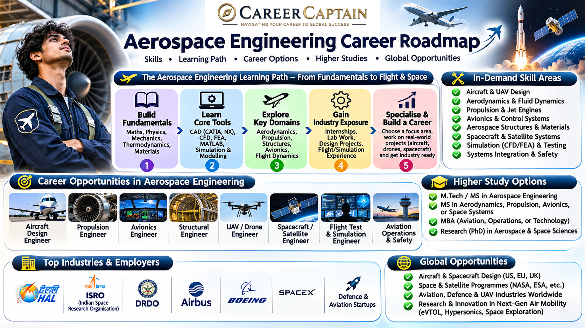

Aerospace Engineering is a specialised engineering discipline focused on the design, development, testing and maintenance of aircraft, spacecraft, satellites, propulsion systems and related technologies.

It combines aerodynamics, mathematics, physics, materials science, propulsion, control systems and advanced manufacturing.

Aerospace engineers contribute to commercial aviation, defence aircraft, space exploration, satellite technology, unmanned aerial vehicles and emerging aerospace technologies.

This roadmap explains the subjects, career opportunities, specialisations, technical skills and preparation strategies available to Aerospace Engineering students in India.

  

## 1. What Is Aerospace Engineering?

Aerospace Engineering deals with the design, development, analysis and operation of vehicles and systems that operate within Earth's atmosphere and beyond it.

It has two major branches:

- **Aeronautical Engineering:** Focuses on aircraft, helicopters, drones and other atmospheric flight systems.
- **Astronautical Engineering:** Focuses on spacecraft, satellites, launch vehicles and space exploration systems.

Major areas include:

- Aerodynamics
- Aircraft structures
- Aerospace propulsion
- Flight mechanics
- Aircraft design
- Spacecraft engineering
- Avionics and control systems
- Aerospace materials
- Computational fluid dynamics
- Guidance, navigation and control

Aerospace engineers work in aviation companies, defence organisations, space research institutions, aircraft manufacturing, engineering consultancies and research laboratories.

## 2. What Do You Study in an Aerospace Engineering Degree?

The exact curriculum varies by university, but most Aerospace Engineering programmes cover the following subjects.

| Subject | What You Learn |
|---|---|
| Engineering Mathematics | Mathematical methods and modelling |
| Engineering Mechanics | Forces, equilibrium and motion |
| Engineering Physics | Fundamental physical principles |
| Thermodynamics | Energy, heat and thermodynamic systems |
| Fluid Mechanics | Behaviour of fluids |
| Aerodynamics | Airflow around aircraft and aerodynamic performance |
| Aircraft Structures | Structural behaviour and aircraft design |
| Aircraft Propulsion | Jet engines and propulsion systems |
| Flight Mechanics | Aircraft motion and stability |
| Aerospace Materials | Materials used in aircraft and spacecraft |
| Gas Dynamics | Compressible flow and shock waves |
| Heat Transfer | Thermal behaviour of engineering systems |
| Control Systems | Feedback, stability and control |
| Computational Fluid Dynamics | Numerical analysis of fluid flow |
| Spacecraft Engineering | Satellite and spacecraft systems |
| Aircraft Design | Integration of aerodynamic, structural and propulsion requirements |

### Why these subjects matter

These subjects provide the foundation for careers in aircraft design, propulsion engineering, aerodynamics, structural analysis, spacecraft development and aerospace research.

Students should understand the physical principles behind aircraft and spacecraft performance rather than simply memorising formulas.

## 3. Major Career Paths in Aerospace Engineering

### 3.1 Aerodynamics Engineering

Aerodynamics engineers study how air flows around aircraft, wings, engines and other aerodynamic surfaces.

Typical responsibilities:

- Aircraft aerodynamic analysis
- Lift and drag calculations
- Airflow modelling
- Wind tunnel testing
- Wing and fuselage optimisation
- Performance evaluation

Useful skills and tools:

- Fluid mechanics
- Aerodynamics
- Computational Fluid Dynamics
- ANSYS Fluent
- OpenFOAM
- MATLAB
- Python

Potential roles:

- Aerodynamics Engineer
- CFD Engineer
- Aircraft Performance Engineer
- Wind Tunnel Test Engineer
- Aerodynamic Design Engineer

### 3.2 Aircraft Structural Engineering

Aircraft structural engineers design and analyse structures that must withstand aerodynamic loads, vibration, fatigue and environmental conditions.

Typical responsibilities:

- Aircraft structural analysis
- Stress and strain calculations
- Composite material analysis
- Fatigue and damage assessment
- Structural testing
- Weight optimisation

Useful skills and tools:

- Strength of materials
- Structural mechanics
- Finite Element Analysis
- ANSYS Mechanical
- Abaqus
- CATIA
- NASTRAN

Potential roles:

- Aerospace Structural Engineer
- Stress Analysis Engineer
- Aircraft Design Engineer
- Composite Structures Engineer
- Structural Test Engineer

### 3.3 Propulsion Engineering

Propulsion engineers develop and analyse systems that generate thrust for aircraft and spacecraft.

Career areas include:

- Jet engines
- Turbofan engines
- Turbojet engines
- Turboprop engines
- Rocket propulsion
- Combustion systems
- Propulsion testing

Useful skills:

- Thermodynamics
- Gas dynamics
- Combustion
- Heat transfer
- Fluid mechanics
- Engine performance analysis

Potential roles:

- Propulsion Engineer
- Gas Turbine Engineer
- Combustion Engineer
- Rocket Propulsion Engineer
- Engine Test Engineer

### 3.4 Aircraft Design Engineering

Aircraft design engineers work on the development of aircraft configurations and integrate aerodynamic, structural, propulsion and operational requirements.

Responsibilities include:

- Aircraft configuration development
- Wing and fuselage design
- Weight estimation
- Performance calculations
- Design optimisation
- CAD modelling

Useful tools:

- CATIA
- Siemens NX
- SolidWorks
- MATLAB
- Python

Potential roles:

- Aircraft Design Engineer
- Aerospace Design Engineer
- CAD Engineer
- Aircraft Configuration Engineer

### 3.5 Avionics and Flight Control Systems

Avionics engineers work on the electronic systems that support aircraft navigation, communication, monitoring and control.

Applications include:

- Flight control systems
- Navigation systems
- Radar technology
- Aircraft communication
- Instrumentation
- Autopilot systems
- Embedded systems

Useful skills:

- Electronics
- Control systems
- Signal processing
- Embedded programming
- C and C++
- MATLAB and Simulink

Potential roles:

- Avionics Engineer
- Flight Control Systems Engineer
- Embedded Systems Engineer
- Aerospace Electronics Engineer
- Navigation Systems Engineer

### 3.6 Spacecraft and Satellite Engineering

Spacecraft engineers work on satellites, space vehicles and systems designed for operation in the space environment.

Career areas include:

- Satellite structures
- Spacecraft thermal systems
- Orbital mechanics
- Satellite communication
- Attitude determination and control
- Spacecraft propulsion
- Payload integration

Potential roles:

- Spacecraft Systems Engineer
- Satellite Design Engineer
- Orbital Mechanics Engineer
- Space Mission Analyst
- Satellite Integration Engineer

### 3.7 UAV and Drone Engineering

Unmanned Aerial Vehicle engineers develop aircraft that operate without an onboard human pilot.

Applications include:

- Agricultural drones
- Defence surveillance
- Mapping and surveying
- Infrastructure inspection
- Logistics
- Search and rescue

Useful skills:

- Aerodynamics
- Flight control
- Embedded systems
- Robotics
- Sensor integration
- Programming

Potential roles:

- UAV Design Engineer
- Drone Systems Engineer
- Flight Control Engineer
- UAV Testing Engineer
- Robotics and Autonomy Engineer

### 3.8 Aerospace Manufacturing and Production

Aerospace manufacturing engineers focus on producing aircraft and spacecraft components with strict quality and safety requirements.

Responsibilities include:

- Manufacturing process planning
- Precision machining
- Composite manufacturing
- Assembly processes
- Quality inspection
- Production optimisation

Potential roles:

- Aerospace Manufacturing Engineer
- Production Engineer
- Quality Engineer
- Composite Manufacturing Engineer
- Aircraft Assembly Engineer

### 3.9 Testing, Certification and Maintenance

Testing and certification professionals evaluate aerospace systems to establish whether they meet applicable technical, safety and regulatory requirements.

Career areas include:

- Aircraft testing
- Engine testing
- Structural testing
- Flight testing
- Quality assurance
- Maintenance engineering
- Airworthiness and certification

Potential roles:

- Aerospace Test Engineer
- Flight Test Engineer
- Quality Assurance Engineer
- Aircraft Maintenance Engineer
- Certification Engineer

Some aviation maintenance and licensed technical roles require specific regulatory qualifications and approvals beyond a general Aerospace Engineering degree.

## 4. Emerging Technologies and Future Opportunities

Aerospace Engineering continues to evolve through advanced materials, automation, sustainable aviation and space technology.

| Technology | Aerospace Application |
|---|---|
| Artificial Intelligence | Autonomous flight and predictive maintenance |
| Digital Twins | Virtual modelling of aircraft and engines |
| Additive Manufacturing | Lightweight and complex aerospace components |
| Advanced Composites | Lightweight aircraft structures |
| Electric Aviation | Electrically powered aircraft |
| Sustainable Aviation Fuels | Reduced lifecycle emissions |
| Hypersonic Technology | High-speed flight research |
| Autonomous UAVs | Unmanned flight and navigation |
| Advanced Propulsion | Next-generation aircraft and rocket engines |
| Satellite Constellations | Communication, navigation and Earth observation |
| Reusable Launch Vehicles | Reusable space transportation |
| Computational Fluid Dynamics | Advanced aerodynamic optimisation |

Students should understand that these technologies supplement fundamental engineering knowledge rather than replace it.

## 5. Important Software and Technical Skills

Software selection should depend on your preferred aerospace specialisation.

### Computer-Aided Design

- CATIA
- Siemens NX
- SolidWorks
- Fusion

### Computational Fluid Dynamics

- ANSYS Fluent
- OpenFOAM
- STAR-CCM+
- MATLAB

### Structural Analysis

- ANSYS Mechanical
- Abaqus
- MSC NASTRAN
- HyperMesh

### Simulation and Control Systems

- MATLAB
- Simulink
- LabVIEW
- Python

### Programming and Data Analysis

- Python
- C
- C++
- MATLAB
- Numerical methods
- Data visualisation

### Aerospace-Specific Tools

- OpenVSP
- XFLR5
- AVL
- GMAT
- Orekit

**Important:** Do not attempt to master every software package. Choose tools relevant to your specialisation and learn the engineering principles behind them.

## 6. A Four-Year Aerospace Engineering Career Roadmap

### First Year: Build the Foundation

Focus on:

- Engineering mathematics
- Engineering physics
- Engineering mechanics
- Engineering graphics
- Basic programming
- Workshop and laboratory practice

Recommended actions:

1. Strengthen mathematics and physics.
2. Understand basic mechanical engineering principles.
3. Learn Python fundamentals.
4. Explore aircraft and spacecraft systems.
5. Participate in technical activities and engineering clubs.

**Goal:** Build a strong engineering foundation.

### Second Year: Develop Core Aerospace Skills

Focus on:

- Fluid mechanics
- Thermodynamics
- Strength of materials
- Aerodynamics fundamentals
- Engineering materials
- Basic control systems

Recommended actions:

1. Understand aircraft components and their functions.
2. Learn CAD fundamentals.
3. Develop programming and numerical analysis skills.
4. Build simple aerodynamic models.
5. Participate in aerospace-related projects.
6. Explore laboratory and workshop opportunities.

**Goal:** Connect engineering theory with aerospace applications.

### Third Year: Choose a Specialisation

Explore areas such as:

- Aerodynamics
- Propulsion
- Aircraft structures
- Avionics
- Spacecraft engineering
- UAV systems
- Aerospace manufacturing
- Flight control systems

Recommended actions:

1. Identify your preferred specialisation.
2. Learn relevant engineering software.
3. Complete two or three practical projects.
4. Apply for internships and research opportunities.
5. Develop technical documentation skills.
6. Explore higher education and entrance examinations.

**Goal:** Develop demonstrable technical skills and practical experience.

### Fourth Year: Prepare for Employment or Higher Studies

Focus on:

- Final-year project
- Internship experience
- Technical interview preparation
- Core subject revision
- Resume development
- Technical portfolio
- Postgraduate applications

Explore:

- Aerospace manufacturing companies
- Defence and aviation organisations
- Space research institutions
- Engineering consultancies
- Research laboratories
- MTech and MS programmes
- International postgraduate opportunities

**Goal:** Graduate with a clear career direction and evidence of your capabilities.

## 7. Projects That Can Strengthen Your Aerospace Engineering Resume

Projects help students demonstrate their ability to apply engineering concepts.

### Beginner-Level Projects

- Paper aircraft aerodynamic comparison
- Basic airfoil analysis
- Aircraft component CAD modelling
- Simple glider design
- Introduction to rocket trajectory calculations
- Basic drone component study

### Intermediate Projects

- Airfoil performance analysis using XFLR5
- CFD analysis of an aircraft wing
- CAD model of a turbofan engine
- UAV design and simulation
- Composite material comparison
- Aircraft stability analysis

### Advanced Projects

- Fixed-wing UAV design
- Multirotor flight control simulation
- Aircraft wing structural analysis
- Turbine blade thermal analysis
- Satellite attitude control simulation
- Rocket propulsion simulation
- Autonomous navigation system
- Aircraft digital twin concept

A good project should include:

- Problem statement
- Design objectives
- Engineering assumptions
- Mathematical calculations
- Design methodology
- Simulation or testing
- Results and limitations
- Future improvements

Projects involving aircraft, drones and propulsion systems must follow applicable safety requirements and legal regulations. Simulation-based academic work should not be presented as certified flight hardware.

## 8. Internships and Industry Exposure

Internships help students understand actual aerospace engineering environments.

Explore opportunities in:

- Aircraft manufacturing
- Aerospace component manufacturing
- Defence research
- Space research
- UAV development
- Aviation maintenance
- Aerospace design consultancies
- Propulsion research
- Advanced materials research
- Flight simulation

Indian organisations and institutions worth researching include:

- Hindustan Aeronautics Limited (HAL)
- Indian Space Research Organisation (ISRO)
- Defence Research and Development Organisation (DRDO)
- National Aerospace Laboratories (NAL)
- Bharat Electronics Limited (BEL)
- Aircraft and aerospace component manufacturers

Students can also seek:

- Faculty-led research
- University laboratory projects
- Aerospace workshops
- UAV development projects
- Engineering competitions
- Technical conferences

Verify internship eligibility, responsibilities and selection procedures through official organisational announcements.

## 9. Government and Public-Sector Career Opportunities

Aerospace Engineering graduates may explore opportunities in India's aviation, defence and space sectors.

Potential areas include:

- Aircraft development
- Defence aviation
- Spacecraft development
- Satellite technology
- Aerospace research
- Propulsion systems
- Aircraft manufacturing
- Defence electronics
- Aviation testing

Organisations worth researching include:

- Indian Space Research Organisation (ISRO)
- Defence Research and Development Organisation (DRDO)
- Hindustan Aeronautics Limited (HAL)
- National Aerospace Laboratories (NAL)
- Indian aviation and defence public-sector organisations

Recruitment routes vary. Some positions require specific degrees, competitive examinations, GATE scores, interviews or technical assessments.

Check the latest official recruitment notifications for eligibility and selection criteria.

## 10. Higher Education After Aerospace Engineering

### Postgraduate Options in India

Students may consider:

- MTech in Aerospace Engineering
- MTech in Aerodynamics
- MTech in Propulsion
- MTech in Aircraft Structures
- MTech in Avionics
- MTech in Space Engineering
- MTech in Computational Fluid Dynamics
- MTech in Aerospace Materials
- MS and research programmes

GATE is an important entrance examination for admission to many postgraduate engineering programmes. Eligibility and admission requirements vary by institution.

### Study-Abroad Specialisations

Potential areas include:

- Aerospace Engineering
- Aeronautical Engineering
- Astronautical Engineering
- Aircraft Design
- Spacecraft Engineering
- Propulsion Systems
- Computational Aerodynamics
- Aerospace Materials
- Flight Dynamics and Control
- Autonomous Aerospace Systems

Popular study destinations include:

- Germany
- United States
- United Kingdom
- France
- Netherlands
- Sweden
- Canada
- Australia

Research university-specific admission requirements, academic prerequisites, language tests, tuition fees, scholarships and visa regulations.

## 11. Salary and Career Growth

Aerospace Engineering salaries vary according to:

- Employer and industry
- Location
- Specialisation
- Technical expertise
- Research experience
- Internship exposure
- Academic qualifications
- Professional experience

Graduates may begin as graduate engineering trainees, design engineers, manufacturing engineers, test engineers or research assistants.

With experience and additional qualifications, professionals may progress into specialist engineering, technical leadership, project management and research positions.

International aerospace roles may have different qualification, security-clearance and work-authorisation requirements.

Evaluate job responsibilities, learning opportunities, working conditions and long-term career growth rather than relying only on advertised salary packages.

## 12. Essential Skills Beyond Technical Knowledge

Successful aerospace engineers need:

- Analytical thinking
- Mathematics and physics
- Problem-solving
- Technical drawing
- Programming
- Simulation and modelling
- Communication
- Teamwork
- Research skills
- Attention to detail
- Documentation
- Safety awareness

Aerospace projects involve multidisciplinary teams. The ability to communicate technical decisions clearly is essential.

## 13. Common Mistakes Aerospace Engineering Students Should Avoid

1. Ignoring mathematics and physics fundamentals.
2. Learning software without understanding engineering concepts.
3. Focusing only on aircraft and ignoring spacecraft opportunities.
4. Avoiding practical projects.
5. Collecting certificates without building a portfolio.
6. Ignoring programming and simulation.
7. Waiting until the final year to seek internships.
8. Underestimating the importance of materials and manufacturing.
9. Confusing an Aerospace Engineering degree with licensed aircraft maintenance qualifications.
10. Assuming every aerospace career requires working for a government organisation.

## 14. How to Choose the Right Aerospace Engineering Specialisation

| If You Enjoy... | Explore... |
|---|---|
| Understanding airflow and lift | Aerodynamics |
| Designing aircraft components | Aircraft Design |
| Engines and thrust generation | Propulsion Engineering |
| Structural strength and materials | Aerospace Structures |
| Electronics and navigation | Avionics |
| Satellites and space missions | Spacecraft Engineering |
| Drones and autonomous systems | UAV Engineering |
| Manufacturing and production | Aerospace Manufacturing |
| Testing and validation | Aerospace Testing |
| Computer simulation | CFD and Computational Engineering |

Use projects, internships and conversations with professionals to understand each specialisation before making a decision.

## 15. Useful Learning and Official Resources

- [AICTE](https://www.aicte-india.org/) — Technical education information.
- [NPTEL](https://nptel.ac.in/) — Aerospace and engineering courses.
- [SWAYAM](https://swayam.gov.in/) — Online learning programmes.
- [GATE](https://gate2026.iitg.ac.in/) — Examination information; consult the relevant year's official website.
- [ISRO](https://www.isro.gov.in/) — Indian space research and career information.
- [DRDO](https://www.drdo.gov.in/) — Defence research and development.
- [HAL](https://hal-india.co.in/) — Aerospace manufacturing and career information.
- [NASA](https://www.nasa.gov/) — Aerospace and space science educational resources.
- [ESA](https://www.esa.int/) — European space research and technology.
- [OpenVSP](https://openvsp.org/) — Aircraft geometry and conceptual design.
- [OpenFOAM](https://www.openfoam.com/) — Computational fluid dynamics.
- [MIT OpenCourseWare](https://ocw.mit.edu/) — Engineering and aerospace learning resources.

Check course availability, software licensing and recruitment requirements directly with the relevant organisations.

---

## 16. Final Thoughts: Build Your Aerospace Engineering Career with a Plan

Aerospace Engineering offers opportunities across aircraft design, aerodynamics, propulsion, structural engineering, avionics, UAVs, satellite technology and space exploration.

The strongest preparation combines engineering fundamentals, practical projects, technical software, research exposure and a clear understanding of industry requirements.

Your degree provides the foundation. Your skills, experience and decisions shape your career.

### Explore Career Guidance with Career Captain

Choosing an Aerospace Engineering specialisation, identifying suitable higher education options and understanding global aerospace opportunities can be challenging.

**Career Captain Global Solutions** provides career counselling, career assessments, course and college planning, and study-abroad guidance to help students and young professionals make informed decisions.

Website: [https://careercaptain.co.in?utm_source=career_roadmaps_india&utm_medium=referral&utm_campaign=github_career_roadmaps&utm_content=aerospace-engineering-career-roadmap](https://careercaptain.co.in?utm_source=career_roadmaps_india&utm_medium=referral&utm_campaign=github_career_roadmaps&utm_content=aerospace-engineering-career-roadmap)

*Educational disclaimer: This roadmap is intended for general career awareness. Course structures, eligibility criteria, recruitment processes and industry requirements may change. Verify important decisions with official institutions and authorities.*

---

**Attribution and Licence**

This guide is part of the Career Roadmaps India open educational initiative by Career Captain Global Solutions.

Licensed under the Creative Commons Attribution 4.0 International (CC BY 4.0) licence. You may share and adapt this material with appropriate attribution and a link to the licence.

Source: [Career Roadmaps India](https://github.com/Career-Captain-Global-Solutions/Career-Roadmaps-India)

---

## Plan your engineering pathway with Career Captain

Choosing an engineering branch is only one part of the decision. Students should also consider their interests, strengths, preferred work and future study options. Career Captain offers personalised career counselling and assessment to support informed decisions.

- [Career counselling in Hyderabad](https://careercaptain.co.in/career-counsellor-near-me?utm_source=career_roadmaps_india&utm_medium=referral&utm_campaign=github_career_roadmaps&utm_content=aerospace-engineering-career-roadmap)
- [Psychometric career assessment](https://guide.careercaptain.co.in/guides/psychometric-career-assessment/?utm_source=career_roadmaps_india&utm_medium=referral&utm_campaign=github_career_roadmaps&utm_content=aerospace-engineering-career-roadmap)
- [Online career counselling](https://careercaptain.co.in/areas-we-serve?utm_source=career_roadmaps_india&utm_medium=referral&utm_campaign=github_career_roadmaps&utm_content=aerospace-engineering-career-roadmap)

[Visit Career Captain](https://careercaptain.co.in?utm_source=career_roadmaps_india&utm_medium=referral&utm_campaign=github_career_roadmaps&utm_content=aerospace-engineering-career-roadmap) · [WhatsApp Career Captain](https://wa.me/919849488838?text=Hi%20Career%20Captain%2C%20I%20found%20your%20aerospace%20engineering%20career%20roadmap%20guide%20in%20Career%20Roadmaps%20India.%20I%20would%20like%20to%20know%20more%20about%20career%20guidance.%20Source%3A%20aerospace-engineering-career-roadmap.)
