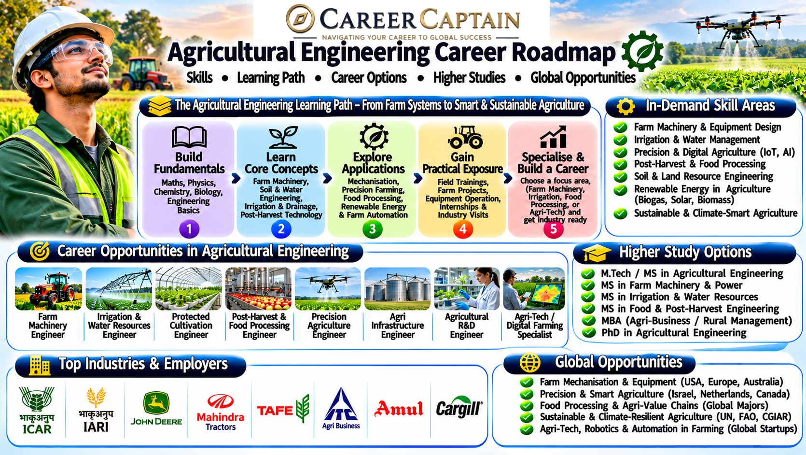

# Agricultural Engineering Career Roadmap in India: Opportunities, Skills, Specialisations and Future Scope

Agricultural Engineering combines engineering, agriculture, technology and environmental science to improve farming systems, food production and agricultural infrastructure.

Agricultural engineers develop machinery, irrigation systems, soil and water management solutions, food-processing technologies, precision agriculture systems and sustainable farming technologies.

The profession is evolving through artificial intelligence, agricultural robotics, drones, Internet of Things (IoT), renewable energy and smart farming.

This roadmap explains the subjects, career opportunities, specialisations, technical skills and preparation strategies available to Agricultural Engineering students in India.

  

## 1. What Is Agricultural Engineering?

Agricultural Engineering applies engineering principles to agricultural production, processing, resource management and rural development.

It focuses on improving agricultural productivity while using land, water, energy and other resources efficiently.

Major areas include:

- Farm machinery and equipment engineering
- Soil and water conservation
- Irrigation and drainage engineering
- Agricultural power and energy
- Precision agriculture
- Food processing engineering
- Post-harvest technology
- Farm structures and rural infrastructure
- Renewable energy in agriculture
- Agricultural automation and robotics

Agricultural engineers work in agricultural machinery companies, food-processing industries, irrigation organisations, government departments, research institutions, agri-tech companies and rural development organisations.

## 2. What Do You Study in an Agricultural Engineering Degree?

The exact curriculum varies by university, but most Agricultural Engineering programmes include the following subjects.

| Subject | What You Learn |
|---|---|
| Engineering Mathematics | Mathematical methods and engineering calculations |
| Engineering Mechanics | Forces, equilibrium and motion |
| Engineering Physics | Physical principles used in engineering |
| Engineering Graphics | Technical drawings and visualisation |
| Soil Mechanics | Soil properties and engineering behaviour |
| Fluid Mechanics | Behaviour of liquids and fluid systems |
| Soil and Water Conservation | Managing soil erosion and water resources |
| Farm Machinery | Design and operation of agricultural equipment |
| Tractor and Power Engineering | Agricultural engines and power systems |
| Irrigation Engineering | Water distribution and irrigation systems |
| Drainage Engineering | Agricultural drainage and water management |
| Agricultural Structures | Design of farm buildings and storage systems |
| Crop Processing | Processing agricultural products |
| Post-Harvest Technology | Storage, handling and preservation |
| Renewable Energy | Solar, biomass and biogas applications |
| Precision Agriculture | Digital technologies for modern farming |

### Why these subjects matter

These subjects provide the foundation for careers in farm machinery design, irrigation systems, agricultural automation, food processing, precision farming and sustainable resource management.

Students should understand the engineering principles behind agricultural systems rather than simply memorising formulas.

## 3. Major Career Paths in Agricultural Engineering

### 3.1 Farm Machinery and Equipment Engineering

Farm machinery engineers design, develop, test and improve equipment used in agricultural operations.

Applications include:

- Tractors
- Harvesters
- Seed drills
- Sprayers
- Cultivators
- Planters
- Threshers
- Agricultural implements

Useful skills and tools:

- Machine design
- Mechanical engineering
- CAD modelling
- Manufacturing processes
- Material selection
- SolidWorks
- AutoCAD
- CATIA

Potential roles:

- Agricultural Machinery Design Engineer
- Farm Equipment Engineer
- Product Development Engineer
- Manufacturing Engineer
- Equipment Testing Engineer

### 3.2 Irrigation and Water Management Engineering

Irrigation engineers develop systems that deliver water efficiently to agricultural land.

Career areas include:

- Drip irrigation
- Sprinkler irrigation
- Surface irrigation
- Micro-irrigation
- Agricultural drainage
- Water distribution
- Watershed management

Useful skills:

- Fluid mechanics
- Hydrology
- Hydraulic engineering
- Water resource management
- Irrigation design
- GIS

Potential roles:

- Irrigation Engineer
- Water Management Engineer
- Hydraulic Design Engineer
- Agricultural Water Resources Specialist
- Irrigation Project Engineer

### 3.3 Soil and Water Conservation Engineering

Soil and water conservation engineers develop methods to protect agricultural land and manage natural resources.

Applications include:

- Soil erosion control
- Watershed development
- Rainwater harvesting
- Land reclamation
- Contour farming
- Check dams
- Groundwater recharge

Potential roles:

- Soil Conservation Engineer
- Watershed Development Engineer
- Land and Water Management Specialist
- Natural Resource Management Engineer

### 3.4 Precision Agriculture and Smart Farming

Precision agriculture uses digital technologies to monitor and optimise farming operations.

Applications include:

- GPS-based farm mapping
- Drone-based crop monitoring
- Soil sensors
- Automated irrigation
- Satellite imagery
- Crop health monitoring
- Variable-rate application

Useful skills and tools:

- Geographic Information Systems
- Remote sensing
- GPS and GNSS
- Python
- IoT
- Data analytics
- Agricultural drones

Potential roles:

- Precision Agriculture Engineer
- Smart Farming Specialist
- Agricultural Data Analyst
- Remote Sensing Specialist
- Agri-Tech Engineer

### 3.5 Food Processing Engineering

Food processing engineers develop equipment and processes used to convert agricultural products into safe, usable and marketable food products.

Applications include:

- Grain processing
- Fruit and vegetable processing
- Dairy processing
- Food packaging
- Drying and dehydration
- Cold storage
- Food preservation

Useful skills:

- Heat transfer
- Food engineering
- Processing technology
- Equipment design
- Quality control
- Food safety fundamentals

Potential roles:

- Food Processing Engineer
- Production Engineer
- Process Development Engineer
- Food Manufacturing Engineer
- Quality Control Engineer

### 3.6 Post-Harvest Technology

Post-harvest engineers focus on maintaining agricultural product quality after harvesting.

Career areas include:

- Grain storage
- Cold chain systems
- Drying technology
- Packaging
- Storage structures
- Material handling
- Loss reduction

Potential roles:

- Post-Harvest Engineer
- Storage Technology Specialist
- Cold Chain Engineer
- Packaging Engineer
- Agricultural Processing Specialist

### 3.7 Renewable Energy in Agriculture

Agricultural engineers contribute to renewable energy systems used in farming and rural communities.

Applications include:

- Solar-powered irrigation
- Agricultural biogas
- Biomass energy
- Solar dryers
- Farm energy management
- Small-scale renewable energy systems

Potential roles:

- Renewable Energy Engineer
- Solar Irrigation Engineer
- Biomass Energy Specialist
- Rural Energy Project Engineer

### 3.8 Agricultural Automation and Robotics

Agricultural automation engineers develop technologies that reduce manual effort and improve agricultural efficiency.

Applications include:

- Autonomous tractors
- Robotic harvesting
- Automated seed planting
- Smart spraying systems
- Agricultural drones
- Automated greenhouse systems

Useful skills:

- Robotics
- Embedded systems
- Control systems
- Sensors
- Programming
- Machine vision
- Artificial intelligence

Potential roles:

- Agricultural Robotics Engineer
- Automation Engineer
- UAV Systems Engineer
- Agricultural Technology Developer
- Embedded Systems Engineer

### 3.9 Farm Structures and Agricultural Infrastructure

These engineers develop infrastructure that supports agricultural production and storage.

Applications include:

- Greenhouses
- Farm buildings
- Grain silos
- Warehouses
- Livestock housing
- Agricultural storage facilities
- Controlled-environment agriculture

Potential roles:

- Agricultural Structures Engineer
- Greenhouse Design Engineer
- Infrastructure Engineer
- Storage Systems Engineer

## 4. Emerging Technologies and Future Opportunities

Agricultural Engineering is increasingly influenced by digital technology, automation and sustainable resource management.

| Technology | Agricultural Application |
|---|---|
| Artificial Intelligence | Crop monitoring and decision support |
| Internet of Things | Soil and environmental sensors |
| Agricultural Drones | Crop monitoring and field operations |
| Precision Agriculture | Optimised use of water and fertilisers |
| Robotics | Automated planting and harvesting |
| Satellite Remote Sensing | Crop and land monitoring |
| Digital Twins | Virtual modelling of agricultural systems |
| Solar Energy | Irrigation and agricultural power |
| Smart Irrigation | Automated water management |
| Biotechnology Integration | Technology-enabled agricultural production |
| Controlled Environment Agriculture | Smart greenhouses and indoor farming |
| Data Analytics | Agricultural productivity and resource analysis |

Students should understand that these technologies supplement agricultural and engineering fundamentals rather than replace them.

## 5. Important Software and Technical Skills

Software selection should depend on your preferred specialisation.

### Design and Drafting

- AutoCAD
- SolidWorks
- CATIA
- Fusion

### Agricultural Machinery Design

- SolidWorks
- CATIA
- ANSYS
- MATLAB

### GIS and Remote Sensing

- QGIS
- ArcGIS
- Google Earth Engine
- Remote sensing tools

### Simulation and Data Analysis

- MATLAB
- Python
- Microsoft Excel
- Statistical analysis tools

### Precision Agriculture and Automation

- Arduino
- Raspberry Pi
- IoT platforms
- GPS and GNSS tools
- Drone mapping software

### Irrigation and Water Resources

- EPANET
- SWMM
- HEC-HMS
- HEC-RAS

**Important:** Do not attempt to master every software package. Choose tools relevant to your specialisation and learn the engineering concepts behind them.

## 6. A Four-Year Agricultural Engineering Career Roadmap

### First Year: Build the Foundation

Focus on:

- Engineering mathematics
- Engineering physics
- Engineering mechanics
- Engineering graphics
- Basic programming
- Agricultural science fundamentals

Recommended actions:

1. Strengthen mathematics and physics.
2. Understand basic mechanical engineering principles.
3. Explore agricultural systems and machinery.
4. Learn Python fundamentals.
5. Participate in technical activities.

**Goal:** Build a strong engineering foundation and understand agricultural applications.

### Second Year: Develop Core Agricultural Engineering Skills

Focus on:

- Fluid mechanics
- Soil mechanics
- Farm machinery
- Thermodynamics
- Soil and water conservation
- Agricultural power systems

Recommended actions:

1. Learn CAD fundamentals.
2. Understand agricultural machinery.
3. Practise basic engineering calculations.
4. Explore irrigation systems.
5. Visit farms and agricultural research facilities.
6. Develop technical documentation skills.

**Goal:** Connect engineering theory with agricultural applications.

### Third Year: Choose a Specialisation

Explore areas such as:

- Farm machinery
- Irrigation engineering
- Precision agriculture
- Food processing
- Post-harvest technology
- Agricultural robotics
- Renewable energy
- Soil and water conservation

Recommended actions:

1. Identify your preferred career direction.
2. Learn relevant software.
3. Complete two or three practical projects.
4. Apply for internships.
5. Participate in agricultural technology projects.
6. Explore higher education and entrance examinations.

**Goal:** Develop demonstrable technical skills and practical experience.

### Fourth Year: Prepare for Employment or Higher Studies

Focus on:

- Final-year project
- Internship experience
- Technical interview preparation
- Core subject revision
- Resume development
- Project portfolio
- Postgraduate applications

Explore:

- Agricultural machinery companies
- Food-processing industries
- Agri-tech companies
- Irrigation organisations
- Government research institutions
- Renewable energy organisations
- MTech and MS programmes

**Goal:** Graduate with a clear career direction and evidence of your capabilities.

## 7. Projects That Can Strengthen Your Agricultural Engineering Resume

Projects help students demonstrate their ability to apply engineering concepts.

### Beginner-Level Projects

- Solar-powered irrigation model
- Basic soil moisture monitoring system
- Drip irrigation demonstration
- Grain drying model
- Farm machinery component design
- Rainwater harvesting model

### Intermediate Projects

- IoT-based irrigation controller
- Agricultural drone mapping
- Smart greenhouse monitoring system
- Solar crop dryer
- Farm machinery performance analysis
- GIS-based agricultural land mapping

### Advanced Projects

- Autonomous agricultural vehicle prototype
- Precision spraying system
- AI-based crop monitoring
- Automated greenhouse control system
- Smart irrigation using weather data
- Agricultural waste-to-energy system
- Robotic harvesting concept
- Digital twin for agricultural operations

A good project should include:

- Problem statement
- Design objectives
- Engineering assumptions
- Methodology
- Technical calculations
- Design drawings or models
- Testing and analysis
- Results and limitations
- Future improvements

Never claim that an academic prototype is a commercially certified agricultural product. Practical machinery and electrical systems require appropriate safety testing.

## 8. Internships and Industry Exposure

Internships help students understand actual agricultural engineering environments.

Explore opportunities in:

- Agricultural machinery manufacturing
- Irrigation equipment companies
- Food-processing industries
- Agri-tech startups
- Agricultural research institutions
- Renewable energy organisations
- Cold storage and logistics
- Precision farming companies
- Government agricultural departments

Indian organisations and institutions worth researching include:

- Indian Council of Agricultural Research (ICAR)
- Indian Agricultural Research Institute (IARI)
- Central Institute of Agricultural Engineering (CIAE)
- National Institute of Agricultural Extension Management (MANAGE)
- State agricultural universities
- Agricultural machinery manufacturers

Students can also seek:

- Faculty-led research
- Farm visits
- Agricultural machinery demonstrations
- Food-processing laboratory exposure
- Agricultural technology workshops
- Research projects

Verify internship eligibility, responsibilities and selection procedures through official organisational announcements.

## 9. Government and Public-Sector Career Opportunities

Agricultural Engineering graduates may explore opportunities in agricultural development, irrigation, research, food processing and rural infrastructure.

Potential areas include:

- Agricultural research
- Farm machinery development
- Soil and water conservation
- Irrigation projects
- Agricultural infrastructure
- Food processing
- Rural development
- Renewable energy
- Agricultural extension and technology programmes

Organisations worth researching include:

- Indian Council of Agricultural Research (ICAR)
- State Agricultural Departments
- Central Institute of Agricultural Engineering
- National Bank for Agriculture and Rural Development (NABARD)
- Agricultural universities
- Government irrigation and water resources departments
- Food processing and rural development organisations

Recruitment routes vary. Some positions require competitive examinations, postgraduate qualifications, interviews or specific technical eligibility.

Always check the latest official recruitment notifications.

## 10. Higher Education After Agricultural Engineering

### Postgraduate Options in India

Students may consider:

- MTech in Farm Machinery and Power Engineering
- MTech in Soil and Water Conservation Engineering
- MTech in Irrigation and Drainage Engineering
- MTech in Processing and Food Engineering
- MTech in Renewable Energy Engineering
- MTech in Agricultural Systems Management
- MTech in Precision Agriculture
- MS and research programmes

GATE and other institution-specific entrance examinations may be relevant for postgraduate admission. Requirements vary by institution.

### Study-Abroad Specialisations

Potential areas include:

- Agricultural Engineering
- Biosystems Engineering
- Precision Agriculture
- Smart Farming
- Food Processing Engineering
- Agricultural Robotics
- Water Resources Engineering
- Sustainable Agriculture
- Environmental Engineering
- Renewable Energy Systems

Popular study destinations include:

- Germany
- United States
- United Kingdom
- Netherlands
- Canada
- Australia
- Sweden
- Denmark

Research university-specific admission requirements, academic prerequisites, language tests, tuition fees, scholarships and visa regulations.

## 11. Salary and Career Growth

Agricultural Engineering salaries vary according to:

- Employer and industry
- Location
- Specialisation
- Technical expertise
- Software skills
- Internship experience
- Research exposure
- Academic qualifications
- Professional experience

Graduates may begin as graduate engineering trainees, agricultural machinery engineers, production engineers, irrigation engineers, project engineers or agri-tech professionals.

With experience and additional qualifications, professionals may progress into specialist engineering, technical leadership, research, consulting and project management.

Evaluate job responsibilities, learning opportunities, working conditions and long-term growth rather than relying only on advertised salary packages.

## 12. Essential Skills Beyond Technical Knowledge

Successful agricultural engineers need:

- Analytical thinking
- Problem-solving
- Mechanical understanding
- Mathematics and physics
- Technical drawing
- Data analysis
- Communication
- Teamwork
- Project management
- Fieldwork capabilities
- Research skills
- Environmental awareness

Agricultural engineering projects involve farmers, engineers, researchers, manufacturers and government organisations. Clear communication and practical understanding are essential.

## 13. Common Mistakes Agricultural Engineering Students Should Avoid

1. Ignoring engineering fundamentals.
2. Treating Agricultural Engineering as only traditional farming.
3. Learning software without understanding its applications.
4. Ignoring automation and precision agriculture.
5. Avoiding practical field exposure.
6. Collecting certificates without building projects.
7. Waiting until the final year to seek internships.
8. Ignoring food processing and post-harvest technologies.
9. Overlooking renewable energy opportunities.
10. Ignoring emerging agri-tech industries.

## 14. How to Choose the Right Agricultural Engineering Specialisation

| If You Enjoy... | Explore... |
|---|---|
| Designing tractors and farm equipment | Farm Machinery Engineering |
| Water systems and irrigation | Irrigation Engineering |
| Soil and land management | Soil and Water Conservation |
| Drones, sensors and digital farming | Precision Agriculture |
| Food production and processing | Food Processing Engineering |
| Storage and preservation | Post-Harvest Technology |
| Solar and biomass systems | Renewable Energy Engineering |
| Robots and automation | Agricultural Robotics |
| Greenhouses and farm infrastructure | Agricultural Structures |
| Environmental sustainability | Sustainable Agricultural Systems |

Use projects, internships and conversations with professionals to understand each specialisation before making a decision.

## 15. Useful Learning and Official Resources

- [ICAR](https://icar.org.in/) — Agricultural research and education information.
- [IARI](https://www.iari.res.in/) — Agricultural research and academic information.
- [CIAE](https://ciae.icar.gov.in/) — Agricultural engineering research.
- [NPTEL](https://nptel.ac.in/) — Engineering and agricultural technology courses.
- [SWAYAM](https://swayam.gov.in/) — Online learning programmes.
- [AICTE](https://www.aicte-india.org/) — Technical education information.
- [GATE](https://gate2026.iitg.ac.in/) — Examination information; consult the relevant year's official website.
- [MANAGE](https://www.manage.gov.in/) — Agricultural extension and management resources.
- [QGIS](https://qgis.org/) — Open-source geographic information system.
- [FAO](https://www.fao.org/) — Global agriculture and food systems information.
- [NASA Earthdata](https://www.earthdata.nasa.gov/) — Earth observation and remote sensing resources.

Check course availability, software licensing and recruitment requirements directly with the relevant organisations.

---

## 16. Final Thoughts: Build Your Agricultural Engineering Career with a Plan

Agricultural Engineering offers opportunities across farm machinery, irrigation, precision agriculture, food processing, agricultural automation, renewable energy and sustainable resource management.

The strongest preparation combines engineering fundamentals, practical field exposure, technical software, internships and a clear understanding of agricultural industry requirements.

Your degree provides the foundation. Your skills, experience and decisions shape your career.

### Explore Career Guidance with Career Captain

Choosing an Agricultural Engineering specialisation, identifying suitable higher education options and understanding emerging agri-tech opportunities can be challenging.

**Career Captain Global Solutions** provides career counselling, career assessments, course and college planning, and study-abroad guidance to help students and young professionals make informed decisions.

Website: [https://careercaptain.co.in/](https://careercaptain.co.in/)

*Educational disclaimer: This roadmap is intended for general career awareness. Course structures, eligibility criteria, recruitment processes and industry requirements may change. Verify important decisions with official institutions and authorities.*

---

**Attribution and Licence**

This guide is part of the Career Roadmaps India open educational initiative by Career Captain Global Solutions.

Licensed under the Creative Commons Attribution 4.0 International (CC BY 4.0) licence. You may share and adapt this material with appropriate attribution and a link to the licence.

Source: [Career Roadmaps India](https://github.com/Career-Captain-Global-Solutions/Career-Roadmaps-India)

---

## Plan your engineering pathway with Career Captain

Choosing an engineering branch is only one part of the decision. Students should also consider their interests, strengths, preferred work and future study options. Career Captain offers personalised career counselling and assessment to support informed decisions.

- [Career counselling in Hyderabad](https://careercaptain.co.in/career-counselling-hyderabad)
- [Psychometric career assessment](https://careercaptain.co.in/psychometric-test-hyderabad)
- [Online career counselling](https://careercaptain.co.in/online-career-counselling)

[Visit Career Captain](https://careercaptain.co.in/) · [WhatsApp Career Captain](https://wa.me/919849488838)
