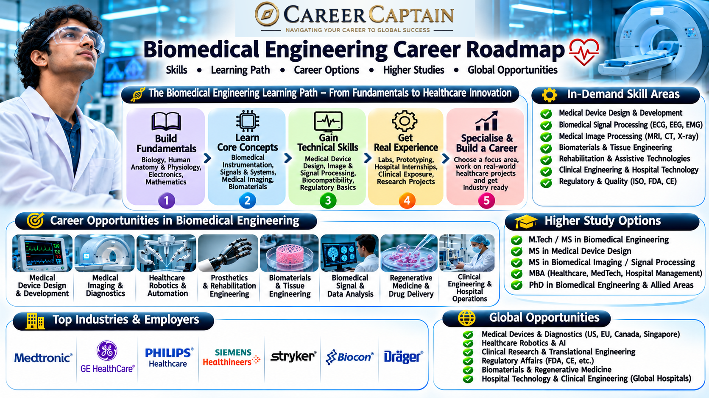

# Biomedical Engineering Career Roadmap in India

Biomedical Engineering combines engineering, biology, medicine, and technology to develop solutions that improve healthcare. From designing medical devices and diagnostic equipment to developing artificial organs, rehabilitation systems, and healthcare technologies, biomedical engineers contribute to the future of medicine.

This roadmap helps students understand the academic foundations, career opportunities, technical skills, emerging technologies, and professional pathways available in Biomedical Engineering.

  

## 1. What Is Biomedical Engineering?

Biomedical Engineering applies engineering principles to medicine and healthcare. It focuses on developing, improving, and maintaining technologies used to diagnose, monitor, treat, and rehabilitate patients.

Biomedical engineers work at the intersection of several disciplines:

- Mechanical engineering
- Electronics and electrical engineering
- Computer science and software development
- Biology and human physiology
- Materials science
- Medical science and healthcare technology

Examples of biomedical engineering applications include MRI scanners, ECG machines, artificial limbs, pacemakers, surgical instruments, medical imaging systems, and wearable health-monitoring devices.

## 2. Subjects You Study in a Biomedical Engineering Degree

The curriculum varies between universities, but students generally study the following subjects.

**Engineering fundamentals**
- Engineering Mathematics
- Engineering Physics
- Engineering Chemistry
- Engineering Mechanics
- Basic Electrical and Electronics Engineering
- Programming and Computational Methods

**Biomedical fundamentals**
- Human Anatomy and Physiology
- Biochemistry
- Cell and Molecular Biology
- Biomaterials
- Medical Terminology

**Core biomedical engineering subjects**
- Biomedical Instrumentation
- Medical Imaging Systems
- Biomechanics
- Bioelectricity
- Biomedical Signal Processing
- Rehabilitation Engineering
- Biomedical Sensors
- Medical Equipment Design
- Clinical Engineering
- Hospital Information Systems

**Advanced subjects**
- Artificial Intelligence in Healthcare
- Tissue Engineering
- Neural Engineering
- Biomedical Image Processing
- Computational Biology

## 3. Major Career Paths in Biomedical Engineering

Biomedical Engineering offers opportunities across healthcare, manufacturing, research, software, and medical technology.

### Medical Device Design and Development
Develop and improve medical devices such as patient monitors, infusion pumps, diagnostic instruments, and wearable healthcare equipment.

### Clinical Engineering
Work with hospitals to manage medical equipment, evaluate equipment performance, coordinate maintenance, and support safe clinical technology operations.

### Medical Imaging Engineering
Work with technologies such as MRI, CT, ultrasound, X-ray, and digital imaging systems.

### Biomaterials Engineering
Research and develop materials used in implants, prosthetics, surgical devices, and other medical applications.

### Rehabilitation Engineering
Design assistive technologies, prosthetic limbs, orthotic systems, mobility devices, and rehabilitation equipment.

### Biomedical Signal Processing
Analyse ECG, EEG, EMG, and other physiological signals to support monitoring, diagnostics, and research.

### Healthcare Software and AI
Develop software, algorithms, and data-driven systems for medical imaging, patient monitoring, diagnostics, and healthcare operations.

### Research and Development
Work in laboratories, universities, research organisations, and medical technology companies to develop new healthcare technologies.

## 4. Emerging Technologies in Biomedical Engineering

Biomedical Engineering is evolving rapidly as healthcare increasingly adopts advanced technology.

Important areas include:

- **Artificial Intelligence in Healthcare:** Machine learning applications in medical imaging, diagnostics, and patient monitoring.
- **Robotic Surgery:** Robotic systems that support surgeons in complex procedures.
- **3D Bioprinting:** Research into printing biological structures and tissue models.
- **Wearable Medical Devices:** Smart devices that monitor heart rate, oxygen saturation, movement, and other health parameters.
- **Brain-Computer Interfaces:** Technologies that connect neural signals with external devices.
- **Advanced Prosthetics:** Intelligent artificial limbs with improved movement and control.
- **Telemedicine:** Remote healthcare technologies and connected medical devices.
- **Digital Twins:** Computational models used to simulate biological systems and support medical research.
- **Regenerative Medicine:** Technologies involving tissue engineering and biological repair.

## 5. Software and Technical Skills

Biomedical engineers need a combination of engineering, computing, and scientific skills.

**Programming**
- Python
- MATLAB
- C and C++
- R for biomedical data analysis

**Design and simulation**
- AutoCAD
- SolidWorks
- Fusion
- ANSYS
- COMSOL Multiphysics

**Biomedical tools and technologies**
- MATLAB Signal Processing Toolbox
- Medical image processing tools
- 3D modelling and prototyping
- Microcontrollers and embedded systems
- Biomedical sensors and instrumentation

**Data and AI**
- Machine learning fundamentals
- Deep learning
- Computer vision
- Biomedical data analysis
- Statistical methods

**Professional knowledge**
- Medical device safety
- Quality assurance
- Testing and validation
- Documentation
- Medical technology regulations and standards

## 6. Four-Year Biomedical Engineering Roadmap

A structured undergraduate plan can help students develop the technical and professional capabilities required for the industry.

### First Year: Build the Foundation

Focus on:
- Mathematics, physics, and chemistry
- Engineering fundamentals
- Introduction to human biology
- Basic programming
- Communication and technical writing

Suggested activities:
- Learn Python fundamentals.
- Understand basic electronics.
- Explore human anatomy and physiology.
- Build simple sensor-based projects.

### Second Year: Develop Core Skills

Focus on:
- Biomedical instrumentation
- Human physiology
- Biomaterials
- Biomechanics
- Biomedical electronics
- MATLAB and Python

Suggested activities:
- Build a basic heart-rate monitoring prototype.
- Learn signal acquisition and processing.
- Explore medical imaging fundamentals.
- Participate in technical competitions.

### Third Year: Specialise and Gain Experience

Focus on:
- Medical imaging
- Biomedical signal processing
- Rehabilitation engineering
- Embedded systems
- Artificial intelligence applications

Suggested activities:
- Complete an industry-oriented project.
- Apply for internships.
- Learn relevant CAD and simulation tools.
- Explore research opportunities.
- Develop a technical portfolio.

### Fourth Year: Prepare for Professional Opportunities

Focus on:
- Final-year project
- Industry applications
- Technical interviews
- Research or higher education planning
- Professional communication

Suggested activities:
- Build a complete biomedical engineering project.
- Apply for internships and graduate positions.
- Prepare a technical resume and portfolio.
- Explore postgraduate programmes.
- Research relevant employers and career opportunities.

## 7. Important Projects to Build

Practical projects demonstrate engineering knowledge and problem-solving ability.

**Beginner projects**
- Heart-rate monitoring system
- Digital thermometer
- Pulse oximeter prototype
- Basic ECG signal visualisation

**Intermediate projects**
- ECG signal filtering and analysis
- Wearable health-monitoring system
- Smart medicine reminder
- Fall detection system for elderly people
- Biomedical sensor data acquisition

**Advanced projects**
- AI-based medical image classification
- Machine learning for ECG classification
- Low-cost assistive robotic prosthetic prototype
- Rehabilitation monitoring system
- Biomedical signal analysis platform

Projects involving human health must be developed and tested responsibly. Student prototypes should not be presented as clinically validated diagnostic or treatment devices.

## 8. Internships and Industry Exposure

Internships help students understand how biomedical technologies are developed, tested, maintained, and used in real healthcare environments.

Potential internship environments include:

- Medical device manufacturers
- Hospitals and clinical engineering departments
- Diagnostic imaging centres
- Biomedical research laboratories
- Medical technology startups
- Healthcare software companies
- University research centres

Before applying, develop a portfolio containing project descriptions, technical documentation, relevant software skills, and practical demonstrations.

Students should seek opportunities involving medical equipment, product development, quality assurance, testing, research, and healthcare technology.

## 9. Government and Public-Sector Opportunities in India

Biomedical engineers may explore opportunities in public healthcare, scientific research, medical technology development, and technical institutions.

Potential organisations and institutions include:

- **AIIMS:** Healthcare institutions with medical technology and research environments.
- **ICMR:** Indian Council of Medical Research and its research ecosystem.
- **CSIR laboratories:** Scientific research and technology development.
- **DRDO:** Research areas involving biomedical technologies, human performance, and life-support systems.
- **BIRAC:** Supports biotechnology innovation and entrepreneurship through relevant programmes.
- **Government medical colleges and hospitals:** Opportunities in biomedical equipment management and clinical engineering.
- **Public-sector research institutions:** Relevant technical and scientific positions when vacancies are available.

Recruitment eligibility, job titles, qualifications, and selection procedures vary. Always check the official recruitment notification.

## 10. Higher Education and Specialisation

Students interested in advanced technical roles, research, or academic careers can pursue postgraduate education.

**Possible postgraduate specialisations**
- Biomedical Engineering
- Medical Imaging
- Biomechanics
- Biomaterials
- Rehabilitation Engineering
- Medical Electronics
- Biomedical Signal Processing
- Tissue Engineering
- Computational Biology
- Healthcare Artificial Intelligence

**International study destinations**

- Germany
- United States
- United Kingdom
- Canada
- Netherlands
- Sweden
- Australia

Students considering international education should evaluate programme content, admission requirements, research facilities, language requirements, tuition fees, and career opportunities.

A strong academic record, relevant projects, research experience, and technical skills can strengthen postgraduate applications.

## 11. Salary and Career Growth

Biomedical Engineering salaries vary significantly according to employer, location, role, experience, technical specialisation, and educational qualifications.

Potential career progression:

| Career stage | Possible roles |
|---|---|
| Entry level | Biomedical Engineer, Service Engineer, Junior R&D Engineer |
| Early career | Product Development Engineer, Clinical Engineer, Application Specialist |
| Experienced | Senior Biomedical Engineer, Design Engineer, Technical Lead |
| Advanced | R&D Manager, Product Manager, Research Scientist |
| Leadership | Engineering Director, Healthcare Technology Leader, Entrepreneur |

Some graduates enter medical equipment servicing or application support, while others specialise in product development, software, research, or advanced medical technology.

Salary expectations should be evaluated using current job postings rather than assuming a fixed salary for the degree.

## 12. Essential Soft Skills

Technical expertise alone is not sufficient for a successful biomedical engineering career.

Important professional skills include:

- Analytical thinking
- Problem-solving
- Attention to detail
- Communication
- Teamwork
- Research skills
- Project management
- Ethical decision-making
- Documentation
- Adaptability

Biomedical engineers often work with doctors, researchers, technicians, patients, software developers, and product teams. The ability to communicate across disciplines is essential.

## 13. Common Mistakes to Avoid

- Studying engineering concepts without understanding their medical applications.
- Ignoring anatomy and physiology.
- Learning software tools without building practical projects.
- Focusing only on theoretical examinations.
- Avoiding internships and industry exposure.
- Ignoring programming and data analysis.
- Assuming every biomedical engineering role involves designing medical devices.
- Neglecting quality, safety, and regulatory requirements.
- Choosing a postgraduate specialisation without researching its career scope.

## 14. How to Choose Your Biomedical Engineering Specialisation

Your interests and strengths can help identify a suitable direction.

| Your interest | Possible specialisation |
|---|---|
| Electronics and circuits | Biomedical Instrumentation |
| Coding and mathematics | Biomedical Signal Processing |
| AI and data science | Healthcare AI |
| Machines and mechanics | Biomechanics |
| Materials and chemistry | Biomaterials |
| Imaging and visual technology | Medical Imaging |
| Robotics and movement | Rehabilitation Engineering |
| Biology and laboratory research | Tissue Engineering |

Explore multiple areas through electives, internships, projects, and research before making a long-term specialisation decision.

## 15. Useful Learning and Official Resources

The following resources can help students develop their knowledge and explore the biomedical engineering ecosystem.

**Learning platforms**
- [NPTEL](https://nptel.ac.in/) — Engineering and science courses.
- [SWAYAM](https://swayam.gov.in/) — Online learning programmes.
- [MIT OpenCourseWare](https://ocw.mit.edu/) — University-level learning materials.
- [Coursera](https://www.coursera.org/) — Technical and interdisciplinary courses.
- [edX](https://www.edx.org/) — Engineering and healthcare-related learning.

**Research and professional resources**
- [IEEE Engineering in Medicine and Biology Society](https://www.embs.org/) — Biomedical engineering research and professional resources.
- [PubMed](https://pubmed.ncbi.nlm.nih.gov/) — Biomedical research literature.
- [ICMR](https://www.icmr.gov.in/) — Indian medical research information.
- [BIRAC](https://birac.nic.in/) — Biotechnology innovation and funding programmes.
- [FDA Medical Devices](https://www.fda.gov/medical-devices) — Medical device regulatory information.
- [WHO](https://www.who.int/) — Global health and medical technology information.

## 16. Final Thoughts: Building a Career in Biomedical Engineering

Biomedical Engineering is an interdisciplinary field that connects engineering innovation with healthcare needs. It offers opportunities in medical devices, clinical engineering, medical imaging, rehabilitation technologies, healthcare software, research, and product development.

The strongest candidates combine engineering fundamentals with an understanding of human biology, practical project experience, programming capabilities, and a commitment to safety and quality.

Students should focus on developing a strong foundation, exploring specialisations, gaining industry exposure, and building a portfolio of meaningful projects.

### How Career Captain Can Help

Choosing an engineering branch is only the beginning of a career journey. Understanding your interests, strengths, aptitude, and long-term goals can help you make more informed academic and professional decisions.

Career Captain Global Solutions supports students through career counselling, psychometric assessments, stream and course selection, career exploration, and study-abroad guidance.

Explore career guidance and planning resources at [Career Captain](https://careercaptain.co.in?utm_source=career_roadmaps_india&utm_medium=referral&utm_campaign=github_career_roadmaps&utm_content=biomedical-engineering-career-roadmap).

---

**Educational Disclaimer:** This roadmap is intended for educational and career-awareness purposes. Course structures, eligibility criteria, recruitment requirements, and employment opportunities may change. Students should verify current information with universities, employers, and official organisations.

**License:** This educational resource is shared under the Creative Commons Attribution 4.0 International (CC BY 4.0) license. Please credit Career Captain Global Solutions when sharing or adapting this material.

---

## Plan your engineering pathway with Career Captain

Choosing an engineering branch is only one part of the decision. Students should also consider their interests, strengths, preferred work and future study options. Career Captain offers personalised career counselling and assessment to support informed decisions.

- [Career counselling in Hyderabad](https://careercaptain.co.in?utm_source=career_roadmaps_india&utm_medium=referral&utm_campaign=github_career_roadmaps&utm_content=biomedical-engineering-career-roadmapcareer-counsellor-near-me?utm_source=career_roadmaps_india&utm_medium=referral&utm_campaign=github_career_roadmaps&utm_content=biomedical-engineering-career-roadmap)
- [Psychometric career assessment](https://guide.careercaptain.co.in/guides/psychometric-career-assessment/?utm_source=career_roadmaps_india&utm_medium=referral&utm_campaign=github_career_roadmaps&utm_content=biomedical-engineering-career-roadmap)
- [Online career counselling](https://careercaptain.co.in?utm_source=career_roadmaps_india&utm_medium=referral&utm_campaign=github_career_roadmaps&utm_content=biomedical-engineering-career-roadmapareas-we-serve?utm_source=career_roadmaps_india&utm_medium=referral&utm_campaign=github_career_roadmaps&utm_content=biomedical-engineering-career-roadmap)

[Visit Career Captain](https://careercaptain.co.in?utm_source=career_roadmaps_india&utm_medium=referral&utm_campaign=github_career_roadmaps&utm_content=biomedical-engineering-career-roadmap) · [WhatsApp Career Captain](https://wa.me/919849488838?text=Hi%20Career%20Captain%2C%20I%20found%20your%20biomedical%20engineering%20career%20roadmap%20guide%20in%20Career%20Roadmaps%20India.%20I%20would%20like%20to%20know%20more%20about%20career%20guidance.%20Source%3A%20biomedical-engineering-career-roadmap.)
