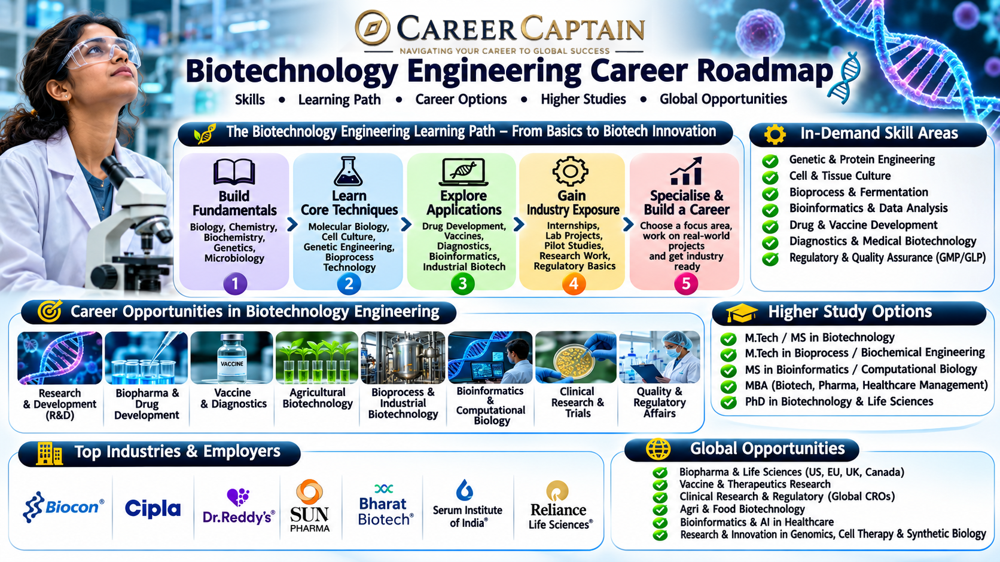

# Biotechnology Engineering Career Roadmap in India

Biotechnology Engineering combines biology, chemistry, engineering, and technology to develop products and processes that improve human health, agriculture, food production, industrial manufacturing, and environmental sustainability.

From developing vaccines and medicines to engineering microorganisms, improving crop varieties, and producing biofuels, biotechnology engineers contribute to some of the most important scientific and technological developments of the modern world.

This roadmap explains the subjects, career opportunities, technical skills, emerging technologies, and professional pathways available in Biotechnology Engineering.

  

## 1. What Is Biotechnology Engineering?

Biotechnology Engineering applies engineering and biological sciences to develop useful products, processes, and technologies using living organisms, cells, enzymes, and biological systems.

It brings together multiple disciplines:

- Molecular biology
- Genetics
- Microbiology
- Biochemistry
- Chemical engineering
- Bioprocess engineering
- Genetic engineering
- Computational biology
- Industrial biotechnology

Applications include vaccine development, pharmaceutical manufacturing, genetic testing, agricultural biotechnology, food processing, waste treatment, and biofuel production.

## 2. Subjects You Study in a Biotechnology Engineering Degree

The curriculum differs between universities, but students generally study the following subjects.

**Engineering fundamentals**
- Engineering Mathematics
- Engineering Physics
- Engineering Chemistry
- Engineering Mechanics
- Basic Electrical and Electronics Engineering
- Computer Programming

**Biological science fundamentals**
- Cell Biology
- Microbiology
- Biochemistry
- Molecular Biology
- Genetics
- Human Physiology

**Core biotechnology subjects**
- Genetic Engineering
- Bioprocess Engineering
- Enzyme Technology
- Immunology
- Biochemical Engineering
- Downstream Processing
- Industrial Microbiology
- Fermentation Technology
- Plant Biotechnology
- Animal Biotechnology

**Advanced subjects**
- Genomics
- Proteomics
- Metabolic Engineering
- Synthetic Biology
- Tissue Engineering
- Bioinformatics
- Computational Biology
- Nanobiotechnology

## 3. Major Career Paths in Biotechnology Engineering

Biotechnology graduates can work across healthcare, pharmaceuticals, agriculture, food technology, industrial manufacturing, environmental science, and research.

### Pharmaceutical and Biopharmaceutical Industry

Work on the development and production of medicines, vaccines, therapeutic proteins, and biological products.

Potential roles include:
- Bioprocess Engineer
- Production Engineer
- Research Associate
- Quality Control Analyst
- Process Development Associate

### Genetic Engineering and Molecular Biology

Work with DNA, genes, proteins, and cellular systems to understand biological processes and develop new applications.

Potential roles include:
- Molecular Biology Researcher
- Genetic Engineering Associate
- Molecular Diagnostics Analyst
- Research Scientist

### Industrial Biotechnology

Use microorganisms and biological processes for industrial production.

Applications include:
- Enzyme production
- Biofuel manufacturing
- Industrial fermentation
- Biochemical production
- Sustainable manufacturing

### Agricultural Biotechnology

Apply biotechnology to improve crops, agricultural productivity, plant health, and resistance to environmental stresses.

Potential roles include:
- Plant Biotechnology Researcher
- Agricultural Biotechnologist
- Crop Research Associate
- Plant Tissue Culture Specialist

### Food Biotechnology

Use microorganisms, enzymes, and biological processes in food production, preservation, quality testing, and fermentation.

Potential roles include:
- Food Biotechnology Specialist
- Fermentation Technologist
- Food Quality Analyst
- Research Associate

### Bioinformatics and Computational Biology

Combine biology, programming, mathematics, and data science to analyse biological information.

Potential roles include:
- Bioinformatics Analyst
- Computational Biology Associate
- Genomics Data Analyst
- Biological Data Scientist

### Environmental Biotechnology

Apply biological systems to pollution control, wastewater treatment, bioremediation, and environmental sustainability.

Potential roles include:
- Environmental Biotechnology Engineer
- Wastewater Treatment Specialist
- Bioremediation Research Associate

## 4. Emerging Technologies in Biotechnology

Biotechnology is evolving rapidly through advances in genetic science, computing, automation, and biological manufacturing.

Important emerging areas include:

- **CRISPR Gene Editing:** Technologies that allow targeted modification of genetic material.
- **Synthetic Biology:** Designing or modifying biological systems for specific applications.
- **Artificial Intelligence in Drug Discovery:** Using computational models to support drug research and development.
- **Personalised Medicine:** Developing healthcare approaches based on individual biological and genetic characteristics.
- **Cell and Gene Therapy:** Developing treatments that use cells or genetic material.
- **3D Bioprinting:** Research into creating biological structures using specialised printing technologies.
- **Precision Fermentation:** Using engineered microorganisms to produce specific proteins and other compounds.
- **Single-Cell Sequencing:** Studying the characteristics and behaviour of individual cells.
- **Metabolic Engineering:** Modifying cellular metabolic pathways to improve biological production.
- **Biomanufacturing:** Using biological systems to manufacture medicines, chemicals, materials, and other products.

## 5. Software and Technical Skills

Biotechnology engineers need practical laboratory skills alongside computational and analytical capabilities.

**Programming and data analysis**
- Python
- R
- MATLAB
- SQL fundamentals
- Statistical analysis

**Bioinformatics tools**
- BLAST
- NCBI databases
- Clustal Omega
- Bioconductor
- Galaxy
- PyMOL

**Laboratory techniques**
- PCR and qPCR
- Gel electrophoresis
- DNA and RNA extraction
- Cell culture
- Microbial culture
- Protein purification
- Chromatography
- Spectrophotometry

**Bioprocess and industrial tools**
- Fermentation systems
- Bioreactor operation
- Downstream processing
- Process monitoring
- Quality control methods

**Professional knowledge**
- Good Laboratory Practices (GLP)
- Good Manufacturing Practices (GMP)
- Biosafety
- Laboratory documentation
- Quality assurance
- Research ethics

Laboratory procedures must be learned under appropriate supervision and institutional safety protocols.

## 6. Four-Year Biotechnology Engineering Roadmap

A structured undergraduate plan helps students develop scientific knowledge, laboratory competence, and industry readiness.

### First Year: Build the Foundation

Focus on:
- Mathematics, physics, and chemistry
- Engineering fundamentals
- Introduction to biology
- Basic programming
- Scientific communication

Suggested activities:
- Learn Python fundamentals.
- Understand basic cell biology.
- Explore microbiology concepts.
- Develop scientific reading and documentation skills.

### Second Year: Develop Core Biotechnology Skills

Focus on:
- Molecular biology
- Biochemistry
- Genetics
- Microbiology
- Cell biology
- Laboratory fundamentals

Suggested activities:
- Learn basic laboratory techniques.
- Understand DNA extraction and PCR concepts.
- Practise biological data analysis.
- Participate in laboratory-based academic projects.

### Third Year: Explore Specialisations

Focus on:
- Genetic engineering
- Bioprocess engineering
- Bioinformatics
- Immunology
- Industrial biotechnology
- Enzyme technology

Suggested activities:
- Complete a biotechnology project.
- Learn relevant bioinformatics tools.
- Explore internships and research opportunities.
- Attend scientific workshops and seminars.
- Build a technical portfolio.

### Fourth Year: Prepare for Professional Opportunities

Focus on:
- Final-year project
- Industrial applications
- Research methodology
- Technical interviews
- Higher education planning

Suggested activities:
- Complete a substantial research or industry-oriented project.
- Apply for internships and graduate positions.
- Prepare a technical resume.
- Explore postgraduate programmes.
- Identify suitable employers and research institutions.

## 7. Important Projects to Build

Practical projects help students demonstrate their understanding of biological processes and engineering applications.

**Beginner projects**
- DNA sequence analysis using Python
- Biological database exploration
- Enzyme activity data analysis
- Microbial growth curve analysis

**Intermediate projects**
- PCR data analysis
- Protein sequence comparison
- Bioinformatics-based gene analysis
- Fermentation process data analysis
- Plant tissue culture study under laboratory supervision

**Advanced projects**
- Machine learning for biological data classification
- Comparative genomic analysis
- Protein structure analysis
- Metabolic pathway modelling
- Bioprocess optimisation using computational methods
- Biological image analysis

Projects involving microorganisms, genetically modified organisms, cell cultures, or biological samples must follow institutional approvals, biosafety requirements, and appropriate laboratory supervision.

## 8. Internships and Industry Exposure

Internships provide exposure to laboratory research, pharmaceutical manufacturing, quality systems, biological production, and biotechnology applications.

Potential internship environments include:

- Pharmaceutical companies
- Biopharmaceutical manufacturers
- Biotechnology startups
- Research laboratories
- Agricultural biotechnology organisations
- Food and fermentation companies
- Diagnostic laboratories
- Bioinformatics companies
- University research departments

Students should look for opportunities involving molecular biology, quality control, bioprocess development, bioinformatics, analytical testing, and research.

A useful internship portfolio should contain project descriptions, laboratory techniques learned, software tools used, and technical reports.

## 9. Government and Public-Sector Opportunities in India

Biotechnology graduates can explore opportunities in scientific research, public healthcare, agricultural research, pharmaceutical development, and government-supported innovation.

Important organisations and institutions include:

- **Department of Biotechnology (DBT):** Supports biotechnology research, development, and innovation.
- **Biotechnology Industry Research Assistance Council (BIRAC):** Supports biotechnology entrepreneurship and innovation.
- **ICMR:** Supports biomedical and health research.
- **CSIR laboratories:** Conduct scientific research across biotechnology and related disciplines.
- **ICAR:** Supports agricultural research and biotechnology-related developments.
- **National Institute of Plant Genome Research (NIPGR):** Focuses on plant genomics and related research.
- **National Centre for Biological Sciences (NCBS):** Conducts research in biological sciences.
- **Institute of Life Sciences (ILS):** Works in life sciences research.
- **Defence Research and Development Organisation (DRDO):** Has research areas involving life sciences and biotechnology.

Potential roles include research assistant, project associate, laboratory scientist, technical officer, and scientific researcher, depending on qualifications and recruitment requirements.

Check individual institutional notifications for eligibility, examinations, and available positions.

## 10. Higher Education and Specialisation

Postgraduate education can help students enter specialised research, advanced industrial roles, and academic careers.

**Possible postgraduate specialisations**
- Biotechnology
- Molecular Biology
- Genetic Engineering
- Microbiology
- Bioprocess Engineering
- Bioinformatics
- Computational Biology
- Pharmaceutical Biotechnology
- Agricultural Biotechnology
- Industrial Biotechnology
- Immunology
- Genomics
- Synthetic Biology

**International study destinations**
- Germany
- United States
- United Kingdom
- Canada
- Netherlands
- Sweden
- Switzerland
- Australia

Students considering international education should evaluate programme structure, research facilities, admission requirements, laboratory opportunities, language requirements, tuition fees, and funding options.

A strong academic record, relevant research experience, technical skills, and well-developed projects can strengthen postgraduate applications.

## 11. Salary and Career Growth

Biotechnology salaries vary according to employer, location, educational qualifications, specialisation, research experience, and technical expertise.

Potential career progression:

| Career stage | Possible roles |
|---|---|
| Entry level | Research Assistant, Quality Control Analyst, Production Associate |
| Early career | Bioprocess Engineer, Bioinformatics Analyst, Research Associate |
| Experienced | Senior Research Associate, Process Development Engineer, Senior Scientist |
| Advanced | Research Scientist, R&D Manager, Technical Lead |
| Leadership | Research Director, Biotechnology Entrepreneur, Head of Bioprocess Development |

Some graduates enter laboratory operations or quality control, while others progress into research, manufacturing, computational biology, product development, or entrepreneurship.

Students should research current job postings and industry requirements rather than relying on fixed salary expectations.

## 12. Essential Soft Skills

Biotechnology is a collaborative discipline requiring scientific thinking and professional communication.

Important skills include:

- Analytical thinking
- Scientific reasoning
- Problem-solving
- Attention to detail
- Research methodology
- Communication
- Teamwork
- Technical documentation
- Project management
- Ethical decision-making
- Adaptability

Biotechnology professionals frequently work with scientists, engineers, healthcare professionals, regulatory specialists, and business teams.

## 13. Common Mistakes to Avoid

- Studying biology without developing engineering and quantitative skills.
- Ignoring mathematics, statistics, and programming.
- Learning laboratory techniques without understanding their scientific principles.
- Focusing only on examinations instead of practical experience.
- Avoiding research projects and internships.
- Ignoring bioinformatics and computational biology.
- Assuming that every biotechnology job involves genetic engineering.
- Neglecting biosafety and research ethics.
- Choosing postgraduate specialisations without understanding their career opportunities.
- Assuming that an undergraduate degree alone qualifies someone for every advanced research position.

## 14. How to Choose Your Biotechnology Specialisation

Your interests, academic strengths, and preferred work environment can help you select an appropriate specialisation.

| Your interest | Possible specialisation |
|---|---|
| DNA and genetics | Genetic Engineering |
| Coding and biological data | Bioinformatics |
| Medicines and vaccines | Pharmaceutical Biotechnology |
| Industrial manufacturing | Bioprocess Engineering |
| Plants and agriculture | Agricultural Biotechnology |
| Microorganisms and enzymes | Industrial Biotechnology |
| Food production | Food Biotechnology |
| Environment and sustainability | Environmental Biotechnology |
| Cells and tissues | Tissue Engineering |
| Research and biological systems | Molecular Biology |

Explore different areas through electives, laboratory work, projects, and internships before selecting a long-term specialisation.

## 15. Useful Learning and Official Resources

The following resources can help students strengthen their scientific knowledge and explore biotechnology research.

**Learning platforms**
- [NPTEL](https://nptel.ac.in/) — Engineering, biological science, and biotechnology courses.
- [SWAYAM](https://swayam.gov.in/) — Online learning programmes.
- [MIT OpenCourseWare](https://ocw.mit.edu/) — University-level educational resources.
- [Coursera](https://www.coursera.org/) — Biotechnology, bioinformatics, and computational biology courses.
- [edX](https://www.edx.org/) — Science and technology programmes.

**Scientific and professional resources**
- [NCBI](https://www.ncbi.nlm.nih.gov/) — Biological databases and scientific resources.
- [PubMed](https://pubmed.ncbi.nlm.nih.gov/) — Biomedical and life sciences research literature.
- [Department of Biotechnology](https://dbtindia.gov.in/) — Indian biotechnology programmes and initiatives.
- [BIRAC](https://birac.nic.in/) — Biotechnology innovation and entrepreneurship.
- [ICMR](https://www.icmr.gov.in/) — Medical research information.
- [CSIR](https://www.csir.res.in/) — Scientific research and development.
- [ICAR](https://icar.org.in/) — Agricultural research and innovation.
- [EMBL-EBI](https://www.ebi.ac.uk/) — Bioinformatics and biological data resources.

## 16. Final Thoughts: Building a Career in Biotechnology Engineering

Biotechnology Engineering offers opportunities to combine scientific discovery with practical engineering applications. Its influence extends across healthcare, pharmaceuticals, agriculture, food production, environmental protection, and industrial manufacturing.

Students who develop a strong foundation in biology, chemistry, mathematics, programming, and engineering can explore a wide range of career directions.

The most effective way to prepare is to combine academic knowledge with laboratory experience, research projects, computational skills, internships, and continuous learning.

### How Career Captain Can Help

Choosing an engineering branch is only the beginning of a career journey. Understanding your interests, aptitude, strengths, and long-term goals can help you make informed academic and professional decisions.

Career Captain Global Solutions supports students through career counselling, psychometric assessments, stream and course selection, career exploration, and study-abroad guidance.

Explore career guidance and planning resources at [Career Captain](https://careercaptain.co.in?utm_source=career_roadmaps_india&utm_medium=referral&utm_campaign=github_career_roadmaps&utm_content=biotechnology-engineering-career-roadmap).

---

**Educational Disclaimer:** This roadmap is intended for educational and career-awareness purposes. Course structures, eligibility criteria, recruitment requirements, and employment opportunities may change. Students should verify current information with universities, employers, and official organisations.

**License:** This educational resource is shared under the Creative Commons Attribution 4.0 International (CC BY 4.0) license. Please credit Career Captain Global Solutions when sharing or adapting this material.

---

## Plan your engineering pathway with Career Captain

Choosing an engineering branch is only one part of the decision. Students should also consider their interests, strengths, preferred work and future study options. Career Captain offers personalised career counselling and assessment to support informed decisions.

- [Career counselling in Hyderabad](https://careercaptain.co.in/career-counsellor-near-me?utm_source=career_roadmaps_india&utm_medium=referral&utm_campaign=github_career_roadmaps&utm_content=biotechnology-engineering-career-roadmap)
- [Psychometric career assessment](https://guide.careercaptain.co.in/guides/psychometric-career-assessment/?utm_source=career_roadmaps_india&utm_medium=referral&utm_campaign=github_career_roadmaps&utm_content=biotechnology-engineering-career-roadmap)
- [Online career counselling](https://careercaptain.co.in/areas-we-serve?utm_source=career_roadmaps_india&utm_medium=referral&utm_campaign=github_career_roadmaps&utm_content=biotechnology-engineering-career-roadmap)

[Visit Career Captain](https://careercaptain.co.in?utm_source=career_roadmaps_india&utm_medium=referral&utm_campaign=github_career_roadmaps&utm_content=biotechnology-engineering-career-roadmap) · [WhatsApp Career Captain](https://wa.me/919849488838?text=Hi%20Career%20Captain%2C%20I%20found%20your%20biotechnology%20engineering%20career%20roadmap%20guide%20in%20Career%20Roadmaps%20India.%20I%20would%20like%20to%20know%20more%20about%20career%20guidance.%20Source%3A%20biotechnology-engineering-career-roadmap.)
