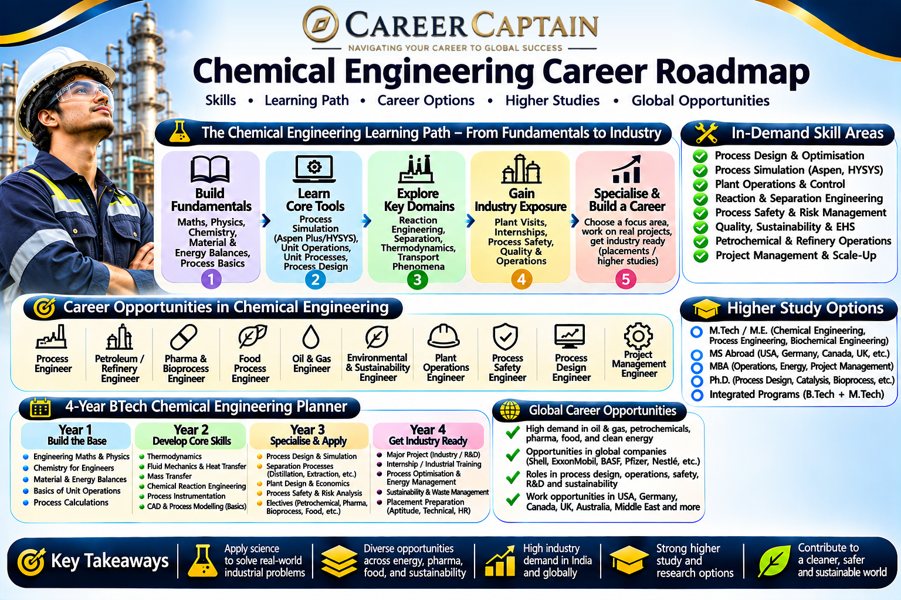

Chemical Engineering combines chemistry, physics, mathematics, biology, and engineering to transform raw materials into useful products through industrial processes. Chemical engineers design, operate, optimise, and improve processes used in petroleum refining, pharmaceuticals, food production, chemicals, energy, materials, and environmental protection.

From developing sustainable fuels and manufacturing medicines to designing large-scale chemical plants and advanced materials, chemical engineers play an important role in modern industry.

This roadmap explains the subjects, career opportunities, technical skills, emerging technologies, and professional pathways available in Chemical Engineering.

  

## 1. What Is Chemical Engineering?

Chemical Engineering applies engineering principles to convert raw materials into valuable products safely, efficiently, and economically.

It focuses on the design and operation of processes involving chemical reactions, heat transfer, fluid movement, separation, and material transformation.

Chemical engineers work across several disciplines:

- Chemistry and applied physics
- Mathematics and computational methods
- Thermodynamics
- Fluid mechanics
- Heat and mass transfer
- Reaction engineering
- Process control
- Materials science
- Environmental engineering

Applications include petroleum refining, fertiliser production, pharmaceuticals, polymers, food processing, water treatment, specialty chemicals, and renewable energy.

## 2. Subjects You Study in a Chemical Engineering Degree

The curriculum varies between universities, but students generally study the following subjects.

**Engineering fundamentals**
- Engineering Mathematics
- Engineering Physics
- Engineering Chemistry
- Engineering Mechanics
- Basic Electrical and Electronics Engineering
- Computer Programming

**Core chemical engineering subjects**
- Chemical Process Calculations
- Chemical Engineering Thermodynamics
- Fluid Mechanics
- Heat Transfer
- Mass Transfer
- Chemical Reaction Engineering
- Mechanical Operations
- Process Dynamics and Control
- Separation Processes
- Chemical Plant Design
- Process Equipment Design

**Advanced subjects**
- Computational Fluid Dynamics
- Process Simulation
- Polymer Technology
- Petroleum Refining
- Biochemical Engineering
- Environmental Engineering
- Process Safety
- Energy Engineering
- Advanced Materials

## 3. Major Career Paths in Chemical Engineering

Chemical engineers can work across manufacturing, energy, pharmaceuticals, materials, environmental technology, and research.

### Process Engineering

Design, operate, monitor, and optimise industrial processes.

Potential roles:
- Process Engineer
- Production Engineer
- Process Design Engineer
- Process Improvement Engineer

### Petroleum and Petrochemical Engineering

Work in petroleum refining, natural gas processing, petrochemical production, and related industrial operations.

Potential roles:
- Refinery Process Engineer
- Production Engineer
- Process Operations Engineer
- Petrochemical Engineer

### Pharmaceutical and Biotechnology Industries

Support the manufacturing and processing of medicines, vaccines, chemicals, and biological products.

Potential roles:
- Pharmaceutical Process Engineer
- Manufacturing Engineer
- Validation Engineer
- Process Development Associate

### Food and Consumer Products

Develop and optimise manufacturing processes for food, beverages, cosmetics, detergents, and other consumer products.

Potential roles:
- Food Process Engineer
- Production Engineer
- Quality Engineer
- Process Development Engineer

### Environmental Engineering

Develop industrial solutions for wastewater treatment, pollution control, waste management, and resource recovery.

Potential roles:
- Environmental Process Engineer
- Water Treatment Engineer
- Sustainability Engineer
- Waste Management Specialist

### Materials and Polymer Engineering

Work with plastics, composites, coatings, advanced materials, and specialty chemicals.

Potential roles:
- Materials Process Engineer
- Polymer Engineer
- Product Development Engineer
- Research Associate

### Energy and Renewable Technologies

Contribute to energy production, hydrogen technologies, battery materials, carbon capture, and sustainable fuel development.

Potential roles:
- Energy Process Engineer
- Hydrogen Technology Engineer
- Carbon Capture Engineer
- Research and Development Engineer

## 4. Emerging Technologies in Chemical Engineering

Chemical Engineering is evolving through digitalisation, advanced materials, clean energy, and sustainable manufacturing.

Important emerging areas include:

- **Green Hydrogen:** Developing processes for hydrogen production using low-carbon energy.
- **Carbon Capture and Storage:** Capturing carbon dioxide from industrial emissions and storing or utilising it.
- **Artificial Intelligence in Process Industries:** Using machine learning to optimise manufacturing and predict equipment performance.
- **Digital Twins:** Creating virtual representations of industrial processes for monitoring and optimisation.
- **Advanced Battery Materials:** Developing materials and manufacturing processes for energy storage.
- **Biorefineries:** Converting biomass into fuels, chemicals, and other useful products.
- **Membrane Technology:** Improving separation, purification, and water treatment.
- **Sustainable Polymers:** Developing recyclable, biodegradable, and bio-based materials.
- **Process Intensification:** Making industrial processes more efficient and compact.
- **Additive Manufacturing of Materials:** Applying advanced manufacturing methods to specialised materials and equipment.

## 5. Software and Technical Skills

Chemical engineers need a combination of engineering calculations, process simulation, design, and analytical capabilities.

**Process simulation and design**
- Aspen Plus
- Aspen HYSYS
- DWSIM
- CHEMCAD
- SuperPro Designer

**Engineering and computational tools**
- MATLAB
- Python
- Excel
- Mathcad
- COMSOL Multiphysics
- ANSYS Fluent

**Plant design and drafting**
- AutoCAD
- Plant 3D
- CAD-based equipment modelling
- Process Flow Diagrams (PFDs)
- Piping and Instrumentation Diagrams (P&IDs)

**Technical knowledge**
- Mass and energy balances
- Equipment sizing
- Heat exchanger design
- Reactor design
- Process optimisation
- Process control
- Industrial safety
- Quality assurance

**Professional knowledge**
- Hazard identification
- Risk assessment
- Environmental compliance
- Technical documentation
- Industrial standards
- Process safety management

## 6. Four-Year Chemical Engineering Roadmap

A structured undergraduate plan helps students build strong engineering fundamentals and prepare for industry roles.

### First Year: Build the Foundation

Focus on:
- Mathematics, physics, and chemistry
- Engineering fundamentals
- Basic programming
- Engineering drawing
- Communication skills

Suggested activities:
- Strengthen mathematical problem-solving.
- Learn Python fundamentals.
- Understand basic chemistry concepts.
- Explore engineering applications in manufacturing.

### Second Year: Develop Core Skills

Focus on:
- Thermodynamics
- Fluid mechanics
- Heat transfer
- Material and energy balances
- Chemical process calculations

Suggested activities:
- Learn Excel for engineering calculations.
- Practise process flow diagrams.
- Explore introductory process simulation.
- Complete small engineering projects.

### Third Year: Develop Specialised Knowledge

Focus on:
- Mass transfer
- Reaction engineering
- Process control
- Separation processes
- Equipment design

Suggested activities:
- Learn Aspen Plus or DWSIM.
- Complete a process simulation project.
- Explore industrial internships.
- Study chemical plant operations.
- Develop technical documentation skills.

### Fourth Year: Prepare for Professional Opportunities

Focus on:
- Final-year project
- Plant design
- Industrial applications
- Technical interviews
- Higher education planning

Suggested activities:
- Complete an industry-oriented project.
- Apply for internships and graduate positions.
- Develop a technical portfolio.
- Prepare for relevant competitive examinations.
- Research employers and postgraduate programmes.

## 7. Important Projects to Build

Practical projects help demonstrate engineering knowledge and problem-solving ability.

**Beginner projects**
- Material balance calculations
- Energy balance calculations
- Heat exchanger performance analysis
- Fluid flow calculations
- Simple distillation calculations

**Intermediate projects**
- Heat exchanger design and simulation
- Distillation column simulation
- Reactor performance modelling
- Wastewater treatment process study
- Process optimisation using Python

**Advanced projects**
- Complete chemical plant process simulation
- Green hydrogen production process modelling
- Carbon capture process simulation
- Biorefinery process design
- Process control and optimisation system
- Computational fluid dynamics study of industrial equipment

Projects involving chemical substances or industrial equipment must be undertaken with suitable supervision, safety procedures, and laboratory or institutional approvals.

## 8. Internships and Industry Exposure

Internships help students understand industrial operations, process design, manufacturing, safety, and quality systems.

Potential internship environments include:

- Chemical manufacturing companies
- Petroleum refineries
- Petrochemical plants
- Fertiliser industries
- Pharmaceutical manufacturers
- Food processing companies
- Water treatment facilities
- Energy companies
- Research and development laboratories

Students should look for opportunities involving process engineering, production, quality control, process simulation, equipment operations, and environmental management.

A strong internship portfolio should contain project reports, simulation work, technical calculations, and evidence of relevant software skills.

## 9. Government and Public-Sector Opportunities in India

Chemical engineers can explore opportunities in energy, petroleum, fertilisers, scientific research, manufacturing, and environmental management.

Important organisations include:

- **Indian Oil Corporation Limited (IOCL):** Petroleum refining, pipelines, and petrochemical operations.
- **Bharat Petroleum Corporation Limited (BPCL):** Refining and energy operations.
- **Hindustan Petroleum Corporation Limited (HPCL):** Petroleum refining and related industries.
- **ONGC:** Oil and natural gas exploration and production.
- **GAIL:** Natural gas processing, transmission, and petrochemicals.
- **NTPC:** Power generation and energy-related technologies.
- **Rashtriya Chemicals and Fertilizers (RCF):** Fertiliser and chemical manufacturing.
- **CSIR laboratories:** Scientific and industrial research.
- **Department of Chemicals and Petrochemicals:** Sector-related government programmes and information.

Potential roles include graduate engineer trainee, process engineer, production engineer, technical officer, and research associate.

Eligibility, recruitment routes, and selection procedures vary. Check official recruitment notifications for current requirements.

## 10. Higher Education and Specialisation

Postgraduate education can help students develop advanced technical expertise and pursue specialised research or leadership opportunities.

**Possible postgraduate specialisations**
- Chemical Engineering
- Process Engineering
- Petroleum Engineering
- Polymer Science and Engineering
- Energy Engineering
- Environmental Engineering
- Biochemical Engineering
- Materials Science
- Pharmaceutical Engineering
- Computational Chemical Engineering
- Sustainable Chemical Technology

**International study destinations**
- Germany
- United States
- United Kingdom
- Canada
- Netherlands
- Sweden
- Switzerland
- Australia

Students considering international education should evaluate course structure, laboratory facilities, research opportunities, admission requirements, language requirements, tuition fees, and funding options.

A strong academic record, technical projects, internships, and relevant research experience can strengthen postgraduate applications.

## 11. Salary and Career Growth

Chemical engineering salaries vary according to industry, employer, location, qualifications, technical specialisation, and experience.

Potential career progression:

| Career stage | Possible roles |
|---|---|
| Entry level | Graduate Engineer Trainee, Junior Process Engineer |
| Early career | Process Engineer, Production Engineer, Quality Engineer |
| Experienced | Senior Process Engineer, Plant Engineer, Project Engineer |
| Advanced | Process Engineering Manager, Technical Lead, R&D Manager |
| Leadership | Plant Head, Operations Director, Engineering Director |

Career opportunities differ between sectors. Petroleum, pharmaceuticals, specialty chemicals, energy, and process consulting may have different qualification and experience requirements.

Use current employer job postings and salary surveys when evaluating compensation.

## 12. Essential Soft Skills

Chemical engineers work in complex industrial environments where technical decisions can affect safety, productivity, quality, and the environment.

Important skills include:

- Analytical thinking
- Problem-solving
- Attention to detail
- Communication
- Teamwork
- Decision-making
- Project management
- Technical documentation
- Risk awareness
- Adaptability
- Leadership

The ability to communicate effectively with operations teams, maintenance engineers, safety professionals, and management is particularly important.

## 13. Common Mistakes to Avoid

- Ignoring mathematics and fundamental chemistry.
- Memorising formulas without understanding engineering applications.
- Avoiding process simulation software.
- Neglecting practical laboratory and industrial exposure.
- Ignoring process safety and environmental responsibilities.
- Focusing only on petroleum careers and overlooking other sectors.
- Learning software without understanding the underlying engineering.
- Avoiding internships and technical projects.
- Choosing a postgraduate specialisation without researching career opportunities.

## 14. How to Choose Your Chemical Engineering Specialisation

Your interests and strengths can help you identify a suitable career direction.

| Your interest | Possible specialisation |
|---|---|
| Industrial manufacturing | Process Engineering |
| Oil and natural gas | Petroleum Engineering |
| Medicines and vaccines | Pharmaceutical Engineering |
| Energy and sustainability | Energy Engineering |
| Pollution control | Environmental Engineering |
| Plastics and advanced materials | Polymer Engineering |
| Biological processes | Biochemical Engineering |
| Programming and modelling | Computational Chemical Engineering |
| Research and innovation | Materials and Process Research |

Explore different areas through electives, internships, simulation projects, and industry exposure before choosing a long-term specialisation.

## 15. Useful Learning and Official Resources

The following resources can help students strengthen their engineering knowledge and explore professional opportunities.

**Learning platforms**
- [NPTEL](https://nptel.ac.in/) — Chemical engineering and related technical courses.
- [SWAYAM](https://swayam.gov.in/) — Online academic programmes.
- [MIT OpenCourseWare](https://ocw.mit.edu/) — University-level engineering learning materials.
- [Coursera](https://www.coursera.org/) — Process engineering, energy, and computational courses.
- [edX](https://www.edx.org/) — Engineering and technology programmes.

**Professional and technical resources**
- [AIChE](https://www.aiche.org/) — American Institute of Chemical Engineers.
- [IChemE](https://www.icheme.org/) — Institution of Chemical Engineers.
- [NPTEL Chemical Engineering](https://nptel.ac.in/) — Engineering lectures and learning resources.
- [Bureau of Indian Standards](https://www.bis.gov.in/) — Indian standards and technical information.
- [Ministry of Petroleum and Natural Gas](https://mopng.gov.in/) — Petroleum and natural gas sector information.
- [Ministry of Chemicals and Fertilizers](https://chemicals.nic.in/) — Chemical and fertiliser sector information.
- [CSIR](https://www.csir.res.in/) — Scientific and industrial research.

## 16. Final Thoughts: Building a Career in Chemical Engineering

Chemical Engineering offers opportunities across manufacturing, energy, pharmaceuticals, materials, food production, environmental technology, and research.

Students who combine strong fundamentals in mathematics, chemistry, and physics with process simulation, problem-solving, safety awareness, and practical experience can build versatile careers.

Focus on understanding industrial processes, developing technical skills, completing meaningful projects, and gaining exposure to real engineering environments.

### How Career Captain Can Help

Choosing an engineering branch is only the beginning of a career journey. Understanding your interests, aptitude, strengths, and long-term goals can help you make informed academic and professional decisions.

Career Captain Global Solutions supports students through career counselling, psychometric assessments, stream and course selection, career exploration, and study-abroad guidance.

Explore career guidance and planning resources at [Career Captain](https://careercaptain.co.in?utm_source=career_roadmaps_india&utm_medium=referral&utm_campaign=github_career_roadmaps&utm_content=chemical-engineering-career-roadmap).

---

**Educational Disclaimer:** This roadmap is intended for educational and career-awareness purposes. Course structures, eligibility criteria, recruitment requirements, and employment opportunities may change. Students should verify current information with universities, employers, and official organisations.

**License:** This educational resource is shared under the Creative Commons Attribution 4.0 International (CC BY 4.0) license. Please credit Career Captain Global Solutions when sharing or adapting this material.

---

## Plan your engineering pathway with Career Captain

Choosing an engineering branch is only one part of the decision. Students should also consider their interests, strengths, preferred work and future study options. Career Captain offers personalised career counselling and assessment to support informed decisions.

- [Career counselling in Hyderabad](https://careercaptain.co.in/career-counsellor-near-me?utm_source=career_roadmaps_india&utm_medium=referral&utm_campaign=github_career_roadmaps&utm_content=chemical-engineering-career-roadmap)
- [Psychometric career assessment](https://guide.careercaptain.co.in/guides/psychometric-career-assessment/?utm_source=career_roadmaps_india&utm_medium=referral&utm_campaign=github_career_roadmaps&utm_content=chemical-engineering-career-roadmap)
- [Online career counselling](https://careercaptain.co.in/areas-we-serve?utm_source=career_roadmaps_india&utm_medium=referral&utm_campaign=github_career_roadmaps&utm_content=chemical-engineering-career-roadmap)

[Visit Career Captain](https://careercaptain.co.in?utm_source=career_roadmaps_india&utm_medium=referral&utm_campaign=github_career_roadmaps&utm_content=chemical-engineering-career-roadmap) · [WhatsApp Career Captain](https://wa.me/919849488838?text=Hi%20Career%20Captain%2C%20I%20found%20your%20chemical%20engineering%20career%20roadmap%20guide%20in%20Career%20Roadmaps%20India.%20I%20would%20like%20to%20know%20more%20about%20career%20guidance.%20Source%3A%20chemical-engineering-career-roadmap.)
