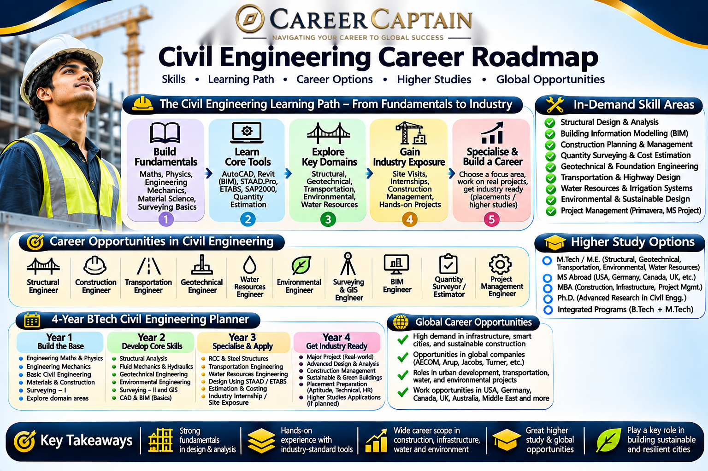

# Civil Engineering Career Roadmap in India: Opportunities, Skills, Specialisations and Future Scope

Civil Engineering is one of the oldest and most important engineering disciplines. It focuses on planning, designing, constructing and maintaining the infrastructure that supports modern society.

Buildings, bridges, highways, airports, railways, dams, water supply systems and sustainable cities all depend on civil engineering.

The profession is evolving through smart infrastructure, green buildings, advanced construction materials, automation, digital modelling and sustainable development.

This roadmap explains the subjects, career opportunities, specialisations, technical skills and preparation strategies available to Civil Engineering students in India.

---

  

## 1. What Is Civil Engineering?

Civil Engineering deals with the built environment and infrastructure.

It combines engineering science, mathematics, materials, design, construction technology and project management.

Major areas include:

- Structural engineering
- Geotechnical engineering
- Transportation engineering
- Environmental engineering
- Water resources engineering
- Construction engineering
- Surveying and geomatics
- Urban and infrastructure planning
- Building materials and technology

Civil engineers work in construction companies, infrastructure organisations, government departments, engineering consultancies, real estate, research institutions and project management organisations.

## 2. What Do You Study in a Civil Engineering Degree?

The exact curriculum varies by university, but most BTech Civil Engineering programmes include the following subjects.

| Subject | What You Learn |
|---|---|
| Engineering Mechanics | Forces, equilibrium and motion |
| Engineering Mathematics | Mathematical methods for engineering |
| Engineering Graphics | Technical drawings and visualisation |
| Building Materials | Properties and applications of construction materials |
| Surveying | Measurement and mapping of land |
| Strength of Materials | Stress, strain and structural behaviour |
| Structural Analysis | Analysis of beams, frames and structures |
| Concrete Technology | Properties and design applications of concrete |
| Geotechnical Engineering | Soil mechanics and foundation systems |
| Fluid Mechanics | Behaviour of liquids and fluid systems |
| Hydrology | Water movement and distribution |
| Transportation Engineering | Roads, railways and transport systems |
| Environmental Engineering | Water treatment, wastewater and pollution control |
| RCC Design | Design of reinforced concrete structures |
| Steel Structures | Design of structural steel systems |
| Construction Management | Planning, scheduling and project control |

### Why these subjects matter

These subjects provide the foundation for careers in structural design, construction, transportation, geotechnical engineering, water resources, environmental engineering and infrastructure development.

Students should understand the engineering principles behind design decisions rather than simply memorising formulas.

## 3. Major Career Paths in Civil Engineering

### 3.1 Structural Engineering

Structural engineers analyse and design buildings, bridges, towers, industrial structures and other load-bearing systems.

Typical responsibilities:

- Structural analysis
- Load calculations
- Reinforced concrete design
- Steel structure design
- Foundation coordination
- Structural safety assessment
- Design documentation

Useful skills and tools:

- Structural mechanics
- RCC and steel design
- ETABS
- STAAD.Pro
- SAP2000
- SAFE
- AutoCAD
- Revit Structure

Potential roles:

- Structural Design Engineer
- Structural Analysis Engineer
- Bridge Design Engineer
- Structural Site Engineer
- Building Design Consultant

Some specialised design roles may require postgraduate education and relevant professional experience.

### 3.2 Construction and Site Engineering

Construction engineers coordinate the execution of infrastructure and building projects.

Their responsibilities may include:

- Site supervision
- Construction planning
- Material coordination
- Labour and equipment management
- Quality control
- Progress monitoring
- Safety compliance
- Contractor coordination

Potential roles:

- Site Engineer
- Construction Engineer
- Project Engineer
- Planning Engineer
- Construction Supervisor
- Project Coordinator

Practical site exposure is particularly valuable in this career path.

### 3.3 Geotechnical Engineering

Geotechnical engineers study soil and rock behaviour to determine whether the ground can safely support structures.

Applications include:

- Building foundations
- Retaining walls
- Tunnels
- Embankments
- Dams
- Slope stability
- Ground improvement

Useful skills:

- Soil mechanics
- Foundation engineering
- Site investigation
- Soil testing
- Geotechnical analysis

Potential roles:

- Geotechnical Engineer
- Foundation Design Engineer
- Soil Investigation Engineer
- Ground Engineering Consultant

### 3.4 Transportation Engineering

Transportation engineers plan, design and improve systems that move people and goods.

Career areas include:

- Highway engineering
- Road design
- Railway infrastructure
- Airport planning
- Traffic engineering
- Urban mobility
- Public transportation
- Transport safety

Useful skills and tools:

- Transportation planning
- Traffic studies
- Highway design
- Surveying
- GIS
- AutoCAD Civil 3D
- Transport modelling tools

Potential roles:

- Highway Design Engineer
- Transportation Engineer
- Traffic Engineer
- Road Safety Engineer
- Infrastructure Planning Engineer

### 3.5 Environmental Engineering

Environmental engineers work on systems that protect public health and the natural environment.

Areas include:

- Water treatment
- Wastewater treatment
- Solid waste management
- Pollution control
- Environmental monitoring
- Sustainable infrastructure
- Environmental impact assessment

Potential roles:

- Environmental Engineer
- Water and Wastewater Engineer
- Environmental Consultant
- Sustainability Engineer
- Pollution Control Specialist

Some environmental roles require additional knowledge of environmental regulations and specialised assessment methods.

### 3.6 Water Resources Engineering

Water resources engineers plan and manage systems related to water storage, distribution, drainage and flood management.

Applications include:

- Dams and reservoirs
- Irrigation systems
- Flood control
- Stormwater management
- River engineering
- Water distribution networks
- Watershed management

Potential roles:

- Water Resources Engineer
- Hydraulic Engineer
- Irrigation Engineer
- Drainage Design Engineer
- Flood Management Specialist

### 3.7 Quantity Surveying and Estimation

Quantity surveyors and estimation engineers help manage the financial and contractual aspects of construction projects.

Typical responsibilities:

- Quantity take-offs
- Cost estimation
- Bill of quantities preparation
- Tender documentation
- Contract administration
- Measurement and billing
- Cost monitoring

Useful skills:

- Construction measurement
- Estimation and costing
- Excel
- AutoCAD
- BOQ preparation
- Contract fundamentals
- Project documentation

Potential roles:

- Quantity Surveyor
- Estimation Engineer
- Cost Engineer
- Billing Engineer
- Contracts Engineer

### 3.8 Building Information Modelling (BIM)

BIM uses digital models to coordinate building and infrastructure projects.

It helps different engineering and construction teams work with shared project information.

Applications include:

- Architectural modelling
- Structural modelling
- MEP coordination
- Clash detection
- Construction planning
- Quantity extraction
- Facility management

Useful tools:

- Autodesk Revit
- Navisworks
- Autodesk Construction Cloud
- Civil 3D
- BIM collaboration platforms

Potential roles:

- BIM Modeler
- BIM Engineer
- BIM Coordinator
- BIM Manager, with appropriate experience
- Digital Construction Specialist

### 3.9 Project Planning and Management

Civil engineers can move into planning and project management roles as they develop industry experience.

Typical responsibilities:

- Project scheduling
- Resource planning
- Cost monitoring
- Risk management
- Progress reporting
- Contractor coordination
- Project documentation

Useful tools:

- Primavera P6
- Microsoft Project
- Excel
- Project management software
- Construction planning methods

Potential roles:

- Planning Engineer
- Project Controls Engineer
- Project Coordinator
- Project Manager, with suitable experience

---

## 4. Emerging Technologies and Future Opportunities

Civil Engineering is increasingly influenced by digital technologies, sustainability and advanced construction methods.

| Technology | Civil Engineering Application |
|---|---|
| Building Information Modelling | Digital modelling and project coordination |
| Digital Twins | Virtual representation of infrastructure |
| Geographic Information Systems | Spatial analysis and infrastructure planning |
| Drones | Surveying, inspection and site monitoring |
| 3D Printing | Advanced construction methods |
| Smart Materials | Improved structural and material performance |
| Artificial Intelligence | Design assistance, monitoring and optimisation |
| Internet of Things | Smart infrastructure monitoring |
| Green Buildings | Energy-efficient and sustainable construction |
| Prefabrication | Off-site construction and modular systems |

Students should understand that these technologies supplement engineering fundamentals; they do not replace knowledge of structures, materials, soil, safety and construction.

## 5. Important Software and Technical Skills

Software selection should depend on the career direction.

### Design and Drafting

- AutoCAD
- Revit
- Civil 3D
- SketchUp

### Structural Analysis

- ETABS
- STAAD.Pro
- SAP2000
- SAFE
- MIDAS Civil

### BIM and Construction Coordination

- Revit
- Navisworks
- Autodesk Construction Cloud

### Surveying and Geospatial Technology

- Total station fundamentals
- GPS and GNSS
- ArcGIS
- QGIS
- Drone survey fundamentals

### Project Planning and Management

- Primavera P6
- Microsoft Project
- Microsoft Excel

### Geotechnical and Hydraulic Analysis

- PLAXIS
- GeoStudio
- HEC-RAS
- HEC-HMS

### Programming and Data Skills

- Excel
- Python
- MATLAB
- Basic data analysis
- GIS data processing

**Important:** Do not attempt to master every software package. Select tools relevant to your specialisation and learn the engineering concepts behind them.

## 6. A Four-Year Civil Engineering Career Roadmap

### First Year: Build the Foundation

Focus on:

- Engineering mathematics
- Engineering mechanics
- Engineering graphics
- Basic physics
- Basic programming
- Workshop and laboratory practice

Recommended actions:

1. Understand basic engineering principles.
2. Develop drawing and visualisation skills.
3. Learn how construction materials are used.
4. Explore surveying and infrastructure projects.
5. Participate in technical activities.

**Goal:** Build a strong foundation and understand the different areas of Civil Engineering.

### Second Year: Develop Core Civil Engineering Skills

Focus on:

- Strength of materials
- Surveying
- Fluid mechanics
- Building materials
- Structural analysis
- Geotechnical engineering fundamentals

Recommended actions:

1. Practise engineering calculations.
2. Learn AutoCAD fundamentals.
3. Understand basic surveying instruments.
4. Visit construction sites when possible.
5. Explore concrete and soil testing.
6. Develop technical documentation skills.

**Goal:** Connect classroom knowledge with practical construction and infrastructure applications.

### Third Year: Choose a Specialisation

Explore areas such as:

- Structural engineering
- Construction management
- Geotechnical engineering
- Transportation engineering
- Environmental engineering
- Water resources
- BIM and digital construction
- Quantity surveying

Recommended actions:

1. Identify your preferred career direction.
2. Learn relevant software.
3. Complete two or three practical projects.
4. Apply for internships.
5. Build a portfolio of drawings, models or project reports.
6. Explore GATE and other relevant examinations if interested.

**Goal:** Develop demonstrable technical skills and understand industry expectations.

### Fourth Year: Prepare for Employment or Higher Studies

Focus on:

- Final-year project
- Internship experience
- Core subject revision
- Technical interview preparation
- Resume development
- Portfolio preparation
- Placement and postgraduate applications

Explore:

- Construction and infrastructure companies
- Engineering consultancies
- Government recruitment
- Public-sector organisations
- GATE and postgraduate admissions
- Research opportunities
- Study-abroad programmes

**Goal:** Graduate with a clear career direction and evidence of your capabilities.

---

## 7. Projects That Can Strengthen Your Civil Engineering Resume

Projects help students demonstrate their ability to apply engineering concepts.

### Beginner-level projects

- Concrete mix comparison
- Basic land surveying exercise
- Model bridge construction
- Soil classification study
- Building material testing
- Rainwater harvesting model

### Intermediate projects

- Small-scale structural analysis
- Stormwater drainage design
- Sustainable building model
- Road traffic survey
- Quantity estimation for a building
- BIM model of a residential building

### Advanced projects

- Seismic analysis of a multistorey building
- Bridge structural analysis
- Urban flood modelling
- Foundation design study
- Highway alignment and geometric design
- Digital twin concept for infrastructure
- Sustainable water management system

A good project should include:

- Problem statement
- Design objectives
- Assumptions and applicable codes
- Engineering calculations
- Drawings or digital models
- Materials and methodology
- Testing or analysis
- Results and limitations
- Future improvements

Never claim that an academic model is a certified construction design. Real projects require qualified professionals, applicable codes, approvals and safety checks.

## 8. Internships and Industry Exposure

Internships help students understand actual construction and infrastructure environments.

Explore opportunities in:

- Construction companies
- Infrastructure developers
- Structural consultancies
- Highway and transportation firms
- Surveying organisations
- Environmental consultancies
- Water management organisations
- BIM and engineering design firms
- Government research institutions

Students can also seek:

- Faculty-led research
- Industrial visits
- Site exposure
- Technical workshops
- Surveying practice
- Material testing laboratory experience

Verify the organisation, internship responsibilities, fees and certificate claims before enrolling.

## 9. Government and Public-Sector Career Opportunities

Civil Engineering graduates may explore government and public-sector opportunities in infrastructure, construction, transport, water resources and public works.

Potential areas include:

- Engineering Services
- Public Works Departments
- Municipal engineering
- Railways
- Highway development
- Water resources departments
- Defence infrastructure
- Public-sector construction organisations
- Government research institutions

Organisations and institutions worth researching include:

- Union Public Service Commission (UPSC)
- National Highways Authority of India (NHAI)
- Indian Railways
- Central Public Works Department (CPWD)
- National Buildings Construction Corporation (NBCC)
- Public-sector engineering organisations

Recruitment routes vary. Some roles require GATE scores, competitive examinations, interviews, technical tests or specific qualifications.

Always check the latest official recruitment notification for eligibility, age limits and selection procedures.

## 10. Higher Education After Civil Engineering

### Postgraduate options in India

Students may consider:

- MTech in Structural Engineering
- MTech in Geotechnical Engineering
- MTech in Transportation Engineering
- MTech in Environmental Engineering
- MTech in Water Resources Engineering
- MTech in Construction Technology and Management
- MTech in Infrastructure Engineering
- MBA
- Research programmes

GATE is an important entrance examination for many postgraduate engineering programmes and certain recruitment processes. Requirements vary by institution.

### Study-abroad specialisations

Potential areas include:

- Structural Engineering
- Construction Management
- Sustainable Infrastructure
- Transportation Engineering
- Geotechnical Engineering
- Environmental Engineering
- Water Resources
- Urban Planning
- Building Information Modelling

Research university-specific admission requirements, academic prerequisites, language tests, tuition fees, scholarships and visa regulations.

## 11. Salary and Career Growth

Civil Engineering salaries vary according to:

- Employer and industry
- Location
- Role and specialisation
- Technical skills
- Internship experience
- Project exposure
- Academic background
- Professional experience

Some graduates begin as site engineers, graduate trainees, quantity surveyors or CAD/BIM professionals. Others enter structural design, planning, infrastructure consultancy or specialised technical roles.

Salary figures found online can differ significantly. Evaluate job responsibilities, learning opportunities, working conditions, long-term growth and your interests rather than relying only on advertised packages.

## 12. Essential Skills Beyond Technical Knowledge

Successful civil engineers need:

- Analytical thinking
- Problem-solving
- Technical drawing
- Engineering calculations
- Communication
- Teamwork
- Site coordination
- Documentation
- Project management
- Attention to safety
- Professional responsibility

Civil engineering projects involve many stakeholders. The ability to communicate clearly with contractors, clients, consultants and technical teams is essential.

## 13. Common Mistakes Civil Engineering Students Should Avoid

1. Ignoring engineering fundamentals while learning software.
2. Learning AutoCAD without understanding technical drawings.
3. Avoiding site visits and practical exposure.
4. Collecting certificates without building a portfolio.
5. Ignoring construction safety.
6. Waiting until the final year to seek internships.
7. Assuming Civil Engineering offers only site-based jobs.
8. Ignoring BIM, GIS and digital construction.
9. Preparing for placements without revising core subjects.
10. Treating academic models as approved professional designs.

## 14. How to Choose the Right Civil Engineering Specialisation

| If You Enjoy... | Explore... |
|---|---|
| Designing buildings and bridges | Structural Engineering |
| Working at construction sites | Construction Engineering |
| Soil and foundation systems | Geotechnical Engineering |
| Roads, railways and transport | Transportation Engineering |
| Water and environmental systems | Environmental Engineering |
| Rivers, dams and drainage | Water Resources Engineering |
| Digital building models | BIM and Digital Construction |
| Costing and project budgets | Quantity Surveying |
| Scheduling and project coordination | Construction Project Management |
| Maps and spatial data | GIS and Geomatics |

Use projects, internships, site visits and conversations with professionals to understand each specialisation before making a decision.

## 15. Useful Learning and Official Resources

- [AICTE](https://www.aicte-india.org/) — Technical education information.
- [SWAYAM](https://swayam.gov.in/) — Online learning programmes.
- [NPTEL](https://nptel.ac.in/) — Engineering and technology courses.
- [GATE](https://gate2026.iitg.ac.in/) — Examination information; consult the relevant year's official website.
- [UPSC](https://upsc.gov.in/) — Government examination and recruitment information.
- [NHAI](https://nhai.gov.in/) — National highway development information.
- [CPWD](https://cpwd.gov.in/) — Public infrastructure and engineering information.
- [Autodesk Education](https://www.autodesk.com/education/home) — Educational software access, subject to eligibility.
- [QGIS](https://qgis.org/) — Open-source geographic information system.
- [US Army Corps of Engineers HEC](https://www.hec.usace.army.mil/) — Hydrology and hydraulic engineering tools.

Check course availability, software licensing and recruitment requirements directly with the relevant organisations.

---

## 16. Final Thoughts: Build Your Civil Engineering Career with a Plan

Civil Engineering offers opportunities across construction, infrastructure, structural design, transportation, water resources, environmental engineering, digital construction and project management.

The strongest preparation combines engineering fundamentals, practical exposure, technical software, internships and a clear understanding of industry requirements.

Your degree provides the foundation. Your skills, experience and decisions shape your career.

### Explore Career Guidance with Career Captain

Choosing a Civil Engineering specialisation, identifying suitable higher education options and understanding infrastructure career opportunities can be challenging.

**Career Captain Global Solutions** provides career counselling, career assessments, course and college planning, and study-abroad guidance to help students and young professionals make informed decisions.

Website: https://careercaptain.co.in/

*Educational disclaimer: This roadmap is intended for general career awareness. Course structures, eligibility criteria, recruitment processes and industry requirements may change. Verify important decisions with official institutions and authorities.*

---

**Attribution and Licence**

This guide is part of the Career Roadmaps India open educational initiative by Career Captain Global Solutions.

Licensed under the Creative Commons Attribution 4.0 International (CC BY 4.0) licence. You may share and adapt this material with appropriate attribution and a link to the licence.

Source: https://github.com/Career-Captain-Global-Solutions/Career-Roadmaps-India

---

## Plan your engineering pathway with Career Captain

Choosing an engineering branch is only one part of the decision. Students should also consider their interests, strengths, preferred work and future study options. Career Captain offers personalised career counselling and assessment to support informed decisions.

- [Career counselling in Hyderabad](https://careercaptain.co.in/career-counselling-hyderabad)
- [Psychometric career assessment](https://careercaptain.co.in/psychometric-test-hyderabad)
- [Online career counselling](https://careercaptain.co.in/online-career-counselling)

[Visit Career Captain](https://careercaptain.co.in/) · [WhatsApp Career Captain](https://wa.me/919849488838)
