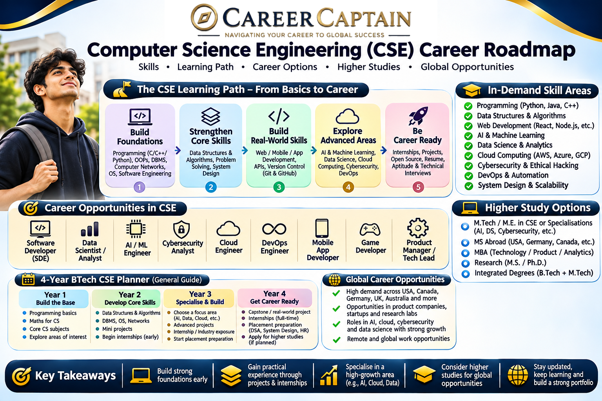

# Computer Science Engineering Career Roadmap in India: Complete Guide for BTech Students

**An educational resource by Career Captain Global Solutions**

Computer Science Engineering (CSE) is one of the most diverse engineering disciplines, offering opportunities across software development, artificial intelligence, cybersecurity, cloud computing, data science, robotics and emerging technologies.

However, studying CSE does not automatically determine a student's career.

The opportunities available to a Computer Science Engineering graduate depend on technical knowledge, practical skills, projects, internships, problem-solving ability and professional development.

This guide provides a structured roadmap for students who want to understand CSE career opportunities and prepare for the technology industry.

---

  

## 1. What Is Computer Science Engineering?

Computer Science Engineering focuses on the design, development, implementation and maintenance of computer systems and software applications.

It combines mathematics, computing theory, programming, algorithms, databases, networks and software engineering.

CSE students learn how computers process information, how applications are developed and how technology can solve real-world problems.

### Major areas of Computer Science

- Programming and software development
- Data structures and algorithms
- Database management
- Computer networks
- Operating systems
- Computer architecture
- Artificial intelligence
- Machine learning
- Cybersecurity
- Cloud computing
- Software engineering

These subjects provide the foundation for several professional specialisations.

---

## 2. Core Subjects in Computer Science Engineering

Students should develop a strong understanding of the following subjects.

| Subject | What students learn |
|---|---|
| Programming | Writing and understanding computer programs |
| Data Structures | Organising and managing information efficiently |
| Algorithms | Developing efficient computational solutions |
| Database Management | Storing, retrieving and managing data |
| Operating Systems | Understanding how computer resources are managed |
| Computer Networks | Understanding communication between systems |
| Computer Architecture | Understanding computer hardware and organisation |
| Software Engineering | Designing and maintaining software systems |
| Theory of Computation | Understanding computational models and complexity |
| Compiler Design | Understanding how programming languages are translated |

These subjects are valuable even when students eventually specialise in areas such as cybersecurity, cloud computing or artificial intelligence.

---

## 3. Major Career Pathways After CSE

CSE graduates can explore several career families.

### A. Software Development

Software development involves designing, building, testing and maintaining applications.

**Potential job roles:**

- Software Engineer
- Software Developer
- Backend Developer
- Frontend Developer
- Full-Stack Developer
- Mobile Application Developer
- Systems Software Engineer

**Important skills:**

- Programming languages
- Data structures and algorithms
- Software design
- Databases
- Version control
- Testing and debugging
- Application development

**Common technologies:**

- Python
- Java
- C++
- JavaScript
- TypeScript
- SQL
- Git
- React
- Node.js

Students should select technologies based on the type of development they want to pursue.

### B. Artificial Intelligence and Machine Learning

Artificial Intelligence involves developing systems that perform tasks associated with human intelligence.

Machine Learning is a branch of AI in which systems learn patterns from data.

**Potential job roles:**

- AI Engineer
- Machine Learning Engineer
- Applied AI Engineer
- Computer Vision Engineer
- Natural Language Processing Engineer
- AI Research Associate
- MLOps Engineer

**Important skills:**

- Python
- Linear algebra
- Probability and statistics
- Calculus
- Data structures
- Machine learning algorithms
- Deep learning
- Model evaluation

**Technologies and tools:**

- Python
- NumPy
- Pandas
- Scikit-learn
- PyTorch
- TensorFlow
- Jupyter

**Career applications:**

- Healthcare
- Finance
- Manufacturing
- Autonomous systems
- Education
- Retail
- Natural language processing
- Computer vision

Students should understand mathematics and programming fundamentals before moving into advanced AI specialisations.

### C. Data Science and Analytics

Data science involves extracting meaningful information from data to support decision-making.

**Potential job roles:**

- Data Analyst
- Data Scientist
- Business Intelligence Analyst
- Data Engineer
- Analytics Engineer
- Quantitative Analyst

**Important skills:**

- Statistics
- Probability
- Python
- SQL
- Data visualisation
- Data cleaning
- Analytical thinking
- Statistical modelling

**Common tools:**

- Excel
- SQL
- Python
- Power BI
- Tableau
- Pandas
- R

**Industries:**

- Banking
- Healthcare
- E-commerce
- Telecommunications
- Manufacturing
- Consulting
- Financial technology

Data-related careers require more than learning visualisation tools. Students should understand statistics, data quality and how to interpret results.

### D. Cybersecurity

Cybersecurity focuses on protecting digital systems, applications, networks and information from unauthorised access and attacks.

**Potential job roles:**

- Cybersecurity Analyst
- Security Engineer
- Security Operations Centre Analyst
- Penetration Tester
- Application Security Engineer
- Digital Forensics Analyst
- Cloud Security Engineer
- Security Consultant

**Important skills:**

- Networking
- Linux
- Operating systems
- Security fundamentals
- Scripting
- Identity and access management
- Vulnerability assessment
- Security monitoring

**Common tools and technologies:**

- Linux
- Wireshark
- SIEM platforms
- Python
- Security testing frameworks
- Cloud security services

**Career specialisations:**

1. Network Security
2. Application Security
3. Cloud Security
4. Digital Forensics
5. Governance, Risk and Compliance
6. Security Operations

Cybersecurity requires continuous learning because threats, technologies and defensive practices evolve.

### E. Cloud Computing

Cloud computing provides computing infrastructure, storage, databases and software services through internet-based platforms.

**Potential job roles:**

- Cloud Engineer
- Cloud Architect
- Cloud Administrator
- Cloud Security Engineer
- Infrastructure Engineer
- Site Reliability Engineer

**Important skills:**

- Linux
- Networking
- Virtualisation
- Cloud architecture
- Databases
- Automation
- Security
- Infrastructure management

**Major cloud platforms:**

- Amazon Web Services (AWS)
- Microsoft Azure
- Google Cloud

Students should understand fundamental computing and networking concepts before specialising in cloud technologies.

### F. DevOps and Site Reliability Engineering

DevOps combines development and IT operations practices to improve software delivery and infrastructure management.

Site Reliability Engineering applies software engineering principles to the reliability and operation of systems.

**Potential job roles:**

- DevOps Engineer
- Site Reliability Engineer
- Platform Engineer
- Infrastructure Automation Engineer
- Release Engineer

**Important skills:**

- Linux
- Git
- CI/CD
- Containers
- Kubernetes
- Cloud computing
- Infrastructure as Code
- Monitoring and observability

These roles require an understanding of how software is deployed, operated and maintained.

### G. Mobile Application Development

Mobile developers build applications for smartphones and other mobile devices.

**Potential job roles:**

- Android Developer
- iOS Developer
- Flutter Developer
- React Native Developer
- Mobile Software Engineer

**Common technologies:**

- Kotlin
- Swift
- Flutter
- Dart
- React Native
- JavaScript

Practical application development and knowledge of mobile architecture are important for this career.

### H. Game Development

Game development combines programming, graphics, physics, design and interactive systems.

**Potential job roles:**

- Game Developer
- Gameplay Programmer
- Game Engine Developer
- Graphics Programmer
- Technical Game Designer

**Common technologies:**

- C++
- C#
- Unity
- Unreal Engine
- Computer graphics
- Mathematics
- Physics

Students interested in game development should create playable projects and develop a portfolio demonstrating their work.

---

## 4. Non-Coding and Interdisciplinary Careers After CSE

Not every CSE graduate wants to become a programmer.

Technology companies also employ professionals in business, management, design, consulting, communication and operations.

### A. Business Analyst

Business Analysts understand business requirements, analyse processes and help organisations identify solutions.

**Responsibilities:**

- Requirement gathering
- Business process analysis
- Documentation
- Stakeholder communication
- Data interpretation
- Solution evaluation

**Useful skills:**

- Excel
- SQL fundamentals
- Power BI
- Communication
- Analytical reasoning
- Business process modelling

### B. Product Manager

Product Managers coordinate the development and improvement of digital products.

**Responsibilities:**

- Product strategy
- Understanding user needs
- Product roadmaps
- Prioritisation
- Stakeholder coordination
- Product performance analysis

**Useful skills:**

- Product thinking
- Communication
- Market research
- Data analysis
- Problem-solving
- User experience fundamentals

### C. UI/UX Designer

UI/UX professionals design digital interfaces and improve user experiences.

**Potential roles:**

- UI Designer
- UX Designer
- Product Designer
- Interaction Designer
- UX Researcher

**Useful tools:**

- Figma
- Design systems
- Prototyping tools
- User research methods
- Usability testing

A strong portfolio is important for demonstrating design capability.

### D. Technical Writer

Technical writers prepare documentation explaining software, systems and technical products.

**Responsibilities:**

- User documentation
- Product guides
- API documentation
- Technical tutorials
- Knowledge base development

**Important skills:**

- Technical understanding
- Research
- Writing
- Documentation tools
- Communication

### E. IT Project Manager

IT Project Managers coordinate technology projects, schedules, resources and stakeholders.

**Important skills:**

- Project planning
- Risk management
- Communication
- Agile methodologies
- Resource management
- Documentation

### F. Technology Consultant

Technology consultants help organisations understand and implement suitable technology solutions.

**Potential areas:**

- Digital transformation
- Enterprise technology
- Cloud strategy
- Technology operations
- Business process improvement

### G. Cybersecurity Governance and Compliance

These roles focus on security policies, risk management, regulatory requirements and organisational controls.

**Potential job roles:**

- GRC Analyst
- Information Security Analyst
- IT Risk Analyst
- Compliance Analyst
- Security Policy Specialist

Technical knowledge, documentation and analytical skills are valuable in these roles.

---

## 5. Emerging Career Opportunities in Computer Science

Technology continues to create specialised career opportunities.

Students can explore the following emerging fields.

### A. Generative AI

Generative AI systems produce content such as text, images, audio and software code.

Potential career areas include:

- Generative AI Engineer
- AI Application Developer
- AI Integration Engineer
- LLM Application Developer
- AI Evaluation Specialist

### B. Robotics and Automation

Robotics combines software, electronics, mechanical systems and control engineering.

Potential roles:

- Robotics Software Engineer
- Automation Engineer
- Robotics Research Associate
- Autonomous Systems Engineer

### C. Blockchain Technology

Blockchain involves distributed systems, cryptographic techniques and decentralised applications.

Potential roles:

- Blockchain Developer
- Smart Contract Developer
- Distributed Systems Engineer
- Blockchain Security Analyst

### D. Quantum Computing

Quantum computing explores computational systems based on quantum mechanical principles.

Potential career areas:

- Quantum Software Development
- Quantum Algorithms Research
- Quantum Information Science
- Scientific Computing

This is a specialised field that commonly requires advanced mathematics and further education.

### E. Internet of Things

IoT connects physical devices through sensors, software and communication networks.

Potential roles:

- IoT Developer
- Embedded Software Engineer
- IoT Solutions Engineer
- Industrial IoT Specialist

### F. Extended Reality

Extended Reality includes virtual reality, augmented reality and mixed reality.

Potential roles:

- AR/VR Developer
- XR Software Engineer
- 3D Application Developer
- Immersive Technology Designer

Emerging fields should be evaluated based on actual job requirements and industry adoption rather than hype alone.

---

## 6. Essential Programming Languages for CSE Students

Programming languages are tools for solving computational problems.

Students should understand programming fundamentals before trying to learn too many languages simultaneously.

| Language | Common applications |
|---|---|
| C | Programming fundamentals and systems concepts |
| C++ | Algorithms, systems and performance-oriented applications |
| Java | Enterprise applications and backend development |
| Python | Automation, data science and AI |
| JavaScript | Web development |
| TypeScript | Large-scale web application development |
| SQL | Database querying |
| Kotlin | Android development |
| Swift | iOS development |
| Go | Backend systems and cloud infrastructure |
| Rust | Systems programming and performance-sensitive applications |

**Recommended starting approach:**

1. Select one primary programming language.
2. Learn variables, conditions, loops and functions.
3. Understand data structures.
4. Practise problem-solving.
5. Build small projects.
6. Learn version control.
7. Explore a specialisation.

Programming knowledge is demonstrated through the ability to build and solve problems, not simply by listing languages on a resume.

---

## 7. Data Structures and Algorithms

Data Structures and Algorithms (DSA) are important for software engineering and many technical interviews.

### Important data structures

- Arrays
- Strings
- Linked Lists
- Stacks
- Queues
- Hash Tables
- Trees
- Binary Search Trees
- Heaps
- Graphs
- Tries

### Important algorithms

- Sorting
- Searching
- Recursion
- Binary Search
- Tree Traversal
- Graph Traversal
- Dynamic Programming
- Greedy Algorithms
- Backtracking
- Shortest Path Algorithms

### Why DSA matters

DSA helps students:

- Develop logical reasoning.
- Understand computational efficiency.
- Write efficient programs.
- Solve complex problems.
- Prepare for technical interviews.

Students should understand concepts and practise progressively instead of memorising solutions.

---

## 8. A Four-Year BTech CSE Career Roadmap

A structured undergraduate plan can help students develop skills gradually.

### First Year: Build the Foundation

**Academic priorities:**

- Mathematics
- Programming fundamentals
- Computer fundamentals
- Basic engineering subjects

**Skill development:**

- Learn C, Python or another suitable introductory language.
- Understand basic problem-solving.
- Learn Git and GitHub.
- Develop communication skills.
- Explore different technology careers.

**Practical activities:**

- Build simple programs.
- Create a GitHub account.
- Complete introductory coding exercises.
- Participate in technical clubs.

**Expected outcome:**

A strong programming foundation and an understanding of the technology landscape.

### Second Year: Develop Technical Competence

**Academic priorities:**

- Data Structures and Algorithms
- Object-Oriented Programming
- Database Management Systems
- Operating Systems
- Computer Networks

**Skill development:**

- Strengthen DSA.
- Learn SQL.
- Understand web development fundamentals.
- Explore one technical specialisation.
- Learn software development practices.

**Practical activities:**

- Build a database-backed application.
- Develop a personal project.
- Contribute to open-source projects.
- Participate in hackathons.

**Expected outcome:**

The ability to build useful applications and demonstrate technical competence.

### Third Year: Choose a Specialisation

Students should identify a preferred career direction.

Possible specialisations:

- Software Engineering
- Artificial Intelligence
- Data Science
- Cybersecurity
- Cloud Computing
- DevOps
- Mobile Development
- UI/UX Design
- Business Analysis

**Important activities:**

- Complete specialisation-related projects.
- Apply for internships.
- Build a professional portfolio.
- Improve problem-solving.
- Prepare for technical interviews.
- Explore industry certifications where relevant.

**Expected outcome:**

A focused career profile supported by projects and practical experience.

### Fourth Year: Prepare for Employment or Higher Education

**Placement preparation:**

- Resume development
- DSA revision
- Technical interviews
- Aptitude preparation
- Group discussions
- Communication practice
- Mock interviews

**Career options:**

- Campus placements
- Off-campus employment
- Graduate trainee programmes
- Higher education in India
- Master's programmes abroad
- Research opportunities
- Entrepreneurship

**Expected outcome:**

A well-prepared graduate with a demonstrable skill set and a clear next-step plan.

---

## 9. Important Projects CSE Students Should Build

Projects demonstrate practical knowledge and the ability to apply technical concepts.

### Beginner Projects

- Calculator application
- Student management system
- Personal portfolio website
- Basic expense tracker
- Quiz application
- Library management system

### Intermediate Projects

- E-commerce application
- Online examination platform
- Job portal
- Attendance management system
- Chat application
- Inventory management system

### Advanced Projects

- AI-powered document assistant
- Data analytics dashboard
- Cloud-based application
- Cybersecurity monitoring dashboard
- Recommendation system
- Intelligent traffic management prototype

### Project Development Guidelines

Every project should ideally include:

1. A clearly defined problem.
2. A suitable technology stack.
3. A working implementation.
4. Proper documentation.
5. Source code management.
6. Testing.
7. A demonstration or deployment where appropriate.

A smaller, complete and well-documented project is often more useful than an unfinished project with an impressive title.

---

## 10. Internships and Industry Experience

Internships allow students to understand professional work environments and apply their academic knowledge.

### When should students start?

Students can begin exploring internships after developing basic skills and building small projects.

Internship requirements differ between organisations.

### Where can students search?

- Company career pages
- University placement cells
- Professional networking platforms
- Internship portals
- Open-source communities
- Faculty and research opportunities

### How to improve internship readiness

- Maintain an updated resume.
- Build a portfolio.
- Publish relevant projects.
- Practise technical interviews.
- Understand the role requirements.
- Apply consistently.
- Prepare for technical assessments.

Students should verify internship authenticity and avoid paying suspicious recruitment fees.

---

## 11. Certifications and Learning Resources

Certifications can support learning and demonstrate knowledge, but they do not replace practical experience or recognised academic qualifications.

### Programming and Software Development

- freeCodeCamp
- Harvard CS50
- Microsoft Learn
- GitHub Skills

### Cloud Computing

- AWS Skill Builder
- Microsoft Learn for Azure
- Google Cloud Skills Boost

### Data Science and AI

- Kaggle Learn
- Google Machine Learning resources
- IBM SkillsBuild
- Official documentation for Python and machine learning libraries

### Cybersecurity

- Cisco Networking Academy
- Microsoft Learn
- CompTIA learning resources
- OWASP educational resources

Students should select learning resources based on their chosen career path.

Official resources:

https://cs50.harvard.edu/

https://www.freecodecamp.org/

https://learn.microsoft.com/

https://aws.amazon.com/training/

https://www.kaggle.com/learn

https://skillsforall.com/

---

## 12. Placement Preparation for CSE Students

Technical placements commonly evaluate a combination of technical ability, problem-solving and communication.

### A. Technical Preparation

Revise:

- Programming fundamentals
- Data Structures and Algorithms
- Object-Oriented Programming
- DBMS
- Operating Systems
- Computer Networks
- Software Engineering

### B. Aptitude Preparation

Practise:

- Quantitative aptitude
- Logical reasoning
- Verbal ability
- Analytical reasoning

### C. Resume Preparation

Your resume should clearly communicate:

- Educational qualifications
- Technical skills
- Projects
- Internship experience
- Certifications
- Relevant achievements

Avoid listing skills that you cannot explain or demonstrate.

### D. Interview Preparation

Prepare to explain:

- Your projects
- Technical decisions
- Problem-solving approach
- Programming concepts
- Database design
- System fundamentals
- Areas of interest

### E. Communication

Develop the ability to explain technical ideas clearly and professionally.

---

## 13. Higher Education Opportunities After BTech CSE

Students can explore several postgraduate and professional pathways.

### In India

- M.Tech in Computer Science
- M.Tech in Artificial Intelligence
- M.Tech in Data Science
- M.Tech in Cybersecurity
- MCA, subject to eligibility
- MBA in Technology Management
- Research programmes

### International Education

Students can explore:

- MS in Computer Science
- MS in Artificial Intelligence
- MS in Data Science
- MS in Cybersecurity
- MS in Software Engineering
- MS in Human-Computer Interaction
- MS in Information Systems

Admission requirements differ by country and university.

Students should evaluate tuition fees, living expenses, recognition, programme curriculum, internships and post-study employment rules.

---

## 14. Career Opportunities Abroad

CSE graduates can explore international employment opportunities in technology, research and consulting.

Common global career areas include:

- Software Engineering
- Cloud Computing
- Artificial Intelligence
- Data Engineering
- Cybersecurity
- Enterprise Technology
- Research and Development

Countries commonly considered for technology education and employment include:

- Germany
- United States
- United Kingdom
- Canada
- Australia
- Netherlands
- Ireland

International opportunities depend on qualifications, experience, immigration rules, employer requirements and local labour market conditions.

Students should consult official immigration and university websites before making decisions.

---

## 15. Salary Expectations in Computer Science Engineering

CSE graduates do not receive a uniform salary.

Compensation depends on several factors:

- Technical specialisation
- Programming and problem-solving ability
- Institution and recruitment channel
- Internship experience
- Project quality
- Employer
- Location
- Market conditions
- Professional experience

Different job families also have different compensation structures.

For example, software engineering, cybersecurity, data analytics, product management and cloud infrastructure are distinct professional areas.

Students should compare verified placement reports, job descriptions and actual employment offers rather than relying on social media salary claims.

A strong long-term career is built through relevant skills, professional development and practical experience.

---

## 16. Common Mistakes CSE Students Should Avoid

**Mistake 1: Learning too many programming languages without mastering fundamentals.**

Focus on problem-solving and one primary language first.

**Mistake 2: Ignoring DSA.**

Understand data structures and algorithms even if your preferred career is not traditional software development.

**Mistake 3: Collecting certificates without building projects.**

Practical work provides evidence of your abilities.

**Mistake 4: Waiting until final year to prepare for placements.**

Start building your skills from the first year.

**Mistake 5: Choosing AI or another specialisation only because it is trending.**

Understand the mathematics, skills and actual work involved.

**Mistake 6: Ignoring communication skills.**

Technical knowledge must be communicated effectively in professional environments.

**Mistake 7: Depending entirely on campus placements.**

Explore internships, networking, open-source contributions and legitimate off-campus opportunities.

**Mistake 8: Copying projects without understanding them.**

Build projects that you can explain, modify and maintain.

---

## 17. Career Selection: Which CSE Pathway Fits You?

| Interest or strength | Career areas to explore |
|---|---|
| Logical reasoning and coding | Software Engineering |
| Mathematics and statistics | Data Science and AI |
| Networks and system security | Cybersecurity |
| Infrastructure and systems | Cloud Computing and DevOps |
| Creativity and visual thinking | UI/UX and Product Design |
| Business and communication | Business Analysis and Product Management |
| Research and experimentation | AI Research and Computer Science Research |
| Hardware and software integration | Embedded Systems and IoT |

These are starting points, not fixed rules. Students can enter many fields through different educational and professional pathways.

---

## 18. Frequently Asked Questions

### Is CSE a good branch for the future?

CSE offers opportunities across many industries. However, future career outcomes depend on skills, industry demand, specialisation and continuous learning.

### Is coding compulsory for every CSE career?

No. Some technology careers focus more on business analysis, design, product management, consulting, governance and project coordination. However, basic technical understanding is valuable.

### Which programming language should a CSE student learn first?

Python, C and Java are common starting choices. The best choice depends on the curriculum and learning objectives.

### Is DSA necessary for placements?

Many software engineering recruitment processes evaluate data structures and algorithms. Requirements vary by employer and role.

### Can CSE students enter AI without a specialised AI degree?

Yes. Students from conventional CSE programmes can develop AI skills through mathematics, programming, machine learning courses and projects.

### Can CSE students get jobs without internships?

Yes, although internships can provide useful experience. Projects, technical ability, academic work and other relevant experience can also support applications.

### Is a master's degree necessary after BTech?

No. Many graduates enter employment after BTech. Postgraduate education may be useful for research, specialisation or certain career objectives.

### Are non-coding technology careers available after CSE?

Yes. Business analysis, product management, technical writing, UI/UX design, project management and cybersecurity governance are examples.

---

## 19. Official Technology and Learning Resources

Students can use these resources to strengthen their technical foundations.

1. **AICTE**
   https://www.aicte-india.org/

2. **UGC**
   https://www.ugc.gov.in/

3. **National Programme on Technology Enhanced Learning**
   https://nptel.ac.in/

4. **SWAYAM**
   https://swayam.gov.in/

5. **GitHub**
   https://github.com/

6. **Python Documentation**
   https://docs.python.org/3/

7. **MDN Web Docs**
   https://developer.mozilla.org/

8. **Harvard CS50**
   https://cs50.harvard.edu/

9. **Google for Developers**
   https://developers.google.com/

10. **OWASP**
    https://owasp.org/

Always check course content, prerequisites and certification conditions before enrolling.

---

## 20. How Career Captain Can Help CSE Students

Choosing a CSE specialisation can be challenging because the field includes many different professional directions.

Students may need help identifying suitable technology careers, understanding their strengths and selecting relevant learning and higher education pathways.

Career Captain Global Solutions provides career guidance and educational planning services.

Our services include:

- One-to-one career counselling
- Five-dimensional psychometric career assessments
- Career exploration and planning
- Course and college guidance
- Higher education planning
- Study-abroad guidance

Explore Career Captain:

https://careercaptain.co.in

---

## Final Thoughts

Computer Science Engineering is not limited to software development.

It offers opportunities across artificial intelligence, data science, cybersecurity, cloud computing, research, product management, design and several emerging technology fields.

Students should build strong fundamentals, develop practical skills, explore different career paths and make informed decisions.

Your degree provides a foundation. Your skills, projects, experience and continued learning help shape your professional journey.

**Learn. Build. Experiment. Grow.**

---

*Published as part of Career Roadmaps India, an open educational initiative by Career Captain Global Solutions.*

Website: https://careercaptain.co.in

Repository: https://github.com/Career-Captain-Global-Solutions/Career-Roadmaps-India

© 2026 Career Captain Global Solutions.

---

**Content licence:** Creative Commons Attribution 4.0 International (CC BY 4.0). Attribution to Career Captain Global Solutions is required when sharing or adapting this material.
