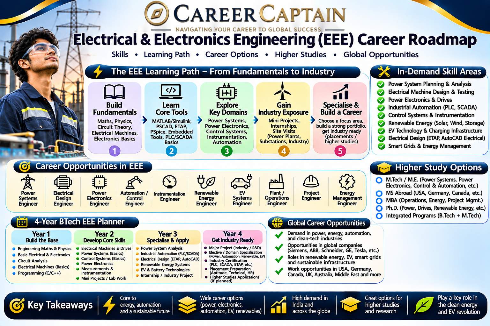

# Electrical and Electronics Engineering Career Roadmap in India

Electrical and Electronics Engineering (EEE) focuses on the generation, transmission, distribution, control, and utilisation of electrical energy, along with the design and application of electronic systems.

From power plants and electric vehicles to renewable energy, industrial automation, robotics, and smart grids, EEE professionals contribute to the technologies that power modern society.

This roadmap explains the subjects, career opportunities, technical skills, emerging technologies, and professional pathways available in Electrical and Electronics Engineering.

  

## 1. What Is Electrical and Electronics Engineering?

Electrical and Electronics Engineering combines electrical power engineering, electronics, control systems, and computing to develop technologies used in industries, infrastructure, transportation, and everyday applications.

The discipline covers:

- Electrical machines
- Power generation and distribution
- Electrical circuits
- Power electronics
- Control systems
- Embedded systems
- Digital electronics
- Renewable energy
- Industrial automation
- Electrical protection systems

EEE engineers work in power utilities, manufacturing companies, renewable energy organisations, electric vehicle industries, automation companies, research institutions, and technology businesses.

## 2. Subjects You Study in an EEE Degree

The curriculum varies between universities, but students generally study the following subjects.

**Engineering fundamentals**
- Engineering Mathematics
- Engineering Physics
- Engineering Chemistry
- Engineering Mechanics
- Basic Programming
- Engineering Drawing

**Core electrical subjects**
- Electrical Circuit Analysis
- Electrical Machines
- Power Systems
- Power System Protection
- Electrical Measurements and Instrumentation
- Electrical Machine Design
- Power Generation and Distribution
- High Voltage Engineering

**Electronics and control subjects**
- Analog Electronics
- Digital Electronics
- Power Electronics
- Control Systems
- Microprocessors and Microcontrollers
- Embedded Systems
- Electrical Drives
- Industrial Instrumentation

**Advanced subjects**
- Smart Grid Technologies
- Renewable Energy Systems
- Electric Vehicle Technology
- Power System Analysis
- Industrial Automation
- Artificial Intelligence Applications in Electrical Engineering

## 3. Major Career Paths in Electrical and Electronics Engineering

EEE graduates can pursue careers in energy, infrastructure, electronics, manufacturing, automation, transportation, and research.

### Power Systems Engineering

Work on electrical power generation, transmission, distribution, and grid management.

Potential roles:
- Power Systems Engineer
- Electrical Design Engineer
- Substation Engineer
- Transmission and Distribution Engineer
- Protection Engineer

### Electrical Machines and Drives

Design, test, maintain, and improve electric motors, generators, transformers, and industrial drives.

Potential roles:
- Electrical Machines Engineer
- Motor Design Engineer
- Electrical Maintenance Engineer
- Drives Engineer

### Power Electronics

Develop systems that convert and control electrical power for industrial, automotive, renewable energy, and consumer applications.

Potential roles:
- Power Electronics Engineer
- Converter Design Engineer
- Inverter Design Engineer
- Power Systems Hardware Engineer

### Renewable Energy Engineering

Work on solar, wind, energy storage, and other clean energy technologies.

Potential roles:
- Solar Design Engineer
- Renewable Energy Engineer
- Wind Energy Engineer
- Energy Storage Engineer

### Electric Vehicle Engineering

Develop electrical and electronic systems used in electric cars, buses, motorcycles, and other vehicles.

Potential roles:
- EV Electrical Engineer
- Battery Systems Engineer
- Motor Control Engineer
- Charging Infrastructure Engineer

### Industrial Automation and Control

Develop automated systems that improve industrial productivity, safety, and efficiency.

Potential roles:
- Automation Engineer
- Control Systems Engineer
- PLC Programmer
- Instrumentation Engineer
- Industrial Robotics Engineer

### Embedded Systems and Electronics

Develop hardware and software systems for electrical equipment, industrial devices, vehicles, and smart products.

Potential roles:
- Embedded Systems Engineer
- Electronics Design Engineer
- Firmware Engineer
- Hardware Testing Engineer

## 4. Emerging Technologies in EEE

Electrical and Electronics Engineering is evolving rapidly through electrification, digitalisation, renewable energy, and intelligent control.

Important emerging areas include:

- **Smart Grids:** Intelligent electrical networks that use digital monitoring and automation to improve grid efficiency.
- **Electric Vehicles:** Advanced electrical propulsion, charging systems, and vehicle electronics.
- **Battery Energy Storage:** Technologies that store electricity for electric vehicles and renewable energy systems.
- **Artificial Intelligence in Power Systems:** Predictive maintenance, load forecasting, and intelligent grid management.
- **Renewable Energy Integration:** Technologies that connect solar and wind power to electrical networks.
- **Wide Bandgap Semiconductors:** Silicon carbide and gallium nitride devices used in high-efficiency power conversion.
- **Wireless Power Transfer:** Technologies that transfer electrical energy without conventional wired connections.
- **Microgrids:** Localised electrical networks that can operate alongside or independently of the main grid.
- **Industrial Internet of Things:** Connected sensors and control systems used in industrial environments.
- **Solid-State Transformers:** Advanced power conversion technologies for future electrical networks.

## 5. Software and Technical Skills

EEE engineers need practical knowledge of electrical systems, electronics, simulation, programming, and industrial control.

**Electrical design and simulation**
- MATLAB
- Simulink
- ETAP
- PSCAD
- PowerWorld Simulator
- PSpice
- LTspice

**CAD and engineering design**
- AutoCAD Electrical
- EPLAN
- SolidWorks Electrical
- Electrical schematic design
- PCB design fundamentals

**Programming**
- C
- C++
- Python
- MATLAB programming
- Embedded C

**Industrial automation**
- PLC programming
- SCADA systems
- HMI development
- Industrial communication protocols
- Control system configuration

**Hardware and embedded technologies**
- Arduino
- ESP32
- STM32
- Microcontrollers
- Sensors and actuators
- PCB prototyping

**Professional knowledge**
- Electrical safety
- Earthing and protection
- Electrical standards
- Equipment testing
- Technical documentation
- Energy auditing fundamentals

## 6. Four-Year EEE Roadmap

A structured undergraduate plan helps students build strong engineering fundamentals and prepare for professional opportunities.

### First Year: Build the Foundation

Focus on:
- Mathematics, physics, and chemistry
- Engineering fundamentals
- Basic programming
- Electrical circuit fundamentals
- Communication skills

Suggested activities:
- Learn C or Python.
- Understand basic electrical components.
- Practise circuit analysis.
- Explore introductory electronics projects.

### Second Year: Develop Core Skills

Focus on:
- Electrical machines
- Analog and digital electronics
- Electrical measurements
- Electromagnetic fields
- Network analysis

Suggested activities:
- Build basic electronic circuits.
- Learn MATLAB fundamentals.
- Work with microcontrollers.
- Develop small electrical measurement projects.

### Third Year: Explore Specialisations

Focus on:
- Power systems
- Power electronics
- Control systems
- Electrical drives
- Embedded systems

Suggested activities:
- Learn an electrical simulation tool.
- Build a motor control project.
- Explore PLC and automation fundamentals.
- Apply for technical internships.
- Develop a specialised project portfolio.

### Fourth Year: Prepare for Professional Opportunities

Focus on:
- Final-year project
- Industrial applications
- Electrical system design
- Technical interviews
- Higher education planning

Suggested activities:
- Complete an industry-oriented project.
- Apply for internships and graduate positions.
- Prepare a technical resume.
- Explore GATE and other relevant examinations.
- Research postgraduate programmes and employers.

## 7. Important Projects to Build

Practical projects help students demonstrate engineering knowledge and problem-solving ability.

**Beginner projects**
- Automatic streetlight controller
- Digital energy meter prototype
- Temperature-controlled fan
- Basic solar-powered charging system
- Battery voltage monitoring system

**Intermediate projects**
- Smart energy monitoring system
- Automatic power factor correction prototype
- Solar tracking system
- BLDC motor speed control
- IoT-based electrical equipment monitoring

**Advanced projects**
- Smart microgrid simulation
- EV battery management system prototype
- Grid-connected solar inverter simulation
- Intelligent fault detection system
- Industrial automation and SCADA project
- AI-based electrical load forecasting

Electrical projects involving high voltage, mains electricity, batteries, or high-current equipment require suitable supervision, protective equipment, and laboratory safety procedures.

## 8. Internships and Industry Exposure

Internships help students understand power generation, electrical equipment, manufacturing, automation, and industrial operations.

Potential internship environments include:

- Power generation companies
- Electricity transmission and distribution utilities
- Electrical equipment manufacturers
- Renewable energy companies
- Electric vehicle manufacturers
- Battery technology companies
- Industrial automation companies
- Electronics manufacturers
- Research laboratories

Students should look for opportunities involving electrical design, testing, power systems, maintenance, automation, renewable energy, and embedded systems.

A strong internship portfolio should include project reports, circuit diagrams, simulation work, technical documentation, and relevant software skills.

## 9. Government and Public-Sector Opportunities in India

EEE graduates can explore opportunities in electricity utilities, energy companies, infrastructure, scientific research, and public-sector manufacturing.

Important organisations include:

- **NTPC:** Power generation and energy infrastructure.
- **Power Grid Corporation of India Limited (POWERGRID):** Electricity transmission and grid development.
- **NHPC:** Hydropower generation and related infrastructure.
- **BHEL:** Electrical equipment and power engineering.
- **Bharat Electronics Limited (BEL):** Electronics and defence technology.
- **Electrical utilities and state DISCOMs:** Electricity distribution and power infrastructure.
- **Indian Railways:** Electrical traction, power systems, and railway electrification.
- **DRDO:** Research involving electrical, electronics, and defence technologies.
- **ISRO:** Opportunities in electrical, electronics, instrumentation, and space systems.

Potential roles include graduate engineer trainee, electrical engineer, maintenance engineer, design engineer, technical officer, and research associate.

Recruitment requirements vary. Some organisations use GATE scores, while others conduct their own examinations or selection processes. Always verify the official recruitment notification.

## 10. Higher Education and Specialisation

Postgraduate education can help students develop advanced expertise in specialised electrical and electronics fields.

**Possible postgraduate specialisations**
- Power Systems Engineering
- Power Electronics
- Electrical Machines
- Control Systems
- Renewable Energy Engineering
- High Voltage Engineering
- Electric Vehicle Technology
- Embedded Systems
- Industrial Automation
- Smart Grid Technology
- Energy Systems Engineering
- Microelectronics

**International study destinations**
- Germany
- United States
- United Kingdom
- Canada
- Netherlands
- Sweden
- Switzerland
- Australia

Students considering international education should evaluate programme content, laboratory facilities, research opportunities, admission requirements, language requirements, tuition fees, and funding options.

A strong academic record, practical projects, internships, and relevant technical skills can strengthen postgraduate applications.

## 11. Salary and Career Growth

EEE salaries vary according to industry, employer, location, educational qualifications, technical specialisation, and experience.

Potential career progression:

| Career stage | Possible roles |
|---|---|
| Entry level | Graduate Engineer Trainee, Junior Electrical Engineer |
| Early career | Electrical Design Engineer, Power Systems Engineer, Automation Engineer |
| Experienced | Senior Electrical Engineer, Project Engineer, Protection Engineer |
| Advanced | Technical Lead, Engineering Manager, Power Systems Specialist |
| Leadership | Plant Head, Project Director, Engineering Director |

Opportunities differ across utilities, renewable energy, automotive, manufacturing, electronics, and industrial automation.

Students should evaluate current job postings and employer requirements rather than relying on fixed salary expectations.

## 12. Essential Soft Skills

EEE professionals work with complex electrical infrastructure, industrial equipment, multidisciplinary teams, and safety-critical systems.

Important skills include:

- Analytical thinking
- Problem-solving
- Attention to detail
- Communication
- Teamwork
- Decision-making
- Technical documentation
- Project management
- Safety awareness
- Adaptability
- Leadership

The ability to communicate with technicians, operations teams, project managers, and other engineering disciplines is essential.

## 13. Common Mistakes to Avoid

- Ignoring fundamental electrical circuit concepts.
- Memorising formulas without understanding their applications.
- Neglecting electrical machines and power systems.
- Avoiding practical laboratory work.
- Learning simulation software without understanding engineering principles.
- Ignoring programming and embedded systems.
- Focusing only on government jobs and overlooking private-sector opportunities.
- Neglecting electrical safety.
- Avoiding internships and industry exposure.
- Choosing a postgraduate specialisation without researching career opportunities.

## 14. How to Choose Your EEE Specialisation

Your interests and strengths can help you identify an appropriate career direction.

| Your interest | Possible specialisation |
|---|---|
| Power generation and transmission | Power Systems |
| Motors and generators | Electrical Machines |
| Circuits and converters | Power Electronics |
| Solar and wind energy | Renewable Energy |
| Electric vehicles | EV Technology |
| Programming and hardware | Embedded Systems |
| Industrial machinery | Automation and Control |
| Sensors and measurement | Instrumentation |
| Electrical infrastructure | Electrical Design |
| Research and advanced technology | Energy Systems and Electronics |

Explore different areas through electives, projects, internships, and technical workshops before choosing a long-term specialisation.

## 15. Useful Learning and Official Resources

The following resources can help students develop their engineering knowledge and explore professional opportunities.

**Learning platforms**
- [NPTEL](https://nptel.ac.in/) — Electrical engineering and electronics courses.
- [SWAYAM](https://swayam.gov.in/) — Online academic programmes.
- [MIT OpenCourseWare](https://ocw.mit.edu/) — University-level engineering learning materials.
- [Coursera](https://www.coursera.org/) — Electrical engineering and energy courses.
- [edX](https://www.edx.org/) — Engineering and technology programmes.

**Technical and professional resources**
- [IEEE](https://www.ieee.org/) — Electrical, electronics, and computing research.
- [IEEE Power & Energy Society](https://ieee-pes.org/) — Power engineering resources.
- [Bureau of Indian Standards](https://www.bis.gov.in/) — Indian technical standards.
- [Ministry of Power](https://powermin.gov.in/) — Indian power sector information.
- [Central Electricity Authority](https://cea.nic.in/) — Electricity planning, statistics, and technical information.
- [MNRE](https://mnre.gov.in/) — Renewable energy programmes and information.
- [BHEL](https://www.bhel.com/) — Power and industrial engineering information.
- [POWERGRID](https://www.powergrid.in/) — Transmission infrastructure and career information.

## 16. Final Thoughts: Building a Career in EEE

Electrical and Electronics Engineering offers opportunities across power generation, renewable energy, electric vehicles, industrial automation, electronics, infrastructure, and advanced research.

Students who develop strong fundamentals in electrical systems, electronics, mathematics, programming, and practical engineering can build versatile careers.

Focus on understanding real-world electrical systems, completing meaningful projects, learning relevant software, gaining industry exposure, and developing a specialisation aligned with your interests.

### How Career Captain Can Help

Choosing an engineering branch is only the beginning of a career journey. Understanding your interests, aptitude, strengths, and long-term goals can help you make informed academic and professional decisions.

Career Captain Global Solutions supports students through career counselling, psychometric assessments, stream and course selection, career exploration, and study-abroad guidance.

Explore career guidance and planning resources at [Career Captain](https://careercaptain.co.in/).

---

**Educational Disclaimer:** This roadmap is intended for educational and career-awareness purposes. Course structures, eligibility criteria, recruitment requirements, and employment opportunities may change. Students should verify current information with universities, employers, and official organisations.

**License:** This educational resource is shared under the Creative Commons Attribution 4.0 International (CC BY 4.0) license. Please credit Career Captain Global Solutions when sharing or adapting this material.

---

## Plan your engineering pathway with Career Captain

Choosing an engineering branch is only one part of the decision. Students should also consider their interests, strengths, preferred work and future study options. Career Captain offers personalised career counselling and assessment to support informed decisions.

- [Career counselling in Hyderabad](https://careercaptain.co.in/career-counselling-hyderabad)
- [Psychometric career assessment](https://careercaptain.co.in/psychometric-test-hyderabad)
- [Online career counselling](https://careercaptain.co.in/online-career-counselling)

[Visit Career Captain](https://careercaptain.co.in/) · [WhatsApp Career Captain](https://wa.me/919849488838)
