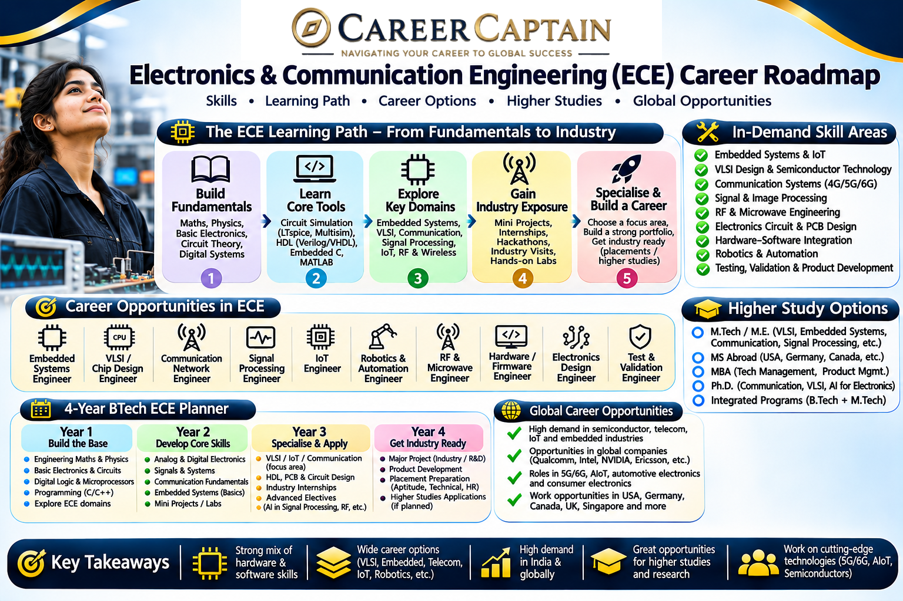

Electronics and Communication Engineering (ECE) is a multidisciplinary engineering branch that combines electronics, electrical systems, communication technologies, embedded systems and computing.

ECE engineers contribute to technologies used in smartphones, computers, satellites, automobiles, medical devices, telecommunications, robotics, defence systems and the Internet of Things (IoT).

With developments in semiconductor manufacturing, 5G and future communication networks, artificial intelligence, embedded computing and connected devices, ECE offers opportunities across both traditional electronics industries and emerging technology sectors.

This roadmap explains the subjects, career paths, technical skills, specialisations and preparation strategies that ECE students can explore.

---

  

## 1. What Is Electronics and Communication Engineering?

ECE focuses on the design, development, testing and maintenance of electronic circuits, communication systems and intelligent electronic devices.

It combines concepts from:

- Electronic circuit design
- Digital electronics
- Analog electronics
- Signals and systems
- Communication engineering
- Microprocessors and microcontrollers
- Semiconductor devices
- Embedded systems
- Computer networks
- Control systems
- Signal processing

ECE graduates can work in core electronics companies, semiconductor organisations, telecommunications, software and IT, automotive technology, aerospace, research and other industries.

## 2. What Do You Study in an ECE Degree?

The exact curriculum varies by university, but most BTech ECE programmes cover the following areas.

### Core subjects

| Subject | What You Learn |
|---|---|
| Engineering Mathematics | Mathematical methods used in engineering |
| Basic Electrical Engineering | Electrical circuits and systems |
| Electronic Devices | Diodes, transistors and semiconductor fundamentals |
| Analog Electronics | Amplifiers and analog circuits |
| Digital Electronics | Logic gates, digital circuits and sequential systems |
| Network Theory | Analysis of electrical networks |
| Signals and Systems | Representation and analysis of signals |
| Electromagnetic Theory | Electromagnetic fields and waves |
| Control Systems | Feedback and system control |
| Analog Communication | Modulation and analog transmission |
| Digital Communication | Digital signal transmission |
| Microprocessors | Processor architecture and programming |
| Microcontrollers | Embedded hardware and control |
| VLSI Design | Design of integrated circuits |
| Digital Signal Processing | Processing digital signals |
| Computer Networks | Communication between connected systems |

### Why these subjects matter

These subjects create the foundation for careers in semiconductor design, embedded systems, telecommunications, signal processing, networking, robotics and electronic product development.

Students should focus on understanding circuit behaviour, mathematical concepts and practical applications.

## 3. Major Career Paths in ECE

### 3.1 Semiconductor and VLSI Design

Semiconductor technology is fundamental to modern electronics. Integrated circuits are used in processors, memory devices, smartphones, vehicles and industrial equipment.

ECE graduates can explore different stages of chip development.

Areas include:

- Digital design
- Analog and mixed-signal design
- RTL design
- Functional verification
- Physical design
- Design for test
- Semiconductor testing
- Chip architecture

Useful skills:

- Digital electronics
- Verilog or SystemVerilog
- CMOS fundamentals
- Computer architecture
- Timing analysis
- Semiconductor device physics
- EDA tools

Potential roles:

- VLSI Design Engineer
- RTL Design Engineer
- Design Verification Engineer
- Physical Design Engineer
- Analog Design Engineer
- Semiconductor Test Engineer

Specialised semiconductor roles may require strong fundamentals and additional training.

### 3.2 Embedded Systems

Embedded systems combine hardware and software to perform dedicated functions inside electronic products.

Examples include automotive controllers, smart appliances, medical devices, industrial machines and consumer electronics.

Important skills:

- C and C++
- Microcontrollers
- Microprocessors
- Embedded C
- Sensors and actuators
- Communication protocols
- Real-time operating systems
- Hardware debugging

Potential roles:

- Embedded Software Engineer
- Embedded Systems Engineer
- Firmware Engineer
- Hardware Design Engineer
- Embedded Testing Engineer

### 3.3 Telecommunications and Communication Engineering

Communication engineers work on technologies that transmit information through wired and wireless systems.

Career areas include:

- Mobile networks
- 4G and 5G systems
- Optical communication
- Satellite communication
- RF engineering
- Antenna systems
- Wireless networks
- Network optimisation

Useful skills:

- Communication theory
- Digital signal processing
- RF fundamentals
- Antenna theory
- Networking
- MATLAB
- Communication system simulation

Potential roles:

- RF Engineer
- Telecom Engineer
- Network Planning Engineer
- Wireless Systems Engineer
- Communication Systems Engineer

### 3.4 Internet of Things (IoT)

IoT connects physical devices to networks so they can collect, exchange and process information.

Examples include smart homes, industrial monitoring, connected vehicles, agriculture monitoring and healthcare devices.

Useful skills:

- Microcontrollers
- Sensors
- Embedded programming
- Wi-Fi and Bluetooth
- MQTT and communication protocols
- Cloud fundamentals
- Python
- Basic cybersecurity

Potential roles:

- IoT Engineer
- IoT Developer
- Embedded IoT Engineer
- Industrial IoT Engineer
- IoT Solutions Engineer

### 3.5 Hardware Design and Testing

Hardware engineers develop and test electronic circuits, boards and systems.

Typical work includes:

- Circuit design
- Schematic development
- PCB layout
- Component selection
- Prototype development
- Testing and debugging
- Hardware validation

Useful tools and skills:

- Electronic circuit fundamentals
- PCB design software
- Oscilloscopes
- Multimeters
- Logic analysers
- Soldering and prototyping
- Altium Designer or KiCad

Potential roles:

- Hardware Design Engineer
- PCB Design Engineer
- Electronics Engineer
- Hardware Validation Engineer
- Product Development Engineer

### 3.6 Signal Processing

Signal processing involves analysing and transforming signals such as audio, images, video, radar data and sensor measurements.

Applications include:

- Speech recognition
- Image processing
- Medical imaging
- Radar systems
- Audio technology
- Wireless communication
- Computer vision

Useful skills:

- Signals and Systems
- Digital Signal Processing
- Probability and mathematics
- MATLAB
- Python
- NumPy and SciPy
- Image processing fundamentals

Potential roles:

- Signal Processing Engineer
- DSP Engineer
- Image Processing Engineer
- Radar Systems Engineer
- Audio Processing Engineer

### 3.7 Robotics and Automation

ECE engineers contribute to the electronic and control systems that enable robots and automated machines to operate.

Areas include:

- Sensors
- Motor control
- Embedded systems
- Microcontrollers
- Control systems
- Machine vision
- Industrial automation

Potential roles:

- Robotics Engineer
- Automation Engineer
- Controls Engineer
- Embedded Robotics Engineer
- Mechatronics Engineer

### 3.8 Automotive Electronics

Modern vehicles use complex electronic systems for safety, performance, communication and control.

Career areas include:

- Electronic control units
- Vehicle communication networks
- Battery management systems
- Advanced driver assistance systems
- Automotive sensors
- Electric vehicle electronics
- Vehicle testing

Potential roles:

- Automotive Electronics Engineer
- ECU Developer
- Embedded Automotive Engineer
- BMS Engineer
- Vehicle Electronics Testing Engineer

Automotive roles may require familiarity with industry-specific standards, tools and development processes.

### 3.9 Aerospace, Defence and Space Technology

ECE graduates may work on specialised electronic systems used in aircraft, satellites, radar, navigation and defence applications.

Areas include:

- Radar systems
- Avionics
- Satellite communication
- Navigation systems
- RF and microwave engineering
- Electronic instrumentation
- Signal processing

Potential roles:

- Avionics Engineer
- Radar Systems Engineer
- RF Engineer
- Satellite Communication Engineer
- Electronics Research Engineer

Some roles have additional eligibility, security or recruitment requirements.

---

## 4. Software and IT Careers After ECE

ECE students are not restricted to core electronics roles.

Their mathematical, analytical and programming foundations can also support careers in software and IT.

Possible paths include:

- Software Development
- Full-Stack Development
- Data Analytics
- Artificial Intelligence and Machine Learning
- Cybersecurity
- Cloud Computing
- DevOps
- Network Engineering
- Software Testing
- Technical Consulting

Useful skills depend on the selected role.

For software development, students can learn programming, data structures, algorithms, databases and software development practices.

For data and AI careers, mathematics, statistics, Python and machine learning fundamentals are useful.

For cybersecurity and networking, students should understand operating systems, networks, security fundamentals and practical tools.

## 5. Emerging Technologies and Future Opportunities

ECE is closely connected to several developing technology areas.

| Technology | ECE Contribution |
|---|---|
| Semiconductor Manufacturing | Chip design, testing and device technology |
| 5G and Future Networks | Wireless communication and network systems |
| Artificial Intelligence Hardware | Accelerators and specialised computing hardware |
| Electric Vehicles | Battery electronics, motor controllers and sensors |
| Autonomous Systems | Radar, sensors, communication and control |
| Internet of Things | Connected electronic devices |
| Edge Computing | Local processing in connected devices |
| Quantum Technology | Specialised electronic and control systems |
| Medical Electronics | Diagnostic and monitoring equipment |
| Satellite Technology | Communication, navigation and electronic systems |

These areas may require specialised study, practical experience or postgraduate education.

## 6. Important Programming Languages and Technical Tools

ECE students should choose tools according to their intended career path.

### Programming languages

- C
- C++
- Python
- MATLAB
- Verilog
- SystemVerilog

### Circuit and PCB design

- KiCad
- Altium Designer
- OrCAD
- LTspice
- Proteus

### Semiconductor and VLSI tools

- Cadence tools
- Synopsys tools
- Siemens EDA tools

Access to professional EDA software may depend on university facilities, employer licences or educational programmes.

### Embedded systems

- Arduino
- ESP32
- STM32
- Raspberry Pi
- Keil
- PlatformIO

### Simulation and signal processing

- MATLAB
- Simulink
- GNU Radio
- Python scientific libraries

### Networking and communication

- Cisco Packet Tracer
- Wireshark
- Network simulation tools

**Important:** Do not try to learn every tool at once. Select one career direction, understand its fundamentals and build relevant projects.

## 7. A Four-Year ECE Career Roadmap

### First Year: Build the Foundation

Focus on:

- Engineering mathematics
- Engineering physics
- Basic electrical engineering
- Basic programming
- Engineering graphics
- Fundamental electronics concepts

Recommended actions:

1. Develop mathematical and analytical skills.
2. Learn basic circuit concepts.
3. Start programming with C or Python.
4. Explore simple electronic components.
5. Participate in technical clubs and workshops.

**Goal:** Understand the fundamentals and explore the different areas of ECE.

### Second Year: Develop Core Electronics Skills

Focus on:

- Electronic devices
- Analog electronics
- Digital electronics
- Network theory
- Signals and systems
- Microprocessors

Recommended actions:

1. Practise circuit analysis.
2. Learn a circuit simulation tool.
3. Build small electronics projects.
4. Understand microcontrollers.
5. Explore PCB design.
6. Improve programming skills.

**Goal:** Connect theoretical subjects with practical electronic systems.

### Third Year: Choose a Specialisation

Explore areas such as:

- VLSI and semiconductor design
- Embedded systems
- Telecommunications
- IoT
- Signal processing
- Robotics
- Automotive electronics
- Software development

Recommended actions:

1. Select a specialisation based on interest and aptitude.
2. Learn relevant tools and programming languages.
3. Complete two or three substantial projects.
4. Apply for internships.
5. Participate in technical competitions.
6. Build a technical portfolio.

**Goal:** Develop demonstrable skills for your chosen career direction.

### Fourth Year: Prepare for Employment or Higher Studies

Focus on:

- Final-year project
- Internship experience
- Core subject revision
- Technical interview preparation
- Resume development
- Placement preparation
- Higher education applications, if relevant

Explore:

- Core electronics recruitment
- Semiconductor companies
- Embedded systems companies
- Telecom organisations
- Software and IT roles
- Government and research opportunities
- GATE and postgraduate programmes
- Study-abroad options

**Goal:** Graduate with a clear career direction and evidence of your capabilities.

---

## 8. Projects That Can Strengthen Your ECE Resume

Projects help demonstrate practical understanding.

### Beginner-level projects

- Automatic street light
- Digital temperature monitor
- Basic sensor-based alarm
- LED control using a microcontroller
- Simple digital logic circuit
- Basic power supply circuit

### Intermediate projects

- Smart home automation
- IoT-based environmental monitoring
- Wireless data transmission system
- Digital frequency counter
- Bluetooth-controlled robot
- PCB-based electronic prototype

### Advanced projects

- FPGA-based digital system
- Smart energy monitoring system
- Real-time embedded control system
- Software-defined radio experiment
- Computer vision-based embedded application
- Autonomous robotic system
- Battery monitoring and management prototype

A good project should include:

- Problem statement
- System architecture
- Circuit diagram or block diagram
- Component selection
- Software and hardware implementation
- Testing methodology
- Results
- Limitations and future improvements

Never list a project on your resume unless you understand its design and can explain your contribution.

## 9. Internships and Industry Exposure

Internships help students understand how electronics and communication technologies are developed and deployed.

Explore opportunities in:

- Semiconductor design
- Electronics manufacturing
- Embedded systems
- Telecommunications
- Automotive electronics
- Robotics and automation
- Aerospace and defence
- Research laboratories
- Software and IT

Students can also seek faculty-led research projects, technical workshops, industrial visits and supervised practical training.

Verify the organisation, internship responsibilities, fees and certificate claims before enrolling.

## 10. Government and Public-Sector Career Opportunities

ECE graduates may explore technical opportunities in government organisations and public-sector institutions.

Areas include:

- Space research
- Defence electronics
- Telecommunications
- Electronics manufacturing
- Railways
- Public-sector engineering
- Scientific research
- Technical services

Organisations worth researching include:

- ISRO
- DRDO
- Bharat Electronics Limited (BEL)
- Electronics Corporation of India Limited (ECIL)
- Indian Railways
- Centre for Development of Telematics (C-DOT)

Depending on the role, selection may involve GATE, competitive examinations, interviews, technical tests or organisation-specific recruitment processes.

Eligibility and recruitment routes vary. Always consult the latest official notification.

## 11. Higher Education After ECE

### Postgraduate options in India

Students may consider:

- MTech in VLSI Design
- MTech in Embedded Systems
- MTech in Communication Systems
- MTech in Signal Processing
- MTech in Microelectronics
- MTech in RF and Microwave Engineering
- MTech in Computer Engineering
- MBA
- Research programmes

GATE is an important entrance examination for many postgraduate engineering programmes and certain recruitment processes. Requirements vary by institution.

### Study-abroad specialisations

Potential areas include:

- Microelectronics
- Semiconductor Engineering
- Embedded Systems
- Wireless Communication
- Robotics
- Signal Processing
- Computer Engineering
- Autonomous Systems
- Photonics
- Electronic Systems Design

Research university-specific admission requirements, academic prerequisites, language tests, tuition fees, scholarships and visa regulations.

## 12. Salary and Career Growth

ECE salaries vary according to:

- Employer and industry
- Location
- Technical specialisation
- Practical skills
- Internship experience
- Academic background
- Project quality
- Interview performance

Semiconductor design, embedded systems, telecommunications, software and research roles have different skill requirements and compensation structures.

Students should evaluate job responsibilities, learning opportunities, long-term growth and personal interest rather than relying only on salary claims.

## 13. Essential Skills Beyond Technical Knowledge

Successful ECE professionals also need:

- Analytical thinking
- Problem-solving
- Circuit debugging
- Programming logic
- Technical documentation
- Communication
- Teamwork
- Project management
- Presentation skills
- Continuous learning

The ability to explain how a circuit, system or software component works is valuable in technical interviews and professional engineering environments.

## 14. Common Mistakes ECE Students Should Avoid

1. Ignoring core electronics subjects.
2. Learning programming without building practical applications.
3. Collecting certificates without developing projects.
4. Avoiding laboratory work and circuit debugging.
5. Trying to learn every specialisation simultaneously.
6. Waiting until the final year to look for internships.
7. Assuming ECE students can only work in telecommunications.
8. Ignoring semiconductor and embedded systems opportunities.
9. Preparing for placements without revising fundamental concepts.
10. Copying projects without understanding the underlying design.

## 15. How to Choose the Right ECE Specialisation

| If You Enjoy... | Explore... |
|---|---|
| Designing electronic chips | VLSI and Semiconductor Design |
| Working with circuits and devices | Hardware Design |
| Combining hardware and programming | Embedded Systems |
| Wireless networks and communication | Telecommunications |
| Sensors and connected devices | Internet of Things |
| Mathematics and signal analysis | Signal Processing |
| Robots and intelligent machines | Robotics and Automation |
| Cars and electronic control systems | Automotive Electronics |
| Programming and software products | Software Development |
| Networks and information security | Networking and Cybersecurity |

Use projects, internships, workshops and discussions with professionals to understand what each field involves before choosing a specialisation.

## 16. Useful Learning and Official Resources

- [AICTE](https://www.aicte-india.org/) — Technical education information.
- [SWAYAM](https://swayam.gov.in/) — Online learning programmes.
- [NPTEL](https://nptel.ac.in/) — Engineering and technology courses.
- [GATE](https://gate2026.iitg.ac.in/) — Examination information; consult the relevant year's official website.
- [ISRO](https://www.isro.gov.in/) — Space research and career information.
- [DRDO](https://www.drdo.gov.in/) — Defence research and development.
- [Bharat Electronics Limited](https://bel-india.in/) — Electronics and defence systems.
- [Electronics Corporation of India Limited](https://www.ecil.co.in/) — Electronics and strategic technology.
- [KiCad](https://www.kicad.org/) — Open-source electronic design automation.
- [Arduino](https://www.arduino.cc/) — Electronics prototyping and embedded learning.
- [MATLAB](https://www.mathworks.com/products/matlab.html) — Technical computing and simulation.

Check course availability, software licensing and recruitment requirements directly with the relevant organisations.

---

## 17. Final Thoughts: Build Your ECE Career with a Plan

Electronics and Communication Engineering offers opportunities across semiconductor technology, embedded systems, telecommunications, robotics, automotive electronics, aerospace, software and research.

The strongest preparation combines core subject knowledge, practical projects, relevant tools, internships and a clear understanding of industry requirements.

Your degree provides the foundation. Your skills, experience and decisions shape your career.

### Explore Career Guidance with Career Captain

Choosing an ECE specialisation, identifying suitable higher education options and understanding emerging technology careers can be challenging.

**Career Captain Global Solutions** provides career counselling, career assessments, course and college planning, and study-abroad guidance to help students and young professionals make informed decisions.

Website: https://careercaptain.co.in?utm_source=career_roadmaps_india&utm_medium=referral&utm_campaign=github_career_roadmaps&utm_content=electronics-and-communication-engineering-career-roadmap

*Educational disclaimer: This roadmap is intended for general career awareness. Course structures, eligibility criteria, recruitment processes and industry requirements may change. Verify important decisions with official institutions and authorities.*

---

**Attribution and Licence**

This guide is part of the Career Roadmaps India open educational initiative by Career Captain Global Solutions.

Licensed under the Creative Commons Attribution 4.0 International (CC BY 4.0) licence. You may share and adapt this material with appropriate attribution and a link to the licence.

Source: https://github.com/Career-Captain-Global-Solutions/Career-Roadmaps-India

---

## Plan your engineering pathway with Career Captain

Choosing an engineering branch is only one part of the decision. Students should also consider their interests, strengths, preferred work and future study options. Career Captain offers personalised career counselling and assessment to support informed decisions.

- [Career counselling in Hyderabad](https://careercaptain.co.in/career-counsellor-near-me?utm_source=career_roadmaps_india&utm_medium=referral&utm_campaign=github_career_roadmaps&utm_content=electronics-and-communication-engineering-career-roadmap)
- [Psychometric career assessment](https://guide.careercaptain.co.in/guides/psychometric-career-assessment/?utm_source=career_roadmaps_india&utm_medium=referral&utm_campaign=github_career_roadmaps&utm_content=electronics-and-communication-engineering-career-roadmap)
- [Online career counselling](https://careercaptain.co.in/areas-we-serve?utm_source=career_roadmaps_india&utm_medium=referral&utm_campaign=github_career_roadmaps&utm_content=electronics-and-communication-engineering-career-roadmap)

[Visit Career Captain](https://careercaptain.co.in?utm_source=career_roadmaps_india&utm_medium=referral&utm_campaign=github_career_roadmaps&utm_content=electronics-and-communication-engineering-career-roadmap) · [WhatsApp Career Captain](https://wa.me/919849488838?text=Hi%20Career%20Captain%2C%20I%20found%20your%20electronics%20and%20communication%20engineering%20career%20roadmap%20guide%20in%20Career%20Roadmaps%20India.%20I%20would%20like%20to%20know%20more%20about%20career%20guidance.%20Source%3A%20electronics-and-communication-engineering-career-roadmap.)
