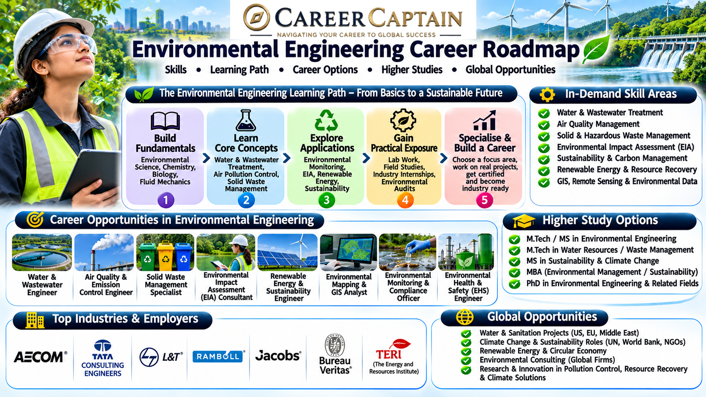

Environmental Engineering applies engineering and scientific principles to protect the environment, manage natural resources, control pollution, and develop sustainable technologies.

From designing wastewater treatment plants and improving air quality to managing industrial waste and developing renewable solutions, environmental engineers play an important role in building a cleaner and more sustainable future.

This roadmap explains the subjects, career opportunities, technical skills, emerging technologies, and professional pathways available in Environmental Engineering.

  

## 1. What Is Environmental Engineering?

Environmental Engineering combines engineering, chemistry, biology, geology, and environmental science to solve problems affecting air, water, soil, and ecosystems.

It focuses on designing systems and technologies that reduce environmental damage while supporting human development.

Major areas include:

- Water supply and treatment
- Wastewater treatment
- Air pollution control
- Solid waste management
- Hazardous waste management
- Environmental impact assessment
- Environmental monitoring
- Sustainable infrastructure
- Resource recovery
- Climate change mitigation

Environmental engineers work with industries, government agencies, consulting firms, research organisations, infrastructure developers, and environmental technology companies.

## 2. Subjects You Study in an Environmental Engineering Degree

The curriculum varies between universities, but students generally study the following subjects.

**Engineering fundamentals**
- Engineering Mathematics
- Engineering Physics
- Engineering Chemistry
- Engineering Mechanics
- Basic Electrical and Electronics Engineering
- Computer Programming

**Environmental science fundamentals**
- Environmental Chemistry
- Environmental Biology
- Ecology
- Microbiology
- Geology and Soil Science
- Environmental Science

**Core environmental engineering subjects**
- Water Supply Engineering
- Wastewater Engineering
- Air Pollution Control Engineering
- Solid Waste Management
- Environmental Pollution and Control
- Hydrology and Water Resources
- Environmental Microbiology
- Environmental Engineering Laboratory
- Environmental Impact Assessment
- Industrial Waste Management

**Advanced subjects**
- Environmental Modelling
- Climate Change and Sustainability
- Groundwater Engineering
- Industrial Ecology
- Renewable Energy Systems
- Environmental Risk Assessment
- Resource Recovery and Circular Economy

## 3. Major Career Paths in Environmental Engineering

Environmental Engineering offers opportunities across infrastructure, manufacturing, consulting, government, research, and sustainability.

### Water and Wastewater Engineering

Design and operate systems that provide clean water and treat wastewater from residential, commercial, and industrial sources.

Potential roles:
- Water Treatment Engineer
- Wastewater Treatment Engineer
- Water Resources Engineer
- Process Design Engineer
- Water Quality Analyst

### Air Pollution Control

Develop technologies and systems to monitor and reduce air pollution from industries, vehicles, and other sources.

Potential roles:
- Air Quality Engineer
- Pollution Control Engineer
- Environmental Monitoring Specialist
- Emissions Control Engineer

### Solid and Hazardous Waste Management

Develop systems for waste collection, segregation, treatment, recycling, disposal, and resource recovery.

Potential roles:
- Waste Management Engineer
- Solid Waste Engineer
- Recycling Process Engineer
- Hazardous Waste Specialist

### Environmental Consulting

Help organisations evaluate environmental risks, comply with regulations, and develop sustainable operating practices.

Potential roles:
- Environmental Consultant
- Environmental Impact Assessment Specialist
- Environmental Compliance Engineer
- Sustainability Consultant

### Industrial Environmental Management

Work with manufacturing and industrial facilities to reduce pollution, improve resource efficiency, and manage environmental performance.

Potential roles:
- Environmental Engineer
- EHS Engineer
- Environmental Compliance Specialist
- Industrial Wastewater Engineer

### Renewable Energy and Sustainability

Contribute to clean energy, carbon reduction, resource efficiency, and sustainable infrastructure projects.

Potential roles:
- Sustainability Engineer
- Renewable Energy Project Engineer
- Carbon Management Analyst
- Energy and Environment Consultant

### Research and Development

Develop new technologies for pollution control, environmental monitoring, water purification, and sustainable materials.

Potential roles:
- Environmental Research Associate
- Research Scientist
- Environmental Technology Developer

## 4. Emerging Technologies in Environmental Engineering

Environmental Engineering is evolving through digital monitoring, automation, advanced materials, and sustainable technologies.

Important emerging areas include:

- **Artificial Intelligence in Environmental Monitoring:** Using machine learning to analyse pollution data and predict environmental risks.
- **Advanced Water Purification:** Membrane filtration, advanced oxidation, and other technologies for improved water treatment.
- **Smart Water Networks:** Using connected sensors to detect leakage and monitor water quality.
- **Carbon Capture and Utilisation:** Capturing carbon dioxide and exploring ways to store or convert it into useful products.
- **Waste-to-Energy:** Recovering energy from suitable waste streams through controlled technologies.
- **Bioremediation:** Using microorganisms and biological processes to help remove environmental contaminants.
- **Remote Sensing and GIS:** Monitoring land use, pollution, vegetation, and environmental changes.
- **Circular Economy:** Designing systems that minimise waste and maximise reuse and recycling.
- **Green Infrastructure:** Developing sustainable urban drainage, green buildings, and nature-based solutions.
- **Digital Environmental Twins:** Creating digital models to simulate and monitor environmental systems.

## 5. Software and Technical Skills

Environmental engineers need a combination of scientific knowledge, engineering calculations, environmental modelling, and data analysis.

**GIS and remote sensing**
- ArcGIS
- QGIS
- Google Earth Engine
- Remote sensing fundamentals

**Engineering and simulation**
- AutoCAD
- Civil 3D
- EPANET
- SWMM
- HEC-RAS
- MATLAB

**Programming and data analysis**
- Python
- R
- Excel
- SQL fundamentals
- Statistical analysis

**Environmental modelling**
- Air pollution dispersion modelling
- Hydrological modelling
- Water quality modelling
- Environmental risk assessment
- Geographic data analysis

**Laboratory and field skills**
- Water quality testing
- Soil analysis
- Air quality monitoring
- Environmental sampling
- Laboratory instrumentation
- Field data collection

**Professional knowledge**
- Environmental regulations
- Environmental Impact Assessment
- Environmental Management Systems
- Occupational health and safety
- Technical reporting
- Sustainability assessment

## 6. Four-Year Environmental Engineering Roadmap

A structured undergraduate plan helps students develop technical knowledge and prepare for environmental engineering careers.

### First Year: Build the Foundation

Focus on:
- Mathematics, physics, and chemistry
- Engineering fundamentals
- Introduction to environmental science
- Basic programming
- Communication skills

Suggested activities:
- Learn Python fundamentals.
- Understand ecosystems and pollution.
- Explore water and air quality concepts.
- Develop basic scientific data analysis skills.

### Second Year: Develop Core Skills

Focus on:
- Environmental chemistry
- Environmental microbiology
- Fluid mechanics
- Hydrology
- Water supply engineering
- Environmental laboratory methods

Suggested activities:
- Learn basic water quality testing.
- Explore GIS fundamentals.
- Practise engineering calculations.
- Complete small environmental monitoring projects.

### Third Year: Explore Specialisations

Focus on:
- Wastewater engineering
- Air pollution control
- Solid waste management
- Environmental modelling
- Environmental impact assessment

Suggested activities:
- Learn QGIS or ArcGIS.
- Explore EPANET or SWMM.
- Complete a pollution monitoring project.
- Apply for internships.
- Develop technical reporting skills.

### Fourth Year: Prepare for Professional Opportunities

Focus on:
- Final-year project
- Environmental system design
- Industrial applications
- Technical interviews
- Higher education planning

Suggested activities:
- Complete an industry-oriented environmental project.
- Apply for internships and graduate positions.
- Build a technical portfolio.
- Explore GATE and other relevant examinations.
- Research postgraduate programmes and employers.

## 7. Important Projects to Build

Practical projects help students demonstrate engineering knowledge and problem-solving ability.

**Beginner projects**
- Water quality analysis
- Rainwater harvesting system design
- Household waste segregation study
- Air quality data analysis
- Basic environmental noise monitoring

**Intermediate projects**
- Wastewater treatment process design
- Solar-powered water purification prototype
- GIS-based land-use analysis
- Rainwater harvesting assessment
- Industrial wastewater characterisation

**Advanced projects**
- Smart water quality monitoring system
- AI-based air pollution prediction
- Waste-to-energy process analysis
- GIS-based environmental risk mapping
- Industrial effluent treatment simulation
- Urban stormwater management modelling

Projects involving environmental sampling, chemicals, wastewater, or potentially hazardous materials must follow suitable safety procedures and institutional supervision.

## 8. Internships and Industry Exposure

Internships provide exposure to environmental monitoring, pollution control, infrastructure, industrial operations, and sustainability projects.

Potential internship environments include:

- Environmental consulting firms
- Water treatment companies
- Wastewater treatment facilities
- Pollution control organisations
- Municipal corporations
- Industrial manufacturing companies
- Renewable energy companies
- Environmental research laboratories
- Infrastructure development companies

Students should look for opportunities involving environmental testing, water treatment, waste management, GIS, pollution monitoring, and environmental compliance.

A useful internship portfolio should contain project reports, technical calculations, field observations, laboratory experience, and relevant software skills.

## 9. Government and Public-Sector Opportunities in India

Environmental engineers can explore opportunities in pollution control, water management, urban infrastructure, environmental research, and public-sector organisations.

Important organisations include:

- **Central Pollution Control Board (CPCB):** National-level pollution monitoring and environmental regulation.
- **State Pollution Control Boards:** State-level environmental monitoring and regulatory functions.
- **Ministry of Environment, Forest and Climate Change (MoEFCC):** Environmental policy and regulatory information.
- **Central Ground Water Board (CGWB):** Groundwater assessment and management.
- **Central Water Commission (CWC):** Water resources planning and technical functions.
- **National Environmental Engineering Research Institute (NEERI):** Environmental science and engineering research.
- **National Mission for Clean Ganga (NMCG):** River conservation and pollution reduction programmes.
- **Municipal corporations:** Water supply, sewage, waste management, and urban environmental services.
- **CSIR laboratories:** Research in environmental science and engineering.

Potential roles include environmental engineer, project associate, scientific assistant, research associate, water quality analyst, and environmental consultant.

Eligibility, qualifications, and recruitment processes vary. Check official notifications before applying.

## 10. Higher Education and Specialisation

Postgraduate education can help students develop advanced expertise in environmental systems, research, sustainability, and specialised engineering applications.

**Possible postgraduate specialisations**
- Environmental Engineering
- Environmental Science
- Water Resources Engineering
- Water and Wastewater Treatment
- Environmental Management
- Climate Science
- Air Pollution Control
- Solid Waste Management
- Environmental Biotechnology
- Sustainable Development
- Environmental Modelling
- Hydrology and Water Resources

**International study destinations**
- Germany
- United States
- United Kingdom
- Canada
- Netherlands
- Sweden
- Denmark
- Australia

Students considering international education should evaluate programme structure, research facilities, admission requirements, language requirements, tuition fees, and funding options.

A strong academic record, relevant projects, internships, and technical skills can strengthen postgraduate applications.

## 11. Salary and Career Growth

Environmental engineering salaries vary according to employer, location, sector, qualifications, specialisation, and experience.

Potential career progression:

| Career stage | Possible roles |
|---|---|
| Entry level | Junior Environmental Engineer, Environmental Analyst |
| Early career | Environmental Engineer, Water Quality Engineer, EHS Engineer |
| Experienced | Senior Environmental Engineer, Project Engineer, Environmental Consultant |
| Advanced | Environmental Manager, Technical Lead, Sustainability Manager |
| Leadership | Head of Environment, Sustainability Director, Environmental Project Director |

Opportunities differ across consulting, water infrastructure, manufacturing, renewable energy, research, and government organisations.

Students should research current job postings and employer requirements rather than relying on fixed salary expectations.

## 12. Essential Soft Skills

Environmental engineers work with technical teams, government organisations, industries, communities, and environmental specialists.

Important skills include:

- Analytical thinking
- Problem-solving
- Scientific reasoning
- Communication
- Teamwork
- Fieldwork adaptability
- Technical documentation
- Project management
- Ethical decision-making
- Environmental awareness
- Stakeholder coordination

The ability to explain technical environmental issues clearly to both specialists and non-specialists is particularly valuable.

## 13. Common Mistakes to Avoid

- Studying environmental science without developing engineering skills.
- Ignoring mathematics, chemistry, and fluid mechanics.
- Neglecting laboratory and field experience.
- Avoiding GIS and environmental modelling tools.
- Focusing only on theoretical knowledge.
- Ignoring environmental regulations and compliance.
- Neglecting technical report writing.
- Avoiding internships and industry exposure.
- Assuming environmental engineering only involves waste management.
- Choosing postgraduate specialisations without researching career opportunities.

## 14. How to Choose Your Environmental Engineering Specialisation

Your interests and strengths can help you identify an appropriate career direction.

| Your interest | Possible specialisation |
|---|---|
| Water purification | Water and Wastewater Engineering |
| Pollution monitoring | Environmental Monitoring |
| Air quality | Air Pollution Control |
| Waste recycling | Solid Waste Management |
| Mapping and spatial data | GIS and Remote Sensing |
| Industrial sustainability | Environmental Management |
| Climate and carbon reduction | Climate and Sustainability |
| Biology and microorganisms | Environmental Biotechnology |
| Rivers and groundwater | Water Resources Engineering |
| Research and modelling | Environmental Modelling |

Explore different areas through electives, fieldwork, internships, and projects before selecting a long-term specialisation.

## 15. Useful Learning and Official Resources

The following resources can help students develop their engineering knowledge and explore environmental opportunities.

**Learning platforms**
- [NPTEL](https://nptel.ac.in/) — Environmental engineering and related technical courses.
- [SWAYAM](https://swayam.gov.in/) — Online academic programmes.
- [MIT OpenCourseWare](https://ocw.mit.edu/) — University-level learning materials.
- [Coursera](https://www.coursera.org/) — Environmental science, GIS, and sustainability courses.
- [edX](https://www.edx.org/) — Environmental and engineering programmes.

**Technical and official resources**
- [Central Pollution Control Board](https://cpcb.nic.in/) — Pollution monitoring and environmental information.
- [MoEFCC](https://moef.gov.in/) — Environmental policies and programmes.
- [Central Ground Water Board](https://cgwb.gov.in/) — Groundwater resources and reports.
- [Central Water Commission](https://cwc.gov.in/) — Water resources information.
- [CSIR-NEERI](https://neeri.res.in/) — Environmental research and engineering.
- [UN Environment Programme](https://www.unep.org/) — Global environmental programmes and research.
- [World Meteorological Organization](https://wmo.int/) — Climate and atmospheric science.
- [QGIS](https://qgis.org/) — Open-source geographic information system software.

## 16. Final Thoughts: Building a Career in Environmental Engineering

Environmental Engineering offers opportunities to address some of the most important challenges facing society, including water scarcity, pollution, waste management, climate change, and sustainable industrial development.

Students who combine strong engineering fundamentals with environmental science, data analysis, practical field experience, and technical problem-solving can build meaningful careers across multiple sectors.

Focus on developing practical skills, understanding environmental systems, completing relevant projects, gaining industry exposure, and choosing a specialisation aligned with your interests.

### How Career Captain Can Help

Choosing an engineering branch is only the beginning of a career journey. Understanding your interests, aptitude, strengths, and long-term goals can help you make informed academic and professional decisions.

Career Captain Global Solutions supports students through career counselling, psychometric assessments, stream and course selection, career exploration, and study-abroad guidance.

Explore career guidance and planning resources at [Career Captain](https://careercaptain.co.in?utm_source=career_roadmaps_india&utm_medium=referral&utm_campaign=github_career_roadmaps&utm_content=environmental-engineering-career-roadmap).

---

**Educational Disclaimer:** This roadmap is intended for educational and career-awareness purposes. Course structures, eligibility criteria, recruitment requirements, and employment opportunities may change. Students should verify current information with universities, employers, and official organisations.

**License:** This educational resource is shared under the Creative Commons Attribution 4.0 International (CC BY 4.0) license. Please credit Career Captain Global Solutions when sharing or adapting this material.

---

## Plan your engineering pathway with Career Captain

Choosing an engineering branch is only one part of the decision. Students should also consider their interests, strengths, preferred work and future study options. Career Captain offers personalised career counselling and assessment to support informed decisions.

- [Career counselling in Hyderabad](https://careercaptain.co.in/career-counsellor-near-me?utm_source=career_roadmaps_india&utm_medium=referral&utm_campaign=github_career_roadmaps&utm_content=environmental-engineering-career-roadmap)
- [Psychometric career assessment](https://guide.careercaptain.co.in/guides/psychometric-career-assessment/?utm_source=career_roadmaps_india&utm_medium=referral&utm_campaign=github_career_roadmaps&utm_content=environmental-engineering-career-roadmap)
- [Online career counselling](https://careercaptain.co.in/areas-we-serve?utm_source=career_roadmaps_india&utm_medium=referral&utm_campaign=github_career_roadmaps&utm_content=environmental-engineering-career-roadmap)

[Visit Career Captain](https://careercaptain.co.in?utm_source=career_roadmaps_india&utm_medium=referral&utm_campaign=github_career_roadmaps&utm_content=environmental-engineering-career-roadmap) · [WhatsApp Career Captain](https://wa.me/919849488838?text=Hi%20Career%20Captain%2C%20I%20found%20your%20environmental%20engineering%20career%20roadmap%20guide%20in%20Career%20Roadmaps%20India.%20I%20would%20like%20to%20know%20more%20about%20career%20guidance.%20Source%3A%20environmental-engineering-career-roadmap.)
