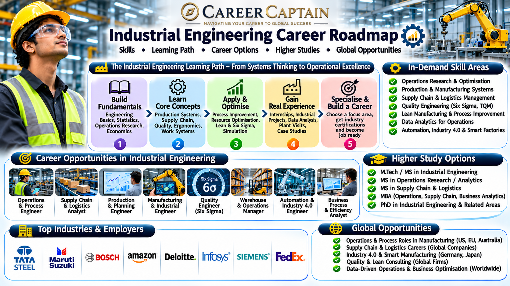

# Industrial Engineering Career Roadmap in India

Industrial Engineering focuses on improving the efficiency, productivity, quality, and performance of systems involving people, machines, materials, information, and processes.

From optimising automobile manufacturing lines and designing efficient supply chains to developing intelligent factories and automated production systems, industrial engineers help organisations operate more effectively.

This roadmap explains the subjects, career opportunities, technical skills, emerging technologies, and professional pathways available in Industrial Engineering.

  

## 1. What Is Industrial Engineering?

Industrial Engineering applies engineering, mathematics, statistics, and management principles to improve complex systems and processes.

Its central objective is to eliminate inefficiencies, reduce waste, improve quality, optimise resources, and increase productivity without compromising safety or performance.

Industrial Engineering combines:

- Manufacturing engineering
- Operations research
- Production planning
- Quality engineering
- Supply chain management
- Industrial automation
- Human factors and ergonomics
- Data analytics
- Systems engineering
- Project management

Industrial engineers work in manufacturing, logistics, healthcare, automotive, aerospace, consulting, technology, and service industries.

## 2. Subjects You Study in an Industrial Engineering Degree

The curriculum varies between universities, but students generally study the following subjects.

**Engineering fundamentals**
- Engineering Mathematics
- Engineering Physics
- Engineering Chemistry
- Engineering Mechanics
- Basic Electrical and Electronics Engineering
- Computer Programming

**Core industrial engineering subjects**
- Manufacturing Processes
- Production Planning and Control
- Operations Research
- Industrial Engineering
- Engineering Economics
- Work Study and Ergonomics
- Quality Control and Management
- Facilities Planning
- Inventory Management
- Supply Chain Management
- Industrial Safety

**Advanced subjects**
- Lean Manufacturing
- Six Sigma
- Simulation and Modelling
- Operations Management
- Reliability Engineering
- Data Analytics
- Industrial Automation
- Systems Engineering
- Logistics Optimisation
- Industry 4.0 Technologies

## 3. Major Career Paths in Industrial Engineering

Industrial Engineering offers opportunities across manufacturing, operations, logistics, consulting, technology, and business process improvement.

### Manufacturing Engineering

Improve manufacturing processes, production systems, equipment utilisation, and factory performance.

Potential roles:
- Manufacturing Engineer
- Production Engineer
- Process Improvement Engineer
- Industrial Engineer

### Production Planning and Control

Coordinate production schedules, materials, workforce, equipment, and manufacturing capacity.

Potential roles:
- Production Planner
- Planning Engineer
- Production Control Engineer
- Operations Planner

### Quality Engineering

Develop systems to improve product quality, reduce defects, and ensure compliance with specifications.

Potential roles:
- Quality Engineer
- Quality Assurance Engineer
- Quality Control Engineer
- Supplier Quality Engineer

### Supply Chain and Logistics

Improve the movement, storage, procurement, and distribution of materials and products.

Potential roles:
- Supply Chain Analyst
- Logistics Engineer
- Procurement Analyst
- Inventory Planning Specialist

### Operations Research and Analytics

Use mathematical models, optimisation, statistics, and algorithms to solve complex operational problems.

Potential roles:
- Operations Research Analyst
- Optimisation Engineer
- Business Analyst
- Operations Analyst

### Automation and Smart Manufacturing

Improve production systems using robotics, sensors, industrial software, and connected equipment.

Potential roles:
- Industrial Automation Engineer
- Manufacturing Systems Engineer
- Robotics Integration Engineer
- Industry 4.0 Specialist

### Consulting and Process Improvement

Help organisations identify inefficiencies, redesign processes, improve productivity, and reduce operational costs.

Potential roles:
- Process Improvement Consultant
- Operations Consultant
- Lean Consultant
- Business Process Analyst

## 4. Emerging Technologies in Industrial Engineering

Industrial Engineering is evolving through digital manufacturing, artificial intelligence, robotics, and advanced analytics.

Important emerging areas include:

- **Industry 4.0:** Integration of connected machines, sensors, automation, and digital systems in manufacturing.
- **Artificial Intelligence in Manufacturing:** Predictive maintenance, production optimisation, and automated quality inspection.
- **Digital Twins:** Virtual representations of factories, equipment, and production processes.
- **Collaborative Robotics:** Robots designed to work alongside human operators.
- **Predictive Analytics:** Using operational data to forecast failures, demand, and production requirements.
- **Additive Manufacturing:** Producing components through advanced 3D printing technologies.
- **Smart Supply Chains:** Using real-time data to improve logistics, inventory, and distribution.
- **Autonomous Mobile Robots:** Automated systems for material movement inside factories and warehouses.
- **Industrial Internet of Things:** Connected equipment and sensors for monitoring and control.
- **Sustainable Manufacturing:** Reducing energy consumption, material waste, emissions, and resource use.

## 5. Software and Technical Skills

Industrial engineers need a combination of engineering knowledge, analytical thinking, optimisation, and software proficiency.

**Data analysis and programming**
- Python
- SQL
- R
- Microsoft Excel
- Power BI
- Tableau

**Manufacturing and process planning**
- AutoCAD
- SolidWorks
- Siemens NX
- CATIA
- Manufacturing process planning tools

**Simulation and optimisation**
- MATLAB
- Arena Simulation
- AnyLogic
- FlexSim
- Simul8
- LINGO

**Enterprise and production systems**
- SAP
- ERP systems
- Manufacturing Execution Systems (MES)
- Production Planning Systems
- Warehouse Management Systems

**Quality and process improvement**
- Statistical Process Control (SPC)
- Six Sigma methodologies
- Lean Manufacturing
- Failure Mode and Effects Analysis (FMEA)
- Root Cause Analysis
- Statistical analysis

**Professional knowledge**
- Production planning
- Cost estimation
- Capacity planning
- Inventory management
- Work measurement
- Industrial safety
- Technical documentation

## 6. Four-Year Industrial Engineering Roadmap

A structured undergraduate plan helps students develop engineering fundamentals, analytical capabilities, and professional readiness.

### First Year: Build the Foundation

Focus on:
- Mathematics, physics, and chemistry
- Engineering fundamentals
- Basic programming
- Engineering drawing
- Communication skills

Suggested activities:
- Learn Python or C fundamentals.
- Develop strong mathematical problem-solving skills.
- Understand basic manufacturing processes.
- Explore how industrial systems operate.

### Second Year: Develop Core Skills

Focus on:
- Manufacturing processes
- Engineering economics
- Operations research
- Work study
- Statistics
- Production planning

Suggested activities:
- Learn advanced Excel.
- Study basic production planning.
- Practise statistical analysis.
- Understand inventory and manufacturing systems.
- Complete small process improvement projects.

### Third Year: Explore Specialisations

Focus on:
- Quality management
- Supply chain management
- Simulation and modelling
- Lean manufacturing
- Industrial automation
- Operations optimisation

Suggested activities:
- Learn Power BI or Python for data analysis.
- Explore manufacturing simulation tools.
- Study Six Sigma fundamentals.
- Apply for industrial internships.
- Complete a process optimisation project.

### Fourth Year: Prepare for Professional Opportunities

Focus on:
- Final-year project
- Industrial applications
- Production system design
- Technical interviews
- Higher education planning

Suggested activities:
- Complete an industry-oriented project.
- Apply for internships and graduate positions.
- Build a technical portfolio.
- Develop a professional resume.
- Research postgraduate programmes and employers.

## 7. Important Projects to Build

Practical projects help students demonstrate their ability to analyse and improve real-world systems.

**Beginner projects**
- Production efficiency analysis
- Inventory management model
- Work measurement study
- Manufacturing cost analysis
- Basic production scheduling

**Intermediate projects**
- Assembly line balancing
- Warehouse layout optimisation
- Statistical quality control dashboard
- Supply chain performance analysis
- Lean manufacturing improvement study

**Advanced projects**
- Factory digital twin simulation
- AI-based predictive maintenance model
- Automated production planning system
- Multi-objective supply chain optimisation
- Robotics-based manufacturing cell simulation
- Data-driven production efficiency platform

Projects should include a clearly defined problem, baseline measurements, proposed improvements, and evidence of the results.

## 8. Internships and Industry Exposure

Internships help students understand manufacturing operations, production systems, quality management, logistics, and industrial performance.

Potential internship environments include:

- Automobile manufacturers
- Aerospace companies
- Manufacturing plants
- Electronics manufacturers
- Logistics and supply chain companies
- Pharmaceutical manufacturers
- Industrial automation companies
- Consulting organisations
- E-commerce operations
- Research and development centres

Students should look for opportunities involving production planning, process improvement, quality control, industrial automation, supply chain management, and operations analytics.

A strong internship portfolio should contain process analysis reports, project documentation, measurable improvements, simulation work, and relevant software skills.

## 9. Government and Public-Sector Opportunities in India

Industrial engineering graduates can explore opportunities in manufacturing, infrastructure, transportation, defence production, research, and public-sector operations.

Important organisations include:

- **BHEL:** Industrial equipment and manufacturing.
- **Bharat Electronics Limited (BEL):** Electronics and defence manufacturing.
- **Hindustan Aeronautics Limited (HAL):** Aerospace manufacturing and production systems.
- **Indian Railways:** Operations, maintenance, production, and logistics.
- **DRDO:** Research and technology development.
- **ISRO:** Engineering, production, quality, and systems-related opportunities.
- **SAIL:** Steel production and industrial operations.
- **NTPC:** Power generation and industrial operations.
- **CSIR laboratories:** Industrial research and technology development.

Potential roles include production engineer, planning engineer, quality engineer, operations analyst, project engineer, and research associate.

Recruitment routes and eligibility requirements differ between organisations. Check current official notifications before applying.

## 10. Higher Education and Specialisation

Postgraduate education can help students develop advanced expertise in manufacturing, operations, analytics, supply chain management, and systems engineering.

**Possible postgraduate specialisations**
- Industrial Engineering
- Manufacturing Engineering
- Production Engineering
- Operations Research
- Supply Chain Management
- Logistics Engineering
- Quality Engineering
- Systems Engineering
- Engineering Management
- Data Analytics
- Robotics and Automation
- Operations Management

**International study destinations**
- Germany
- United States
- United Kingdom
- Canada
- Netherlands
- Sweden
- Switzerland
- Australia

Students considering international education should evaluate programme content, laboratory facilities, industry collaborations, admission requirements, language requirements, tuition fees, and funding options.

A strong academic record, practical projects, internships, and analytical skills can strengthen postgraduate applications.

## 11. Salary and Career Growth

Industrial engineering salaries vary according to industry, employer, location, technical specialisation, educational qualifications, and experience.

Potential career progression:

| Career stage | Possible roles |
|---|---|
| Entry level | Graduate Engineer Trainee, Junior Industrial Engineer |
| Early career | Production Engineer, Quality Engineer, Operations Analyst |
| Experienced | Senior Industrial Engineer, Process Improvement Engineer, Supply Chain Specialist |
| Advanced | Operations Manager, Manufacturing Manager, Technical Lead |
| Leadership | Plant Head, Operations Director, Supply Chain Director |

Career opportunities differ across manufacturing, automotive, logistics, consulting, technology, and service industries.

Students should research current job postings and employer requirements rather than relying on fixed salary expectations.

## 12. Essential Soft Skills

Industrial engineers work with production teams, management, suppliers, technical specialists, and customers.

Important skills include:

- Analytical thinking
- Problem-solving
- Communication
- Teamwork
- Decision-making
- Leadership
- Project management
- Negotiation
- Time management
- Attention to detail
- Adaptability

The ability to understand operational problems and communicate practical improvements is particularly valuable.

## 13. Common Mistakes to Avoid

- Studying manufacturing without understanding process optimisation.
- Ignoring mathematics, statistics, and operations research.
- Neglecting programming and data analysis.
- Learning Lean and Six Sigma terminology without applying the methods.
- Avoiding factory visits and industrial internships.
- Ignoring quality management and safety.
- Focusing only on production roles and overlooking analytics or consulting.
- Neglecting supply chain and logistics knowledge.
- Learning software without understanding the underlying engineering.
- Choosing a postgraduate specialisation without researching career opportunities.

## 14. How to Choose Your Industrial Engineering Specialisation

Your interests and strengths can help you identify an appropriate career direction.

| Your interest | Possible specialisation |
|---|---|
| Manufacturing and machines | Manufacturing Engineering |
| Production planning | Production and Operations Management |
| Quality and precision | Quality Engineering |
| Mathematics and optimisation | Operations Research |
| Logistics and distribution | Supply Chain Engineering |
| Data and programming | Industrial Analytics |
| Automation and robotics | Smart Manufacturing |
| Process improvement | Lean and Six Sigma |
| Business operations | Engineering Management |
| Research and modelling | Systems Engineering |

Explore different areas through electives, projects, internships, and industry exposure before choosing a long-term specialisation.

## 15. Useful Learning and Official Resources

The following resources can help students strengthen their engineering knowledge and explore professional opportunities.

**Learning platforms**
- [NPTEL](https://nptel.ac.in/) — Industrial engineering, manufacturing, and operations courses.
- [SWAYAM](https://swayam.gov.in/) — Online academic programmes.
- [MIT OpenCourseWare](https://ocw.mit.edu/) — University-level engineering learning materials.
- [Coursera](https://www.coursera.org/) — Supply chain, analytics, and operations courses.
- [edX](https://www.edx.org/) — Engineering and management programmes.

**Technical and professional resources**
- [IISE](https://www.iise.org/) — Institute of Industrial and Systems Engineers.
- [ASQ](https://asq.org/) — Quality management and professional resources.
- [NIST](https://www.nist.gov/) — Manufacturing and measurement science.
- [CII](https://www.cii.in/) — Confederation of Indian Industry.
- [Bureau of Indian Standards](https://www.bis.gov.in/) — Indian technical standards.
- [SAP](https://www.sap.com/) — Enterprise resource planning and business systems.
- [NPTEL](https://nptel.ac.in/) — Manufacturing and operations learning resources.

## 16. Final Thoughts: Building a Career in Industrial Engineering

Industrial Engineering offers opportunities to improve the way organisations design products, manufacture goods, manage resources, and deliver services.

Students who combine engineering fundamentals with statistics, programming, process optimisation, quality management, and practical industry experience can build versatile careers.

Focus on solving real operational problems, developing analytical skills, completing meaningful projects, gaining industry exposure, and choosing a specialisation aligned with your interests.

### How Career Captain Can Help

Choosing an engineering branch is only the beginning of a career journey. Understanding your interests, aptitude, strengths, and long-term goals can help you make informed academic and professional decisions.

Career Captain Global Solutions supports students through career counselling, psychometric assessments, stream and course selection, career exploration, and study-abroad guidance.

Explore career guidance and planning resources at [Career Captain](https://careercaptain.co.in?utm_source=career_roadmaps_india&utm_medium=referral&utm_campaign=github_career_roadmaps&utm_content=industrial-engineering-career-roadmap).

---

**Educational Disclaimer:** This roadmap is intended for educational and career-awareness purposes. Course structures, eligibility criteria, recruitment requirements, and employment opportunities may change. Students should verify current information with universities, employers, and official organisations.

**License:** This educational resource is shared under the Creative Commons Attribution 4.0 International (CC BY 4.0) license. Please credit Career Captain Global Solutions when sharing or adapting this material.

---

## Plan your engineering pathway with Career Captain

Choosing an engineering branch is only one part of the decision. Students should also consider their interests, strengths, preferred work and future study options. Career Captain offers personalised career counselling and assessment to support informed decisions.

- [Career counselling in Hyderabad](https://careercaptain.co.in/career-counsellor-near-me?utm_source=career_roadmaps_india&utm_medium=referral&utm_campaign=github_career_roadmaps&utm_content=industrial-engineering-career-roadmap)
- [Psychometric career assessment](https://guide.careercaptain.co.in/guides/psychometric-career-assessment/?utm_source=career_roadmaps_india&utm_medium=referral&utm_campaign=github_career_roadmaps&utm_content=industrial-engineering-career-roadmap)
- [Online career counselling](https://careercaptain.co.in/areas-we-serve?utm_source=career_roadmaps_india&utm_medium=referral&utm_campaign=github_career_roadmaps&utm_content=industrial-engineering-career-roadmap)

[Visit Career Captain](https://careercaptain.co.in?utm_source=career_roadmaps_india&utm_medium=referral&utm_campaign=github_career_roadmaps&utm_content=industrial-engineering-career-roadmap) · [WhatsApp Career Captain](https://wa.me/919849488838?text=Hi%20Career%20Captain%2C%20I%20found%20your%20industrial%20engineering%20career%20roadmap%20guide%20in%20Career%20Roadmaps%20India.%20I%20would%20like%20to%20know%20more%20about%20career%20guidance.%20Source%3A%20industrial-engineering-career-roadmap.)
