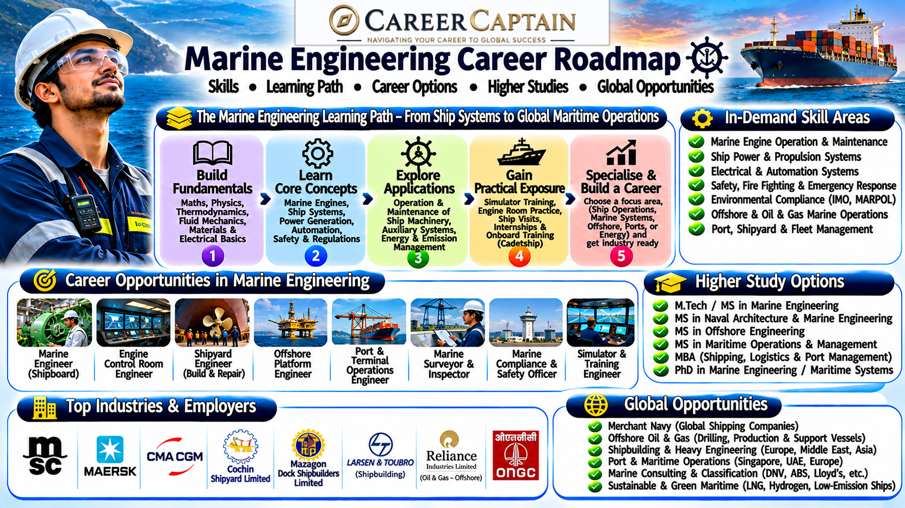

# Marine Engineering Career Roadmap in India

Marine Engineering focuses on the design, construction, operation, maintenance, and management of machinery and engineering systems used aboard ships and other marine vessels.

From propulsion engines and power generation systems to offshore platforms, marine automation, and advanced ship technologies, marine engineers help keep the global maritime industry operating safely and efficiently.

This roadmap explains the subjects, career opportunities, technical skills, emerging technologies, and professional pathways available in Marine Engineering.

  

## 1. What Is Marine Engineering?

Marine Engineering applies mechanical, electrical, electronics, and control engineering principles to ships, offshore installations, and marine equipment.

Marine engineers are responsible for ensuring that propulsion systems, power generation, auxiliary machinery, and other onboard engineering systems operate safely and reliably.

The discipline covers:

- Marine propulsion systems
- Marine diesel engines
- Steam and gas turbines
- Electrical power generation
- Shipboard automation
- Refrigeration and air conditioning
- Hydraulic and pneumatic systems
- Marine machinery maintenance
- Ship design and construction
- Offshore engineering

Marine engineers may work aboard commercial ships, naval vessels, offshore platforms, shipyards, marine equipment companies, and maritime research organisations.

## 2. Subjects You Study in a Marine Engineering Degree

The curriculum varies between universities and maritime institutions, but students generally study the following subjects.

**Engineering fundamentals**
- Engineering Mathematics
- Engineering Physics
- Engineering Chemistry
- Engineering Mechanics
- Engineering Drawing
- Basic Electrical Engineering
- Computer Programming

**Core mechanical engineering subjects**
- Thermodynamics
- Fluid Mechanics
- Heat Transfer
- Strength of Materials
- Applied Mechanics
- Machine Design
- Manufacturing Processes

**Core marine engineering subjects**
- Marine Diesel Engines
- Marine Steam Engineering
- Marine Boilers
- Marine Auxiliary Machinery
- Marine Electrical Systems
- Marine Refrigeration and Air Conditioning
- Ship Construction
- Marine Power Plants
- Marine Engineering Drawing
- Ship Stability Fundamentals

**Advanced subjects**
- Marine Automation and Control
- Marine Propulsion Systems
- Marine Engineering Management
- Marine Safety and Environmental Protection
- Offshore Engineering
- Maritime Energy Systems
- Condition Monitoring and Predictive Maintenance

Professional seagoing training also includes practical competencies, safety training, and applicable maritime certification requirements.

## 3. Major Career Paths in Marine Engineering

Marine Engineering offers opportunities both at sea and ashore.

### Marine Engineer at Sea

Operate, maintain, and troubleshoot the machinery and engineering systems aboard commercial vessels.

Potential career progression:
- Junior Engineer
- Fourth Engineer
- Third Engineer
- Second Engineer
- Chief Engineer

Seagoing progression depends on qualifying sea service, competency assessments, examinations, and applicable maritime certification.

### Shipbuilding and Ship Design

Work on the design, construction, testing, and improvement of ships and marine engineering systems.

Potential roles:
- Marine Design Engineer
- Shipbuilding Engineer
- Marine Systems Engineer
- Naval Architecture Support Engineer

### Offshore Engineering

Work with engineering systems used in offshore oil and gas installations, floating structures, and marine energy projects.

Potential roles:
- Offshore Mechanical Engineer
- Offshore Maintenance Engineer
- Marine Systems Engineer
- Offshore Project Engineer

### Marine Equipment and Machinery

Design, install, test, and maintain marine engines, pumps, compressors, generators, and other shipboard equipment.

Potential roles:
- Marine Equipment Engineer
- Service Engineer
- Maintenance Engineer
- Technical Support Engineer

### Marine Electrical and Automation Engineering

Develop and maintain electrical power, instrumentation, automation, and control systems used aboard ships.

Potential roles:
- Marine Electrical Engineer
- Marine Automation Engineer
- Instrumentation Engineer
- Control Systems Engineer

### Marine Surveying and Inspection

Inspect ships, machinery, and engineering systems for safety, condition, and regulatory compliance.

Potential roles:
- Marine Surveyor
- Machinery Inspector
- Technical Superintendent
- Marine Inspection Engineer

### Marine Research and Advanced Technologies

Contribute to research involving ship propulsion, maritime energy efficiency, autonomous vessels, and environmentally sustainable marine systems.

Potential roles:
- Marine Research Associate
- Propulsion Systems Researcher
- Marine Technology Engineer

## 4. Emerging Technologies in Marine Engineering

The maritime industry is evolving through automation, digitalisation, alternative fuels, and environmental technologies.

Important emerging areas include:

- **Autonomous Ships:** Vessels using advanced sensors, navigation systems, and automation to reduce manual intervention.
- **Artificial Intelligence in Ship Maintenance:** Predicting machinery failures through operational data and condition monitoring.
- **Digital Twins:** Virtual models of ship engines and machinery used for monitoring and performance optimisation.
- **Alternative Marine Fuels:** Research into methanol, ammonia, hydrogen, and other lower-emission fuel pathways.
- **Electric and Hybrid Propulsion:** Integrating batteries, electric motors, and conventional propulsion systems.
- **Advanced Marine Batteries:** Energy storage technologies for electric and hybrid vessels.
- **Wind-Assisted Propulsion:** Using rotor sails, wing sails, and other technologies to reduce fuel consumption.
- **Smart Ship Systems:** Connected sensors and automated control systems for vessel operations.
- **Carbon Reduction Technologies:** Systems designed to improve fuel efficiency and reduce maritime emissions.
- **Underwater Robotics:** Remotely operated and autonomous underwater vehicles used for inspection and research.

## 5. Software and Technical Skills

Marine engineers need strong mechanical and electrical fundamentals alongside knowledge of shipboard machinery, automation, and engineering design.

**CAD and design software**
- AutoCAD
- SolidWorks
- CATIA
- Siemens NX
- Autodesk Inventor

**Engineering simulation**
- ANSYS
- MATLAB
- Simulink
- Computational Fluid Dynamics tools
- Thermodynamic simulation tools

**Marine design and analysis**
- ShipConstructor
- NAPA
- Maxsurf
- Marine machinery modelling tools

**Programming and automation**
- Python
- MATLAB programming
- PLC fundamentals
- Embedded systems
- Industrial control systems

**Practical engineering knowledge**
- Diesel engine operation
- Pump and compressor maintenance
- Boiler operation
- Marine electrical systems
- Hydraulic systems
- Machinery troubleshooting
- Preventive maintenance
- Condition monitoring

**Professional knowledge**
- Maritime safety
- Engine-room operations
- Technical documentation
- Environmental compliance
- Risk assessment
- Marine engineering regulations

## 6. Four-Year Marine Engineering Roadmap

A structured undergraduate plan helps students build engineering fundamentals and prepare for marine engineering careers.

### First Year: Build the Foundation

Focus on:
- Mathematics, physics, and chemistry
- Engineering mechanics
- Engineering drawing
- Basic electrical engineering
- Introduction to mechanical systems

Suggested activities:
- Strengthen mathematics and physics.
- Learn basic engineering drawing.
- Understand mechanical components.
- Develop communication skills.
- Explore maritime careers and training requirements.

### Second Year: Develop Core Engineering Skills

Focus on:
- Thermodynamics
- Fluid mechanics
- Heat transfer
- Strength of materials
- Basic electrical systems
- Mechanical engineering laboratories

Suggested activities:
- Understand internal combustion engines.
- Explore pumps and compressors.
- Learn introductory CAD tools.
- Complete mechanical engineering projects.
- Develop practical workshop skills.

### Third Year: Develop Marine Specialisation

Focus on:
- Marine diesel engines
- Marine auxiliary machinery
- Marine electrical systems
- Ship construction
- Marine refrigeration
- Marine automation

Suggested activities:
- Study shipboard engineering systems.
- Explore marine simulation tools.
- Complete machinery-related projects.
- Seek maritime internships.
- Understand applicable safety requirements.

### Fourth Year: Prepare for Professional Opportunities

Focus on:
- Final-year project
- Marine engineering applications
- Practical machinery knowledge
- Maritime career requirements
- Higher education planning

Suggested activities:
- Complete a marine engineering project.
- Explore shipyard and marine industry internships.
- Research approved training pathways.
- Prepare for relevant recruitment and certification processes.
- Build a technical portfolio.

Students targeting seagoing employment should separately verify the current Directorate General of Shipping requirements for approved programmes, medical fitness, training, and certification.

## 7. Important Projects to Build

Practical projects help students demonstrate their understanding of mechanical systems, marine machinery, and engineering applications.

**Beginner projects**
- Marine engine performance calculations
- Centrifugal pump performance analysis
- Heat exchanger efficiency analysis
- Shipboard energy consumption study
- Basic refrigeration system model

**Intermediate projects**
- Diesel engine performance simulation
- Marine cooling water system design
- Ship auxiliary power system study
- Fuel consumption optimisation analysis
- Machinery vibration monitoring prototype

**Advanced projects**
- Hybrid marine propulsion system simulation
- Predictive maintenance model for marine engines
- Ship energy efficiency optimisation
- Digital twin of a marine propulsion system
- Alternative marine fuel performance study
- Automated machinery monitoring system

Projects involving engines, electrical machinery, pressurised equipment, or fuel systems must be undertaken with appropriate supervision and safety procedures.

## 8. Internships and Industry Exposure

Internships help students understand marine machinery, shipbuilding, maintenance, offshore operations, and maritime engineering practices.

Potential internship environments include:

- Commercial ship operators
- Shipbuilding companies
- Ship repair yards
- Marine engine manufacturers
- Offshore engineering companies
- Marine equipment suppliers
- Port engineering departments
- Marine research institutions
- Classification and inspection organisations

Students should look for opportunities involving machinery maintenance, engine operations, ship design, electrical systems, technical inspection, and marine equipment.

A strong internship portfolio should include technical reports, machinery studies, design projects, simulation work, and relevant practical experience.

## 9. Government and Public-Sector Opportunities in India

Marine engineers can explore opportunities in shipping, shipbuilding, ports, maritime infrastructure, defence, and marine research.

Important organisations include:

- **Directorate General of Shipping (DGS):** Maritime training, certification, and regulatory information.
- **Cochin Shipyard Limited:** Shipbuilding, ship repair, and marine engineering.
- **Mazagon Dock Shipbuilders Limited:** Shipbuilding and defence vessel construction.
- **Garden Reach Shipbuilders & Engineers (GRSE):** Shipbuilding and marine engineering.
- **Goa Shipyard Limited:** Ship construction and repair.
- **Shipping Corporation of India (SCI):** Commercial shipping operations.
- **Indian Navy:** Technical opportunities in naval engineering through applicable entry routes.
- **Indian Coast Guard:** Maritime technical and engineering-related opportunities.
- **Indian Ports and port authorities:** Marine infrastructure and technical operations.
- **National Institute of Ocean Technology (NIOT):** Marine technology and ocean engineering research.

Potential roles include marine engineer, graduate engineer trainee, shipbuilding engineer, maintenance engineer, technical officer, and research associate.

Eligibility and recruitment requirements differ between organisations. Check official notifications and maritime regulations before applying.

## 10. Higher Education and Specialisation

Postgraduate education can help students develop advanced technical expertise and pursue specialised marine engineering or research careers.

**Possible postgraduate specialisations**
- Marine Engineering
- Naval Architecture
- Ocean Engineering
- Offshore Engineering
- Marine Electrical Engineering
- Marine Propulsion Systems
- Ship Design
- Marine Automation
- Maritime Safety
- Marine Renewable Energy
- Coastal and Ocean Engineering

**International study destinations**
- Germany
- United Kingdom
- United States
- Norway
- Netherlands
- Denmark
- Singapore
- Australia

Students considering international education should evaluate programme content, research facilities, maritime industry connections, admission requirements, language requirements, tuition fees, and funding options.

A strong academic record, practical projects, and relevant maritime experience can strengthen postgraduate applications.

## 11. Salary and Career Growth

Marine engineering compensation varies considerably depending on whether a professional works at sea or ashore.

Important factors include:
- Rank and certification
- Vessel type
- Employer
- Sea experience
- Vessel operating region
- Specialisation
- Employment contract
- Shore-based responsibilities

Potential career progression:

| Career stage | Possible roles |
|---|---|
| Entry level | Junior Engineer, Graduate Marine Engineer |
| Early career | Fourth Engineer, Third Engineer, Junior Technical Engineer |
| Experienced | Second Engineer, Marine Technical Engineer |
| Senior | Chief Engineer, Technical Superintendent |
| Leadership | Fleet Technical Manager, Marine Operations Director |

Seagoing remuneration may include contract-based arrangements and allowances, while shore-based employment generally follows different compensation structures.

Students should research current employer vacancies and applicable maritime employment conditions rather than relying on fixed salary estimates.

## 12. Essential Soft Skills

Marine engineers work in environments that require teamwork, discipline, technical judgement, and strong safety awareness.

Important skills include:

- Problem-solving
- Analytical thinking
- Communication
- Teamwork
- Leadership
- Decision-making
- Time management
- Attention to detail
- Adaptability
- Safety awareness
- Technical documentation

For seagoing professionals, the ability to work effectively in confined spaces, follow procedures, communicate during emergencies, and operate within a multicultural team is particularly important.

## 13. Common Mistakes to Avoid

- Choosing Marine Engineering without understanding the nature of seagoing work.
- Ignoring mechanical and electrical fundamentals.
- Neglecting practical workshop experience.
- Focusing only on theoretical examinations.
- Ignoring maritime medical fitness and certification requirements.
- Assuming that all marine engineering jobs involve working aboard ships.
- Avoiding shipyard and industry exposure.
- Neglecting safety procedures and technical documentation.
- Ignoring emerging technologies in maritime propulsion.
- Choosing a postgraduate specialisation without researching career opportunities.

## 14. How to Choose Your Marine Engineering Specialisation

Your interests, strengths, and preferred work environment can help you identify a suitable career direction.

| Your interest | Possible specialisation |
|---|---|
| Engines and machinery | Marine Propulsion Engineering |
| Ship design and structures | Naval Architecture |
| Electrical systems | Marine Electrical Engineering |
| Automation and control | Marine Automation |
| Offshore installations | Offshore Engineering |
| Shipbuilding | Marine Production Engineering |
| Energy efficiency | Marine Energy Systems |
| Machinery inspection | Marine Surveying |
| Research and innovation | Ocean and Marine Technology |

Students should also consider whether they prefer seagoing employment, shipyard work, offshore operations, technical consulting, or research.

## 15. Useful Learning and Official Resources

The following resources can help students develop engineering knowledge and understand maritime career requirements.

**Learning platforms**
- [NPTEL](https://nptel.ac.in/) — Mechanical, marine, and ocean engineering courses.
- [SWAYAM](https://swayam.gov.in/) — Online academic programmes.
- [MIT OpenCourseWare](https://ocw.mit.edu/) — Engineering learning materials.
- [Coursera](https://www.coursera.org/) — Engineering and maritime technology courses.
- [edX](https://www.edx.org/) — Engineering and technology programmes.

**Maritime and technical resources**
- [Directorate General of Shipping](https://www.dgshipping.gov.in/) — Indian maritime training, certification, and regulatory information.
- [International Maritime Organization](https://www.imo.org/) — International maritime safety and environmental regulations.
- [International Association of Classification Societies](https://iacs.org.uk/) — Ship classification and technical standards.
- [Indian Register of Shipping](https://www.irclass.org/) — Marine classification and technical services.
- [Cochin Shipyard](https://cochinshipyard.in/) — Shipbuilding and marine engineering.
- [Shipping Corporation of India](https://www.shipindia.com/) — Commercial shipping information.
- [National Institute of Ocean Technology](https://www.niot.res.in/) — Ocean engineering and marine technology research.

## 16. Final Thoughts: Building a Career in Marine Engineering

Marine Engineering offers opportunities across commercial shipping, shipbuilding, offshore operations, marine equipment, maritime research, and advanced propulsion technologies.

Students who combine strong mechanical and electrical fundamentals with practical machinery knowledge, safety awareness, and technical problem-solving can build rewarding careers in the maritime industry.

Before choosing this discipline, understand the differences between seagoing and shore-based careers. Explore the training requirements, professional certification pathways, working conditions, and long-term career opportunities.

### How Career Captain Can Help

Choosing an engineering branch is only the beginning of a career journey. Understanding your interests, aptitude, strengths, and long-term goals can help you make informed academic and professional decisions.

Career Captain Global Solutions supports students through career counselling, psychometric assessments, stream and course selection, career exploration, and study-abroad guidance.

Explore career guidance and planning resources at [Career Captain](https://careercaptain.co.in/).

---

**Educational Disclaimer:** This roadmap is intended for educational and career-awareness purposes. Course structures, eligibility criteria, maritime certification requirements, recruitment procedures, and employment opportunities may change. Students should verify current information with universities, approved maritime training institutions, the Directorate General of Shipping, and employers.

**License:** This educational resource is shared under the Creative Commons Attribution 4.0 International (CC BY 4.0) license. Please credit Career Captain Global Solutions when sharing or adapting this material.
