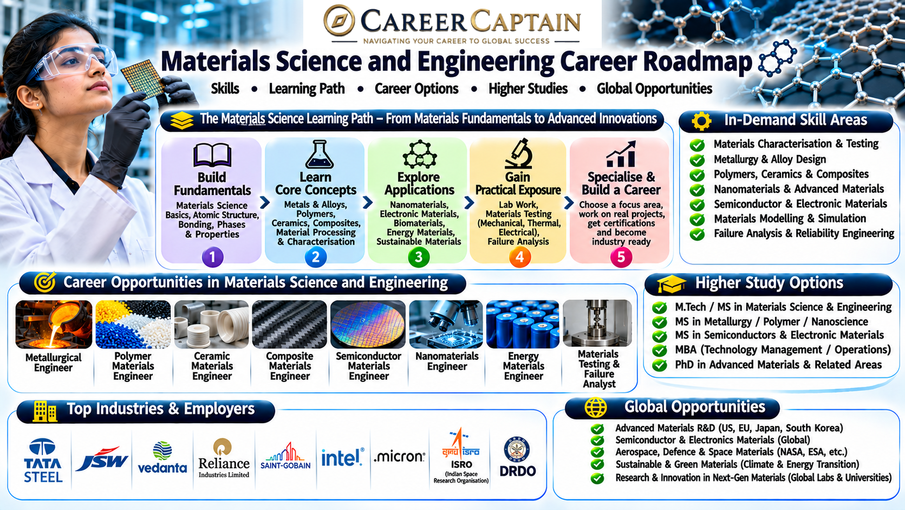

Materials Science and Engineering focuses on understanding, designing, developing, testing, and improving materials used in engineering applications. It explores the relationship between a material's structure, properties, processing methods, and performance.

From aerospace alloys and semiconductor materials to advanced batteries, medical implants, nanotechnology, and sustainable materials, this discipline contributes to the development of technologies across modern industries.

This roadmap explains the subjects, career opportunities, technical skills, emerging technologies, and professional pathways available in Materials Science and Engineering.

  

## 1. What Is Materials Science and Engineering?

Materials Science and Engineering studies how materials behave, how their internal structures influence their properties, and how they can be engineered for specific applications.

It combines:

- Physics
- Chemistry
- Mechanical engineering
- Metallurgy
- Materials characterisation
- Manufacturing engineering
- Nanotechnology
- Computational modelling

Materials engineers work with metals, ceramics, polymers, composites, semiconductors, biomaterials, and advanced functional materials.

Applications include aircraft components, automobiles, electronic devices, medical implants, batteries, construction materials, and renewable energy technologies.

## 2. Subjects You Study in a Materials Science and Engineering Degree

The curriculum varies between universities, but students generally study the following subjects.

**Engineering fundamentals**
- Engineering Mathematics
- Engineering Physics
- Engineering Chemistry
- Engineering Mechanics
- Basic Electrical and Electronics Engineering
- Computer Programming

**Core materials science subjects**
- Physical Metallurgy
- Materials Chemistry
- Crystallography
- Structure of Materials
- Mechanical Behaviour of Materials
- Phase Transformations
- Thermodynamics of Materials
- Materials Processing
- Heat Treatment
- Materials Characterisation

**Major material categories**
- Ferrous and Non-Ferrous Metals
- Ceramics and Glasses
- Polymers
- Composite Materials
- Semiconductor Materials
- Biomaterials

**Advanced subjects**
- Nanomaterials
- Computational Materials Science
- Advanced Alloys
- Functional Materials
- Electronic Materials
- Corrosion Engineering
- Materials Failure Analysis
- Additive Manufacturing
- Energy Storage Materials

## 3. Major Career Paths in Materials Science and Engineering

Materials Science and Engineering offers opportunities in manufacturing, aerospace, automotive, electronics, energy, healthcare, and scientific research.

### Metallurgical Engineering

Develop, process, test, and improve metallic materials used in industrial applications.

Potential roles:
- Metallurgical Engineer
- Materials Engineer
- Foundry Engineer
- Heat Treatment Engineer
- Failure Analysis Engineer

### Aerospace and Automotive Materials

Develop lightweight, high-strength, heat-resistant materials for aircraft, spacecraft, automobiles, and other transportation systems.

Potential roles:
- Aerospace Materials Engineer
- Automotive Materials Engineer
- Composite Materials Engineer
- Materials Testing Engineer

### Semiconductor and Electronic Materials

Work on materials used in integrated circuits, sensors, electronic components, and semiconductor devices.

Potential roles:
- Semiconductor Materials Engineer
- Process Engineer
- Thin Film Engineer
- Electronic Materials Research Associate

### Battery and Energy Materials

Develop materials for batteries, fuel cells, solar technologies, and energy storage systems.

Potential roles:
- Battery Materials Engineer
- Energy Storage Research Associate
- Electrochemical Materials Engineer
- Battery Testing Engineer

### Polymer and Composite Engineering

Develop plastics, advanced polymers, carbon-fibre composites, and other engineered materials.

Potential roles:
- Polymer Engineer
- Composite Materials Engineer
- Product Development Engineer
- Materials Processing Engineer

### Biomaterials and Medical Devices

Develop materials used in medical implants, prosthetics, surgical devices, and tissue engineering.

Potential roles:
- Biomaterials Engineer
- Medical Materials Researcher
- Biomedical Materials Engineer
- Implant Development Engineer

### Research and Development

Investigate new materials, improve existing material performance, and develop innovative manufacturing processes.

Potential roles:
- Materials Research Associate
- Research Scientist
- Materials Characterisation Engineer
- Product Development Researcher

## 4. Emerging Technologies in Materials Science and Engineering

Materials science is advancing rapidly through nanotechnology, computational modelling, advanced manufacturing, and sustainable material development.

Important emerging areas include:

- **Artificial Intelligence in Materials Discovery:** Machine learning models used to identify and optimise promising material compositions.
- **Nanomaterials:** Materials engineered at nanoscale dimensions for specialised electrical, mechanical, optical, and chemical properties.
- **Solid-State Batteries:** Advanced battery systems using solid electrolytes.
- **Advanced Semiconductor Materials:** Materials used in next-generation electronic and computing devices.
- **Graphene and Two-Dimensional Materials:** Ultra-thin materials with distinctive electrical, thermal, and mechanical properties.
- **Metal Additive Manufacturing:** Producing complex metallic components through advanced 3D printing.
- **High-Entropy Alloys:** Alloys containing multiple principal elements for specialised performance.
- **Self-Healing Materials:** Materials designed to repair certain types of damage.
- **Biodegradable Materials:** Materials developed to reduce environmental impact.
- **Computational Materials Science:** Using simulations and data-driven methods to predict material properties and behaviour.

## 5. Software and Technical Skills

Materials engineers need a combination of laboratory skills, engineering calculations, material characterisation, simulation, and data analysis.

**Materials modelling and simulation**
- ANSYS
- COMSOL Multiphysics
- MATLAB
- Abaqus
- Thermo-Calc
- Materials Studio

**CAD and engineering design**
- AutoCAD
- SolidWorks
- CATIA
- Fusion

**Programming and data analysis**
- Python
- MATLAB programming
- R
- Excel
- Statistical analysis
- Machine learning fundamentals

**Materials characterisation techniques**
- Scanning Electron Microscopy (SEM)
- Transmission Electron Microscopy (TEM)
- X-ray Diffraction (XRD)
- Optical Microscopy
- Energy Dispersive X-ray Spectroscopy (EDS)
- Differential Scanning Calorimetry (DSC)
- Thermogravimetric Analysis (TGA)

**Mechanical and materials testing**
- Tensile testing
- Hardness testing
- Impact testing
- Fatigue testing
- Fracture analysis
- Corrosion testing

**Professional knowledge**
- Quality assurance
- Materials selection
- Failure analysis
- Manufacturing processes
- Technical documentation
- Industrial safety

## 6. Four-Year Materials Science and Engineering Roadmap

A structured undergraduate plan helps students develop strong scientific foundations and prepare for materials engineering careers.

### First Year: Build the Foundation

Focus on:
- Mathematics, physics, and chemistry
- Engineering fundamentals
- Basic programming
- Engineering drawing
- Communication skills

Suggested activities:
- Strengthen physics and chemistry fundamentals.
- Learn Python basics.
- Understand metals, polymers, and ceramics.
- Explore basic manufacturing processes.

### Second Year: Develop Core Skills

Focus on:
- Physical metallurgy
- Crystallography
- Thermodynamics
- Materials structure and properties
- Mechanical behaviour of materials

Suggested activities:
- Learn materials testing fundamentals.
- Explore microscopy techniques.
- Understand phase diagrams.
- Complete basic materials analysis projects.

### Third Year: Explore Specialisations

Focus on:
- Advanced materials
- Materials characterisation
- Corrosion engineering
- Composite materials
- Semiconductor materials
- Computational materials science

Suggested activities:
- Learn relevant simulation software.
- Explore SEM and XRD concepts.
- Complete a materials research project.
- Apply for laboratory or industrial internships.
- Develop technical reporting skills.

### Fourth Year: Prepare for Professional Opportunities

Focus on:
- Final-year project
- Materials design and processing
- Industrial applications
- Technical interviews
- Higher education planning

Suggested activities:
- Complete an industry-oriented or research project.
- Apply for internships and graduate positions.
- Prepare a technical portfolio.
- Explore GATE and other relevant examinations.
- Research postgraduate programmes and employers.

## 7. Important Projects to Build

Practical projects help students demonstrate their understanding of material properties, processing, testing, and engineering applications.

**Beginner projects**
- Comparative hardness testing of metals
- Corrosion rate analysis
- Polymer property comparison
- Heat treatment study of steel
- Material selection for an engineering component

**Intermediate projects**
- Aluminium alloy microstructure analysis
- Composite material development and testing
- Mechanical property evaluation of polymers
- Phase diagram analysis
- Failure analysis of a damaged engineering component

**Advanced projects**
- Battery electrode material performance analysis
- Computational modelling of alloy properties
- Nanomaterial synthesis and characterisation
- Corrosion-resistant coating development
- Metal additive manufacturing study
- Machine learning for materials property prediction

Laboratory projects involving high temperatures, chemical treatments, powders, or specialised equipment must follow institutional safety procedures and appropriate supervision.

## 8. Internships and Industry Exposure

Internships help students understand material production, testing, processing, research, and industrial quality systems.

Potential internship environments include:

- Steel and metal manufacturing companies
- Automotive manufacturers
- Aerospace organisations
- Semiconductor and electronics companies
- Battery manufacturers
- Research laboratories
- Materials testing laboratories
- Foundries and casting industries
- Polymer and composite manufacturers
- Defence manufacturing organisations

Students should look for opportunities involving materials testing, metallurgical analysis, quality control, failure analysis, manufacturing, and research.

A strong internship portfolio should include laboratory reports, material characterisation results, testing projects, simulation work, and technical documentation.

## 9. Government and Public-Sector Opportunities in India

Materials Science and Engineering graduates can explore opportunities in metallurgy, advanced manufacturing, aerospace, defence, scientific research, and energy technology.

Important organisations include:

- **CSIR laboratories:** Scientific research involving metals, materials, chemicals, and advanced technologies.
- **Defence Metallurgical Research Laboratory (DMRL):** Research in defence-related metallurgy and advanced materials.
- **DRDO:** Research and development involving aerospace, defence, and engineering materials.
- **ISRO:** Materials and manufacturing technologies for space applications.
- **BHEL:** Materials, manufacturing, and industrial engineering.
- **SAIL:** Steel manufacturing and metallurgical operations.
- **National Metallurgical Laboratory (NML):** Metallurgical research and materials development.
- **BARC:** Research involving materials science and nuclear technology.
- **Indian Institute of Science (IISc):** Advanced research in materials and engineering.
- **Bureau of Indian Standards (BIS):** Standards and materials-related technical information.

Potential roles include materials engineer, metallurgical engineer, research associate, project scientist, quality engineer, and technical officer.

Eligibility and recruitment requirements vary. Check official notifications for current qualifications and selection procedures.

## 10. Higher Education and Specialisation

Postgraduate education can help students develop advanced technical expertise and pursue research, specialised engineering, and leadership opportunities.

**Possible postgraduate specialisations**
- Materials Science and Engineering
- Metallurgical Engineering
- Materials Chemistry
- Nanotechnology
- Polymer Science
- Composite Materials
- Semiconductor Materials
- Biomaterials
- Energy Materials
- Computational Materials Science
- Corrosion Engineering
- Advanced Manufacturing

**International study destinations**
- Germany
- United States
- United Kingdom
- Canada
- Netherlands
- Sweden
- Switzerland
- Japan
- South Korea

Students considering international education should evaluate programme content, research facilities, laboratory access, admission requirements, language requirements, tuition fees, and funding options.

A strong academic record, relevant laboratory experience, technical projects, and research exposure can strengthen postgraduate applications.

## 11. Salary and Career Growth

Materials engineering salaries vary according to industry, employer, location, qualifications, specialisation, and experience.

Potential career progression:

| Career stage | Possible roles |
|---|---|
| Entry level | Graduate Engineer Trainee, Junior Materials Engineer |
| Early career | Materials Engineer, Quality Engineer, Metallurgical Engineer |
| Experienced | Senior Materials Engineer, Process Engineer, Failure Analysis Specialist |
| Advanced | Materials Research Scientist, R&D Manager, Technical Lead |
| Leadership | Materials Engineering Director, Research Director, Plant Technical Head |

Career opportunities differ across metals, automotive, aerospace, electronics, semiconductors, energy storage, and research.

Students should evaluate current job postings and employer requirements rather than relying on fixed salary expectations.

## 12. Essential Soft Skills

Materials engineers work with scientists, designers, manufacturing teams, quality specialists, and research organisations.

Important skills include:

- Analytical thinking
- Problem-solving
- Attention to detail
- Scientific reasoning
- Communication
- Teamwork
- Research methodology
- Technical documentation
- Project management
- Adaptability
- Ethical decision-making

The ability to interpret experimental results and explain material behaviour clearly is particularly valuable.

## 13. Common Mistakes to Avoid

- Studying materials without understanding the relationship between structure and properties.
- Ignoring physics, chemistry, and mathematics.
- Neglecting laboratory and testing experience.
- Learning simulation tools without understanding material behaviour.
- Avoiding internships and industrial exposure.
- Ignoring emerging semiconductor and energy material technologies.
- Focusing only on traditional metallurgy and overlooking polymers, composites, and functional materials.
- Neglecting research methodology and technical documentation.
- Choosing postgraduate specialisations without understanding their career scope.

## 14. How to Choose Your Materials Science Specialisation

Your interests and strengths can help you identify an appropriate career direction.

| Your interest | Possible specialisation |
|---|---|
| Metals and manufacturing | Metallurgical Engineering |
| Aerospace and lightweight structures | Composite Materials |
| Batteries and energy storage | Energy Materials |
| Electronics and computing | Semiconductor Materials |
| Plastics and advanced polymers | Polymer Science |
| Medical implants | Biomaterials |
| Nanotechnology | Nanomaterials |
| Research and modelling | Computational Materials Science |
| Corrosion and durability | Corrosion Engineering |
| Product development | Materials Design and Processing |

Explore different areas through electives, laboratory projects, internships, and research before choosing a long-term specialisation.

## 15. Useful Learning and Official Resources

The following resources can help students develop their scientific knowledge and explore materials engineering research.

**Learning platforms**
- [NPTEL](https://nptel.ac.in/) — Materials science, metallurgy, and engineering courses.
- [SWAYAM](https://swayam.gov.in/) — Online academic programmes.
- [MIT OpenCourseWare](https://ocw.mit.edu/) — University-level learning materials.
- [Coursera](https://www.coursera.org/) — Materials science and engineering courses.
- [edX](https://www.edx.org/) — Science and engineering programmes.

**Technical and research resources**
- [ASM International](https://www.asminternational.org/) — Materials science and engineering resources.
- [Materials Project](https://materialsproject.org/) — Computational materials data and research tools.
- [NIST](https://www.nist.gov/) — Materials measurement and research resources.
- [CSIR](https://www.csir.res.in/) — Scientific research and technology development.
- [DRDO](https://www.drdo.gov.in/) — Defence research and advanced materials.
- [ISRO](https://www.isro.gov.in/) — Space technology and engineering research.
- [Bureau of Indian Standards](https://www.bis.gov.in/) — Materials-related standards.
- [National Metallurgical Laboratory](https://www.nml.res.in/) — Metallurgical research and development.

## 16. Final Thoughts: Building a Career in Materials Science and Engineering

Materials Science and Engineering is a fundamental discipline behind many modern technologies. Its applications range from aerospace structures and semiconductor devices to medical implants, advanced batteries, and sustainable manufacturing.

Students who combine strong foundations in physics, chemistry, and engineering with practical testing, material characterisation, computational tools, and research experience can build versatile careers.

Focus on understanding material behaviour, developing laboratory skills, completing meaningful projects, gaining industrial exposure, and choosing a specialisation aligned with your interests.

### How Career Captain Can Help

Choosing an engineering branch is only the beginning of a career journey. Understanding your interests, aptitude, strengths, and long-term goals can help you make informed academic and professional decisions.

Career Captain Global Solutions supports students through career counselling, psychometric assessments, stream and course selection, career exploration, and study-abroad guidance.

Explore career guidance and planning resources at [Career Captain](https://careercaptain.co.in?utm_source=career_roadmaps_india&utm_medium=referral&utm_campaign=github_career_roadmaps&utm_content=materials-science-and-engineering-career-roadmap).

---

**Educational Disclaimer:** This roadmap is intended for educational and career-awareness purposes. Course structures, eligibility criteria, recruitment requirements, and employment opportunities may change. Students should verify current information with universities, employers, and official organisations.

**License:** This educational resource is shared under the Creative Commons Attribution 4.0 International (CC BY 4.0) license. Please credit Career Captain Global Solutions when sharing or adapting this material.

---

## Plan your engineering pathway with Career Captain

Choosing an engineering branch is only one part of the decision. Students should also consider their interests, strengths, preferred work and future study options. Career Captain offers personalised career counselling and assessment to support informed decisions.

- [Career counselling in Hyderabad](https://careercaptain.co.in/career-counsellor-near-me?utm_source=career_roadmaps_india&utm_medium=referral&utm_campaign=github_career_roadmaps&utm_content=materials-science-and-engineering-career-roadmap)
- [Psychometric career assessment](https://guide.careercaptain.co.in/guides/psychometric-career-assessment/?utm_source=career_roadmaps_india&utm_medium=referral&utm_campaign=github_career_roadmaps&utm_content=materials-science-and-engineering-career-roadmap)
- [Online career counselling](https://careercaptain.co.in/areas-we-serve?utm_source=career_roadmaps_india&utm_medium=referral&utm_campaign=github_career_roadmaps&utm_content=materials-science-and-engineering-career-roadmap)

[Visit Career Captain](https://careercaptain.co.in?utm_source=career_roadmaps_india&utm_medium=referral&utm_campaign=github_career_roadmaps&utm_content=materials-science-and-engineering-career-roadmap) · [WhatsApp Career Captain](https://wa.me/919849488838?text=Hi%20Career%20Captain%2C%20I%20found%20your%20materials%20science%20and%20engineering%20career%20roadmap%20guide%20in%20Career%20Roadmaps%20India.%20I%20would%20like%20to%20know%20more%20about%20career%20guidance.%20Source%3A%20materials-science-and-engineering-career-roadmap.)
