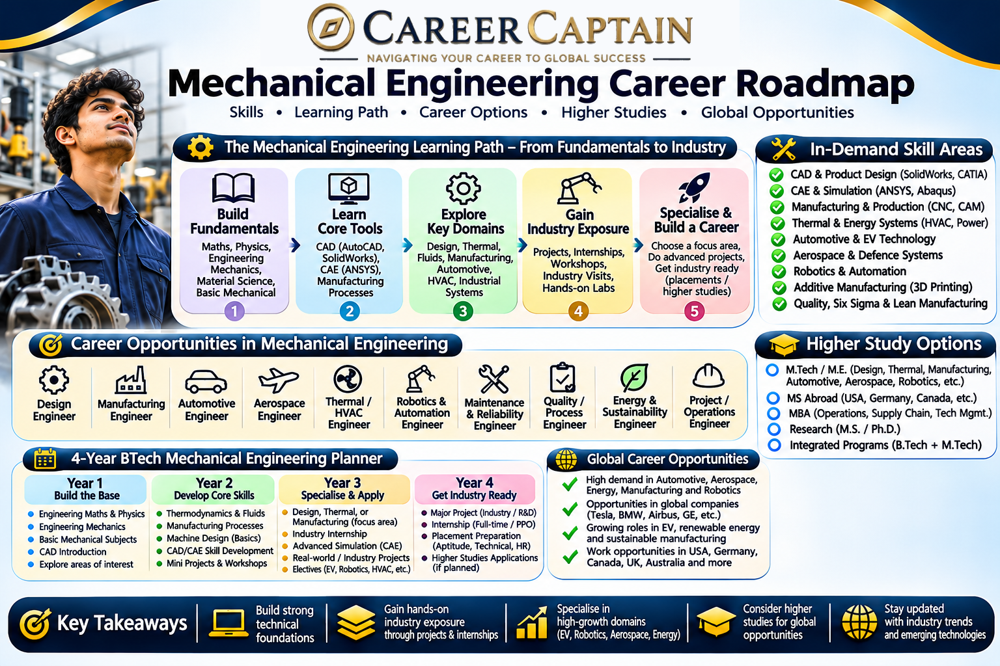

# Mechanical Engineering Career Roadmap in India: Opportunities, Skills, Specialisations and Future Scope

Mechanical Engineering is one of the broadest engineering disciplines. It combines physics, mathematics, materials science, design and manufacturing to develop machines, products, industrial systems and technologies.

From automobiles and aircraft to robotics, renewable energy, medical equipment and advanced manufacturing, mechanical engineers contribute to many industries.

However, a Mechanical Engineering degree alone does not determine career success. Students need to build practical skills, understand industry requirements and choose suitable specialisations.

This roadmap explains the opportunities available to Mechanical Engineering students in India and how to prepare for them.

---

  

## 1. What Is Mechanical Engineering?

Mechanical Engineering focuses on the design, analysis, development, manufacturing, operation and maintenance of mechanical systems.

Major areas include:

- Machine design and engineering drawing
- Thermodynamics and heat transfer
- Fluid mechanics
- Manufacturing technology
- Materials science and metallurgy
- Strength of materials
- Industrial engineering
- Automobile engineering
- Robotics and automation
- Energy systems

Mechanical engineers work in industries ranging from manufacturing and transportation to aerospace, energy, healthcare and research.

## 2. What Do You Study in a Mechanical Engineering Degree?

The exact curriculum varies by university, but most BTech Mechanical Engineering programmes include the following subjects.

### Core engineering subjects

| Subject | What You Learn |
|---|---|
| Engineering Mechanics | Forces, motion and equilibrium |
| Engineering Graphics | Technical drawings and visualisation |
| Strength of Materials | Stress, strain and material behaviour |
| Thermodynamics | Heat, work and energy conversion |
| Fluid Mechanics | Behaviour of liquids and gases |
| Manufacturing Technology | Production processes and methods |
| Theory of Machines | Motion and mechanisms |
| Machine Design | Designing mechanical components |
| Heat Transfer | Conduction, convection and radiation |
| Industrial Engineering | Productivity and process optimisation |
| Materials Science | Properties and selection of materials |
| CAD/CAM | Computer-aided design and manufacturing |

### Why these subjects matter

These subjects provide the foundation for specialisations such as automotive engineering, aerospace, product design, manufacturing, robotics and energy systems.

Students should focus on understanding engineering principles rather than memorising formulas only.

## 3. Major Career Paths in Mechanical Engineering

Mechanical Engineering offers several career directions. Students should explore different fields before deciding where to specialise.

### 3.1 Design and Product Development

Design engineers develop mechanical components, machines, equipment and consumer products.

Typical responsibilities:

- Creating 2D engineering drawings
- Developing 3D models
- Selecting materials
- Performing design calculations
- Testing prototypes
- Improving product performance

Useful tools:

- AutoCAD
- SolidWorks
- CATIA
- Siemens NX
- Creo
- Autodesk Fusion

Potential roles:

- Mechanical Design Engineer
- Product Design Engineer
- CAD Engineer
- Design and Development Engineer
- R&D Engineer

### 3.2 Automobile Engineering

Automobile engineers work on vehicle design, development, testing and production.

Areas of specialisation include:

- Vehicle dynamics
- Engine systems
- Transmission systems
- Automotive electronics
- Electric vehicles
- Battery systems
- Thermal management
- Vehicle safety
- Autonomous driving technologies

Potential roles:

- Automotive Design Engineer
- Vehicle Testing Engineer
- Powertrain Engineer
- EV Systems Engineer
- Automotive Quality Engineer

The growth of electric mobility is creating new opportunities in battery technology, electric drivetrains, charging infrastructure and vehicle integration.

### 3.3 Aerospace and Aviation

Aerospace engineering involves the development and testing of aircraft, spacecraft, propulsion systems and related technologies.

Mechanical engineers may contribute to:

- Aircraft structures
- Propulsion systems
- Thermal systems
- Manufacturing
- Materials engineering
- Maintenance and testing

Potential roles:

- Aerospace Design Engineer
- Propulsion Engineer
- Aircraft Maintenance-related technical roles, subject to required qualifications
- Manufacturing Engineer
- Testing Engineer

Specialised aerospace positions may require postgraduate education, additional training or specific regulatory qualifications.

### 3.4 Manufacturing and Production Engineering

Manufacturing engineers improve how products are produced.

Their work may involve:

- Production planning
- Process development
- Machine operation and optimisation
- Quality control
- Lean manufacturing
- Automation
- Industrial safety
- Production efficiency

Potential roles:

- Production Engineer
- Manufacturing Engineer
- Process Engineer
- Quality Engineer
- Industrial Engineer

### 3.5 Robotics and Automation

Robotics combines mechanical engineering with electronics, control systems and programming.

Mechanical engineers contribute to robot structures, mechanisms, actuators, motion systems and industrial automation.

Useful skills:

- Engineering mechanics
- Control systems
- CAD
- Sensors and actuators
- PLC programming
- Python or C++
- Robotics fundamentals

Potential roles:

- Robotics Engineer
- Automation Engineer
- Mechatronics Engineer
- Controls Engineer
- Industrial Automation Engineer

### 3.6 Energy and Renewable Energy

Mechanical engineers contribute to conventional and renewable energy systems.

Career areas include:

- Solar thermal systems
- Wind energy
- Power plants
- Turbines
- Energy efficiency
- HVAC systems
- Thermal power systems
- Hydrogen and emerging energy technologies

Potential roles:

- Energy Engineer
- HVAC Engineer
- Thermal Engineer
- Power Plant Engineer
- Renewable Energy Engineer

### 3.7 HVAC and Building Services

Heating, ventilation and air conditioning systems are essential in residential buildings, hospitals, commercial spaces, factories and data centres.

Mechanical engineers may work on:

- Cooling load calculations
- Ventilation design
- Air distribution
- Refrigeration systems
- Energy-efficient building systems
- Installation and commissioning

Potential roles:

- HVAC Design Engineer
- HVAC Project Engineer
- Refrigeration Engineer
- Building Services Engineer

### 3.8 Quality, Testing and Reliability

Quality engineers ensure that products meet technical specifications, safety requirements and customer expectations.

Typical work includes:

- Inspection and testing
- Root-cause analysis
- Failure analysis
- Quality documentation
- Process improvement
- Reliability assessment

Potential roles:

- Quality Engineer
- Testing Engineer
- Reliability Engineer
- Supplier Quality Engineer

---

## 4. Modern and Emerging Career Opportunities

Mechanical Engineering is evolving through automation, digital technologies and advanced manufacturing.

Students can explore these interdisciplinary areas.

| Emerging

---

## Plan your engineering pathway with Career Captain

Choosing an engineering branch is only one part of the decision. Students should also consider their interests, strengths, preferred work and future study options. Career Captain offers personalised career counselling and assessment to support informed decisions.

- [Career counselling in Hyderabad](https://careercaptain.co.in/career-counsellor-near-me?utm_source=career_roadmaps_india&utm_medium=referral&utm_campaign=github_career_roadmaps&utm_content=mechanical-engineering-career-roadmap)
- [Psychometric career assessment](https://guide.careercaptain.co.in/guides/psychometric-career-assessment/?utm_source=career_roadmaps_india&utm_medium=referral&utm_campaign=github_career_roadmaps&utm_content=mechanical-engineering-career-roadmap)
- [Online career counselling](https://careercaptain.co.in/areas-we-serve?utm_source=career_roadmaps_india&utm_medium=referral&utm_campaign=github_career_roadmaps&utm_content=mechanical-engineering-career-roadmap)

[Visit Career Captain](https://careercaptain.co.in?utm_source=career_roadmaps_india&utm_medium=referral&utm_campaign=github_career_roadmaps&utm_content=mechanical-engineering-career-roadmap) · [WhatsApp Career Captain](https://wa.me/919849488838?text=Hi%20Career%20Captain%2C%20I%20found%20your%20mechanical%20engineering%20career%20roadmap%20guide%20in%20Career%20Roadmaps%20India.%20I%20would%20like%20to%20know%20more%20about%20career%20guidance.%20Source%3A%20mechanical-engineering-career-roadmap.)
