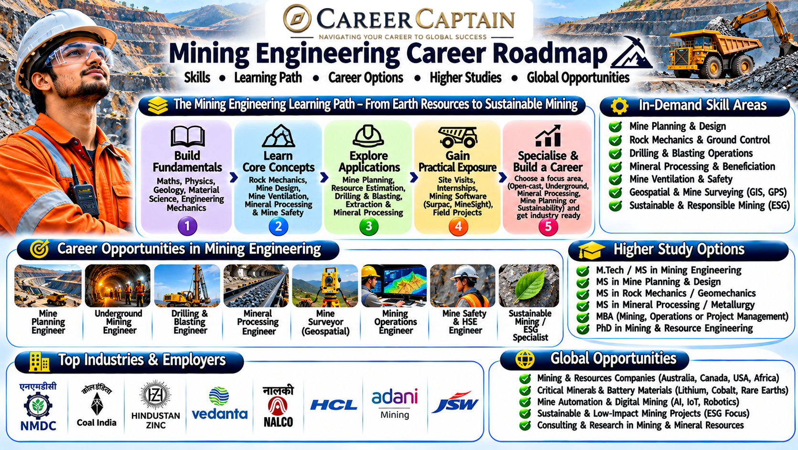

# Mining Engineering Career Roadmap

A comprehensive guide for students exploring Mining Engineering, covering academic foundations, technical skills, specialisations, industry opportunities, and career growth in India.

Mining Engineering combines geology, engineering, technology, safety, and resource management. It focuses on the responsible extraction of minerals and other geological resources while improving operational efficiency and minimising environmental impact.

  

## 1. What Is Mining Engineering?

Mining Engineering is the branch of engineering concerned with the planning, design, development, operation, and closure of mines.

Mining engineers work with mineral deposits and develop methods to extract resources safely and efficiently. They may work in surface mines, underground mines, mineral-processing facilities, research organisations, and mining technology companies.

Common resources include:

- Coal and lignite
- Iron ore
- Bauxite
- Copper
- Gold
- Limestone
- Manganese
- Zinc
- Critical minerals and rare earth elements

The discipline combines engineering principles with geology, environmental science, automation, and occupational safety.

## 2. Subjects You Study

The curriculum varies by institution, but commonly includes:

**First Year – Engineering Foundations**
- Engineering Mathematics
- Engineering Physics
- Engineering Chemistry
- Engineering Mechanics
- Basic Electrical and Mechanical Engineering
- Engineering Graphics
- Programming Fundamentals

**Second Year – Mining Fundamentals**
- Introduction to Mining Engineering
- Engineering Geology
- Mine Surveying
- Strength of Materials
- Mining Machinery
- Rock Mechanics
- Mine Development

**Third Year – Core Mining Applications**
- Underground Mining Methods
- Surface Mining Technology
- Mine Ventilation
- Drilling and Blasting
- Mine Safety Engineering
- Mineral Processing
- Mine Environmental Engineering

**Fourth Year – Advanced Applications**
- Mine Planning and Design
- Mine Management
- Mine Economics
- Advanced Rock Mechanics
- Mine Automation
- Mine Closure and Reclamation
- Industrial Training and Major Project

## 3. Major Career Paths

Mining Engineering offers several technical and managerial career directions.

### Mine Planning Engineer
Develops mine layouts, production schedules, excavation plans, and operational strategies.

### Underground Mining Engineer
Plans and supervises underground extraction operations, including tunnels, shafts, and underground production systems.

### Open-Pit Mining Engineer
Works on surface mine design, bench development, haul-road planning, equipment selection, and production management.

### Mine Safety Engineer
Focuses on hazard identification, risk assessment, emergency preparedness, safety procedures, and regulatory compliance.

### Rock Mechanics Engineer
Studies the behaviour and stability of rocks surrounding excavations, tunnels, slopes, and underground structures.

### Mine Ventilation Engineer
Designs and monitors ventilation systems to maintain safe underground air quality and temperature conditions.

### Drilling and Blasting Engineer
Plans drilling patterns and controlled blasting operations to fragment rock safely and efficiently.

### Mineral Processing Engineer
Works on crushing, grinding, separation, concentration, and recovery of valuable minerals.

### Mine Surveyor
Uses surveying instruments and digital mapping technologies to measure mine boundaries, excavations, and production areas.

### Mining Technology Specialist
Works with automation, remote equipment, digital mine models, sensors, and data-driven mining operations.

## 4. Emerging Technologies

Mining is increasingly adopting digital and automated technologies.

- **Autonomous haulage:** Driverless trucks and automated material movement.
- **Remote-controlled equipment:** Machinery operated from safer control centres.
- **Drone surveying:** Aerial mapping, stockpile measurement, and inspection.
- **Digital twins:** Virtual models of mines and their operations.
- **Artificial intelligence:** Predictive maintenance, geological interpretation, and operational optimisation.
- **Internet of Things:** Sensors monitoring equipment, environmental conditions, and worker safety.
- **Advanced geospatial systems:** GIS, GPS, and satellite-based mine monitoring.
- **Electric mining equipment:** Battery-powered vehicles and machinery to reduce emissions.
- **Real-time monitoring:** Systems that track production, ventilation, and ground conditions.

## 5. Software and Technical Skills

Mining engineers benefit from a combination of engineering, surveying, modelling, and data-analysis skills.

**Mine planning and design**
- Deswik
- Surpac
- MinePlan
- Datamine
- Vulcan

**Geospatial and surveying**
- ArcGIS
- QGIS
- AutoCAD
- Civil 3D

**Rock mechanics and simulation**
- FLAC3D
- RS2
- Rocscience software suite

**Data and programming**
- Excel
- Python
- SQL
- Power BI

Software availability and industry preferences vary. Focus on understanding the engineering concepts behind the tools rather than learning software without practical application.

## 6. Four-Year Roadmap

### First Year: Build Your Foundation
- Strengthen mathematics, physics, and mechanics.
- Learn basic programming.
- Develop technical drawing skills.
- Understand the fundamentals of geology.
- Explore mining operations through introductory resources.

### Second Year: Understand Mining Systems
- Study mine surveying and rock mechanics.
- Learn the fundamentals of surface and underground mining.
- Practise technical drawing and basic mine planning.
- Participate in technical clubs and student projects.
- Begin learning relevant industry software.

### Third Year: Develop Specialisation
- Explore mine ventilation, drilling, blasting, and mineral processing.
- Choose an area of interest.
- Complete practical projects using mine-planning or geospatial tools.
- Seek industrial training or internships.
- Develop awareness of mining regulations and safety practices.

### Fourth Year: Prepare for Industry
- Complete a substantial mining-related project.
- Seek industry internships and practical exposure.
- Build a portfolio of technical work.
- Prepare for campus recruitment and competitive examinations.
- Research postgraduate options and professional specialisations.

## 7. Important Projects

Practical projects help demonstrate engineering understanding.

1. **Open-Pit Mine Design:** Develop a conceptual surface mine layout with benches, haul roads, and production zones.
2. **Underground Mine Ventilation Model:** Create a simplified ventilation network and analyse airflow distribution.
3. **Mine Surveying Project:** Map a small area using surveying equipment and prepare a digital site plan.
4. **Drilling Pattern Analysis:** Compare drilling layouts for a hypothetical rock excavation.
5. **Slope Stability Study:** Investigate factors affecting the stability of an open-pit mine slope.
6. **Mineral Processing Simulation:** Model the stages involved in separating valuable minerals from ore.
7. **Mine Safety Monitoring:** Design a sensor-based concept for monitoring environmental conditions.
8. **Mine Closure Plan:** Prepare a conceptual rehabilitation plan for a depleted mining site.

Clearly state project assumptions, data sources, limitations, and safety considerations.

## 8. Internships and Industry Exposure

Practical exposure is essential because mining operations involve equipment, geological conditions, operational procedures, and safety systems that cannot be fully understood through classroom study.

Explore opportunities with:

- Coal India Limited and its subsidiaries
- NMDC Limited
- Hindustan Zinc
- NLC India Limited
- MOIL Limited
- Steel Authority of India Limited
- Geological Survey of India
- Mining contractors and equipment manufacturers
- Mineral-processing and mining technology companies

Possible internship areas include mine planning, surveying, geology, mineral processing, safety, ventilation, and equipment maintenance.

Follow the organisation's official internship and recruitment announcements. Mine visits and industrial training must comply with access permissions and safety requirements.

## 9. Government and Public-Sector Opportunities in India

Mining graduates can explore opportunities in public-sector organisations and government-related technical services.

Potential employers include:

- Coal India Limited
- NMDC Limited
- NLC India Limited
- MOIL Limited
- Hindustan Copper Limited
- Steel Authority of India Limited
- Geological Survey of India
- Indian Bureau of Mines

Recruitment routes, eligibility, and job titles vary by organisation and notification.

Some regulatory and statutory mining positions require prescribed qualifications, experience, certificates, or other eligibility conditions. Check the applicable official recruitment notification and mining regulations before applying.

## 10. Higher Education and Specialisation

Postgraduate study can help engineers develop advanced expertise.

Possible specialisations include:

- Mine Planning and Design
- Underground Mining
- Surface Mining
- Rock Mechanics and Ground Control
- Mine Ventilation
- Mineral Processing
- Mine Safety Engineering
- Mining Machinery
- Mine Environmental Management
- Geoinformatics and Remote Sensing
- Mining Automation and Robotics

Students can explore M.Tech programmes, research degrees, and relevant interdisciplinary programmes at institutions offering mining and mineral engineering education.

Research each programme's eligibility criteria, entrance requirements, curriculum, laboratory facilities, and industry connections.

## 11. Salary and Career Growth

Mining compensation depends on the employer, location, qualification, operational environment, experience, and nature of the role.

Typical career progression may include:

1. Graduate Engineer Trainee
2. Junior Mining Engineer
3. Mining Engineer
4. Senior Mining Engineer
5. Mine Planning or Operations Manager
6. Mine Manager or Technical Specialist
7. Senior Management or Independent Consultant

Public-sector and private-sector compensation structures can differ considerably. Some mining positions may also involve site allowances, shift arrangements, remote postings, and other benefits.

Evaluate opportunities based on safety standards, learning potential, technical exposure, career progression, and working conditions—not salary alone.

## 12. Essential Soft Skills

Successful mining engineers need more than technical knowledge.

- **Safety awareness:** Recognising hazards and following established procedures.
- **Leadership:** Coordinating teams and operational activities.
- **Communication:** Explaining technical instructions clearly.
- **Decision-making:** Responding to changing site conditions.
- **Problem-solving:** Resolving production and equipment challenges.
- **Teamwork:** Working with geologists, technicians, operators, and managers.
- **Adaptability:** Learning new technologies and operational systems.
- **Environmental responsibility:** Understanding the effects of mining on land, water, and communities.

## 13. Common Mistakes to Avoid

- Treating mining as only a traditional excavation-based industry.
- Ignoring geology, mathematics, and mechanics.
- Learning software without understanding mining principles.
- Neglecting occupational health and safety.
- Avoiding practical exposure and industrial training.
- Overlooking environmental management and mine rehabilitation.
- Assuming every mining job involves the same working conditions.
- Choosing a specialisation without understanding its actual responsibilities.
- Ignoring the eligibility requirements for statutory and regulatory roles.

## 14. How to Choose Your Specialisation

Start by identifying which aspects of mining interest you most.

| Your Interest | Possible Specialisation |
|---|---|
| Mine layouts and production planning | Mine Planning and Design |
| Underground operations | Underground Mining |
| Large-scale surface excavation | Surface Mining |
| Rock behaviour and stability | Rock Mechanics |
| Airflow and underground conditions | Mine Ventilation |
| Mineral separation and recovery | Mineral Processing |
| Workplace risk management | Mine Safety Engineering |
| Automation and digital systems | Mining Technology |
| Land restoration and sustainability | Mine Environmental Management |

Where possible, speak with practising professionals, attend technical events, and seek supervised industry exposure before making a decision.

## 15. Useful Learning and Official Resources

Use reliable technical and institutional resources to build your knowledge.

- [Indian Bureau of Mines](https://ibm.gov.in/) — Mineral statistics, mining information, and regulatory resources.
- [Ministry of Mines](https://mines.gov.in/) — Government policies, initiatives, and sector information.
- [Directorate General of Mines Safety](https://dgms.gov.in/) — Mining safety regulations and guidance.
- [Geological Survey of India](https://www.gsi.gov.in/) — Geological information and publications.
- [Coal India Limited](https://www.coalindia.in/) — Information about India's coal-mining sector.
- [NMDC Limited](https://www.nmdc.co.in/) — Mineral exploration and mining industry information.
- [Society for Mining, Metallurgy & Exploration](https://www.smenet.org/) — Professional mining and mineral-industry resources.
- [International Council on Mining and Metals](https://www.icmm.com/) — Responsible mining and sustainability resources.

Always verify current regulations, recruitment details, and educational requirements through the relevant official organisation.

## 16. Final Thoughts

Mining Engineering is evolving through automation, digital planning, advanced surveying, mineral-processing innovations, and stronger environmental responsibilities.

Students who combine sound engineering fundamentals with practical experience, safety awareness, and modern technical skills can explore opportunities across mining operations, mineral processing, research, equipment development, and technology.

The strongest career decisions begin with understanding your interests, evaluating your strengths, and researching the actual demands of each specialisation.

### Explore Your Career with Career Captain

Career Captain Global Solutions helps students explore academic pathways, understand career options, and make informed education and career decisions through structured career guidance and assessment.

**Explore:** [Career Captain](https://careercaptain.co.in?utm_source=career_roadmaps_india&utm_medium=referral&utm_campaign=github_career_roadmaps&utm_content=mining-engineering-career-roadmap)

---

*Disclaimer: This roadmap is intended for educational and career-exploration purposes. Course structures, recruitment requirements, statutory qualifications, salaries, and industry practices may change. Verify current information with the relevant institutions and official authorities.*

*License: Creative Commons Attribution 4.0 International (CC BY 4.0).*

---

## Plan your engineering pathway with Career Captain

Choosing an engineering branch is only one part of the decision. Students should also consider their interests, strengths, preferred work and future study options. Career Captain offers personalised career counselling and assessment to support informed decisions.

- [Career counselling in Hyderabad](https://careercaptain.co.in/career-counsellor-near-me?utm_source=career_roadmaps_india&utm_medium=referral&utm_campaign=github_career_roadmaps&utm_content=mining-engineering-career-roadmap)
- [Psychometric career assessment](https://guide.careercaptain.co.in/guides/psychometric-career-assessment/?utm_source=career_roadmaps_india&utm_medium=referral&utm_campaign=github_career_roadmaps&utm_content=mining-engineering-career-roadmap)
- [Online career counselling](https://careercaptain.co.in/areas-we-serve?utm_source=career_roadmaps_india&utm_medium=referral&utm_campaign=github_career_roadmaps&utm_content=mining-engineering-career-roadmap)

[Visit Career Captain](https://careercaptain.co.in?utm_source=career_roadmaps_india&utm_medium=referral&utm_campaign=github_career_roadmaps&utm_content=mining-engineering-career-roadmap) · [WhatsApp Career Captain](https://wa.me/919849488838?text=Hi%20Career%20Captain%2C%20I%20found%20your%20mining%20engineering%20career%20roadmap%20guide%20in%20Career%20Roadmaps%20India.%20I%20would%20like%20to%20know%20more%20about%20career%20guidance.%20Source%3A%20mining-engineering-career-roadmap.)
