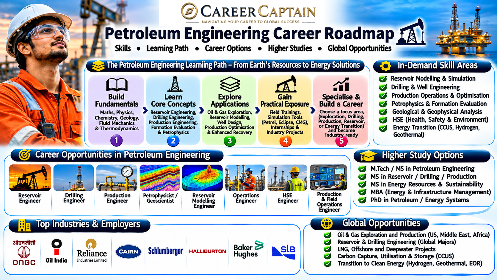

# Petroleum Engineering Career Roadmap

A comprehensive guide for students exploring Petroleum Engineering, covering academic foundations, technical skills, specialisations, industry opportunities, and career growth in India and internationally.

Petroleum Engineering applies engineering, geology, mathematics, and technology to the exploration, development, production, and management of oil and natural gas resources. The field is also evolving through digital technologies, energy efficiency, carbon management, geothermal systems, and other emerging energy applications.

  

## 1. What Is Petroleum Engineering?

Petroleum Engineering is the branch of engineering concerned with recovering hydrocarbons from underground reservoirs.

Petroleum engineers work with geologists, geophysicists, drilling teams, production specialists, and other professionals to evaluate reservoirs and develop technically and economically viable extraction methods.

The discipline includes:

- Exploration and reservoir evaluation
- Well planning and drilling
- Well completion and production
- Reservoir management
- Enhanced oil recovery
- Offshore and onshore operations
- Production optimisation
- Health, safety, and environmental management

Petroleum Engineering requires an understanding of fluid mechanics, thermodynamics, geology, rock properties, and subsurface fluid behaviour.

## 2. Subjects You Study

Course structures vary across universities, but commonly include the following subjects.

**First Year – Engineering Foundations**
- Engineering Mathematics
- Engineering Physics
- Engineering Chemistry
- Engineering Mechanics
- Basic Electrical and Mechanical Engineering
- Programming Fundamentals
- Engineering Graphics

**Second Year – Petroleum Fundamentals**
- Introduction to Petroleum Engineering
- Petroleum Geology
- Fluid Mechanics
- Thermodynamics
- Strength of Materials
- Drilling Engineering Fundamentals
- Reservoir Rock and Fluid Properties

**Third Year – Core Petroleum Applications**
- Reservoir Engineering
- Drilling Engineering
- Production Engineering
- Well Logging and Formation Evaluation
- Petroleum Exploration
- Well Completion
- Petroleum Economics
- Offshore Engineering Fundamentals

**Fourth Year – Advanced Applications**
- Advanced Reservoir Engineering
- Enhanced Oil Recovery
- Well Testing and Analysis
- Production Optimisation
- Petroleum Project Management
- Health, Safety and Environmental Engineering
- Industrial Training and Major Project

## 3. Major Career Paths

Petroleum Engineering offers several technical specialisations.

### Reservoir Engineer
Studies underground reservoirs and estimates their ability to produce oil and gas. Reservoir engineers develop production strategies and evaluate recovery methods.

### Drilling Engineer
Plans and supervises drilling operations, including well design, drilling-fluid selection, equipment requirements, and operational risk management.

### Production Engineer
Works to improve the flow of hydrocarbons from reservoirs to the surface. Responsibilities include production optimisation, artificial lift, and well performance.

### Well Completion Engineer
Designs and manages the equipment and processes required to prepare a drilled well for production.

### Formation Evaluation Engineer
Interprets well-log and subsurface data to understand rock properties, fluid content, and reservoir characteristics.

### Well Testing Engineer
Analyses pressure and flow measurements to evaluate well performance and reservoir behaviour.

### Petroleum Geologist
Works with geological data to identify and evaluate potential hydrocarbon-bearing formations. This role commonly involves close collaboration with geoscientists and engineers.

### Offshore Operations Engineer
Supports engineering and operational activities on offshore drilling and production facilities.

### Petroleum Data Analyst
Uses engineering data, programming, and analytical tools to support reservoir evaluation, production forecasting, and operational decisions.

### Energy Transition Specialist
Applies subsurface and engineering knowledge to areas such as carbon capture and storage, geothermal energy, and underground hydrogen storage.

## 4. Emerging Technologies

Petroleum Engineering is being reshaped by digitalisation, automation, and changing energy requirements.

- **Artificial intelligence:** Supports geological interpretation, production forecasting, and equipment maintenance.
- **Digital oilfields:** Integrate sensors, operational data, and control systems for improved decision-making.
- **Advanced drilling systems:** Include directional drilling, horizontal drilling, and measurement-while-drilling technologies.
- **Real-time reservoir monitoring:** Uses downhole sensors and production data to understand reservoir behaviour.
- **Digital twins:** Create virtual representations of wells, equipment, and production systems.
- **Robotics and automation:** Support inspection and operations in hazardous or difficult-to-access environments.
- **Enhanced oil recovery:** Uses specialised techniques to improve hydrocarbon recovery from reservoirs.
- **Carbon capture and storage:** Uses subsurface engineering knowledge to assess and manage geological storage.
- **Geothermal systems:** Apply drilling and subsurface engineering methods to access underground heat.
- **Advanced simulation:** Improves reservoir modelling, drilling design, and production planning.

## 5. Software and Technical Skills

Petroleum engineers use specialised software for reservoir modelling, drilling design, production analysis, and data interpretation.

**Reservoir simulation and modelling**
- Eclipse
- INTERSECT
- CMG
- Petrel

**Drilling and well engineering**
- Landmark software
- WellPlan
- Drillbench

**Production and well analysis**
- PROSPER
- GAP
- Pipesim

**Geological interpretation**
- Petrel
- Techlog
- Kingdom

**Programming and data analysis**
- Python
- MATLAB
- SQL
- Excel
- Power BI

Software access and employer preferences vary. Build a strong understanding of the underlying engineering concepts before concentrating on individual applications.

## 6. Four-Year Roadmap

### First Year: Build Your Foundation
- Strengthen mathematics, physics, and chemistry.
- Learn basic programming.
- Understand engineering mechanics and fluid behaviour.
- Explore introductory geology.
- Develop technical communication skills.

### Second Year: Understand Petroleum Systems
- Study petroleum geology and fluid mechanics.
- Learn about reservoir rocks and fluids.
- Understand drilling fundamentals.
- Explore well logging and formation evaluation.
- Begin learning relevant engineering software.

### Third Year: Develop Technical Expertise
- Study reservoir, drilling, and production engineering.
- Explore well completion and well testing.
- Select an area of technical interest.
- Complete simulation or data-analysis projects.
- Seek industrial training and internships.

### Fourth Year: Prepare for Industry
- Complete a substantial petroleum engineering project.
- Develop a portfolio of technical work.
- Apply for internships and graduate opportunities.
- Prepare for relevant recruitment examinations.
- Research postgraduate programmes and emerging energy specialisations.

## 7. Important Projects

Practical projects help students apply engineering principles.

1. **Reservoir Simulation:** Build a simplified reservoir model and study production behaviour under different assumptions.
2. **Drilling Hydraulics Analysis:** Investigate pressure losses and fluid circulation in a hypothetical well.
3. **Well Log Interpretation:** Analyse sample well-log data to identify possible reservoir intervals.
4. **Production Optimisation:** Compare production scenarios and evaluate possible improvements.
5. **Decline Curve Analysis:** Study historical production data and estimate future production trends.
6. **Enhanced Oil Recovery Study:** Compare selected recovery techniques for a hypothetical reservoir.
7. **Well Design Project:** Prepare a conceptual well design, including casing and drilling considerations.
8. **Carbon Storage Assessment:** Develop a preliminary study of geological conditions relevant to subsurface carbon storage.

State all assumptions, data sources, and limitations clearly. Use simulated or publicly available datasets where operational data is not available.

## 8. Internships and Industry Exposure

Industry exposure helps students understand drilling operations, production facilities, reservoir studies, and workplace safety.

Explore opportunities with organisations such as:

- Oil and Natural Gas Corporation (ONGC)
- Oil India Limited
- Indian Oil Corporation Limited
- Bharat Petroleum Corporation Limited
- Hindustan Petroleum Corporation Limited
- GAIL (India) Limited
- Vedanta Limited
- Petroleum and Natural Gas Regulatory Board-related industry organisations
- Engineering service providers and energy technology companies

Possible exposure areas include drilling, reservoir studies, production operations, well logging, pipeline systems, refinery operations, and energy technology.

Not every organisation offers internships in every specialisation. Check official career and internship announcements, eligibility requirements, and application dates.

## 9. Government and Public-Sector Opportunities in India

Petroleum graduates can explore technical and engineering opportunities in public-sector energy organisations.

Potential employers include:

- Oil and Natural Gas Corporation (ONGC)
- Oil India Limited
- Indian Oil Corporation Limited
- Bharat Petroleum Corporation Limited
- Hindustan Petroleum Corporation Limited
- GAIL (India) Limited
- Engineers India Limited
- Directorate General of Hydrocarbons

Recruitment routes differ by organisation and role. Some positions may recruit through graduate engineering examinations, organisation-specific selection processes, interviews, or other prescribed methods.

Check each official recruitment notification for eligible degrees, disciplines, examinations, experience requirements, and selection procedures.

## 10. Higher Education and Specialisation

Postgraduate education can help engineers develop deeper expertise.

Possible areas include:

- Reservoir Engineering
- Drilling Engineering
- Production Engineering
- Petroleum Geoscience
- Well Logging and Formation Evaluation
- Offshore Engineering
- Natural Gas Engineering
- Petroleum Economics and Management
- Computational Reservoir Engineering
- Carbon Capture and Storage
- Geothermal Energy Engineering
- Energy Systems and Sustainability

Students can explore M.Tech, M.S., and research programmes in petroleum engineering and related disciplines.

Compare course content, laboratory facilities, research opportunities, faculty expertise, eligibility requirements, and industry connections before choosing a programme.

## 11. Salary and Career Growth

Petroleum engineering compensation varies significantly according to the employer, location, qualification, technical specialisation, experience, and operational responsibilities.

Career progression may include:

1. Graduate Engineer Trainee
2. Junior Petroleum Engineer
3. Reservoir, Drilling, or Production Engineer
4. Senior Petroleum Engineer
5. Lead Engineer or Technical Specialist
6. Engineering Manager
7. Asset Manager or Senior Technical Leader

Onshore and offshore assignments may have different working arrangements and compensation structures. International opportunities also depend on local regulations, experience, and employer requirements.

Evaluate roles based on technical learning, safety practices, career progression, work location, and long-term industry outlook—not salary alone.

## 12. Essential Soft Skills

Petroleum engineers work in multidisciplinary teams and often make decisions involving complex technical and operational conditions.

Important skills include:

- **Analytical thinking:** Interpreting geological, reservoir, and production data.
- **Problem-solving:** Addressing drilling and production challenges.
- **Communication:** Explaining technical findings clearly.
- **Teamwork:** Coordinating with geologists, technicians, and operations teams.
- **Safety awareness:** Recognising and managing operational hazards.
- **Decision-making:** Evaluating technical and economic alternatives.
- **Adaptability:** Responding to changing operational and energy-sector requirements.
- **Environmental responsibility:** Understanding the environmental implications of energy development.

## 13. Common Mistakes to Avoid

- Assuming Petroleum Engineering is limited to drilling.
- Ignoring geology, mathematics, and fluid mechanics.
- Learning software without understanding engineering principles.
- Neglecting safety and environmental responsibilities.
- Avoiding practical projects and industry exposure.
- Overlooking data analysis and programming skills.
- Assuming all petroleum jobs require offshore assignments.
- Ignoring the changing role of low-carbon and alternative energy technologies.
- Choosing a specialisation without researching its actual responsibilities.

## 14. How to Choose Your Specialisation

Consider your interests and technical strengths before selecting a specialisation.

| Your Interest | Possible Specialisation |
|---|---|
| Underground reservoirs and fluid behaviour | Reservoir Engineering |
| Well construction and drilling systems | Drilling Engineering |
| Improving hydrocarbon production | Production Engineering |
| Well equipment and production readiness | Well Completion Engineering |
| Geological and well-log interpretation | Formation Evaluation |
| Pressure and flow analysis | Well Testing |
| Offshore facilities and operations | Offshore Engineering |
| Data analysis and simulation | Computational Petroleum Engineering |
| Subsurface carbon storage | Carbon Capture and Storage |
| Underground heat and energy systems | Geothermal Engineering |

Speak with faculty members and practising professionals, explore technical projects, and investigate the working conditions associated with each area.

## 15. Useful Learning and Official Resources

Use reliable sources to understand the petroleum industry and develop technical knowledge.

- [Directorate General of Hydrocarbons](https://www.dghindia.gov.in/) — Exploration and production information in India.
- [Ministry of Petroleum and Natural Gas](https://mopng.gov.in/) — Government policies and energy-sector information.
- [ONGC](https://ongcindia.com/) — Exploration and production activities.
- [Oil India Limited](https://www.oil-india.com/) — Oil and gas operations and career information.
- [Indian Oil Corporation Limited](https://iocl.com/) — Energy, refining, pipelines, and related operations.
- [Society of Petroleum Engineers](https://www.spe.org/) — Technical publications, professional development, and industry resources.
- [International Energy Agency](https://www.iea.org/) — Energy research, reports, and transition analysis.
- [U.S. Energy Information Administration](https://www.eia.gov/) — Energy statistics and industry information.

Verify current recruitment details, educational requirements, and regulations through official sources.

## 16. Final Thoughts

Petroleum Engineering is a multidisciplinary field that combines subsurface science, engineering design, drilling, production, and data analysis.

Although the traditional oil and gas industry remains an important part of the discipline, emerging applications in carbon storage, geothermal energy, digital operations, and broader energy systems are expanding the range of technical skills that engineers can develop.

Students who build strong fundamentals, gain practical exposure, and remain adaptable can explore careers across petroleum operations, engineering services, research, and emerging energy technologies.

### Explore Your Career with Career Captain

Career Captain Global Solutions helps students explore academic pathways, understand career options, and make informed education and career decisions through structured career guidance and assessment.

**Explore:** [Career Captain](https://careercaptain.co.in?utm_source=career_roadmaps_india&utm_medium=referral&utm_campaign=github_career_roadmaps&utm_content=petroleum-engineering-career-roadmap)

---

*Disclaimer: This roadmap is intended for educational and career-exploration purposes. Course structures, recruitment requirements, salaries, and industry practices may change. Verify current information with the relevant institutions and official authorities.*

*License: Creative Commons Attribution 4.0 International (CC BY 4.0).*

---

## Plan your engineering pathway with Career Captain

Choosing an engineering branch is only one part of the decision. Students should also consider their interests, strengths, preferred work and future study options. Career Captain offers personalised career counselling and assessment to support informed decisions.

- [Career counselling in Hyderabad](https://careercaptain.co.in/career-counsellor-near-me?utm_source=career_roadmaps_india&utm_medium=referral&utm_campaign=github_career_roadmaps&utm_content=petroleum-engineering-career-roadmap)
- [Psychometric career assessment](https://guide.careercaptain.co.in/guides/psychometric-career-assessment/?utm_source=career_roadmaps_india&utm_medium=referral&utm_campaign=github_career_roadmaps&utm_content=petroleum-engineering-career-roadmap)
- [Online career counselling](https://careercaptain.co.in/areas-we-serve?utm_source=career_roadmaps_india&utm_medium=referral&utm_campaign=github_career_roadmaps&utm_content=petroleum-engineering-career-roadmap)

[Visit Career Captain](https://careercaptain.co.in?utm_source=career_roadmaps_india&utm_medium=referral&utm_campaign=github_career_roadmaps&utm_content=petroleum-engineering-career-roadmap) · [WhatsApp Career Captain](https://wa.me/919849488838?text=Hi%20Career%20Captain%2C%20I%20found%20your%20petroleum%20engineering%20career%20roadmap%20guide%20in%20Career%20Roadmaps%20India.%20I%20would%20like%20to%20know%20more%20about%20career%20guidance.%20Source%3A%20petroleum-engineering-career-roadmap.)
