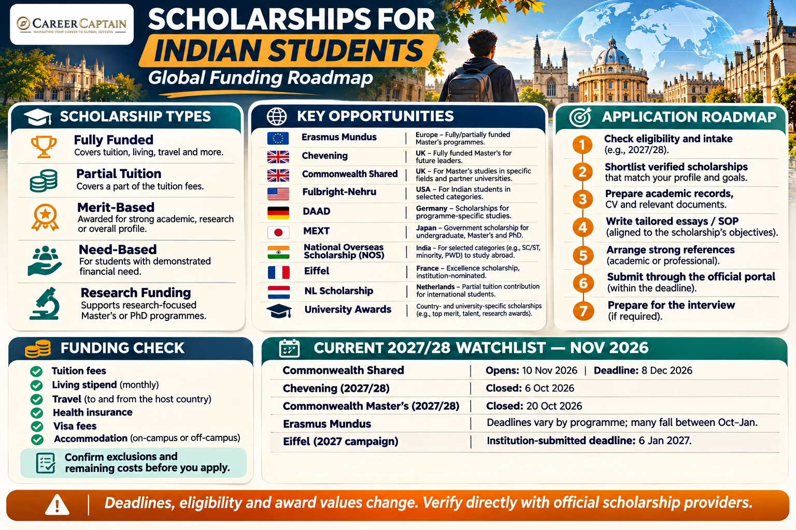

*Last reviewed: 12 November 2026. Scholarship amounts, eligibility and deadlines change by intake; verify every award with its official provider before applying.*

**A practical guide to fully funded scholarships, partial tuition waivers, government funding, eligibility, application documents and scholarship strategies for Indian students.**

Studying abroad can open doors to international education, research opportunities and global career pathways. However, tuition fees, accommodation, travel and living expenses can make overseas education financially challenging.

Scholarships can reduce this burden. Some cover tuition fees, living expenses and travel, while others provide only a partial reduction in tuition fees.

For Indian students, scholarship opportunities are available through:

- The Government of India.
- Foreign governments.
- International organisations.
- Universities and educational institutions.
- Private foundations.
- Research and development programmes.

This guide explains the major opportunities, how to identify suitable scholarships and how to prepare a competitive application.

---

## Application Checklist for Indian Students

Use this checklist to build a realistic scholarship application plan. Requirements differ by award, country, university and intake.

- [ ] Decide your intended degree level, subject, intake year and preferred destinations.
- [ ] Check nationality, age, academic, subject, work-experience and residency eligibility for each award.
- [ ] Confirm whether the scholarship is open for the intended intake and whether Indian applicants are eligible in the current cycle.
- [ ] Read the official award terms, including return-home obligations, restrictions on other funding and conditions for retaining the award.
- [ ] Check exactly what is funded: tuition, stipend, travel, insurance, visa, accommodation and dependants.
- [ ] Confirm whether you must apply for university admission first, apply to the scholarship first, or submit both applications separately.
- [ ] Prepare passport, Class 10/12 records, degree certificates, transcripts and grading-scale information as required.
- [ ] Prepare a tailored CV, statement of purpose, scholarship essays and research proposal where applicable.
- [ ] Arrange recommendation letters from referees who can provide specific evidence of your academic or professional ability.
- [ ] Prepare accepted English-language test results if required by the university or scholarship.
- [ ] Gather work-experience evidence, leadership records, publications, project evidence or portfolio items where relevant.
- [ ] For need-based or targeted government schemes, prepare the exact income, category, domicile or other eligibility documents specified in the official rules.
- [ ] Submit through the official scholarship or university portal before the deadline, allowing time for technical issues.
- [ ] Save the submitted application, confirmation, reference number and all uploaded documents.
- [ ] If shortlisted, prepare for interviews and verify the award conditions before accepting.
- [ ] Before departure, confirm visa requirements, remaining costs and how scholarship payments will be made.

**Important:** Never pay an agent who guarantees a scholarship. A scholarship offer must be verified directly with the awarding body or university.

## 1. Understand the Different Types of Scholarships

Before applying, understand what a scholarship actually covers.

### A. Fully Funded Scholarships

A fully funded scholarship may cover several major expenses:

- Full or substantial tuition fees.
- Monthly living allowance.
- Accommodation support.
- Travel expenses.
- Health insurance.
- Research or study-related allowances.

The exact benefits depend on the scholarship programme.

### B. Partial Scholarships

Partial scholarships cover only a portion of the total cost.

For example:
- 25% tuition-fee reduction.
- 50% tuition-fee reduction.
- A fixed tuition grant.
- A one-time financial award.

Students must arrange the remaining expenses themselves.

### C. Merit-Based Scholarships

These are awarded based on academic performance, achievements, leadership, research potential or other selection criteria.

### D. Need-Based Scholarships

These consider the applicant's financial circumstances and ability to fund overseas education.

### E. Research Scholarships

These are particularly relevant for students pursuing master's by research, doctoral programmes and other research-intensive degrees.

Funding may come from universities, research groups, government agencies or external organisations.

**Important:** A scholarship advertised as fully funded may still have exclusions. Always read the official award conditions and calculate the remaining costs.

## 2. Major International Scholarships for Indian Students

The following programmes are useful starting points. Eligibility, funding and application arrangements vary by programme and academic year.

### 1. Erasmus Mundus Joint Masters — Europe

**Study destination:** Multiple European countries.

**Study level:** Master's.

Erasmus Mundus Joint Masters are international master's programmes designed and delivered by partnerships of higher education institutions.

Students may study at multiple universities in different countries during the programme.

**Scholarship benefits may include:**
- Participation costs.
- Travel contribution.
- Visa-related contribution.
- Living allowance.

The European Commission's programme information describes a scholarship contribution of €1,400 per month for the duration of the eligible programme, subject to the applicable programme rules.

**Who should consider applying?**
- Students with a recognised bachelor's degree.
- Final-year undergraduate students who meet the programme conditions.
- Applicants with strong academic and relevant subject backgrounds.

**Application process:**
1. Search the official Erasmus Mundus catalogue.
2. Identify suitable joint master's programmes.
3. Review the programme's admission requirements.
4. Prepare academic and supporting documents.
5. Apply directly to the institution or programme consortium.
6. Follow the scholarship selection procedure.

Many programmes accept applications between October and January for the following academic year, but dates differ.

Official website: https://erasmus-plus.ec.europa.eu/opportunities/individuals/students/erasmus-mundus-joint-masters

### 2. Chevening Scholarships — United Kingdom

**Study destination:** United Kingdom.

**Study level:** One-year master's programmes.

Chevening is a UK government scholarship programme supporting future leaders and professionals.

**Scholarship benefits generally include:**
- University tuition fees, subject to programme conditions.
- Living allowance.
- Travel to and from the UK.
- Certain additional allowances.

**Key eligibility considerations:**
- Citizenship of an eligible country, including India.
- An undergraduate degree that qualifies the applicant for a UK master's programme.
- At least 2,800 hours of work experience acquired after completing the undergraduate degree.
- A commitment to return to the home country for at least two years after the scholarship.

Chevening is not designed as a general undergraduate scholarship.

**Who should consider applying?**

Graduates and professionals who can demonstrate leadership, professional achievements, clear career objectives and a commitment to contributing to their home country.

Official website: https://www.chevening.org/

Eligibility: https://www.chevening.org/resource-hub/guidance/eligibility/

### 3. Commonwealth Scholarships — United Kingdom

**Study destination:** United Kingdom.

**Study levels:** Primarily master's and doctoral opportunities, depending on the specific programme.

Commonwealth Scholarships support talented candidates from eligible Commonwealth countries, including India.

The programmes focus on academic excellence and development impact.

**Commonwealth Master's Scholarships may provide:**
- Approved tuition fees.
- Return airfare.
- Monthly living allowance.
- Certain study-related allowances.

Eligibility generally includes:
- Citizenship or eligible status in a participating Commonwealth country.
- Permanent residence in an eligible country.
- Appropriate undergraduate qualifications.
- Demonstrated inability to afford study without the award.
- A programme of study aligned with the scholarship's development themes.

Applications may involve a nominating agency or an approved application route.

**Current application information:** The Commonwealth Shared Scholarships programme for the 2027/28 academic year is scheduled to open on 10 November 2026, with a stated closing date of 8 December 2026. Applicants should check the official CSC website for the final course list and application instructions.

Commonwealth Master's Scholarships for 2027/28 have a separate application cycle and deadline.

Official website: https://cscuk.fcdo.gov.uk/

Commonwealth Shared Scholarships: https://cscuk.fcdo.gov.uk/shared/

### 4. Fulbright-Nehru Fellowships — United States

**Study destination:** United States.

**Study levels:** Master's, doctoral and research opportunities, depending on the fellowship category.

Fulbright-Nehru programmes support educational and research exchange between India and the United States.

Different fellowship categories have different eligibility requirements.

Applicants may need to demonstrate:
- Academic achievement.
- Relevant professional or research experience.
- Leadership and community engagement.
- A clear academic or research objective.
- English-language proficiency where required.

Funding benefits vary by fellowship category and may include tuition support, living expenses, travel and other approved costs.

Some categories are intended for experienced professionals, while others focus on researchers or doctoral scholars.

Do not assume that every Fulbright-Nehru fellowship is open to fresh graduates.

Official information: https://www.usief.org.in/

### 5. DAAD Scholarships — Germany

**Study destination:** Germany.

**Study levels:** Master's, doctoral and research programmes, depending on the scholarship.

The German Academic Exchange Service (DAAD) provides scholarships for international students and researchers.

One important programme is the **Development-Related Postgraduate Courses (EPOS)** scholarship.

EPOS supports selected graduates from developing countries who wish to pursue development-related postgraduate courses at participating German institutions.

**Potential benefits include:**
- Monthly scholarship payments.
- Insurance support.
- Travel allowance.
- Other approved benefits under the specific award.

**Who should investigate DAAD?**
- Graduates interested in development-related subjects.
- Professionals with relevant work experience.
- Applicants whose academic and professional backgrounds match eligible courses.

EPOS has specific professional experience and academic requirements. It is not a universal scholarship for every master's programme in Germany.

Official website: https://www.daad.de/en/

EPOS information: https://www.daad.de/en/information-services-for-higher-education-institutions/further-information-on-daad-programmes/epos/

### 6. MEXT Scholarship — Japan

**Study destination:** Japan.

**Study levels:** Undergraduate, research, master's, doctoral and other categories, depending on the application route.

MEXT is the Japanese Government's scholarship programme for international students.

Applications may be available through:
- Embassy recommendation.
- University recommendation.

The benefits depend on the scholarship category and can include:
- Tuition support.
- Monthly stipend.
- Travel support under the applicable conditions.
- Preparatory education in selected categories.

Indian students should check the Embassy of Japan in India for current application announcements and eligibility requirements.

The application process and deadlines vary by country, category and recommendation route.

Official website: https://www.studyinjapan.go.jp/en/

### 7. National Overseas Scholarship — Government of India

**Study destination:** Approved overseas institutions.

**Study levels:** Master's and PhD.

The National Overseas Scholarship (NOS) is a Government of India scheme intended to support eligible students from specified marginalised communities in pursuing higher education abroad.

The scheme includes eligible candidates from categories such as:
- Scheduled Castes.
- De-notified, Nomadic and Semi-Nomadic Tribes.
- Landless Agricultural Labourers.
- Traditional Artisans.

The scheme has category-specific eligibility requirements, income conditions, academic requirements and annual selection limits.

For the 2026–27 selection year, the official guidelines must be consulted for the applicable conditions.

**Important:** This is a targeted scheme, not a general scholarship open to every Indian student. Use the current year's official guidelines for category eligibility, income ceilings, qualifying institutions, award limits and application dates.

Applications are made through the official portal when the application window is open.

Official information: https://socialjustice.gov.in/schemes/28

Application portal: https://nosmsje.gov.in/

### 8. Inlaks Scholarships

**Study destination:** Selected international universities.

**Study levels:** Primarily postgraduate programmes, subject to the current scheme.

The Inlaks Shivdasani Foundation supports outstanding Indian students pursuing higher education at selected international institutions.

Selection is competitive and depends on the current award rules, eligible institutions, fields and applicant profile.

Applicants should investigate:
- Academic requirements.
- Age and citizenship conditions.
- Eligible courses and institutions.
- Funding limits.
- Restrictions on other financial awards.

Scholarship amounts and application windows should be confirmed from the foundation's current official announcement.

Official website: https://www.inlaksfoundation.org/

### 9. NL Scholarship — Netherlands

**Study destination:** Netherlands.

**Study levels:** Bachelor's and master's at participating institutions.

The NL Scholarship is intended for international students from outside the European Economic Area who want to study at participating Dutch institutions.

It is generally a partial financial contribution, not a full scholarship covering all tuition and living expenses.

Students should check:
- Whether their chosen university participates.
- Whether their course is eligible.
- Academic and nationality requirements.
- The institution's application deadline.
- Whether the award can be combined with other funding.

Official website: https://www.studyinnl.org/finances/scholarships

### 10. University-Specific Scholarships

Many universities offer their own financial support to international students.

Examples include scholarship opportunities at:

- University of Oxford.
- University of Cambridge.
- University of Toronto.
- University of Melbourne.
- Delft University of Technology.
- University of Twente.
- University of Groningen.
- Maastricht University.
- ETH Zurich.
- Selected universities in France, Ireland and other European countries.

These awards may be:
- Fully funded.
- Partially funded.
- Tuition-fee waivers.
- Research stipends.
- Department-specific grants.

Search the official university website rather than relying on third-party scholarship lists.

---

## Scholarship Status Snapshot: November 2026

The following is a time-sensitive snapshot, not a permanent deadline calendar.

| Scholarship | 2027/28 cycle status as of 12 November 2026 |
|---|---|
| Erasmus Mundus Joint Masters | Many programmes are accepting applications; individual deadlines commonly fall between October 2026 and January 2027. Apply to each programme consortium. |
| Commonwealth Shared Scholarships | 2027/28 applications opened on 10 November 2026 and close at 16:00 GMT on 8 December 2026. Participating UK universities nominate candidates. |
| Commonwealth Master's Scholarships | The 2027/28 application deadline of 20 October 2026 has passed. Watch for the next cycle and the relevant Indian nominating route. |
| Chevening | The 2027/28 application window closed on 6 October 2026. The next round has not been announced. |
| DAAD | Deadlines are programme-specific. Check each scholarship database entry and course deadline; do not rely on a single DAAD-wide date. |
| France Excellence Eiffel | The 2027 campaign is open through participating French institutions; the institution submits the candidate's application by 6 January 2027. |
| National Overseas Scholarship | Check the Ministry's current 2026–27 guidelines and portal notices; do not assume a previous year's dates or eligibility thresholds continue unchanged. |

**Planning priority:** If you are eligible for Commonwealth Shared Scholarships, check the participating university/course list immediately because the current 2027/28 window is short. For Erasmus Mundus, shortlist programmes now and verify each consortium's deadline.

Official cycle information:
- [Commonwealth Shared Scholarships](https://cscuk.fcdo.gov.uk/shared/)
- [Commonwealth Scholarship Commission](https://cscuk.fcdo.gov.uk/)
- [Chevening](https://www.chevening.org/)
- [Erasmus Mundus Joint Masters](https://erasmus-plus.ec.europa.eu/opportunities/individuals/students/erasmus-mundus-joint-masters)
- [DAAD Scholarship Database](https://www.daad.de/en/study-and-research-in-germany/scholarships/)
- [France Excellence Eiffel](https://www.campusfrance.org/en/eiffel-scholarship-program-of-excellence)
- [National Overseas Scholarship](https://socialjustice.gov.in/schemes/28)

## 3. Scholarship Comparison Table

| Scholarship | Destination | Typical study level | Funding type |
|---|---|---|---|
| Erasmus Mundus | Europe | Master's | Full scholarships available |
| Chevening | UK | Master's | Fully funded |
| Commonwealth Master's | UK | Master's | Fully funded |
| Commonwealth Shared | UK | Master's | Fully funded |
| Fulbright-Nehru | USA | Varies | Depends on fellowship |
| DAAD EPOS | Germany | Postgraduate | Scholarship funding |
| MEXT | Japan | Varies | Government scholarship |
| National Overseas Scholarship | Multiple countries | Master's / PhD | Government funding |
| Inlaks | Multiple countries | Postgraduate | Award subject to limits |
| NL Scholarship | Netherlands | Bachelor's / Master's | Partial contribution |

This comparison is a starting point, not a guarantee of eligibility or funding. Always consult the latest official programme conditions.

## 4. What Makes a Student Eligible?

There is no single eligibility formula for all international scholarships.

Selection may consider several factors.

### Academic Performance

Scholarship providers may assess:
- Undergraduate CGPA or percentage.
- Class 12 academic performance for undergraduate awards.
- Subject-specific achievements.
- Research and academic projects.
- Academic consistency.

### English-Language Proficiency

Depending on the university and scholarship, accepted tests may include:
- IELTS Academic.
- TOEFL iBT.
- Cambridge English qualifications.
- Other approved tests.

A scholarship provider may have different language requirements from the university.

### Leadership and Extracurricular Activities

Some scholarships assess:
- Leadership positions.
- Volunteering.
- Community involvement.
- Entrepreneurship.
- Student organisations.
- Professional achievements.

### Research and Professional Experience

For postgraduate awards, relevant experience can strengthen an application.

Some programmes make work experience mandatory, while others do not.

### Financial Need

Need-based awards may require proof of family income, financial circumstances or other supporting documentation.

---

## 5. Documents Required for Scholarship Applications

Prepare a digital folder containing the following documents.

### Academic Documents

- Class 10 marksheet.
- Class 12 marksheet.
- Undergraduate transcripts.
- Degree certificate or provisional certificate.
- Academic grading-scale explanation, if requested.
- Academic awards and certificates.

### Personal Documents

- Valid passport.
- Updated CV or résumé.
- Statement of Purpose.
- Personal statement.
- Scholarship-specific essays.
- Passport-sized photograph, if required.

### Supporting Documents

- Letters of recommendation.
- English-language test results.
- Research proposal, where applicable.
- Portfolio, where applicable.
- Work experience certificates.
- Internship certificates.
- Proof of financial circumstances, where required.

### Document Preparation Tip

Use clear file names, for example:

- `Academic_Transcripts.pdf`
- `Degree_Certificate.pdf`
- `CV.pdf`
- `Statement_of_Purpose.pdf`
- `Recommendation_Letter_1.pdf`
- `IELTS_Result.pdf`

Follow the scholarship provider's instructions on file size, format, translation and certification.

---

## 6. How to Write a Strong Scholarship Statement of Purpose

The Statement of Purpose (SOP) is an important part of many scholarship and university applications.

A strong SOP should explain:

1. Your academic background.
2. Your interest in the chosen field.
3. Why you selected the programme.
4. Why the university or country is appropriate.
5. Your relevant projects and achievements.
6. Your short-term career objectives.
7. Your long-term goals.
8. How the scholarship will help you achieve them.

### Avoid These Common SOP Mistakes

- Copying generic templates.
- Making unsupported claims.
- Listing achievements without explaining their significance.
- Selecting a course without a clear academic reason.
- Using exaggerated language.
- Repeating information already available in your CV.
- Failing to explain your future contribution.

Your SOP should communicate a coherent academic and professional direction.

---

## 7. How to Build a Scholarship Application Strategy

Applying randomly to dozens of scholarships is not an effective strategy.

Use a structured approach.

### Step 1: Define Your Study Objective

Identify:
- Intended degree.
- Subject area.
- Preferred countries.
- Academic entry year.
- Career objectives.

### Step 2: Create a Scholarship Shortlist

Identify awards that match your:
- Nationality.
- Academic qualifications.
- Study level.
- Subject.
- Financial requirements.
- Work experience.

### Step 3: Check Funding Coverage

For each scholarship, record:

| Expense | Is it covered? |
|---|---|
| Tuition | Check |
| Accommodation | Check |
| Living allowance | Check |
| Airfare | Check |
| Health insurance | Check |
| Visa costs | Check |
| Research expenses | Check |
| Family or dependent expenses | Check |

Do not assume that every expense is included.

### Step 4: Apply for University Admission

Some scholarships require an admission offer before the scholarship application.

Others allow applicants to apply for admission and funding simultaneously.

Follow the exact sequence specified by the programme.

### Step 5: Prepare Strong Supporting Material

Work on your:
- Academic CV.
- SOP.
- Scholarship essays.
- Research proposal.
- Recommendation letters.
- Evidence of leadership and achievements.

### Step 6: Submit Before the Deadline

Submit early enough to correct technical issues and missing documents.

Save copies of every submitted application.

### Step 7: Prepare for Interviews

Some scholarship programmes include interviews.

Be ready to explain:
- Why you selected the course.
- Why you selected the country.
- How the scholarship supports your objectives.
- What you plan to do after graduation.
- How your education can create meaningful impact.

---

## 8. Common Scholarship Application Mistakes

Avoid these mistakes:

1. Applying for scholarships without checking nationality requirements.
2. Applying for a master's scholarship before meeting degree requirements.
3. Ignoring mandatory work experience.
4. Assuming a partial tuition waiver is fully funded.
5. Missing university admission deadlines.
6. Submitting generic scholarship essays.
7. Using inaccurate academic information.
8. Failing to obtain recommendation letters on time.
9. Ignoring scholarship renewal requirements.
10. Depending on unofficial scholarship agents.
11. Paying someone who guarantees a scholarship.
12. Failing to calculate the remaining cost after receiving an award.

---

## 9. Scholarship Scams: Protect Yourself

International scholarship searches attract fraudulent agents and websites.

Be cautious if someone:
- Guarantees a scholarship in exchange for money.
- Claims to have special access to government scholarship selection.
- Requests payment to release an award letter.
- Uses unofficial email addresses while pretending to represent a university.
- Asks for passport or financial documents through suspicious channels.
- Promises admission and a visa without a formal university process.

### How to Verify a Scholarship

1. Find the scholarship on the official government or university website.
2. Verify the application portal.
3. Check the award's terms and conditions.
4. Confirm the scholarship provider's contact details.
5. Contact the institution directly if anything is unclear.

The Commonwealth Scholarship Commission specifically advises applicants to use its official website and application systems and warns about unauthorised third-party organisations.

Official CSC website: https://cscuk.fcdo.gov.uk/

---

## 10. Suggested Scholarship Preparation Timeline

The following is a general planning framework. Actual deadlines vary by programme.

| Time before course begins | Activity |
|---|---|
| 15–18 months | Identify countries, courses and scholarships |
| 12–15 months | Research eligibility and funding coverage |
| 10–12 months | Prepare tests, CV and academic documents |
| 8–10 months | Obtain recommendations and prepare essays |
| 6–9 months | Submit university and scholarship applications |
| 4–6 months | Attend interviews and respond to offers |
| 2–4 months | Finalise funding and immigration arrangements |
| Before departure | Complete enrolment and travel preparation |

Some prestigious scholarships open more than a year before the course begins. Do not wait until you receive a university admission offer to start researching funding.

---

## 11. Official Scholarship Resources

Use these websites as your primary research sources.

| Organisation | Official website |
|---|---|
| National Scholarship Portal, India | https://scholarships.gov.in/ |
| National Overseas Scholarship | https://nosmsje.gov.in/ |
| Erasmus+ | https://erasmus-plus.ec.europa.eu/ |
| Chevening | https://www.chevening.org/ |
| Commonwealth Scholarship Commission | https://cscuk.fcdo.gov.uk/ |
| Fulbright-Nehru / USIEF | https://www.usief.org.in/ |
| DAAD Germany | https://www.daad.de/en/ |
| Study in Japan | https://www.studyinjapan.go.jp/en/ |
| Inlaks Foundation | https://www.inlaksfoundation.org/ |
| Study in NL | https://www.studyinnl.org/finances/scholarships |

For other destinations, search the official education ministry, embassy and university scholarship pages.

---

## 12. How Career Captain Can Help

Finding a scholarship is only one part of planning an overseas education journey.

Students also need to identify the right course, assess their academic eligibility, compare universities, understand career opportunities and prepare a realistic financial plan.

**Career Captain Global Solutions** supports students and families through:

- Career counselling and career exploration.
- Course and university selection.
- Academic profile assessment.
- Study-abroad planning.
- Scholarship and admission guidance.
- Career pathway planning.

Explore our services:

https://careercaptain.co.in?utm_source=career_roadmaps_india&utm_medium=referral&utm_campaign=github_career_roadmaps&utm_content=scholarships-for-indian-students-studying-abroad

---

## Conclusion

Scholarships can make international education more accessible, but securing one requires preparation, research and a clear academic direction.

Indian students should explore government-funded awards, international programmes, university scholarships and private foundations rather than depending on a single opportunity.

The strongest approach is to identify suitable scholarships early, understand their exact funding coverage, prepare a credible application and verify every detail through official sources.

**Start with the right course. Identify the right funding. Build a realistic plan.**

---

**Educational Disclaimer**

This guide is intended for general educational and career-planning purposes. Scholarship availability, funding amounts, eligibility, application windows and selection criteria can change. The information in this guide is not a guarantee of admission or scholarship selection. Applicants must verify current requirements through official scholarship providers and universities before applying.

---

**Published by Career Captain Global Solutions**

Website: https://careercaptain.co.in?utm_source=career_roadmaps_india&utm_medium=referral&utm_campaign=github_career_roadmaps&utm_content=scholarships-for-indian-students-studying-abroad

**Open Licence:** This educational guide is shared under the Creative Commons Attribution 4.0 International (CC BY 4.0) licence. You may share and adapt the material with appropriate attribution.

Licence: https://creativecommons.org/licenses/by/4.0/

---

## Plan your study-abroad journey with Career Captain

Country and university choices should be evaluated against your academic profile, course goals, budget, entry requirements and long-term plans. Career Captain provides study-abroad counselling and application-planning support. Admission, scholarship and visa decisions remain with the relevant institutions and authorities.

- [Study-abroad counselling in Hyderabad](https://careercaptain.co.in/?utm_source=career_roadmaps_india&utm_medium=referral&utm_campaign=github_career_roadmaps&utm_content=scholarships-for-indian-students-studying-abroad)
- [Scholarship guidance for Indian students](https://guide.careercaptain.co.in/study-abroad/?utm_source=career_roadmaps_india&utm_medium=referral&utm_campaign=github_career_roadmaps&utm_content=scholarships-for-indian-students-studying-abroad)
- [Explore Career Captain](https://careercaptain.co.in?utm_source=career_roadmaps_india&utm_medium=referral&utm_campaign=github_career_roadmaps&utm_content=scholarships-for-indian-students-studying-abroad)

[WhatsApp Career Captain](https://wa.me/919849488838?text=Hi%20Career%20Captain%2C%20I%20found%20your%20scholarships%20for%20indian%20students%20studying%20abroad%20guide%20in%20Career%20Roadmaps%20India.%20I%20would%20like%20to%20know%20more%20about%20career%20guidance.%20Source%3A%20scholarships-for-indian-students-studying-abroad.)
