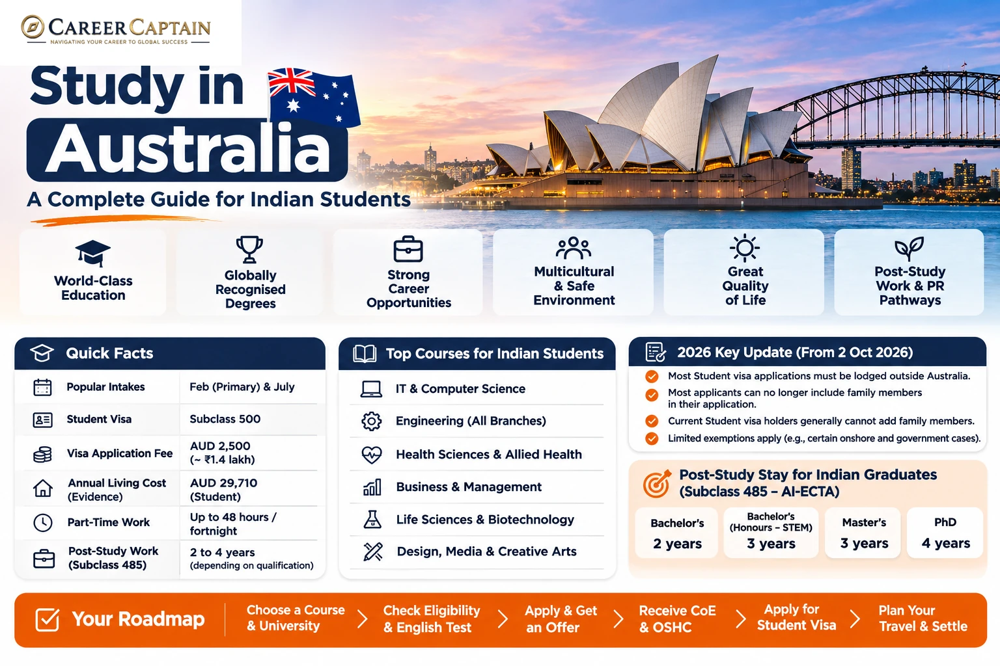

Australia is a major international education destination offering undergraduate degrees, postgraduate qualifications, research programmes and career-oriented education.

Its universities and vocational institutions provide opportunities across engineering, computer science, business, healthcare, science, finance, design and emerging technologies.

However, studying in Australia requires careful planning. Students must understand admission requirements, CRICOS registration, tuition fees, scholarships, the Student visa, financial capacity, work restrictions and post-study employment pathways.

This guide explains the process for Indian students, from selecting a course to planning a career after graduation.

*Last reviewed: 12 November 2026. Admission requirements, tuition fees and immigration policies can change. In particular, check the Student visa application-rule changes that commenced on 2 October 2026. Always verify current information through official Australian government and university websites.*

---

## 1. Why Study in Australia?

Australia offers several advantages for international students.

- **Recognised qualifications:** Australian universities offer qualifications recognised by employers and academic institutions internationally.
- **Research opportunities:** Universities provide research facilities, laboratories and postgraduate research programmes.
- **Industry exposure:** Some programmes include internships, work-integrated learning and industry projects.
- **Multicultural environment:** Students interact with people from different countries and backgrounds.
- **Wide course selection:** Students can explore engineering, technology, business, healthcare, sciences and creative industries.
- **Post-study work opportunities:** Eligible graduates may qualify for the Temporary Graduate visa (Subclass 485), subject to immigration requirements.

The best destination is the one that matches your academic interests, financial circumstances and long-term career objectives.

## 2. Understand the Different Study Options

Indian students generally consider four academic pathways.

### A. Undergraduate study

Bachelor's degrees commonly take three to four years, depending on the programme.

Popular courses include:

- Computer Science
- Software Engineering
- Mechanical Engineering
- Civil Engineering
- Electrical Engineering
- Aerospace Engineering
- Information Technology
- Business Administration
- Finance
- Economics
- Psychology
- Biotechnology
- Nursing
- Data Science
- Artificial Intelligence
- Environmental Science
- Architecture

Students generally apply after completing Class 12.

Admission requirements vary by university. Engineering programmes commonly require Mathematics and Physics, while other courses may have different subject prerequisites.

Some universities offer foundation programmes for students who do not meet direct-entry requirements.

### B. Postgraduate study

Master's degrees commonly take one to two years, depending on the qualification and programme.

Popular options include:

- Master of Information Technology
- Master of Computer Science
- Master of Data Science
- Master of Artificial Intelligence
- Master of Cybersecurity
- Master of Mechanical Engineering
- Master of Civil Engineering
- Master of Business Administration
- Master of Finance
- Master of Business Analytics
- Master of Biotechnology
- Master of Public Health

Some programmes require relevant undergraduate qualifications, work experience or specific prerequisite subjects.

### C. Doctoral study

A PhD is suitable for students interested in advanced research, academic careers and specialised research and development.

Funding opportunities may include:

- Research Training Program (RTP) scholarships
- University research scholarships
- Research assistantships
- Faculty-funded projects
- External fellowships

Funding conditions vary. Confirm whether the scholarship covers tuition, living expenses or both.

### D. Vocational Education and Training (VET)

Australia also offers vocational qualifications through registered training organisations and technical institutions.

Examples include:

- Information Technology
- Engineering Technology
- Business
- Hospitality
- Construction
- Automotive Technology
- Community Services
- Design

VET qualifications are different from university degrees. Before enrolling, check the provider's registration, course recognition and future study or employment options.

## 3. Eligibility for Indian Students

Australian institutions establish their own admission standards.

### Undergraduate admission

Common requirements include:

- Class 10 academic records
- Class 12 marksheets and certificates
- Required subject combinations
- Minimum academic marks
- English-language proficiency
- Additional application documents
- Portfolio or supplementary assessment for selected courses

Some universities accept Indian Class 12 qualifications directly. Others require a foundation programme or additional qualifications.

For example:

- Engineering programmes may require Mathematics and Physics.
- Computer Science programmes may require Mathematics.
- Nursing programmes have specific academic and professional requirements.
- Design programmes may require portfolios.

Check the precise eligibility criteria for your intended course.

### Postgraduate admission

Common requirements include:

- Recognised Bachelor's degree
- Academic transcripts
- Minimum marks or equivalent GPA
- Relevant subject background
- English-language proficiency
- Statement of Purpose
- Letters of Recommendation
- Resume or CV
- Portfolio or research proposal, where required
- Work experience for selected programmes

Some universities accept three-year Indian Bachelor's degrees, while others have specific qualification and academic requirements.

Confirm degree equivalency directly with the university.

## 4. English-Language Requirements

English-language proficiency is commonly required for admission.

Popular tests include:

- IELTS Academic
- TOEFL iBT
- PTE Academic
- Cambridge English qualifications
- Other tests accepted by the university

The minimum score varies by institution and programme.

Some universities may offer exemptions based on previous education in English.

### Important distinction

University admission requirements and Australian Student visa English-language requirements are separate.

A university may accept a particular test for admission, but that does not automatically mean the same test meets the immigration requirement.

Check both policies before booking your examination.

Official visa information: https://immi.homeaffairs.gov.au/visas/getting-a-visa/visa-listing/student-500

## 5. How to Choose the Right University

Do not select a university only because it appears in a global ranking.

Evaluate the following:

1. Course curriculum and specialisation
2. University recognition and accreditation
3. CRICOS registration
4. Faculty expertise and research facilities
5. Internship and industry connections
6. Graduate employment outcomes
7. Tuition and living expenses
8. Scholarships and financial assistance
9. Location and accommodation costs
10. International student support
11. Professional accreditation where applicable
12. Post-study eligibility of the intended qualification

### What is CRICOS?

CRICOS stands for the Commonwealth Register of Institutions and Courses for Overseas Students.

It is the official register of Australian education providers and courses approved to enrol international students on student visas.

Before accepting an offer, verify that the provider and intended course are registered.

Official register: https://cricos.education.gov.au/

### Types of institutions

**Universities:** Offer undergraduate, postgraduate and doctoral degrees, as well as research opportunities.

**Technical and Further Education (TAFE) institutions:** Offer vocational qualifications and selected applied higher education programmes.

**Private registered providers:** Offer selected vocational and higher education courses. Verify registration and course eligibility carefully.

The institution's name alone does not establish that every course is suitable for your intended academic or immigration pathway.

## 6. Estimated Cost of Studying in Australia

Australia can be expensive, especially in major cities such as Sydney and Melbourne.

Costs depend on the university, programme, location and accommodation arrangement.

### Illustrative annual tuition estimates

These are broad planning estimates, not official quotations.

| Programme | Illustrative annual tuition |
|---|---:|
| Undergraduate degrees | AUD 25,000–50,000+ |
| Postgraduate degrees | AUD 28,000–55,000+ |
| Vocational programmes | AUD 10,000–25,000+ |
| Doctoral programmes | Varies by university and funding |

Medicine, dentistry, veterinary science and specialist programmes can cost considerably more.

### Illustrative annual living budget

| Expense | Illustrative annual range |
|---|---:|
| Accommodation | AUD 12,000–24,000 |
| Food and groceries | AUD 4,000–7,000 |
| Transport | AUD 1,000–2,500 |
| Books and supplies | AUD 500–1,500 |
| Personal expenses | AUD 2,000–4,000 |

These are planning estimates. Actual costs vary significantly by city and lifestyle.

### How to reduce expenses

- Compare universities in different cities.
- Research accommodation before accepting an offer.
- Apply for institutional scholarships.
- Compare the total programme cost.
- Consider eligible regional campuses where academically appropriate.
- Investigate research scholarships and assistantships.
- Prepare a realistic monthly budget.

Do not rely on part-time work to finance your entire education.

## 7. Scholarships for Indian Students

Scholarships can reduce the financial burden of studying in Australia.

### Common funding options

**University scholarships:** Many universities offer merit-based scholarships for international students.

**Research Training Program (RTP):** Supports eligible domestic and international students undertaking research doctorate and research Master's programmes at participating Australian universities.

Official information: https://www.education.gov.au/research-block-grants/research-training-program

**University research scholarships:** Individual universities offer research funding through faculties, departments and research projects.

**External scholarships:** Selected organisations and governments may offer funding for eligible students.

### Scholarship application strategy

1. Identify universities offering international scholarships.
2. Confirm eligibility for Indian applicants.
3. Check scholarship deadlines.
4. Prepare academic records.
5. Write a strong Statement of Purpose.
6. Obtain suitable recommendation letters.
7. Contact departments about research funding.
8. Confirm the value and duration of the award.

Some scholarships cover only part of tuition, while others may include living support.

Never assume that every international student receives a scholarship.

## 8. Application Process: Step by Step

### Step 1: Select your course

Identify the subject, qualification level and career direction you want to pursue.

Compare course content, specialisations and entry requirements.

### Step 2: Shortlist universities

Prepare a balanced shortlist based on:

- Academic eligibility
- Course quality
- CRICOS registration
- Tuition fees
- Location
- Scholarship opportunities
- Post-study eligibility, where relevant

### Step 3: Check admission requirements

For every university, record:

- Minimum marks
- Required subjects
- English-language requirements
- Standardised tests, if applicable
- Application deadlines
- Tuition fees
- Scholarship deadlines

### Step 4: Prepare documents

Common documents include:

- Passport
- Class 10 and Class 12 certificates
- Undergraduate transcripts, if applicable
- Degree certificate, if applicable
- English-language test scores
- Statement of Purpose
- Letters of Recommendation
- Resume or CV
- Portfolio, where required
- Financial documents, where requested

### Step 5: Submit your application

Apply through the official university or institution portal.

Check document formats, deadlines and application fees.

### Step 6: Receive your admission decision

You may receive:

- Unconditional admission
- Conditional admission
- Waitlist placement
- Rejection

Read the admission letter carefully.

### Step 7: Accept your offer

Complete the institution's acceptance process and pay any required deposit.

### Step 8: Obtain your Confirmation of Enrolment

After meeting the institution's requirements and completing the necessary acceptance and payment steps, you will generally receive a Confirmation of Enrolment (CoE).

The CoE is an important document for your Student visa application.

### Indian student application checklist

Use this checklist to organise the main stages of an application. The exact requirements depend on the university, course and your personal circumstances.

- [ ] Check that the intended course and provider are listed on CRICOS.
- [ ] Confirm Class 12 or degree eligibility, subject prerequisites and minimum academic results.
- [ ] Check the university's accepted English-language tests and required scores.
- [ ] Compare total tuition, living costs, insurance and other expenses.
- [ ] Check scholarship eligibility and deadlines before submitting applications.
- [ ] Prepare a valid passport and academic records, including transcripts and certificates.
- [ ] Prepare any required portfolio, CV, references or research proposal.
- [ ] Submit applications through the institution's official channel.
- [ ] Read the offer conditions and confirm the amount and deadline for any deposit.
- [ ] Accept the offer and obtain the Confirmation of Enrolment (CoE).
- [ ] Arrange Overseas Student Health Cover (OSHC) for the required period.
- [ ] Prepare Genuine Student responses that are accurate and supported by evidence.
- [ ] Check the latest Student visa location and family-member rules that commenced on 2 October 2026.
- [ ] Calculate the required funds for tuition, living costs, travel and any permitted accompanying family members.
- [ ] Check the current visa document checklist, application charge and processing guidance.
- [ ] Lodge through ImmiAccount from the location required for your visa circumstances.
- [ ] Complete health examinations, biometrics or further information requests when instructed.
- [ ] Do not book non-refundable travel until you have considered the visa decision and your institution's start-date requirements.

## 9. Understanding the Genuine Student Requirement

Australia uses the **Genuine Student (GS) requirement** for Student visa applications lodged on or after 23 March 2024.

Applicants must demonstrate that studying in Australia is their primary reason for applying for a Student visa.

The online application includes questions covering areas such as:

1. Your current circumstances, including family, community, employment and economic circumstances.
2. Why you selected the course and education provider.
3. Your understanding of the course and living in Australia.
4. How completing the course will benefit your future.
5. Any other relevant information.

The standard questions have a maximum of 150 words per response.

### How to prepare

- Explain why you selected the course.
- Show that you researched the institution.
- Explain how the course relates to your academic background.
- Describe how the qualification supports your career goals.
- Provide evidence supporting your statements.
- Explain relevant study gaps or changes in academic direction.

Avoid generic answers copied from the internet.

Your responses should be accurate, consistent and supported by genuine documents.

**Important:** The GS requirement does not mean applicants must promise never to pursue future migration options. The assessment focuses on whether the applicant genuinely intends to study.

Official information: https://immi.homeaffairs.gov.au/visas/getting-a-visa/visa-listing/student-500/genuine-student-requirement

## 10. The Australian Student Visa (Subclass 500)

Indian students generally require a **Student visa (Subclass 500)** to undertake eligible full-time study in Australia.

### Basic requirements

Applicants generally need to:

- Be enrolled in an eligible course.
- Hold a valid Confirmation of Enrolment.
- Meet the Genuine Student requirement.
- Demonstrate sufficient financial capacity.
- Meet English-language requirements where applicable.
- Hold Overseas Student Health Cover (OSHC), unless exempt.
- Meet health and character requirements.
- Provide additional documents when requested.

### Application process

1. Receive admission from a registered provider.
2. Meet the university's conditions.
3. Obtain your CoE.
4. Arrange OSHC.
5. Prepare financial evidence.
6. Complete the online visa application through ImmiAccount.
7. Pay the applicable visa fee.
8. Complete biometrics or medical examinations if required.
9. Respond to additional requests.
10. Follow the instructions issued by the Department of Home Affairs.

### Common supporting documents

Depending on your circumstances, you may need:

- Valid passport
- Confirmation of Enrolment
- Academic transcripts and certificates
- English-language evidence
- Financial documents
- GS responses and supporting evidence
- OSHC confirmation
- Health examination results, if required
- Other documents requested by the Department

Official visa information: https://immi.homeaffairs.gov.au/visas/getting-a-visa/visa-listing/student-500

### Visa application fee

The standard Student visa (Subclass 500) application charge for the primary applicant is from AUD 2,500 as listed by the Department of Home Affairs at the time this guide was reviewed. Additional applicant charges and payment surcharges may apply where relevant. Visa charges can change, so check the official pricing information on the day you lodge your application.

Official fees: https://immi.homeaffairs.gov.au/visas/getting-a-visa/fees-and-charges

### Important Student visa rule changes from 2 October 2026

Changes commencing on **2 October 2026** affect where certain applicants must be located when they lodge a Student visa application and when a visa can be granted. They also significantly restrict the inclusion of family members.

**Applying while in Australia:** From 2 October 2026, most temporary visa holders cannot apply for a Student visa while in Australia. Student visa holders generally cannot apply for a further Student visa onshore either. Exemptions include specified DFAT- or Defence-sponsored students; applicants for doctoral, primary-school or secondary-school study; students affected by provider default; students who need up to 12 additional months to complete their course with the same provider; and students progressing to a higher-level course after completing the main course covered by their current visa. The exact exemption criteria matter. Applicants who are required to apply offshore must also be outside Australia when the visa is granted. An application lodged from the wrong location may be invalid.

**Including family members:** From 2 October 2026, Student visa applicants generally cannot include a partner or dependent children in a new Student visa application unless a specified exemption applies. Exemptions include doctoral students, nationals of Pacific countries and ASEAN member states, fully funded foreign government scholarship recipients, and DFAT- or Defence-sponsored students. Transitional arrangements allow some applicants to include the same family members who were already included in a visa or application before 2 October 2026, if the primary applicant is eligible to apply for a further Student visa in Australia. **A Student visa holder cannot add family members after the visa has been granted; there are no exemptions to this rule.** Applications lodged before 2 October 2026 continue to be assessed under the rules in force when lodged.

Before making travel, enrolment or financial decisions, check the official rules for your exact visa category and family circumstances. These rules do not mean every applicant must lodge offshore; they apply according to the categories and exemptions set by the Department.

Official update: https://immi.homeaffairs.gov.au/visas/getting-a-visa/visa-listing/changes-to-student-visa-application-rules-500-590

Applying in Australia: https://immi.homeaffairs.gov.au/visas/getting-a-visa/visa-listing/changes-to-student-visa-application-rules-500-590/applying-in-australia

Family members: https://immi.homeaffairs.gov.au/visas/getting-a-visa/visa-listing/changes-to-student-visa-application-rules-500-590/family-members

## 11. Financial Requirements for the Student Visa

Applicants must demonstrate that they can meet the financial requirements for studying and living in Australia.

The evidence must cover the applicable costs of:

- Travel
- Tuition fees
- Living expenses
- Accompanying family members, where applicable
- School costs for accompanying school-age children, where applicable

### Published annual living-cost amounts

The Department of Home Affairs currently lists these 12-month living-cost amounts for financial-capacity calculations:

| Person or expense | Amount |
|---|---:|
| Student applicant | AUD 29,710 |
| Spouse or de facto partner | AUD 10,394 |
| Each dependent child | AUD 4,449 |

School costs for school-age children and travel costs may also need to be included. These amounts are separate from tuition fees.

**Important:** These figures describe financial-capacity calculations; they do not mean that a family member is automatically permitted to be included in a Student visa application. The family-member restrictions that commenced on 2 October 2026 and their exemptions must be checked separately.

### Possible financial evidence

- Bank deposits
- Government or financial institution education loans
- Scholarship documentation
- Other accepted financial support evidence
- Eligible parental or partner income evidence

The exact evidence required depends on the applicant and the current document checklist.

### Important advice

The visa financial threshold is a minimum immigration requirement, not a guarantee that you can comfortably live in Australia on that amount.

Research actual accommodation, transport, food and other expenses in your intended city.

Do not depend on future part-time earnings to satisfy your initial financial requirements.

Official source: https://immi.homeaffairs.gov.au/visas/getting-a-visa/visa-listing/student-500

## 12. Working While Studying

Eligible international students can work while studying, subject to the conditions of their Student visa.

### Work limits

Most Student visa holders can work:

- Up to 48 hours per fortnight while their course is in session.
- Unlimited hours during scheduled course breaks, subject to visa conditions.

Students generally cannot begin working before their course commences unless they already hold another visa with work rights.

Students undertaking a Master's by research or doctoral degree have different work conditions after their course begins.

### Common student jobs

- Retail assistant
- Hospitality staff
- Customer service representative
- Administrative assistant
- Campus support roles
- Research assistant, where eligible
- Tutoring, subject to relevant conditions

### Important restrictions

- Follow your visa work conditions.
- Do not exceed permitted working hours.
- Maintain the required student status.
- Ensure work does not interfere with your studies.
- Check the rules before accepting employment.

Working beyond permitted limits can affect your immigration status.

Official information: https://immi.homeaffairs.gov.au/visas/getting-a-visa/visa-listing/student-500

## 13. Internships and Industry Placements

Some Australian courses include practical learning and industry placements.

These may involve:

- Engineering projects
- Business internships
- Software development
- Research placements
- Healthcare placements
- Work-integrated learning

Before starting a placement, check whether it is part of your registered course and whether the relevant visa work conditions permit it.

Healthcare and other regulated professions may have additional registration and placement requirements.

## 14. Temporary Graduate Visa (Subclass 485)

The Temporary Graduate visa allows eligible international graduates to live, work and study in Australia temporarily after completing qualifying Australian studies.

It has different streams depending on the qualification.

### A. Post-Higher Education Work stream

This stream is generally for graduates with eligible higher education qualifications.

Standard stay periods are generally:

| Qualification | Standard stay period |
|---|---:|
| Bachelor's degree | 2 years |
| Bachelor's honours degree | 2 years |
| Master's by coursework | 2 years |
| Master's by research | 3 years |
| Doctoral degree | 3 years |

### Special arrangements for Indian nationals

Under the Australia–India Economic Cooperation and Trade Agreement (AI-ECTA), eligible Indian graduates may receive longer periods:

| Qualification | Potential stay period |
|---|---:|
| Bachelor's degree | 2 years |
| Bachelor's degree with first-class honours in STEM, including ICT | 3 years |
| Master's degree, including coursework, extended and research | 3 years |
| Doctoral degree | 4 years |

Eligibility and the exact qualification classification must be checked against current Department of Home Affairs rules.

### B. Post-Vocational Education Work stream

This stream is intended for eligible graduates with associate degrees, diplomas or trade qualifications related to occupations Australia needs.

Applicants must meet the relevant qualification and occupation requirements.

### General eligibility considerations

Applicants generally need to:

- Be aged 35 or under when applying, subject to exceptions.
- Hold an eligible visa.
- Have held a Student visa within the required period.
- Complete an eligible qualification in a CRICOS-registered course.
- Meet the Australian study requirement.
- Apply within the required period.
- Meet English, health and character requirements.
- Provide the required documents.

The standard age limit has exceptions, including certain research degree applicants.

**Important:** Completing an Australian course does not automatically guarantee a Subclass 485 visa.

Official resources:

- https://immi.homeaffairs.gov.au/visas/getting-a-visa/visa-listing/temporary-graduate-485
- https://immi.homeaffairs.gov.au/visas/getting-a-visa/visa-listing/temporary-graduate-485/post-higher-education-work

## 15. Career Opportunities After Graduation

Australia offers employment opportunities across several industries.

However, employment is not guaranteed. Graduates must meet the requirements of employers and any applicable professional licensing bodies.

### Technology

- Software engineering
- Artificial intelligence
- Data science
- Cybersecurity
- Cloud computing
- Business intelligence
- Product management

### Engineering

- Mechanical engineering
- Civil engineering
- Electrical engineering
- Aerospace engineering
- Automotive engineering
- Robotics
- Manufacturing
- Renewable energy

### Business and finance

- Financial analysis
- Accounting
- Business analytics
- Consulting
- Marketing
- Supply chain management
- Human resources

### Healthcare and life sciences

- Biotechnology
- Biomedical research
- Public health
- Pharmaceutical research
- Healthcare management

Some professions require professional registration or licensing.

Research these requirements before choosing your course.

## 16. Building a Strong Profile Before Applying

A strong application demonstrates more than academic marks.

### For engineering students

- Develop technical skills.
- Complete practical projects.
- Participate in engineering competitions.
- Build a technical portfolio.
- Gain internship experience.
- Strengthen mathematics and core engineering subjects.

### For business students

- Develop analytical and communication skills.
- Participate in leadership activities.
- Complete market research projects.
- Gain internship experience.
- Learn relevant business tools.

### For science students

- Participate in research projects.
- Develop laboratory skills.
- Explore research internships.
- Build relationships with faculty members.
- Strengthen analytical and academic writing skills.

### For all applicants

- Maintain consistent academic performance.
- Develop a clear academic direction.
- Participate in meaningful extracurricular activities.
- Prepare strong application essays.
- Request recommendations from people who know your work.

Meaningful experience is more valuable than collecting certificates without practical learning.

## 17. A 12-Month Preparation Roadmap

| Timeline | Recommended action |
|---|---|
| Months 1–2 | Identify courses, universities and eligibility |
| Months 3–4 | Prepare for English-language tests and strengthen your profile |
| Months 5–6 | Shortlist institutions and research scholarships |
| Months 7–8 | Prepare applications and recommendation letters |
| Months 9–10 | Submit applications and scholarship applications |
| Month 11 | Compare offers, fees and accommodation |
| Month 12 | Obtain CoE, arrange OSHC and prepare your visa application |

This is an illustrative schedule. Admission and visa timelines vary.

## 18. Common Mistakes Indian Students Should Avoid

1. Choosing an institution without checking CRICOS registration.
2. Selecting a course only because it appears to offer migration opportunities.
3. Ignoring total tuition and living costs.
4. Depending on part-time work to finance the entire degree.
5. Applying without checking academic prerequisites.
6. Assuming every course provides the same post-study work eligibility.
7. Writing generic Genuine Student responses.
8. Ignoring Overseas Student Health Cover.
9. Misunderstanding the 48-hour fortnightly work limit.
10. Assuming permanent residence is guaranteed after graduation.
11. Ignoring professional accreditation.
12. Trusting agents who promise guaranteed admission, visas or permanent residence.

## 19. Useful Official Resources

| Resource | Purpose |
|---|---|
| https://www.studyaustralia.gov.au/ | Official study information |
| https://immi.homeaffairs.gov.au/ | Australian immigration information |
| https://cricos.education.gov.au/ | Registered providers and courses |
| https://www.education.gov.au/ | Australian education policy |
| https://www.education.gov.au/research-block-grants/research-training-program | Research Training Program |
| https://www.studyaustralia.gov.au/en/plan-your-move/your-guide-to-visas | Student and graduate visa information |
| https://immi.homeaffairs.gov.au/visas/getting-a-visa/visa-listing/student-500 | Student visa |
| https://immi.homeaffairs.gov.au/visas/getting-a-visa/visa-listing/temporary-graduate-485 | Temporary Graduate visa |

Always verify the latest requirements directly through the Department of Home Affairs and the institution.

## 20. How Career Captain Can Help

Choosing a country is only one part of a successful study-abroad decision.

Students also need to understand their interests, abilities, academic strengths, suitable courses and long-term career objectives.

Career Captain Global Solutions supports students and young professionals through:

- One-to-one career counselling
- Five-dimensional psychometric career assessments
- Stream and subject selection
- Course and college planning
- Study-abroad guidance
- Scholarship and admission support
- Career exploration and planning

Explore: https://careercaptain.co.in?utm_source=career_roadmaps_india&utm_medium=referral&utm_campaign=github_career_roadmaps&utm_content=study-in-australia-complete-guide-for-indian-students

The objective is to help students make informed education and career decisions rather than selecting a course simply because it is popular.

---

## Final Thoughts

Studying in Australia can offer valuable academic and professional exposure, but it requires realistic financial planning and careful research.

Understand the admission requirements, verify CRICOS registration, compare universities, calculate the total cost and stay informed about visa and post-study work rules.

Most importantly, select a programme that matches your interests, academic background and long-term career goals.

A successful study-abroad journey begins with choosing the right educational pathway.

---

## Attribution and Licence

This educational guide is published by **Career Captain Global Solutions** as part of the Open-Source BTech and Career Roadmaps initiative.

This work is licensed under the **Creative Commons Attribution 4.0 International (CC BY 4.0)** licence.

You may share and adapt this material with appropriate attribution.

**Attribution:** Career Captain Global Solutions — https://careercaptain.co.in?utm_source=career_roadmaps_india&utm_medium=referral&utm_campaign=github_career_roadmaps&utm_content=study-in-australia-complete-guide-for-indian-students

*Disclaimer: This guide is for general educational information and is not legal, immigration, financial or admission advice. University policies, fees and immigration rules can change. Verify all requirements through official sources before making decisions.*

---

## Plan your study-abroad journey with Career Captain

Country and university choices should be evaluated against your academic profile, course goals, budget, entry requirements and long-term plans. Career Captain provides study-abroad counselling and application-planning support. Admission, scholarship and visa decisions remain with the relevant institutions and authorities.

- [Study-abroad counselling in Hyderabad](https://careercaptain.co.in/?utm_source=career_roadmaps_india&utm_medium=referral&utm_campaign=github_career_roadmaps&utm_content=study-in-australia-complete-guide-for-indian-students)
- [Scholarship guidance for Indian students](https://guide.careercaptain.co.in/study-abroad/?utm_source=career_roadmaps_india&utm_medium=referral&utm_campaign=github_career_roadmaps&utm_content=study-in-australia-complete-guide-for-indian-students)
- [Explore Career Captain](https://careercaptain.co.in?utm_source=career_roadmaps_india&utm_medium=referral&utm_campaign=github_career_roadmaps&utm_content=study-in-australia-complete-guide-for-indian-students)

[WhatsApp Career Captain](https://wa.me/919849488838?text=Hi%20Career%20Captain%2C%20I%20found%20your%20study%20in%20australia%20complete%20guide%20for%20indian%20students%20guide%20in%20Career%20Roadmaps%20India.%20I%20would%20like%20to%20know%20more%20about%20career%20guidance.%20Source%3A%20study-in-australia-complete-guide-for-indian-students.)
