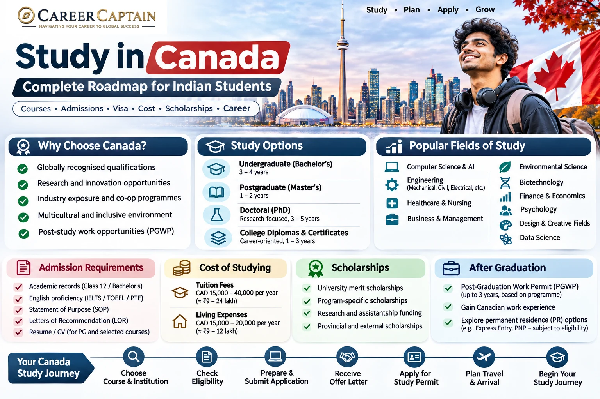

Canada is a popular destination for Indian students seeking internationally recognised qualifications, research opportunities and exposure to a multicultural professional environment.

Canadian institutions offer undergraduate degrees, postgraduate programmes, diplomas, certificates and doctoral research opportunities.

However, studying in Canada requires careful planning. Students must understand university admission requirements, Designated Learning Institutions (DLIs), study permits, financial requirements, scholarships and post-graduation work eligibility.

This guide explains the process for Indian students, from choosing a course to planning a career after graduation.

*Last reviewed: November 2026. Admission requirements, fees and immigration policies can change. Always verify current information through official Canadian government and university websites.*

---

## 1. Why Study in Canada?

Canada offers several advantages for international students.

- **Recognised qualifications:** Canadian universities and colleges offer qualifications recognised by employers and academic institutions internationally.
- **Research opportunities:** Universities provide research facilities, laboratories and postgraduate research programmes.
- **Industry exposure:** Some programmes include internships, co-op placements and practical learning.
- **Multicultural environment:** Students interact with people from different countries and backgrounds.
- **Wide course selection:** Students can explore engineering, business, healthcare, technology, sciences, finance and creative fields.
- **Post-study opportunities:** Eligible graduates may qualify for a Post-Graduation Work Permit (PGWP), subject to current immigration rules.

Canada should be selected because the programme and institution match your goals, not simply because you expect to obtain permanent residence.

## 2. Understand the Different Study Options

Indian students generally consider three academic routes.

### A. Undergraduate study

Bachelor's degrees commonly take three to four years, depending on the university and programme.

Popular programmes include:

- Computer Science
- Software Engineering
- Mechanical Engineering
- Civil Engineering
- Electrical Engineering
- Electronics Engineering
- Aerospace Engineering
- Business Administration
- Finance
- Economics
- Psychology
- Biotechnology
- Nursing
- Data Science
- Artificial Intelligence
- Environmental Science

Students generally apply after completing Class 12.

Admission requirements vary by university and programme. Engineering programmes commonly require Mathematics and Physics, while other courses may have different subject prerequisites.

### B. Postgraduate study

Master's degrees commonly take one to two years, depending on the programme.

Popular options include:

- MSc Computer Science
- MSc Data Science
- MSc Artificial Intelligence
- MSc Cybersecurity
- MSc Mechanical Engineering
- MSc Civil Engineering
- MSc Electrical Engineering
- Master of Business Administration
- Master of Finance
- Master of Business Analytics
- MSc Biotechnology
- Master of Public Health

Some programmes require relevant undergraduate qualifications, work experience or specific prerequisite subjects.

### C. Doctoral study

A PhD is suitable for students interested in advanced research, academic careers and specialised research and development.

Funding may be available through:

- University scholarships
- Research assistantships
- Teaching assistantships
- Research grants
- External fellowships

Funding conditions vary. Confirm whether the funding covers tuition, living expenses or both.

### D. College diplomas and certificates

Canadian colleges offer career-oriented programmes in areas such as:

- Information Technology
- Business Management
- Supply Chain Management
- Hospitality
- Engineering Technology
- Healthcare support
- Digital Marketing

A college diploma is not automatically equivalent to a university degree.

Check the institution, programme recognition, transfer opportunities and PGWP eligibility before enrolling.

## 3. Eligibility for Indian Students

Admission requirements vary across Canadian universities and colleges.

### Undergraduate admission

Common requirements include:

- Class 10 academic records
- Class 12 marksheets and certificates
- Required subject combinations
- Minimum academic marks
- English-language proficiency
- Additional application documents
- Portfolio or supplementary assessment for selected programmes

Some universities require higher marks for competitive courses.

For example:

- Engineering programmes may require Mathematics and Physics.
- Computer Science programmes may require Mathematics.
- Nursing programmes have specific science and academic prerequisites.
- Design programmes may require portfolios.

### Postgraduate admission

Common requirements include:

- Recognised Bachelor's degree
- Academic transcripts
- Minimum marks or equivalent GPA
- Relevant subject background
- English-language proficiency
- Statement of Purpose
- Letters of Recommendation
- Resume or CV
- Portfolio or research proposal, where required
- Work experience for selected programmes

Some universities accept three-year Indian Bachelor's degrees, while others have specific qualification and academic requirements.

Confirm eligibility directly with the university.

## 4. English-Language Requirements

English-language proficiency is commonly required for admission.

Popular tests include:

- IELTS Academic
- TOEFL iBT
- PTE Academic
- Other tests accepted by the university

The minimum score varies according to the university and course.

Some institutions may provide English-language exemptions based on previous education.

### Important distinction

University admission requirements and immigration language requirements are separate.

A university may accept a particular English test for admission, but that does not automatically mean the same test is accepted for every immigration application.

For example, PGWP language requirements are based on specific approved evidence and Canadian language benchmarks.

Check the university's admission policy and the applicable IRCC requirements separately.

## 5. How to Choose the Right University or College

Do not select an institution only because it is popular among international students.

Evaluate these factors:

1. Programme curriculum and specialisation
2. Institutional recognition
3. Designated Learning Institution status
4. PGWP eligibility of the specific programme
5. Faculty expertise and research facilities
6. Internship and co-op opportunities
7. Graduate employment outcomes
8. Tuition and living expenses
9. Scholarships and financial assistance
10. Location and accommodation costs
11. International student support
12. Professional accreditation where applicable

### Universities and colleges

**Universities:** Generally offer Bachelor's, Master's and doctoral degrees, along with research opportunities.

**Colleges and polytechnics:** Often provide career-oriented diplomas, certificates and applied degree programmes.

**Private institutions:** May offer specialised courses, but students must carefully verify institutional recognition and programme eligibility.

### What is a DLI?

A Designated Learning Institution is a Canadian institution approved by a provincial or territorial government to host international students.

International students generally need an acceptance letter from a DLI to apply for a study permit.

However, not every programme offered by a DLI qualifies graduates for a PGWP.

Check both the institution and the specific programme.

Official DLI list: https://www.canada.ca/en/immigration-refugees-citizenship/services/study-canada/study-permit/prepare/designated-learning-institutions-list.html

## 6. Estimated Cost of Studying in Canada

Canada can be expensive, particularly for international students studying in major cities.

Costs vary depending on the province, institution, programme and accommodation.

### Average tuition reference

Official Canadian education information based on 2026 Statistics Canada figures reports average international tuition of approximately:

| Programme level | Average annual tuition |
|---|---:|
| Undergraduate | CAD 41,746 |
| Graduate | CAD 24,028 |

These are national averages, not guaranteed university fees. Individual programmes may cost substantially more or less.

Source: https://www.educanada.ca/programs-programmes/education_cost-cout_education.aspx

### Illustrative annual living budget

| Expense | Illustrative annual range |
|---|---:|
| Accommodation | CAD 9,000–18,000 |
| Food and groceries | CAD 3,600–6,000 |
| Transport | CAD 800–2,000 |
| Books and supplies | CAD 500–1,500 |
| Personal expenses | CAD 1,500–3,000 |

These are planning estimates, not official immigration financial thresholds.

Toronto and Vancouver can be significantly more expensive than smaller cities.

### How to reduce expenses

- Compare universities across different provinces.
- Research accommodation before accepting an offer.
- Apply for institutional scholarships.
- Compare the total programme cost.
- Consider eligible public institutions with suitable programmes.
- Investigate research funding and assistantships.
- Prepare a realistic monthly budget.

Do not rely on part-time work to finance your entire education.

## 7. Scholarships for Indian Students

Scholarships can reduce the financial burden of studying in Canada.

### Common funding options

**University scholarships:** Many universities provide merit-based awards to international students.

**Entrance scholarships:** Selected institutions award scholarships based on academic performance during admission.

**Graduate research funding:** Research-oriented Master's and PhD students may receive funding through supervisors, departments or research projects.

**Government and external scholarships:** Selected programmes are supported by Canadian and international funding organisations.

### Scholarship application strategy

1. Identify universities offering international student scholarships.
2. Confirm eligibility for Indian applicants.
3. Check scholarship deadlines.
4. Prepare academic records.
5. Write a strong Statement of Purpose.
6. Obtain suitable recommendation letters.
7. Contact departments about research funding.
8. Confirm the value and duration of the award.

Some scholarships cover only part of tuition, while others may provide broader financial support.

Never assume that every international student receives funding.

Official scholarship information: https://www.educanada.ca/scholarships-bourses/index.aspx

## 8. Application Process: Step by Step

### Step 1: Select your course

Identify the subject, qualification level and career direction you want to pursue.

Compare course content, specialisations and entry requirements.

### Step 2: Shortlist institutions

Prepare a balanced shortlist based on:

- Academic eligibility
- Course quality
- Tuition fees
- Location
- Scholarship opportunities
- PGWP eligibility, where relevant

### Step 3: Check admission requirements

For every institution, record:

- Minimum marks
- Required subjects
- English-language requirements
- Standardised tests, if applicable
- Application deadlines
- Tuition fees
- Scholarship deadlines

### Step 4: Prepare documents

Common documents include:

- Passport
- Class 10 and Class 12 certificates
- Undergraduate transcripts, if applicable
- Degree certificate, if applicable
- English-language test scores
- Statement of Purpose
- Letters of Recommendation
- Resume or CV
- Portfolio, where required
- Financial documents, where requested

### Step 5: Submit the application

Apply through the official university or college application portal.

Pay attention to document formats, deadlines and application fees.

### Step 6: Receive your admission decision

You may receive:

- Unconditional admission
- Conditional admission
- Waitlist placement
- Rejection

Read the admission letter carefully.

### Step 7: Accept your offer

Complete the institution's acceptance process and pay any required deposit.

### Step 8: Obtain the required attestation letter

Most study permit applicants need a Provincial Attestation Letter (PAL) or Territorial Attestation Letter (TAL), unless exempt.

Your institution generally provides instructions for obtaining it.

## 9. Understanding PAL and TAL Requirements

A Provincial Attestation Letter or Territorial Attestation Letter confirms that your study permit application falls within the applicable provincial or territorial allocation.

Most international students applying for a study permit need a PAL or TAL.

### Important 2026 exemptions

As of 2026, certain applicants are exempt, including:

- Students pursuing Master's or doctoral degrees at public designated learning institutions.
- Primary and secondary school students.
- Certain government priority groups and other specified categories.
- Some existing study permit holders applying for an extension at the same DLI and level of study.

Exemptions are subject to the official rules and conditions.

### Practical steps

1. Obtain admission from a DLI.
2. Confirm whether you need a PAL or TAL.
3. Follow the institution's instructions.
4. Obtain the applicable letter.
5. Include it with your study permit application.

Quebec has separate requirements, including the Quebec Acceptance Certificate (CAQ), where applicable.

Official information: https://www.canada.ca/en/immigration-refugees-citizenship/services/study-canada/study-permit/get-documents/provincial-attestation-letter.html

## 10. The Canadian Study Permit

Indian students generally require a study permit to pursue eligible academic programmes in Canada.

A study permit is an immigration document that authorises you to study in Canada under specified conditions.

It is not the same as a visa or an electronic travel authorisation.

### Basic eligibility

Applicants generally need to:

- Have an acceptance letter from a DLI.
- Provide a PAL or TAL unless exempt.
- Demonstrate sufficient financial resources.
- Meet admissibility requirements.
- Satisfy the immigration officer that they will comply with the conditions of their stay.
- Provide additional documents when required.

### Application process

1. Receive your admission letter.
2. Confirm DLI and programme details.
3. Obtain a PAL or TAL if required.
4. Prepare financial evidence.
5. Complete the online study permit application.
6. Pay the applicable application fee.
7. Complete biometrics when required.
8. Complete a medical examination if required.
9. Respond to any additional requests.
10. Follow the instructions provided by IRCC.

### Common documents

Depending on your circumstances, you may need:

- Valid passport
- Letter of Acceptance
- PAL or TAL, if required
- Academic transcripts and certificates
- English-language test results, where applicable
- Proof of financial support
- Statement of Purpose or letter of explanation
- Biometrics
- Medical examination results, if required
- Other supporting documents

Official application information: https://www.canada.ca/en/immigration-refugees-citizenship/services/study-canada/study-permit/apply.html

### Important: Student Direct Stream has ended

Canada ended the Student Direct Stream (SDS) on 8 November 2024.

Indian students can no longer submit new applications through SDS.

Applications are processed through the regular study permit system.

Official source: https://www.canada.ca/en/immigration-refugees-citizenship/news/notices/end-student-direct-stream-nigeria-student-express.html

## 11. Financial Requirements for a Canadian Study Permit

Applicants must demonstrate that they can pay for:

- Tuition fees
- Living expenses
- Transportation to and from Canada

You must demonstrate sufficient funds without depending on employment in Canada.

### Living expense requirement for applications submitted on or after 1 September 2026

For applicants studying outside Quebec, the official minimum living expense amount for one person is:

<escape>**CAD 23,448 per year**</escape>

This amount is separate from tuition and transportation costs.

| Family members included | Required annual living funds |
|---|---:|
| 1 | CAD 23,448 |
| 2 | CAD 29,192 |
| 3 | CAD 35,888 |
| 4 | CAD 43,572 |
| 5 | CAD 49,419 |
| 6 | CAD 55,736 |
| 7 | CAD 62,054 |

Each additional family member beyond seven requires an additional CAD 6,318 under the published schedule.

Quebec has separate financial requirements.

### How to demonstrate financial capacity

Possible evidence includes:

- Bank statements
- Education loan documents
- Scholarship letters
- Proof of tuition payment
- Guaranteed Investment Certificate (GIC), where applicable
- Financial support documents from sponsors
- Other evidence accepted by IRCC

For programmes longer than one year, applicants must also explain how they intend to fund the full duration of their studies.

Official source: https://www.canada.ca/en/immigration-refugees-citizenship/services/study-canada/study-permit/get-documents/financial-support.html

**Important:** The minimum immigration financial requirement is not necessarily enough to cover your actual living costs.

## 12. Working While Studying

Eligible international students may work during their studies, subject to their study permit conditions.

### Off-campus employment

Eligible students can generally work:

- Up to 24 hours per week during regular academic sessions.
- Unlimited hours during scheduled academic breaks, provided they meet the applicable requirements.

Students must meet the eligibility conditions before beginning off-campus employment.

You generally cannot begin working before your programme starts.

### On-campus employment

Eligible students may also work on campus without a separate work permit, subject to the applicable immigration conditions.

### Important restrictions

- You must maintain the required student status.
- You must comply with your study permit conditions.
- You must keep track of working hours.
- You cannot exceed the permitted work limit.
- Employment must not interfere with your studies.

Working more than the permitted hours can affect your immigration status and future applications.

Official information: https://www.canada.ca/en/immigration-refugees-citizenship/services/study-canada/work/work-off-campus.html

## 13. Co-op and Internship Opportunities

Some Canadian programmes include practical work placements or co-op components.

These opportunities can help students:

- Gain professional experience.
- Apply academic knowledge.
- Develop workplace skills.
- Build industry connections.
- Improve their employment profile.

However, not every internship is automatically permitted under a study permit.

A student who needs a work placement as part of an academic programme may require a co-op work permit, depending on the applicable rules.

Confirm the requirements with your institution before starting a placement.

Official information: https://www.canada.ca/en/immigration-refugees-citizenship/services/study-canada/work/intern.html

## 14. Post-Graduation Work Permit (PGWP)

The Post-Graduation Work Permit allows eligible international graduates to work in Canada after completing qualifying studies.

However, graduating from a Canadian institution does not automatically make a student eligible.

### General eligibility

Applicants generally need to:

- Complete an eligible programme at a PGWP-eligible DLI.
- Meet the programme-duration requirements.
- Maintain the required full-time student status, subject to permitted exceptions.
- Apply within the applicable 180-day period after receiving confirmation of programme completion.
- Meet language and field-of-study requirements where applicable.

### PGWP duration

The duration depends on the qualification and programme.

Broadly:

| Programme | Potential PGWP duration |
|---|---|
| Eligible programme of at least 8 months but less than 2 years | Generally up to the length of the programme |
| Eligible programme of 2 years or longer | Up to 3 years |
| Eligible Master's degree of at least 8 months | Up to 3 years |

Actual duration is determined by IRCC and depends on eligibility and other applicable conditions.

### Language requirements

For PGWP applications subject to the language rules introduced on 1 November 2024:

- Bachelor's, Master's and doctoral graduates generally need Canadian Language Benchmarks (CLB) 7 in English or Niveaux de compétence linguistique canadiens (NCLC) 7 in French across all four language abilities.
- Graduates of other university programmes generally need CLB/NCLC 7.
- Graduates of eligible college and other non-university programmes generally need CLB/NCLC 5.

### Field-of-study requirements

For certain non-degree programmes, applicants must graduate from an eligible field of study.

Bachelor's, Master's and doctoral degree graduates are exempt from the field-of-study requirement.

For other programmes, eligibility may depend on the applicable Classification of Instructional Programs (CIP) code and the rules associated with the date of the study permit application.

**Critical advice:** Before paying a deposit, verify that the exact programme—not merely the college—is PGWP eligible.

Official resources:

- PGWP eligibility: https://www.canada.ca/en/immigration-refugees-citizenship/services/study-canada/work/after-graduation/eligibility.html
- Field-of-study requirements: https://www.canada.ca/en/immigration-refugees-citizenship/services/study-canada/work/after-graduation/eligibility/field-of-study.html

## 15. Career Opportunities After Graduation

Canada offers employment opportunities in several industries.

However, employment is not guaranteed, and graduates must comply with the conditions of their immigration status.

### Technology

- Software engineering
- Artificial intelligence
- Data science
- Cybersecurity
- Cloud computing
- Business intelligence
- Product management

### Engineering

- Mechanical engineering
- Civil engineering
- Electrical engineering
- Aerospace engineering
- Automotive engineering
- Robotics
- Manufacturing
- Renewable energy

### Business and finance

- Financial analysis
- Accounting
- Business analytics
- Consulting
- Marketing
- Supply chain management
- Human resources

### Healthcare and life sciences

- Biotechnology
- Biomedical research
- Public health
- Pharmaceutical research
- Healthcare administration

Some occupations require professional licensing or registration.

Research these requirements before selecting your course.

## 16. Building a Strong Profile Before Applying

A strong application demonstrates more than academic marks.

### For engineering students

- Develop technical skills.
- Complete practical projects.
- Participate in engineering competitions.
- Build a portfolio or GitHub profile.
- Gain internship experience.
- Strengthen mathematics and core engineering subjects.

### For business students

- Develop analytical and communication skills.
- Participate in leadership activities.
- Complete market research projects.
- Gain internship experience.
- Learn relevant business tools.

### For science students

- Participate in research projects.
- Develop laboratory skills.
- Explore research internships.
- Build relationships with faculty members.
- Strengthen analytical and academic writing skills.

### For all applicants

- Maintain consistent academic performance.
- Develop a clear academic direction.
- Participate in meaningful extracurricular activities.
- Prepare strong application essays.
- Request recommendations from people who know your work.

Meaningful experience is more valuable than collecting certificates without practical learning.

## 17. A 12-Month Preparation Roadmap

| Timeline | Recommended action |
|---|---|
| Months 1–2 | Identify courses, universities and eligibility |
| Months 3–4 | Prepare for English-language tests and strengthen your profile |
| Months 5–6 | Shortlist institutions and research scholarships |
| Months 7–8 | Prepare applications and recommendation letters |
| Months 9–10 | Submit applications and scholarship applications |
| Month 11 | Compare offers, fees and accommodation |
| Month 12 | Complete PAL/TAL requirements and prepare your study permit application |

This is an illustrative schedule. Admission and immigration timelines vary.
## 17A. Canada Student Application Checklist for Indian Students

Use this checklist to organise your preparation, university applications and study permit process.

### A. Academic Preparation

- [ ] Complete Class 10 and Class 12 academic records.
- [ ] Obtain marksheets and certificates.
- [ ] Prepare undergraduate transcripts and degree certificates, if applying for postgraduate study.
- [ ] Check subject prerequisites and minimum academic requirements.
- [ ] Identify suitable courses based on academic background and career goals.

### B. University and Course Selection

- [ ] Shortlist universities and colleges.
- [ ] Compare course curriculum, duration and specialisations.
- [ ] Verify the institution's Designated Learning Institution (DLI) status.
- [ ] Check whether the exact programme is eligible for a Post-Graduation Work Permit (PGWP), where relevant.
- [ ] Compare tuition fees, accommodation and living expenses.
- [ ] Research scholarships and financial assistance.
- [ ] Check application deadlines and intake availability.

### C. English-Language Preparation

- [ ] Check the English-language requirements of each institution.
- [ ] Register for an accepted test, if required.
- [ ] Complete IELTS Academic, TOEFL iBT, PTE Academic or another accepted test.
- [ ] Ensure test results meet the institution's requirements.
- [ ] Separately verify applicable immigration language requirements.

### D. Admission Application Documents

- [ ] Valid passport.
- [ ] Class 10 and Class 12 marksheets and certificates.
- [ ] Undergraduate academic transcripts, if applicable.
- [ ] Degree certificate, if applicable.
- [ ] English-language test results, where required.
- [ ] Statement of Purpose (SOP).
- [ ] Letters of Recommendation (LORs), where required.
- [ ] Resume or CV, where required.
- [ ] Portfolio or research proposal, where applicable.
- [ ] Additional documents requested by the institution.

### E. Admission and Acceptance

- [ ] Submit applications through official university or college portals.
- [ ] Track application status and respond to requests for additional documents.
- [ ] Review admission offers and conditions.
- [ ] Compare programme costs and scholarship offers.
- [ ] Accept the selected offer.
- [ ] Pay the required tuition deposit.
- [ ] Obtain the official Letter of Acceptance (LOA).

### F. PAL/TAL and Immigration Preparation

- [ ] Check whether a Provincial Attestation Letter (PAL) or Territorial Attestation Letter (TAL) is required.
- [ ] Confirm whether an exemption applies to your circumstances.
- [ ] Obtain the required PAL/TAL through the institution's instructions, if applicable.
- [ ] Check whether additional provincial requirements apply, particularly for Quebec.
- [ ] Review the latest IRCC study permit application instructions.

### G. Financial Preparation

- [ ] Calculate the complete tuition cost.
- [ ] Calculate living expenses for the intended study period.
- [ ] Include travel, accommodation, insurance and other expenses.
- [ ] Arrange acceptable proof of financial support.
- [ ] Collect relevant bank statements and education loan documents.
- [ ] Obtain scholarship or sponsorship letters, where applicable.
- [ ] Verify the latest IRCC financial requirements.
- [ ] Prepare a realistic budget without depending on part-time employment to finance the entire education.

### H. Study Permit Application

- [ ] Complete the official online study permit application.
- [ ] Upload the Letter of Acceptance.
- [ ] Include PAL/TAL or evidence of exemption, as applicable.
- [ ] Submit financial documents.
- [ ] Include a letter of explanation or Statement of Purpose, where appropriate.
- [ ] Pay the applicable application fees.
- [ ] Complete biometrics when instructed.
- [ ] Complete a medical examination if required.
- [ ] Respond promptly to additional IRCC requests.
- [ ] Follow the official decision and travel instructions.

### I. Pre-Departure Preparation

- [ ] Confirm study permit approval and review the issued documents.
- [ ] Arrange accommodation in Canada.
- [ ] Book travel after checking the applicable travel requirements.
- [ ] Arrange suitable health insurance coverage.
- [ ] Prepare academic certificates and important supporting documents.
- [ ] Keep copies of admission and immigration documents.
- [ ] Research local transport, weather and living costs.
- [ ] Understand the conditions attached to your study permit.

### J. Arrival and Beginning Your Studies

- [ ] Carry your passport, Letter of Acceptance and relevant immigration documents.
- [ ] Follow the instructions of Canadian border officials.
- [ ] Check the details of your study permit when it is issued.
- [ ] Travel to your accommodation.
- [ ] Complete university or college registration.
- [ ] Attend orientation and understand institutional policies.
- [ ] Familiarise yourself with permitted employment conditions.
- [ ] Maintain the required student status and comply with immigration rules.

**Important:** This checklist is a planning tool, not a guarantee of admission, study permit approval or PGWP eligibility. Requirements vary by institution, programme and individual circumstances. Always verify current information through the official Canadian government and institutional websites.

## 18. Common Mistakes Indian Students Should Avoid

1. Choosing a college without checking its DLI status.
2. Assuming every DLI programme qualifies for a PGWP.
3. Selecting a course only because it appears to offer immigration opportunities.
4. Ignoring total tuition and living costs.
5. Depending on part-time work to finance the entire degree.
6. Applying without checking academic prerequisites.
7. Assuming all Canadian colleges have the same recognition.
8. Ignoring PAL/TAL requirements.
9. Using outdated information about SDS.
10. Misunderstanding PGWP eligibility.
11. Assuming permanent residence is guaranteed after graduation.
12. Trusting agents who promise guaranteed admission, visas or permanent residence.

## 19. Useful Official Resources

| Resource | Purpose |
|---|---|
| https://www.canada.ca/en/immigration-refugees-citizenship.html | Official immigration information |
| https://www.canada.ca/en/immigration-refugees-citizenship/services/study-canada.html | Study in Canada |
| https://www.canada.ca/en/immigration-refugees-citizenship/services/study-canada/study-permit.html | Study permit |
| https://www.canada.ca/en/immigration-refugees-citizenship/services/study-canada/study-permit/get-documents/financial-support.html | Financial requirements |
| https://www.educanada.ca/ | Canadian education information |
| https://www.educanada.ca/programs-programmes/education_cost-cout_education.aspx | Study costs |
| https://www.educanada.ca/scholarships-bourses/index.aspx | Scholarship information |
| https://www.statcan.gc.ca/ | Education and statistical information |

Always verify the latest requirements directly through IRCC and the institution.

## 20. How Career Captain Can Help

Choosing a country is only one part of a successful study-abroad decision.

Students also need to understand their interests, abilities, academic strengths, suitable courses and long-term career objectives.

Career Captain Global Solutions supports students and young professionals through:

- One-to-one career counselling
- Five-dimensional psychometric career assessments
- Stream and subject selection
- Course and college planning
- Study-abroad guidance
- Scholarship and admission support
- Career exploration and planning

Explore: https://careercaptain.co.in?utm_source=career_roadmaps_india&utm_medium=referral&utm_campaign=github_career_roadmaps&utm_content=study-in-canada-complete-guide-for-indian-students

The objective is to help students make informed education and career decisions rather than selecting a course simply because it is popular.

---

## Final Thoughts

Studying in Canada can offer valuable academic and professional exposure, but it requires realistic financial planning and careful research.

Understand the admission requirements, compare institutions, verify DLI and PGWP eligibility, calculate the total cost and stay informed about immigration rules.

Most importantly, select a programme that matches your interests, academic background and long-term career goals.

A successful study-abroad journey begins with choosing the right educational pathway.

---

## Attribution and Licence

This educational guide is published by **Career Captain Global Solutions** as part of the Open-Source BTech and Career Roadmaps initiative.

This work is licensed under the **Creative Commons Attribution 4.0 International (CC BY 4.0)** licence.

You may share and adapt this material with appropriate attribution.

**Attribution:** Career Captain Global Solutions — https://careercaptain.co.in?utm_source=career_roadmaps_india&utm_medium=referral&utm_campaign=github_career_roadmaps&utm_content=study-in-canada-complete-guide-for-indian-students

*Disclaimer: This guide is for general educational information and is not legal, immigration, financial or admission advice. University policies, fees and immigration rules can change. Verify all requirements through official sources before making decisions.*

---

## Plan your study-abroad journey with Career Captain

Country and university choices should be evaluated against your academic profile, course goals, budget, entry requirements and long-term plans. Career Captain provides study-abroad counselling and application-planning support. Admission, scholarship and visa decisions remain with the relevant institutions and authorities.

- [Study-abroad counselling in Hyderabad](https://careercaptain.co.in/?utm_source=career_roadmaps_india&utm_medium=referral&utm_campaign=github_career_roadmaps&utm_content=study-in-canada-complete-guide-for-indian-students)
- [Scholarship guidance for Indian students](https://guide.careercaptain.co.in/study-abroad/?utm_source=career_roadmaps_india&utm_medium=referral&utm_campaign=github_career_roadmaps&utm_content=study-in-canada-complete-guide-for-indian-students)
- [Explore Career Captain](https://careercaptain.co.in?utm_source=career_roadmaps_india&utm_medium=referral&utm_campaign=github_career_roadmaps&utm_content=study-in-canada-complete-guide-for-indian-students)

[WhatsApp Career Captain](https://wa.me/919849488838?text=Hi%20Career%20Captain%2C%20I%20found%20your%20study%20in%20canada%20complete%20guide%20for%20indian%20students%20guide%20in%20Career%20Roadmaps%20India.%20I%20would%20like%20to%20know%20more%20about%20career%20guidance.%20Source%3A%20study-in-canada-complete-guide-for-indian-students.)
