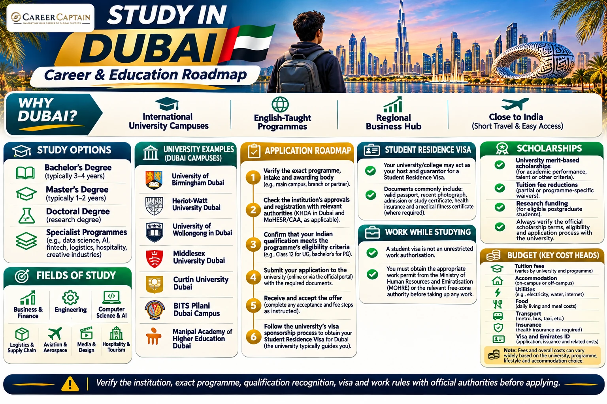

*Last reviewed: 12 November 2026. Admissions, tuition, accreditation, residence permits and employment rules can change. Verify current requirements with the institution, KHDA, UAE Ministry of Higher Education and Scientific Research, GDRFA Dubai and other relevant authorities before applying.*

**A practical guide for Indian students exploring Dubai's universities, courses, admissions, tuition, scholarships, student residence visas, work rules and career pathways.**

Dubai is a major international education hub, with local institutions and branch campuses of universities from several countries. It offers programmes in business, engineering, information technology, finance, media, design, law, health and other fields. A key part of choosing Dubai is understanding who regulates the institution and programme, which body awards the degree, and whether the qualification meets your future study or employment needs.

## 1. Why Consider Dubai?

- A wide selection of international university branch campuses and local higher education institutions.
- Many programmes taught in English.
- Proximity to India and connectivity to international business centres.
- Study options in business, finance, engineering, IT, media, design, logistics, aviation and hospitality.
- Opportunities to build regional industry connections through internships and employer engagement.
- A multicultural environment with a substantial Indian student and professional community.

Dubai is not automatically a low-cost study destination. Tuition and accommodation can be significant. Compare the exact programme, awarding university, recognition, fees and career outcomes before paying a deposit.

## 2. Understand Dubai's Higher Education System

Dubai's higher education sector includes:
- **International university branch campuses:** overseas universities delivering their programmes in Dubai.
- **Local private universities and colleges:** institutions established in the UAE.
- **Specialist institutions:** providers focused on business, aviation, design, hospitality, technology and other fields.

The regulatory framework is important:

- **KHDA (Knowledge and Human Development Authority):** regulates private higher education institutions in Dubai, including institutions in designated free zones, and maintains a directory of institutions and programmes.
- **UAE Ministry of Higher Education and Scientific Research (MoHESR) / Commission for Academic Accreditation (CAA):** licenses higher education institutions and accredits programmes within its remit.
- Some international branch campuses in Dubai operate under specific quality-assurance arrangements, including KHDA and UQAIB or CAA routes. The applicable status depends on the institution and programme.

Do not assume that a campus's brand name alone proves the status of every programme it offers. Verify the institution, exact programme, regulator, awarding body and qualification recognition.

## 3. Universities and Institutions to Research

Examples to begin your research include:

| Institution | Areas to explore |
|---|---|
| University of Birmingham Dubai | Engineering, business, computer science, education |
| Heriot-Watt University Dubai | Engineering, business, data science, architecture |
| University of Wollongong in Dubai | Engineering, IT, business, media |
| Middlesex University Dubai | Business, law, psychology, IT, media |
| Curtin University Dubai | Engineering, business, IT, design |
| De Montfort University Dubai | Business, computing, design, media |
| University of Bradford Dubai | Business, engineering, computing |
| American University in Dubai | Business, engineering, architecture, communication |
| Rochester Institute of Technology Dubai | Engineering, computing, business |
| BITS Pilani Dubai Campus | Engineering, technology, sciences |
| Manipal Academy of Higher Education Dubai | Engineering, business, media, design |
| Canadian University Dubai | Architecture, engineering, business, communication |
| Amity University Dubai | Engineering, business, hospitality, arts |
| British University in Dubai | Business, education, engineering, law |

This is a shortlist, not a ranking or endorsement. Institution status, programme availability and approvals can change. Check the current KHDA directory and relevant federal accreditation records before applying.

## 4. Popular Fields for Indian Students

**Business and finance**
- Business administration and management
- Accounting, finance and economics
- Marketing, entrepreneurship and international business
- FinTech and business analytics

**Engineering and technology**
- Mechanical, civil and electrical engineering
- Computer science and software engineering
- Artificial intelligence, data science and cybersecurity
- Robotics, automation and renewable energy

**Media and design**
- Graphic, communication and product design
- Architecture and interior design
- Animation, film, media and digital communication
- Fashion and creative industries

**Industry and services**
- Aviation and aerospace management
- Logistics and supply chain
- Hospitality, tourism and event management
- Real estate and construction management

Regulated professions may require additional approvals or professional registration. Confirm recognition with the relevant authority in the country where you plan to work.

## 5. Eligibility for Indian Applicants

Admission criteria are set by the institution and programme.

**Undergraduate applicants**
- Class 10 and Class 12 certificates and marksheets.
- Required overall grades and subject-specific prerequisites.
- Recognition or equivalency of the Indian school-leaving qualification where required.
- English-language evidence if required.
- Entrance test, interview, portfolio or additional assessment for selected courses.

**Postgraduate applicants**
- A recognised bachelor's degree in a relevant discipline.
- Academic transcripts and degree certificate.
- Minimum grades and prerequisite subjects.
- CV, statement of purpose and references where required.
- Work experience, portfolio or research proposal for selected programmes.
- English-language evidence where required.

Some institutions may require UAE Ministry equivalency or attestation of foreign qualifications, depending on the programme and intended use. Ask the admissions office for the exact current requirements for Indian qualifications before applying.

## 6. English-Language Requirements

Many Dubai programmes are delivered in English. Institutions may accept IELTS Academic, TOEFL iBT, PTE Academic or other approved evidence.

- Minimum scores vary by institution and course.
- Some programmes require minimum scores in each component.
- An English-medium education background may qualify for a waiver only under the institution's policy.
- Certain professional or regulated programmes may have additional language requirements.

Obtain written confirmation of any waiver rather than assuming that a medium-of-instruction certificate will be accepted.

## 7. How to Apply

1. Select a programme based on academic fit, career goals and total cost.
2. Check the institution and programme in the current KHDA directory and relevant MoHESR/CAA records.
3. Confirm the awarding university, qualification title, campus delivery and recognition route.
4. Review entry requirements, English tests, application deadlines and fees.
5. Prepare passport, academic records, CV, essays, references and portfolio where applicable.
6. Apply through the institution's official admissions portal.
7. Complete any interview, entrance test or additional assessment.
8. Review the offer, tuition schedule, refund rules and scholarship conditions.
9. Accept the offer and complete the university's enrolment requirements.
10. Follow the institution's instructions for student residence visa sponsorship.

Do not pay an agent or intermediary solely on the basis of a promise of admission, scholarship, visa or employment. Confirm all payments and offers directly with the institution.

## 8. Tuition Fees and Living Costs

Costs vary significantly by institution, qualification, programme and location. Dubai does not have one standard international tuition rate.

As a planning approach:
- Compare annual tuition for the exact programme and intake.
- Ask whether fees are charged by credit, semester or academic year.
- Include registration, laboratory, examination, technology and other compulsory fees.
- Confirm whether VAT or other charges apply to the quoted service.
- Compare accommodation, transport and food costs based on the actual campus location.

Your budget should include:
- Tuition and university fees.
- Accommodation, utilities and deposits.
- Food, transport and mobile/internet.
- Health insurance.
- Student residence visa, Emirates ID and medical fitness costs, where applicable.
- Books, equipment and course materials.
- Flights and initial settlement expenses.
- Emergency funds.

Use the university's current fee schedule and obtain a written estimate of all compulsory costs. Do not rely on outdated online fee tables or a general citywide estimate.

## 9. Scholarships and Financial Support

Potential funding routes include:

**University scholarships**
Universities may offer merit-based awards, tuition discounts, sports or talent scholarships, or financial assistance. Eligibility and renewal conditions vary.

**Academic excellence awards**
Some institutions offer awards based on Class 12 results, undergraduate GPA, entrance performance or other defined criteria. Check whether the award applies to the full programme or only the first year.

**Research funding**
Postgraduate research applicants should contact departments and potential supervisors about funded projects, assistantships and research scholarships.

**External funding**
Indian education loans, employer sponsorship and external awards may help meet costs. Check whether the funds are available by the tuition payment deadlines.

Read the terms carefully:
- Is the award a fixed amount or a percentage discount?
- Does it cover all years or only the first year?
- What GPA or attendance must be maintained?
- Can it be combined with other discounts?
- What happens if the student changes programme or withdraws?

Do not treat a scholarship as confirmed until the institution issues an official award letter.

Official starting points:
- [KHDA – Higher Education Directory](https://web.khda.gov.ae/en/education-directory/Higher-Education)
- Individual university scholarship pages.
- [Consulate General of India, Dubai – Student Information](https://www.cgidubai.gov.in/page/information-for-students/)

## 10. Student Residence Visa for Dubai

International students generally need an appropriate UAE residence status to live in Dubai for the duration of their studies.

The UAE government states that a student may stay under:
- Sponsorship of an accredited university or college; or
- Sponsorship of a resident parent, if the student meets the applicable family-sponsorship conditions.

For university-sponsored students, the institution typically acts as the host and guarantor and facilitates the student residence visa process. The specific route and procedures depend on the institution and the relevant immigration authority.

Official information:
- [UAE Government – Residence Visa for Studying](https://u.ae/en/information-and-services/visa-and-emirates-id/residence-visas/residence-visa-for-studying-in-the-uae)
- [Dubai Government – Student Residence Visa](https://www.dubai.ae/living/residency/student-residence-visa)
- [GDRFA Dubai – Student Residence Permit](https://gdrfad.gov.ae/en/services/f52024e0-b812-11ed-5210-4cd98f768936)

## 11. Student Visa Documents and Process

The institution will provide the exact checklist. Commonly requested documents include:
- Passport copy with sufficient validity.
- Recent passport-size photograph.
- Official admission letter or study certificate confirming course and duration.
- Health insurance evidence.
- Medical fitness examination, where required.
- Emirates ID application or receipt, where applicable.
- Existing UAE residence visa cancellation or transfer documents, if relevant.
- Any additional forms, undertakings or supporting documents requested by the university or GDRFA.

The usual sequence is:
1. Receive an unconditional or otherwise visa-eligible admission offer.
2. Complete the university's enrolment and visa application forms.
3. Submit the required documents and pay the applicable university/immigration fees.
4. The university or authorised sponsor submits the residence permit application.
5. Complete medical fitness and Emirates ID formalities as instructed.
6. Receive the residence permit and follow the institution's registration instructions.

Requirements, fees, validity and processing times depend on the application route and can change. Obtain the current written fee schedule from the university before making payments.

## 12. Health Insurance and Medical Fitness

Health insurance is an important part of the student residence process. Dubai's GDRFA student residence service lists health insurance and an approved medical examination among its requirements.

Ask the university:
- Whether insurance is included in tuition or billed separately.
- Which insurance provider and coverage level are accepted.
- Whether the policy covers the full residence period.
- Where and when the medical fitness examination must be completed.
- Whether additional steps apply based on age or individual circumstances.

Do not assume that an Indian travel insurance policy will satisfy the local student residence requirements.

## 13. Working While Studying

A student residence visa is not an unrestricted work authorisation.

The UAE has specific work-permit categories, including a **student training and employment permit** for eligible students who are already in the UAE. The employer must follow the applicable Ministry of Human Resources and Emiratisation (MOHRE) rules or the relevant free-zone authority's process.

Before accepting paid work or an internship:
- Confirm that your residence status permits the proposed activity.
- Ask the employer to obtain the required permit or authorisation.
- Check whether the role is part of a university-approved internship or training arrangement.
- Confirm any age, duration, employer and documentation conditions.
- Do not work informally or assume that a university NOC alone replaces a legal work permit.

Official information:
- [MOHRE](https://www.mohre.gov.ae/)
- [UAE Government – Work Permits](https://u.ae/en/information-and-services/jobs/employment-in-the-private-sector/work-permits)

## 14. Accommodation and Student Life

Options include:
- University-managed student residences.
- Purpose-built student accommodation.
- Shared apartments.
- Private rental housing.
- Accommodation arranged through a university partner.

Compare commute time, transport cost, utility bills, deposit, contract length and access to campus. Verify the property and landlord before transferring money. Ask whether the accommodation is approved for student occupancy and whether the quoted price includes utilities.

Dubai has a hot desert climate and a car-oriented urban layout in some areas. Campus location and transport access can make a significant difference to the total budget.

## 15. Employment After Graduation

Graduation does not automatically grant a right to work or remain in Dubai indefinitely.

Graduates who secure employment generally need the appropriate work authorisation and residence status arranged under the applicable UAE rules. Employers must comply with the relevant work-permit process. Some high-achieving students may qualify for long-term residence options, including student-related Golden Visa categories, subject to the official eligibility criteria and nomination/document requirements.

Before choosing a programme for employment purposes:
- Check the degree's recognition and attestation route.
- Review the sector's hiring requirements.
- Check whether the role requires professional licensing.
- Understand current work-permit and residence rules.
- Compare the career value of the qualification with its total cost.

No university can guarantee a job, work permit, Golden Visa or permanent residence.

## 16. Indian Student Application Checklist

- [ ] Shortlist institutions and programmes that match your academic background and career goals.
- [ ] Verify the institution in the current KHDA directory and relevant MoHESR/CAA records.
- [ ] Confirm the exact programme approval, awarding body, qualification title and recognition route.
- [ ] Check Indian Class 12 or bachelor's entry requirements and subject prerequisites.
- [ ] Confirm English-language test requirements and any waiver in writing.
- [ ] Compare tuition, compulsory fees, scholarship terms and refund policy.
- [ ] Prepare passport, Class 10/12 certificates, degree documents and transcripts as applicable.
- [ ] Arrange attestations, equivalency or certified translations if the institution requires them.
- [ ] Prepare CV, statement of purpose, references, portfolio or research proposal where applicable.
- [ ] Apply through the institution's official admissions portal.
- [ ] Obtain and verify the official offer letter before paying fees.
- [ ] Check scholarship eligibility and secure the official award letter, if applicable.
- [ ] Prepare a full budget covering tuition, accommodation, insurance, transport and visa-related charges.
- [ ] Follow the university's current student residence visa checklist.
- [ ] Prepare passport copy, photograph, admission certificate and other required visa documents.
- [ ] Complete medical fitness and Emirates ID formalities as instructed.
- [ ] Confirm health insurance coverage and accommodation before travel.
- [ ] Do not start paid work or an internship until the required permit/authorisation is in place.
- [ ] Keep copies of admission, fee receipts, residence documents and insurance.
- [ ] Before graduation, check qualification recognition, professional licensing and work-permit options.

**Important:** This checklist is a planning aid, not a substitute for the current university, KHDA, MoHESR, GDRFA or MOHRE instructions.

## 17. Suggested Application Timeline

| Period before course begins | Suggested action |
|---|---|
| 9–12 months | Research institutions, programmes, accreditation and total costs |
| 6–9 months | Prepare academic documents, English tests and applications |
| 4–6 months | Apply, complete assessments and compare offers |
| After offer | Verify programme approval, scholarships and fee/refund terms |
| Before travel | Complete student residence visa steps, insurance and accommodation |
| After arrival | Complete medical, Emirates ID and university registration formalities |

This is a planning framework, not a guarantee of admission or visa processing time. Follow the exact intake calendar and current instructions from your institution.

## 18. Official Resources

| Purpose | Official resource |
|---|---|
| KHDA higher education directory | https://web.khda.gov.ae/en/education-directory/Higher-Education |
| KHDA student guidance | https://web.khda.gov.ae/en/guides/students |
| UAE higher education regulators | https://u.ae/en/information-and-services/education/higher-education/Higher-education-regulatory-bodies |
| UAE student residence visa | https://u.ae/en/information-and-services/visa-and-emirates-id/residence-visas/residence-visa-for-studying-in-the-uae |
| Dubai student residence visa | https://www.dubai.ae/living/residency/student-residence-visa |
| GDRFA Dubai student permit | https://gdrfad.gov.ae/en/services/f52024e0-b812-11ed-5210-4cd98f768936 |
| MOHRE | https://www.mohre.gov.ae/ |
| Consulate General of India, Dubai – Student Information | https://www.cgidubai.gov.in/page/information-for-students/ |

## 19. How Career Captain Can Help

Choosing a city is only one part of a successful international education plan. Students also need to identify a suitable course, assess academic eligibility, compare institutions, plan funding and understand career pathways.

Career Captain Global Solutions supports students and families through:
- One-to-one career counselling and career exploration.
- Course and university selection.
- Academic profile assessment.
- Study-abroad planning.
- Scholarship and admission guidance.
- Career pathway planning.

Explore: https://careercaptain.co.in?utm_source=career_roadmaps_india&utm_medium=referral&utm_campaign=github_career_roadmaps&utm_content=study-in-dubai-complete-guide-for-indian-students

## Conclusion

Dubai can offer Indian students access to international university campuses and programmes in business, engineering, technology, finance, design and other fields. The most important step is to verify the exact programme and awarding body, understand the regulatory and recognition route, calculate the full cost and follow the correct student residence and work-permit procedures.

**Choose the programme carefully, verify the institution and qualification, plan your finances and follow the official UAE immigration process.**

---

**Educational Disclaimer**

This guide is for general educational and career-planning purposes. Admission requirements, tuition fees, scholarships, programme approvals, residence procedures and employment rules can change. It does not guarantee admission, funding, a residence visa, employment or permanent residence. Verify current requirements with the institution and official UAE authorities before making decisions.

**Published by Career Captain Global Solutions**  
Website: https://careercaptain.co.in?utm_source=career_roadmaps_india&utm_medium=referral&utm_campaign=github_career_roadmaps&utm_content=study-in-dubai-complete-guide-for-indian-students

**Open Licence:** Creative Commons Attribution 4.0 International (CC BY 4.0), subject to applicable third-party asset rights.  
https://creativecommons.org/licenses/by/4.0/

---

## Plan your study-abroad journey with Career Captain

Country and university choices should be evaluated against your academic profile, course goals, budget, entry requirements and long-term plans. Career Captain provides study-abroad counselling and application-planning support. Admission, scholarship and visa decisions remain with the relevant institutions and authorities.

- [Study-abroad counselling in Hyderabad](https://careercaptain.co.in/?utm_source=career_roadmaps_india&utm_medium=referral&utm_campaign=github_career_roadmaps&utm_content=study-in-dubai-complete-guide-for-indian-students)
- [Scholarship guidance for Indian students](https://guide.careercaptain.co.in/study-abroad/?utm_source=career_roadmaps_india&utm_medium=referral&utm_campaign=github_career_roadmaps&utm_content=study-in-dubai-complete-guide-for-indian-students)
- [Explore Career Captain](https://careercaptain.co.in?utm_source=career_roadmaps_india&utm_medium=referral&utm_campaign=github_career_roadmaps&utm_content=study-in-dubai-complete-guide-for-indian-students)

[WhatsApp Career Captain](https://wa.me/919849488838?text=Hi%20Career%20Captain%2C%20I%20found%20your%20study%20in%20dubai%20complete%20guide%20for%20indian%20students%20guide%20in%20Career%20Roadmaps%20India.%20I%20would%20like%20to%20know%20more%20about%20study%20abroad%20guidance.%20Source%3A%20study-in-dubai-complete-guide-for-indian-students.)
