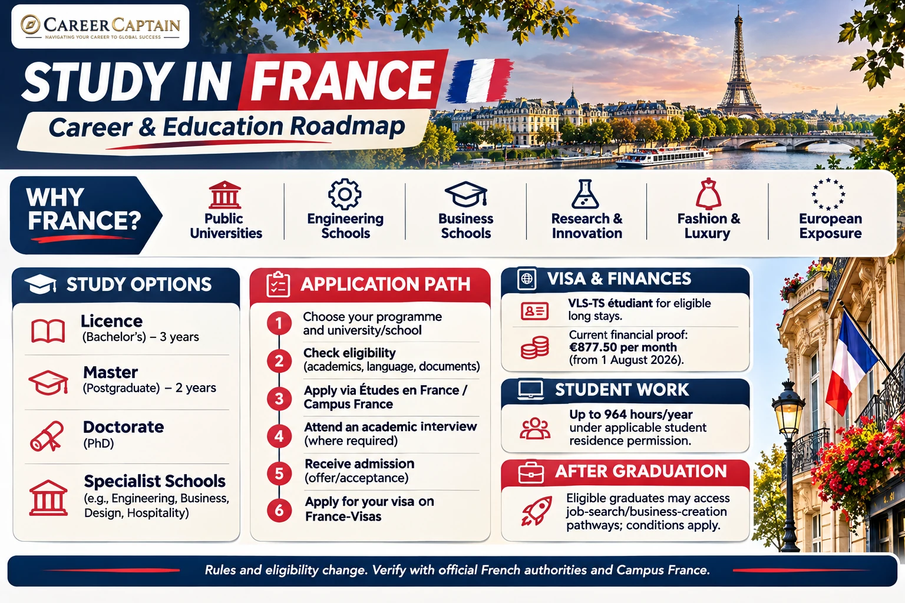

# Study in France: Complete Roadmap for Indian Students

France is an important international education destination for students interested in engineering, business, luxury brand management, fashion, hospitality, mathematics, science, art and technology.

Its universities and specialist institutions offer undergraduate degrees, postgraduate programmes, professional qualifications and doctoral research opportunities.

For Indian students, France can be particularly attractive because of its public university system, specialised business and engineering schools, research ecosystem and growing academic cooperation with India.

However, studying in France requires careful planning. Students must understand admission requirements, the Campus France process, tuition fees, scholarships, student visas, work restrictions and post-study opportunities.

This guide explains the process for Indian students, from selecting a course to planning a career after graduation.

*Last reviewed: November 2026. Admission requirements, tuition fees and immigration policies can change. Always verify current information through official French government, Campus France and university websites.*

---

## 1. Why Study in France?

France offers several advantages for international students.

- **Internationally recognised qualifications:** French institutions offer degrees recognised by employers and academic institutions internationally.
- **Public university opportunities:** Public higher education institutions receive substantial government funding.
- **Engineering education:** France has a strong tradition of engineering education through universities and specialised Grandes Écoles.
- **Business and management:** French business schools offer programmes in management, finance, luxury brand management and international business.
- **Technology and research:** Students can explore artificial intelligence, mathematics, aerospace, biotechnology and scientific research.
- **Fashion and creative industries:** France has a significant presence in fashion, design, luxury goods and hospitality.
- **European exposure:** Students can experience an international academic environment within the European Union.
- **Post-study opportunities:** Eligible graduates may qualify for job-search or business-creation residence pathways.

France is especially worth exploring if you are interested in engineering, business, mathematics, aerospace, luxury management, fashion or research.

## 2. Understand the Different Study Options

Indian students generally consider four academic pathways.

### A. Undergraduate study

Bachelor's-level education in France is commonly organised around the Licence system.

A standard Licence degree generally takes three years.

Popular programmes include:

- Computer Science
- Mathematics
- Mechanical Engineering
- Electrical Engineering
- Civil Engineering
- Physics
- Chemistry
- Economics
- Business Administration
- International Relations
- Psychology
- Biotechnology
- Fashion Design
- Architecture

Students generally apply after completing Class 12.

Admission requirements vary by institution and programme. Some courses require specific subjects, entrance examinations or foundation preparation.

### B. Postgraduate study

Master's programmes commonly take two years, divided into Master 1 and Master 2.

Popular options include:

- MSc Computer Science
- MSc Artificial Intelligence
- MSc Data Science
- MSc Cybersecurity
- MSc Mechanical Engineering
- MSc Aerospace Engineering
- MSc Finance
- MSc Business Analytics
- Master in Management
- MBA
- MSc Luxury Brand Management
- MSc Fashion Management
- MSc Biotechnology

Some programmes are taught in English, while others require French proficiency.

### C. Doctoral study

A doctorate is suitable for students interested in advanced research, academic careers and specialised research and development.

Funding opportunities may include:

- Doctoral contracts
- University research scholarships
- Research laboratory funding
- Government-funded research programmes
- International research fellowships

Funding conditions vary. Confirm whether the funding covers tuition, living expenses or both.

### D. Foundation and pathway programmes

Some institutions offer preparatory programmes for international students who need additional academic or language preparation.

Before enrolling, check the provider, programme recognition, progression requirements and eligibility for student immigration permission.

## 3. Eligibility for Indian Students

French universities and institutions establish their own academic requirements.

### Undergraduate admission

Common requirements include:

- Class 10 academic records
- Class 12 marksheets and certificates
- Required subject combinations
- Minimum academic performance
- Language proficiency
- Motivation letter
- Additional application documents
- Entrance examinations or interviews, where applicable

Some institutions accept Indian Class 12 qualifications directly.

For example:

- Engineering programmes may require Mathematics and Physics.
- Computer Science programmes may require Mathematics.
- Business programmes may require evidence of quantitative and analytical ability.
- Design programmes may require a portfolio.

Some programmes require a foundation year or additional preparation.

### Postgraduate admission

Common requirements include:

- Recognised Bachelor's degree
- Academic transcripts
- Minimum marks or equivalent GPA
- Relevant subject background
- Language proficiency
- Statement of Purpose
- Letters of Recommendation
- Resume or CV
- Portfolio or research proposal, where required
- Work experience for selected programmes

Some universities accept three-year Indian Bachelor's degrees, while others have specific academic and qualification requirements.

Confirm eligibility directly with the university.

## 4. English-Taught and French-Taught Programmes

France offers programmes in both French and English.

### English-taught programmes

These are useful for Indian students who want to study in France without initially having advanced French proficiency.

Common fields include:

- Computer Science
- Data Science
- Artificial Intelligence
- Engineering
- Business
- Finance
- International Management
- Biotechnology
- Luxury Brand Management

English-language tests may include:

- IELTS Academic
- TOEFL iBT
- PTE Academic
- Other tests accepted by the institution

### French-taught programmes

Students applying for French-language courses may need to demonstrate proficiency through qualifications such as:

- DELF
- DALF
- TCF
- TEF

The required level depends on the programme and institution. Many academic programmes expect B2 or higher, while some may require C1.

### Why learning French is valuable

Even when your programme is taught in English, learning French can help with:

- Everyday communication
- Accommodation and administrative procedures
- Internships
- Part-time employment
- Networking
- Professional integration

French language ability can be a significant advantage when looking for employment in France.

## 5. How to Choose the Right Institution

Do not select an institution only because it appears in a global ranking.

Evaluate the following:

1. Course curriculum and specialisation
2. Institutional recognition
3. Degree accreditation and qualification level
4. Faculty expertise and research facilities
5. Industry connections
6. Internship and placement opportunities
7. Graduate employment outcomes
8. Tuition and living expenses
9. Scholarships and financial assistance
10. Location and accommodation costs
11. Language of instruction
12. International student support

### Types of institutions

**Public universities:** Offer Bachelor's, Master's and doctoral programmes across many academic disciplines.

**Grandes Écoles:** Selective institutions known for specialised education in engineering, management and other professional fields.

**Business schools:** Offer programmes in management, finance, marketing, entrepreneurship and luxury brand management.

**Engineering schools:** Provide specialised technical education and research opportunities.

**Specialist institutions:** Focus on fields such as fashion, art, architecture, hospitality and design.

### Check the qualification carefully

Look for recognised national degrees and relevant accreditation.

Useful indicators include:

- Licence, Master's and Doctorate national degrees
- RNCP registration where applicable
- Grade de Master recognition
- Relevant professional accreditation

A programme's marketing title does not necessarily establish its academic recognition.

Useful resources:

- Campus France: https://www.campusfrance.org/
- Campus France India: https://www.inde.campusfrance.org/
- France Compétences: https://www.francecompetences.fr/

## 6. Estimated Cost of Studying in France

France can offer relatively affordable public higher education, but costs vary significantly by institution.

Private business schools, specialist schools and some engineering institutions may charge substantially higher fees.

### Public institution tuition: 2026–2027

For non-EU international students enrolled in affected public higher education programmes, the published differentiated tuition rates are:

| Qualification | Annual tuition |
|---|---:|
| Bachelor's / Licence | €2,902 |
| Master's | €3,950 |
| Doctorate | €398 |

These rates apply to the relevant public institutions under the differentiated-fee system.

Some students and programmes are exempt, and certain institutions may apply eligible exemptions. Always confirm the actual fee with your university.

Private institutions and specialist schools may charge several thousand euros or more per year.

Official information: https://www.campusfrance.org/en/tuition-fees-France

### Illustrative annual living budget

| Expense | Illustrative annual range |
|---|---:|
| Accommodation | €4,800–€10,800 |
| Food and groceries | €2,400–€3,600 |
| Transport | €300–€1,000 |
| Books and supplies | €300–€700 |
| Personal expenses | €1,000–€2,000 |

These are planning estimates, not official financial requirements.

Paris is generally more expensive than many other French cities.

### How to reduce expenses

- Compare universities outside Paris.
- Investigate public university programmes.
- Apply for scholarships.
- Research student accommodation.
- Check eligibility for housing assistance.
- Learn about student transport discounts.
- Prepare a realistic monthly budget.

Do not rely on part-time employment to finance your entire degree.

## 7. Scholarships for Indian Students

Scholarships can reduce the financial burden of studying in France.

### Common funding opportunities

**Eiffel Excellence Scholarship Programme:** A French government scholarship supporting selected international students pursuing eligible Master's and doctoral studies.

Official information: https://www.campusfrance.org/en/eiffel-scholarship-program-of-excellence

**Charpak Scholarship Programme:** Scholarships offered by the French Embassy in India for eligible Indian students pursuing selected study opportunities in France.

Official information: https://www.inde.campusfrance.org/scholarships-for-indian-students

**Raman-Charpak Fellowship:** Supports eligible research mobility between India and France.

**University scholarships:** French universities and business schools may provide merit-based awards.

**Research funding:** Doctoral students may receive funding through laboratories, research projects and doctoral contracts.

### Scholarship application strategy

1. Identify programmes offering scholarships.
2. Confirm eligibility for Indian applicants.
3. Check deadlines.
4. Prepare academic records.
5. Write a strong motivation letter.
6. Obtain suitable recommendation letters.
7. Contact departments about research funding.
8. Confirm the scholarship value and duration.

Some awards cover tuition, while others provide monthly allowances or travel support.

Never assume that every international student receives a scholarship.

## 8. The Campus France and Études en France Process

For Indian students, Campus France is an important part of the application journey.

India is among the countries covered by the **Études en France (EEF)** procedure.

The platform supports admission-related procedures and connects applicants with the relevant Campus France office.

### Typical application process

1. Create an account on the Études en France platform.
2. Enter personal and academic details.
3. Upload academic records and certificates.
4. Add your CV and motivation statements.
5. Select eligible programmes.
6. Submit the application.
7. Attend the academic interview when required.
8. Receive and review institution decisions.
9. Select your preferred offer.
10. Complete the relevant visa process.

Some private institutions have their own direct admission procedures. However, Indian students may still need to complete the applicable Campus France procedure for the visa process.

### Important timing

Campus France India advises applicants to begin the visa-related process after receiving unconditional acceptance and sufficiently ahead of the intended intake.

Its guidance recommends submitting the relevant file at least three months before the intake.

Do not wait until the final weeks to begin.

Official resources:

- https://www.inde.campusfrance.org/application-and-admission-procedure
- https://pastel.diplomatie.gouv.fr/etudesenfrance/

## 9. Application Process: Step by Step

### Step 1: Select your course

Identify your subject, qualification level and career direction.

Compare course content, language requirements and entry criteria.

### Step 2: Shortlist institutions

Prepare a balanced shortlist based on:

- Academic eligibility
- Course quality
- Recognition
- Tuition fees
- Location
- Scholarships
- Language of instruction

### Step 3: Check admission requirements

For each institution, record:

- Minimum marks
- Required subjects
- Language requirements
- Entrance tests, if applicable
- Application deadlines
- Tuition fees
- Scholarship deadlines

### Step 4: Prepare documents

Common documents include:

- Passport
- Class 10 and Class 12 certificates
- Undergraduate transcripts, if applicable
- Degree certificate, if applicable
- Language test results
- CV
- Motivation letter or Statement of Purpose
- Recommendation letters
- Portfolio, where required
- Other supporting documents

### Step 5: Apply through the appropriate system

Depending on your programme, you may apply through:

- Études en France
- The institution's own application portal
- Parcoursup, for applicable undergraduate applications
- Another official admissions system

### Step 6: Complete the Campus France process

Follow the required academic interview and document verification procedure.

### Step 7: Receive admission

Review your offer, programme conditions, tuition and payment deadlines.

### Step 8: Prepare your visa application

Once you have the required acceptance documentation, proceed with the relevant France-Visas application.

## 10. The French Student Visa

Indian students generally require a long-stay student visa for degree programmes lasting more than 90 days.

The common visa category is the **VLS-TS étudiant**, a long-stay visa that also functions as a residence permit after validation.

### Basic requirements

Applicants generally need to:

- Have an offer or acceptance from an eligible institution.
- Complete the applicable Campus France procedure.
- Demonstrate sufficient financial resources.
- Provide academic documents.
- Demonstrate the required language ability.
- Provide accommodation information.
- Meet the relevant immigration requirements.

### Application process

1. Obtain admission.
2. Complete the applicable Études en France process.
3. Prepare the required supporting documents.
4. Create an account on France-Visas.
5. Complete the online visa application.
6. Follow the appointment instructions for the relevant visa application centre.
7. Submit documents and biometrics when required.
8. Pay the applicable visa and service fees.
9. Wait for the decision.
10. Follow the instructions issued with your visa.

### Common supporting documents

Depending on your circumstances, you may need:

- Valid passport
- Visa application form
- Admission or enrolment letter
- Campus France documentation
- Academic certificates and transcripts
- Language test results
- Financial evidence
- Accommodation information
- Proof of tuition payment, where applicable
- Other documents requested by the authorities

Official resources:

- https://france-visas.gouv.fr/en/web/france-visas/etudiant
- https://www.inde.campusfrance.org/preparing-the-visa-application

### Indian student application checklist

Use this checklist to organise your application. The exact documents and steps depend on your institution, programme, visa category and personal circumstances.

- [ ] Confirm that the institution and specific programme are recognised and appropriate for your intended qualification.
- [ ] Check academic eligibility, subject prerequisites, language of instruction and accepted language tests.
- [ ] Confirm the institution's application route and deadline; Indian residents are generally covered by the Études en France (EEF) procedure, but some institutions also have direct admission steps.
- [ ] Create and complete your Études en France account where required.
- [ ] Prepare passport, photograph, Class 10 and Class 12 records, degree certificates and transcripts, as applicable.
- [ ] Prepare CV, motivation letter or Statement of Purpose, recommendation letters, portfolio or research proposal where required.
- [ ] Complete the Campus France academic interview and retain the relevant confirmation.
- [ ] Compare the admission offer, tuition, scholarship conditions, refund policy and payment deadlines.
- [ ] Check the current France-Visas checklist and complete the student long-stay visa application.
- [ ] Prepare financial evidence meeting the current requirement: Campus France India states €877.50 per month from 1 August 2026; verify accepted evidence and any applicable exemptions.
- [ ] Arrange suitable accommodation evidence and health/insurance documents required for your case.
- [ ] Attend the required visa application appointment and provide biometrics/documents as instructed.
- [ ] Do not make non-refundable travel bookings before the visa decision.
- [ ] After arrival, validate the VLS-TS online within the required period, if that is the visa issued.
- [ ] Complete university registration, health coverage and other local formalities.
- [ ] Track residence-permit renewal dates and comply with student work restrictions.

**Important:** The checklist is a planning aid, not a substitute for the current Campus France India, France-Visas or prefecture checklist.

## 11. Financial Requirements for a French Student Visa

Students must demonstrate that they have sufficient financial resources to support themselves during their stay.

### Updated financial requirement

Effective 1 August 2026, Campus France India states that the minimum financial proof required for a French student visa is:

**€877.50 per month.**

This replaces the previous €615 monthly threshold.

For a 12-month period, this is equivalent to €10,530.

The actual financial evidence required may depend on the duration of the stay, tuition payments, scholarship arrangements and the applicant's circumstances.

### Possible financial evidence

- Personal bank statements
- Sponsor's bank statements
- Scholarship documentation
- Education loan evidence
- Financial guarantee documents
- Other accepted proof of resources

Check the official checklist for the precise evidence and acceptable sponsorship arrangements.

**Important:** The minimum visa financial requirement is not necessarily enough to cover actual living costs, particularly in Paris.

Official information:

- https://www.inde.campusfrance.org/node/46
- https://france-visas.gouv.fr/

## 12. What to Do After Arriving in France

The administrative process does not end when your visa is issued.

If you receive a VLS-TS étudiant, you generally need to validate it online after arriving in France.

### Important arrival steps

1. Validate your VLS-TS through the official immigration platform within the required period.
2. Keep your passport and immigration documents safe.
3. Complete university registration.
4. Arrange accommodation.
5. Register for the applicable health coverage.
6. Open a bank account if needed.
7. Obtain transport and student identification cards.
8. Check the renewal deadline for your residence permission.

Some visa categories have different formalities. Follow the exact instructions associated with your visa.

Official information: https://administration-etrangers-en-france.interieur.gouv.fr/

## 13. Working While Studying

Eligible non-EU students holding the appropriate student residence permission can undertake paid employment in France.

### Work limit

The general annual limit is:

**964 hours per year**, equivalent to approximately 60% of the normal annual working time.

The limit applies to eligible student residence permissions and is subject to specific rules.

### Common student jobs

- Retail assistant
- Hospitality staff
- Customer service
- Administrative support
- Campus employment
- Tutoring
- Research support, where eligible

### Important restrictions

- Employment must comply with your residence permission.
- You must respect the annual working-hour limit.
- Student residence permission does not generally authorise self-employment.
- Employment must not interfere with your studies.
- Certain nationalities are subject to different rules.

Part-time work can help with expenses, but it should not be treated as the primary funding source for tuition and living costs.

Official information: https://www.service-public.gouv.fr/particuliers/vosdroits/F2713

## 14. Post-Study Opportunities in France

France offers post-study pathways for eligible international graduates.

The available route depends on the qualification, nationality and immigration status.

### Job Search or Business Creation residence permit

Eligible graduates who obtain a French qualification at Master's level or an equivalent recognised qualification may apply for a residence permit allowing them to:

- Search for employment.
- Develop a business project related to their training.
- Prepare to transition to an appropriate work or business residence status.

The standard Job Search / Business Creation residence permit is valid for up to 12 months and is generally non-renewable.

### Important arrangements for Indian graduates

India has a bilateral migration and mobility arrangement with France.

Eligible Indian graduates may have access to specific provisions, including an Authorisation Provisoire de Séjour (APS) pathway.

Campus France India publishes guidance on the relevant Indian graduate provisions, including a one-year renewable residence arrangement for eligible applicants.

The exact route depends on the qualification and individual circumstances. Verify the current procedure before relying on it.

### Employment after graduation

Graduates who obtain a suitable job may be able to change to an employment-related residence status.

The relevant conditions can include:

- Qualification level
- Job relevance
- Employment contract
- Salary
- Employer requirements
- Work authorisation rules

A French degree does not automatically guarantee employment or permanent residence.

Official resources:

- https://www.france-visas.gouv.fr/en/web/france-visas/recherche-d-emploi-creation-d-entreprise
- https://www.campusfrance.org/en/job-seeker-business-creator-residence-permit
- https://www.inde.campusfrance.org/

## 15. Career Opportunities After Graduation

France offers employment opportunities in several industries.

However, employment is not guaranteed. Graduates must meet employer requirements and applicable professional registration rules.

### Technology

- Software engineering
- Artificial intelligence
- Data science
- Cybersecurity
- Cloud computing
- Business intelligence
- Product management

### Engineering

- Mechanical engineering
- Aerospace engineering
- Automotive engineering
- Civil engineering
- Electrical engineering
- Robotics
- Manufacturing
- Renewable energy

### Business and finance

- Financial analysis
- Accounting
- Consulting
- Business analytics
- Marketing
- International business
- Luxury brand management

### Fashion and creative industries

- Fashion design
- Fashion merchandising
- Luxury management
- Product design
- Graphic design
- Creative direction

### Science and healthcare

- Biotechnology
- Pharmaceutical research
- Biomedical science
- Chemistry
- Materials science
- Public health

French language proficiency can be a significant advantage in many employment sectors.

## 16. Building a Strong Profile Before Applying

A strong application demonstrates more than academic marks.

### For engineering students

- Develop technical skills.
- Complete practical projects.
- Participate in engineering competitions.
- Build a technical portfolio.
- Gain internship experience.
- Strengthen mathematics and core engineering subjects.

### For business students

- Develop analytical and communication skills.
- Participate in leadership activities.
- Complete market research projects.
- Gain internship experience.
- Learn relevant business tools.

### For science students

- Participate in research projects.
- Develop laboratory skills.
- Explore research internships.
- Build relationships with faculty members.
- Strengthen analytical and academic writing skills.

### For all applicants

- Maintain consistent academic performance.
- Develop a clear academic direction.
- Learn French where possible.
- Participate in meaningful extracurricular activities.
- Prepare strong motivation letters.
- Request recommendations from people who know your work.

Meaningful experience is more valuable than collecting certificates without practical learning.

## 17. A 12-Month Preparation Roadmap

| Timeline | Recommended action |
|---|---|
| Months 1–2 | Identify courses, institutions and eligibility |
| Months 3–4 | Prepare for language tests and strengthen your profile |
| Months 5–6 | Shortlist institutions and research scholarships |
| Months 7–8 | Prepare applications and recommendation letters |
| Months 9–10 | Submit applications and complete Campus France procedures |
| Month 11 | Compare offers, tuition and accommodation |
| Month 12 | Prepare financial evidence and submit the visa application |

This is an illustrative schedule. Application calendars and visa processing times vary.

## 18. Common Mistakes Indian Students Should Avoid

1. Selecting a university only because of its ranking.
2. Assuming every French public university charges the same fees.
3. Ignoring differentiated tuition requirements.
4. Applying without checking the language of instruction.
5. Assuming every private institution offers a nationally recognised qualification.
6. Ignoring the Campus France process.
7. Starting visa preparation too late.
8. Depending on part-time employment to finance the entire degree.
9. Misunderstanding the 964-hour annual work limit.
10. Assuming every graduate automatically qualifies for post-study residence permission.
11. Ignoring the value of learning French.
12. Trusting agents who promise guaranteed admission or visas.

## 19. Useful Official Resources

| Resource | Purpose |
|---|---|
| https://www.campusfrance.org/ | Official French higher education guidance |
| https://www.inde.campusfrance.org/ | Campus France India |
| https://pastel.diplomatie.gouv.fr/etudesenfrance/ | Études en France application platform |
| https://france-visas.gouv.fr/ | Official visa information |
| https://www.enseignementsup-recherche.gouv.fr/ | Higher education and research |
| https://www.francecompetences.fr/ | Professional qualifications and certification |
| https://www.service-public.gouv.fr/ | Official administrative information |
| https://www.letudiant.fr/ | Student information and education guidance |

Always verify the latest requirements directly through official sources.

## 20. How Career Captain Can Help

Choosing a country is only one part of a successful study-abroad decision.

Students also need to understand their interests, abilities, academic strengths, suitable courses and long-term career objectives.

Career Captain Global Solutions supports students and young professionals through:

- One-to-one career counselling
- Five-dimensional psychometric career assessments
- Stream and subject selection
- Course and college planning
- Study-abroad guidance
- Scholarship and admission support
- Career exploration and planning

Explore: https://careercaptain.co.in/

The objective is to help students make informed education and career decisions rather than selecting a course simply because it is popular.

---

## Final Thoughts

Studying in France can provide valuable academic and professional exposure, particularly in engineering, technology, business, research, fashion and luxury management.

However, students must carefully compare institutions, understand the Campus France process, calculate the full cost and stay informed about immigration requirements.

Most importantly, select a programme that matches your interests, academic background and long-term career goals.

A successful study-abroad journey begins with choosing the right educational pathway.

---

## Attribution and Licence

This educational guide is published by **Career Captain Global Solutions** as part of the Open-Source BTech and Career Roadmaps initiative.

This work is licensed under the **Creative Commons Attribution 4.0 International (CC BY 4.0)** licence.

You may share and adapt this material with appropriate attribution.

**Attribution:** Career Captain Global Solutions — https://careercaptain.co.in/

*Disclaimer: This guide is for general educational information and is not legal, immigration, financial or admission advice. University policies, fees and immigration rules can change. Verify all requirements through official sources before making decisions.*

---

## Plan your study-abroad journey with Career Captain

Country and university choices should be evaluated against your academic profile, course goals, budget, entry requirements and long-term plans. Career Captain provides study-abroad counselling and application-planning support. Admission, scholarship and visa decisions remain with the relevant institutions and authorities.

- [Study-abroad counselling in Hyderabad](https://careercaptain.co.in/study-abroad-consultant-hyderabad)
- [Scholarship guidance for Indian students](https://careercaptain.co.in/study-abroad-scholarships)
- [Explore Career Captain](https://careercaptain.co.in/)

[WhatsApp Career Captain](https://wa.me/919849488838)
