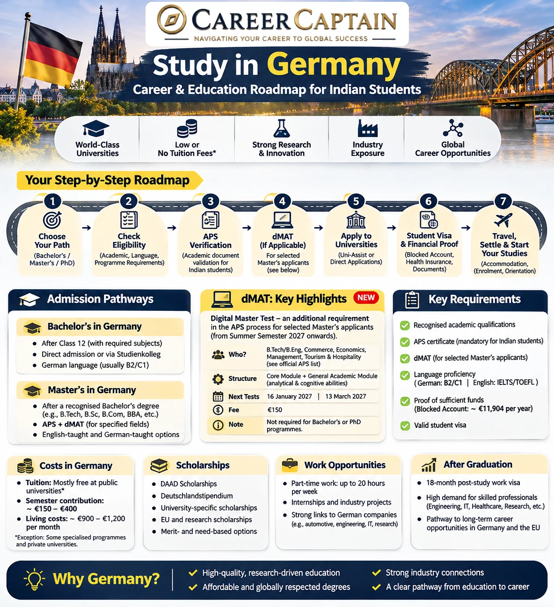

# Study in Germany for Indian Students: Complete Guide to Admissions, APS, Costs, Scholarships and Career Opportunities

Germany is one of the most attractive destinations for Indian students interested in engineering, technology, science, management and research.

Its universities offer a wide range of internationally recognised programmes, strong research opportunities and access to Europe's industrial and technology ecosystem.

Many public universities charge no general tuition fee for many degree programmes, although semester contributions and certain programme-specific or state-specific fees apply.

However, studying in Germany requires careful planning. Students must understand academic eligibility, language requirements, APS verification, university applications, financial proof, visa procedures and accommodation.

This guide explains the process step by step.

---
## Study in Germany – Visual Roadmap

Explore the complete journey through our visual guide:

[View the Study in Germany Career & Education Roadmap](../images/study-abroad/study-in-germany-guide.webp)

  

## 1. Why Study in Germany?

Germany offers several advantages for international students.

### Strong Academic and Research Environment

German universities and research institutions are known for programmes in:

- Mechanical Engineering
- Automotive Engineering
- Electrical Engineering
- Electronics and Communication
- Computer Science
- Artificial Intelligence
- Data Science
- Renewable Energy
- Robotics
- Business and Management
- Natural Sciences
- Architecture and Design

### Public University Options

Many public universities do not charge general tuition fees for consecutive degree programmes.

However, students should check:

- Semester contributions
- State-specific tuition fees
- Fees for non-EU students
- Special programme fees
- Private university tuition

Do not assume that every public university or every programme is tuition-free.

### Industry and Research Opportunities

Germany has major industrial and research sectors, including:

- Automotive manufacturing
- Mechanical engineering
- Industrial automation
- Semiconductor technology
- Renewable energy
- Chemicals
- Pharmaceuticals
- Software and information technology
- Logistics
- Advanced manufacturing

### International Exposure

Students can experience a different academic environment, develop language skills and build international professional networks.

---

## 2. Undergraduate or Postgraduate Studies?

The first step is to identify which academic route applies to you.

### Bachelor's Degree

A Bachelor's degree is generally the first university-level qualification.

Common programmes include:

- BSc Computer Science
- BEng Mechanical Engineering
- BSc Mathematics
- BSc Physics
- BSc Business Administration
- BSc Electrical Engineering

For Indian students, direct admission after Class 12 is not automatic. The recognition of the Indian school qualification and the applicable German admission pathway must be checked.

### Master's Degree

A Master's degree is generally pursued after completing a relevant Bachelor's degree.

Popular options include:

- MSc Computer Science
- MSc Data Science
- MSc Mechanical Engineering
- MSc Automotive Engineering
- MSc Robotics
- MSc Electrical Engineering
- MSc Renewable Energy
- MSc Management
- MSc Finance

Universities may require specific undergraduate subjects, credit points, academic performance and language qualifications.

### Doctoral Studies

Students interested in research may consider doctoral programmes.

Admission normally requires a suitable Master's qualification or an accepted equivalent, along with the relevant academic and research requirements of the institution.

---

## 3. Undergraduate Admission After Class 12 in India

This is one of the most important areas for Indian applicants.

German universities do not automatically treat every Indian Class 12 certificate as equivalent to the German university entrance qualification.

For admissions beginning with Winter Semester 2026/27, APS India announced updated eligibility criteria.

### The Updated 70% Requirement

From Winter Semester 2026/27, the revised criteria specify a minimum overall score of 70% of the maximum achievable marks in the Indian Class 12 certificate.

Two established pathways remain relevant:

**Pathway A: Class 12 and APS**

Students meeting the updated criteria may qualify for subject-restricted admission through a Studienkolleg followed by the Feststellungsprüfung.

**Pathway B: Class 12, APS and One Successful Academic Year**

Students who meet the updated Class 12 threshold and successfully complete at least one academic year in a recognised Bachelor's programme in India may qualify for direct subject-restricted admission in their previous field and closely related subjects.

Completing one academic year does not guarantee admission. The qualification, institution, subject relationship and university requirements must also be checked.

A valid IIT-JEE Advanced result may provide another eligibility route under the applicable recognition criteria.

**Important:** These are eligibility pathways, not admission guarantees. The final decision belongs to the German university.

Official references:

- https://aps-india.de/news/
- https://www.daad.de/en/studying-in-germany/requirements/admission-database/

### What Is Studienkolleg?

Studienkolleg is a preparatory programme for international applicants whose school qualifications do not directly provide the required German university entrance qualification.

It helps students prepare for university-level education.

Common course types include:

| Course | Intended Study Areas |
|---|---|
| T-Kurs | Mathematics, engineering and natural sciences |
| W-Kurs | Business, economics and social sciences |
| M-Kurs | Medicine, biology and related fields |
| G-Kurs | Humanities |
| S-Kurs | Language-related studies |

Course availability and subject combinations vary between Studienkollegs.

Students generally complete the preparatory programme and take the Feststellungsprüfung (FSP).

Passing the FSP establishes an applicable entrance qualification, but does not automatically guarantee a place at a particular university.

---

## 4. Master's Admission After a Bachelor's Degree in India

Students who have completed a Bachelor's degree can explore Master's programmes in Germany.

Common requirements include:

- Recognised Bachelor's degree
- Relevant academic background
- Required subject credits
- Minimum academic performance, where specified
- Language proficiency
- APS certificate, where applicable
- Programme-specific documents
- Motivation letter or statement of purpose
- CV
- Recommendation letters, where required

### Subject Matching Is Important

German universities often evaluate the actual subjects studied during your Bachelor's degree.

For example:

A Mechanical Engineering graduate may be eligible for certain programmes in:

- Mechanical Engineering
- Automotive Engineering
- Production Engineering
- Computational Engineering
- Energy Engineering

But admission to a programme in Data Science or Computer Science may require specific mathematics, statistics or programming credits.

Do not assume that any Bachelor's degree allows entry into any Master's programme.

### Check the Curriculum Before Applying

Compare:

1. Your undergraduate subjects.
2. The Master's programme's required credits.
3. The programme's admission regulations.
4. The language requirements.
5. Any additional examinations or prerequisites.

The programme's official admission page is the most important source.

---

## 5. APS Certificate for Indian Students

APS stands for Akademische Prüfstelle, or Academic Evaluation Centre.

APS India verifies academic documents and qualifications issued by Indian educational institutions for applicants planning to study in Germany.

For most Indian applicants, APS verification is an important part of the university admission and student visa process.

### Why Is APS Important?

APS helps verify:

- Academic certificates
- Mark sheets
- Educational history
- Institutional qualifications
- Relevant examination records

The APS certificate does not itself provide university admission or guarantee a visa.

### When Should You Apply?

Plan the APS process early, but submit your application only when you have completed the academic stage relevant to your intended admission route.

For example:

- Class 12 students planning a Studienkolleg route
- Students who have completed the academic year required for direct subject-restricted admission
- Graduates applying for Master's programmes

APS has clarified that it cannot keep an application open while an applicant waits for future examination results or additional semester mark sheets.

### Documents

The exact checklist depends on the applicant's academic background.

It may include:

- Class 10 certificate
- Class 12 certificate
- University mark sheets
- Degree certificate
- University transcripts
- Academic records
- Passport details
- Other supporting documents requested by APS

Always use the current checklist on the official APS website.

Official website:

https://aps-india.de/
### Digital Master Test (dMAT): New Requirement for Selected Master's Applicants

The Digital Master Test (dMAT) is a standardised academic aptitude test administered by the Society for Academic Study Preparation and Test Development (g.a.s.t.). From 2026, it has been introduced as an additional requirement in the APS documentation process for selected Indian applicants planning to pursue Master's studies in Germany.

**Important:** The dMAT requirement applies to specified Master's applicants with affected undergraduate qualifications. It is not a general requirement for every student planning to study in Germany.

#### Who Must Take the dMAT?

Under the APS India rules updated in November 2026, the requirement applies to Indian Master's applicants whose previous undergraduate degree falls within these fields:

- **Engineering and Technology:** All B.Tech and B.Eng degrees, regardless of specialisation, as well as other undergraduate engineering degrees.
- **Commerce and Economics:** Commerce, Accounting, Finance and Economics.
- **Business and Management:** Business Administration and Management Studies.
- **Tourism and Hospitality:** Tourism, Travel, Hotel and Hospitality Management.
- **Integrated and Dual-Degree Programmes:** Where a component or major field falls within an affected discipline.

For these applicants, the dMAT is required for APS documentation relating to Master's intakes from Summer Semester 2027 onwards, subject to transitional exemptions.

#### Who Is Currently Exempt?

Under the current APS procedure, the following groups are not required to take the dMAT:

- Students applying directly for Bachelor's programmes.
- PhD applicants.
- Applicants whose previous degree is outside the specified fields.
- Bachelor's students who have not completed at least five semesters of a three-year programme or seven semesters of a four-year programme.
- Applicants in officially confirmed exchange, double-degree or university partnership programmes.

Transitional exemptions also apply to applicants who completed APS online registration before 29 June 2026, shipped their complete APS documents before that date, or have already received an APS certificate for the completed procedure.

Applicants with mixed or borderline degree subjects should consult APS India directly.

#### dMAT Examination Structure

The dMAT consists of two modules:

**1. Core Module**
- Figure Sequences
- Mathematical Equations
- Latin Squares

This module assesses general cognitive, analytical and study-related abilities.

**2. General Academic Module**

This module assesses the ability to apply analytical and cognitive skills to academic problem-solving situations across different subject areas.

For the Indian APS procedure, affected applicants must take the dMAT with the General Academic Module.

#### Confirmed dMAT Test Dates for 2027

| Test cycle | Examination date |
|---|---|
| January 2027 | 16 January 2027 |
| March 2027 | 13 March 2027 |

Registration is open according to the latest APS announcement. Check the g.a.s.t. registration portal for the applicable registration deadline, available centres and result-release schedule.

The currently listed Indian test-centre cities include Ahmedabad, Bengaluru, Bhopal, Chandigarh, Chennai, Kolkata, Mananthavady, Mumbai, New Delhi and Pune. Availability is confirmed during registration.

#### Registration, Fee and Certificate

- The test is administered by g.a.s.t., not APS India.
- The current examination fee is €150.
- A valid passport is required for identity verification.
- Registration, payment and test-centre booking are handled through the official g.a.s.t. portal.
- The dMAT certificate is issued by g.a.s.t.
- The certificate forms part of the APS documentation, and the result is reflected on the APS certificate.

Applicants who are subject to the requirement may submit their APS documents before receiving the dMAT certificate. However, APS India can issue the final APS certificate only after the required dMAT certificate has been submitted and verified.

**Important clarification:** The dMAT does not replace APS document verification, university recognition, anabin checks, academic eligibility or university admission requirements. It is not a standalone pass/fail test for APS certification, and a good result does not guarantee university admission.

#### Official dMAT Resources

- APS India dMAT requirements: https://aps-india.de/dmat/
- dMAT official website: https://www.d-mat.de/en/
- dMAT registration: https://www.gast.de/portal/center-search/center-search/dmat/exams/worldwide?lang=en

**Student advice:** If you have completed a B.Tech or B.Eng in India and intend to apply for a Master's programme in Germany for Summer Semester 2027 or later, check the dMAT requirement early. Plan your APS documentation and test registration together rather than waiting until university application deadlines approach.
---

## 6. Language Requirements: German or English?

Germany offers programmes taught in German and English.

The required language depends on the programme.

### English-Taught Programmes

Commonly accepted English tests may include:

- IELTS Academic
- TOEFL iBT
- Other certificates accepted by the university

Some universities may waive English test requirements if previous education was conducted in English and their rules permit it.

Do not assume that a medium-of-instruction certificate is accepted everywhere.

For applications through the German Missions in India, the current visa instructions specify recognised language evidence. They also state that Duolingo, Pearson PTE and TOEFL Home Edition are not recognised for the relevant study visa applications.

### German-Taught Programmes

Common language certificates include:

- TestDaF
- DSH
- Goethe certificates
- telc
- ÖSD

Many degree programmes require advanced German proficiency, often around C1, but requirements vary.

### Should You Learn German Even If Your Course Is in English?

Yes, it is strongly advisable.

German language skills can help with:

- Everyday communication
- Accommodation searches
- Part-time employment
- Internships
- Networking
- Understanding workplace culture
- Long-term employment opportunities

A practical learning progression is:

| Level | Focus |
|---|---|
| A1 | Basic expressions and introductions |
| A2 | Everyday communication |
| B1 | Independent basic communication |
| B2 | More confident academic and professional communication |
| C1 | Advanced academic and professional language |

Students should check the specific programme's accepted certificate and required level.

---

## 7. How to Find German Universities and Courses

Do not select universities based only on rankings or advertisements.

Research the actual programme and its admission requirements.

Useful platforms include:

**DAAD International Programmes**

https://www.daad.de/en/studying-in-germany/universities/all-degree-programmes/

**DAAD Study in Germany**

https://www.study-in-germany.com/

**Hochschulkompass**

https://www.hochschulkompass.de/en/

**uni-assist**

https://www.uni-assist.de/

**Anabin**

https://anabin.kmk.org/

### How to Shortlist Universities

Evaluate each programme using the following factors:

1. Programme curriculum
2. Language of instruction
3. Admission eligibility
4. Tuition and semester contribution
5. Location
6. Accommodation availability
7. Internship opportunities
8. Research facilities
9. Industry connections
10. Application deadlines

Create a spreadsheet with at least 8–12 suitable programmes.

Record the admission requirements and deadlines separately for each university.

---

## 8. Public Universities vs Private Universities

Both public and private institutions operate in Germany.

| Public Universities | Private Universities |
|---|---|
| Many programmes have no general tuition fee | Usually charge tuition |
| Strong academic and research focus | Programme structures vary |
| Admission can be competitive | Admission processes vary |
| Semester contributions generally apply | Additional programme fees may apply |
| Many established research institutions | Quality and recognition must be checked carefully |

### What Should You Check?

Before enrolling in any institution, verify:

- State recognition
- Accreditation where applicable
- Programme recognition
- Degree awarded
- Total tuition
- Refund policies
- Internship opportunities
- Graduate outcomes

Never pay an institution based only on an agent's claims.

---

## 9. Tuition Fees and Semester Contributions

Germany is often described as a low-tuition study destination, but students must understand the actual costs.

### Public Universities

Many public universities do not charge general tuition fees for consecutive Bachelor's and Master's programmes.

However, students may need to pay:

- Semester contribution
- Student services fees
- Student union contribution
- Public transport-related charges, where included
- Programme-specific charges

Some states and institutions charge tuition fees for certain international students or programmes.

### Private Universities

Private institutions generally charge tuition.

The amount depends on:

- University
- Programme
- Duration
- Degree level
- Payment structure

Always calculate the complete programme cost rather than relying on the first advertised semester fee.

---

## 10. Cost of Living in Germany

Students should budget for more than tuition.

Major expenses include:

- Accommodation
- Food
- Health insurance
- Local transportation
- Mobile and internet
- Study materials
- Clothing
- Personal expenses
- Travel

### Illustrative Monthly Budget

The following is an example planning range, not an official cost guarantee.

| Expense | Indicative Monthly Budget |
|---|---:|
| Shared accommodation | €350–€650 |
| Food and groceries | €180–€280 |
| Health insurance | €120–€150 |
| Transport | €0–€70 |
| Phone and internet | €20–€40 |
| Study and personal expenses | €100–€180 |
| Miscellaneous | €50–€100 |

<text color="secondary" size="sm">Illustrative estimates only. Actual costs depend on city, accommodation, insurance category and lifestyle. Verify current prices before budgeting.</text>

Cities such as Munich, Frankfurt and Hamburg may have higher housing costs than smaller university towns.

### Additional Initial Expenses

Students should also plan for:

- Visa application
- APS verification
- Language examinations
- University application fees, where applicable
- Travel
- Initial accommodation
- Rental deposit
- Residence permit
- Household essentials

A realistic budget should include an emergency reserve.

---

## 11. Blocked Account and Financial Proof

International students applying for a German study visa must demonstrate sufficient financial resources.

A common method is a blocked account (Sperrkonto).

According to the German Missions in India's study visa information published in February 2026:

- Required annual blocked account amount: €11,904
- Maximum monthly withdrawal: €992

Other accepted financial proof may include:

- A recognised scholarship
- A formal declaration of commitment from an eligible sponsor in Germany
- Other officially accepted evidence

The amount can change. Always verify the latest requirement before transferring money.

Official sources:

- https://india.diplo.de/
- https://www.auswaertiges-amt.de/

**Important:** The blocked account is not an additional tuition payment. It is evidence of funds for living expenses, released according to the applicable monthly limits.

---

## 12. Scholarships for Indian Students

Scholarships can reduce the financial burden of studying abroad.

Potential sources include:

### DAAD Scholarships

The German Academic Exchange Service provides scholarship opportunities for international students and researchers.

https://www.daad.de/en/

### Deutschlandstipendium

A merit-based scholarship programme offered by participating German universities.

https://www.deutschlandstipendium.de/

### University Scholarships

Some universities provide:

- Merit-based awards
- Research funding
- Programme-specific scholarships
- Financial assistance
- Scholarships for international students

### Other Funding Opportunities

Depending on eligibility, students may investigate:

- Foundations
- Research grants
- Exchange programmes
- Government-sponsored scholarships
- Industry-supported funding

### Scholarship Preparation

Prepare:

- Academic transcripts
- CV
- Motivation letter
- Recommendation letters
- Language certificates
- Research proposal, where required

Check scholarship deadlines separately from university application deadlines.

Never assume that receiving university admission automatically includes a scholarship.

---

## 13. How to Apply to German Universities

The application process depends on the university and programme.

Some institutions accept applications directly, while others use uni-assist.

### Step 1: Shortlist Programmes

Identify suitable Bachelor's or Master's programmes.

### Step 2: Check Eligibility

Review the official admission regulations.

### Step 3: Complete APS Verification

Apply through APS India if required.

### Step 4: Prepare Documents

Common documents include:

- Passport
- Academic certificates
- Mark sheets and transcripts
- APS certificate
- Language certificates
- CV
- Motivation letter
- Recommendation letters, if required
- Portfolio, if required
- Other programme-specific documents

### Step 5: Apply

Submit the application through the university portal or uni-assist, according to the programme's instructions.

### Step 6: Track Your Application

Monitor:

- Application status
- Missing documents
- Additional requirements
- Interview invitations
- Admission decisions

### Step 7: Accept the Offer

Follow the university's enrolment instructions and meet any payment or documentation deadlines.

---

## 14. Student Visa for Germany

Indian students generally require a national visa for long-term university studies in Germany.

The process should be planned after understanding the applicable visa category and documentation requirements.

### Common Documents

Depending on the visa category, documents may include:

- Valid passport
- Admission letter
- APS certificate, where required
- Academic certificates
- Language certificate
- Proof of financial resources
- Health insurance evidence
- CV
- Motivation letter
- Application forms
- Additional documents requested by the German Missions

### Motivation Letter

The motivation letter should explain:

- Why you want to study in Germany
- Why you selected the university
- Why you selected the programme
- How your academic background relates to the programme
- Your academic and professional plans

Avoid generic statements and unsupported claims.

### Visa Application

Use the official German Missions in India website and the Consular Services Portal.

https://india.diplo.de/

https://digital.diplo.de/

The visa decision is made by the competent German authorities. Admission and financial proof do not guarantee visa approval.
## Indian Student Application Checklist for Germany

Use this checklist to organise your preparation. Requirements differ depending on whether you are applying for a Bachelor's degree, Master's degree, Studienkolleg or another study pathway.

### 1. Course and University Research

- [ ] Identify your intended degree and specialisation.
- [ ] Shortlist recognised German universities.
- [ ] Check whether the programme is taught in English or German.
- [ ] Verify academic eligibility and subject prerequisites.
- [ ] Check whether the programme requires an entrance examination, internship or aptitude assessment.
- [ ] Confirm tuition fees and semester contributions.
- [ ] Record application deadlines for every university.

### 2. Academic Documents

- [ ] Class 10 marksheets and certificates.
- [ ] Class 12 marksheets and certificates.
- [ ] Bachelor's degree certificate, if applying for a Master's.
- [ ] All available semester marksheets and transcripts.
- [ ] Provisional degree certificate, if applicable.
- [ ] Grading-system explanation, if requested.
- [ ] Certified translations, where required.
- [ ] Passport and identity documents.

### 3. Academic Verification and Testing

- [ ] Check whether APS certification is required for your application pathway.
- [ ] Complete the applicable APS procedure.
- [ ] If applying for an affected Master's programme, check the current dMAT requirement.
- [ ] Register separately for dMAT through the official g.a.s.t. portal, if applicable.
- [ ] Check whether TestAS, an entrance examination or another assessment is required by your chosen university.
- [ ] Keep copies of certificates, receipts and application confirmations.

**Important:** APS, dMAT and university admission are separate processes. An APS certificate does not guarantee admission, and dMAT is not a general requirement for every applicant.

### 4. Language Requirements

- [ ] Check the programme's accepted English-language certificates.
- [ ] Prepare IELTS, TOEFL or another accepted qualification if required.
- [ ] For German-taught programmes, check the required German proficiency level.
- [ ] Confirm whether the university accepts alternative proof of language proficiency.
- [ ] Check certificate validity and minimum scores.

### 5. University Application

- [ ] Prepare your CV in the required format.
- [ ] Write a programme-specific motivation letter.
- [ ] Prepare a statement of purpose if requested.
- [ ] Obtain recommendation letters where required.
- [ ] Prepare a portfolio or project documentation if applicable.
- [ ] Submit applications through the university portal or uni-assist, as instructed.
- [ ] Pay application fees where applicable.
- [ ] Save submission confirmations and monitor application status.

### 6. Financial Preparation

- [ ] Calculate tuition fees and semester contributions.
- [ ] Estimate accommodation, food, transport and insurance expenses.
- [ ] Research scholarships and funding opportunities.
- [ ] Arrange accepted proof of financial resources.
- [ ] If using a blocked account, verify the current required amount.
- [ ] Check whether additional tuition payments or deposits are required.

For 2026, the published student-visa financial benchmark for a blocked account is €11,904 for one year, equivalent to €992 per month. Always verify the applicable amount before applying.

### 7. Student Visa Preparation

- [ ] Obtain the admission letter or applicable preparatory-course confirmation.
- [ ] Complete the relevant German national visa application process.
- [ ] Prepare your valid passport.
- [ ] Prepare academic certificates and APS documentation, where required.
- [ ] Arrange accepted proof of language proficiency.
- [ ] Prepare financial evidence.
- [ ] Prepare your CV and motivation letter.
- [ ] Arrange the required health-insurance documentation.
- [ ] Follow the current German Missions in India document checklist.
- [ ] Attend the required appointment and provide originals where requested.

Submitting a complete application does not guarantee visa approval.

### 8. Before Departure

- [ ] Confirm accommodation in Germany.
- [ ] Arrange travel after checking visa validity.
- [ ] Understand your university's enrolment requirements.
- [ ] Carry original academic documents.
- [ ] Arrange suitable health insurance.
- [ ] Understand local transport and student services.
- [ ] Keep digital and physical copies of important documents.
- [ ] Prepare an initial living-expense budget.

---

## Germany Study Application Timeline for Indian Students

The following is a planning framework, not a fixed national application calendar. Start earlier if your university has an early deadline, if you need Studienkolleg, or if your APS and dMAT procedures require additional time.

### 12–15 Months Before Intended Intake: Research and Planning

- Decide whether you are applying for a Bachelor's, Master's or preparatory programme.
- Research German universities and eligible courses.
- Check academic recognition and subject prerequisites.
- Identify language requirements.
- Understand the APS process applicable to your academic background.
- Estimate tuition, living costs and funding requirements.

### 9–12 Months Before Intake: Academic Preparation

- Prepare academic transcripts and certificates.
- Start language-test preparation.
- Shortlist universities and programmes.
- Prepare your CV and motivation letter.
- Check whether APS documentation can be submitted at this stage.
- For affected Master's applicants, understand the dMAT procedure and upcoming test dates.
- Research scholarships and accommodation options.

### 6–9 Months Before Intake: Applications and Verification

- Submit APS documentation when eligible.
- Register for dMAT if required.
- Complete language examinations.
- Submit university applications according to individual deadlines.
- Apply through uni-assist where required.
- Track applications and respond to requests for additional documents.

uni-assist recommends submitting applications at least eight weeks before the deadline where possible. Some universities and programmes have earlier deadlines.

### 3–6 Months Before Intake: Admission and Financial Preparation

- Review admission decisions.
- Accept an offer according to university instructions.
- Pay required deposits or tuition fees, where applicable.
- Arrange financial proof.
- Begin blocked-account preparation if using that route.
- Research accommodation.
- Prepare the visa documentation.

### 1–3 Months Before Intake: Visa and Travel Preparation

- Submit the national student-visa application through the applicable process.
- Attend the required appointment.
- Monitor application status.
- Finalise accommodation and insurance arrangements.
- Prepare original documents for travel and enrolment.
- Avoid making non-refundable travel commitments before confirming the relevant visa arrangements.

### Final Month: Departure and Enrolment

- Confirm travel arrangements after visa approval.
- Carry your passport, admission letter and essential documents.
- Complete university enrolment.
- Arrange local registration and residence formalities.
- Activate your health insurance and bank arrangements.
- Attend university orientation.

### Important Intake Planning Notes

German universities commonly have two main admission cycles:

- **Winter Semester:** Often begins around October.
- **Summer Semester:** Often begins around April.

The application deadlines are not uniform. Many programmes have deadlines around 15 July for winter intake and 15 January for summer intake, but individual universities, Master's programmes and preparatory courses may set earlier dates.

Always use the official programme page as the final authority.

### Official Planning Resources

- [APS India](https://aps-india.de/) — Academic document verification.
- [APS India dMAT](https://aps-india.de/dmat/) — Current dMAT requirements.
- [g.a.s.t. dMAT](https://www.d-mat.de/en/) — Test information and registration.
- [uni-assist](https://www.uni-assist.de/en/) — International university applications.
- [German Missions in India](https://india.diplo.de/) — Student-visa requirements.
- [Study in Germany](https://www.study-in-germany.com/en/) — Study opportunities and planning.
- [DAAD](https://www.daad.de/en/) — University and scholarship information.

*This checklist is a planning aid, not a substitute for the current requirements of the university, APS India or the German Missions in India.*
---

## 15. Accommodation in Germany

Accommodation should be researched early.

Common options include:

### Student Dormitories

Student accommodation may be offered through Studentenwerk organisations.

Advantages:

- Often more affordable than private rentals
- Student community
- Proximity to universities in some locations

Availability may be limited, so apply early.

### Shared Apartments (WG)

Students share an apartment with other residents.

Advantages:

- Shared expenses
- Opportunities to interact with other students
- More flexibility than some dormitory options

### Private Apartments

Private accommodation offers greater independence but may involve higher costs and rental deposits.

### Important Rental Checks

Before paying any money:

- Verify the landlord or property manager.
- Confirm the address.
- Review the rental agreement.
- Understand the deposit and payment terms.
- Check whether registration is possible.
- Avoid sending money before verifying the accommodation.

---

## 16. Part-Time Work While Studying

International students may work during their studies under applicable residence and employment rules.

For students from outside the EU, the general framework permits:

- Up to 140 full days per year, or
- Up to 280 half days per year, or
- Up to 20 hours per week under the applicable rules.

The exact treatment of particular jobs and exceptions should be checked with the relevant authorities.

Possible student jobs include:

- University research assistance
- Student assistant positions
- Retail
- Hospitality
- Warehouse operations
- Tutoring
- Technical support
- Relevant company internships

### Important Advice

Do not build your entire study budget around part-time income.

Finding a job is not guaranteed. Work availability depends on:

- German language skills
- City
- Employer requirements
- Academic schedule
- Job market conditions

Prioritise academic progress and understand your employment restrictions.

Official reference:

https://www.make-it-in-germany.com/en/visa-recognition/visa-types/studying

---

## 17. Internships and Industry Exposure

Germany offers opportunities to connect academic learning with industry.

Students can explore:

- University research projects
- Working student positions
- Internships
- Industry-sponsored projects
- Research assistantships
- Graduate trainee programmes

Potential sectors include:

- Automotive
- Mechanical manufacturing
- Electronics
- Semiconductors
- Software
- Renewable energy
- Pharmaceuticals
- Logistics
- Consulting

Start preparing early.

A strong internship application should include:

- Relevant academic subjects
- Practical projects
- Technical skills
- Language ability
- A focused CV
- A suitable motivation letter

Some programmes require compulsory internships as part of the curriculum.

---

## 18. Post-Study Opportunities in Germany

Germany offers a route for international graduates to remain in the country and search for qualified employment after successfully completing their studies.

Under the applicable residence rules, graduates of German higher education institutions may apply for a residence permit for job seeking for up to 18 months.

During this period, they may work in any occupation while looking for qualified employment.

After securing suitable qualified employment, graduates may be able to apply for a residence permit for skilled workers or an EU Blue Card, depending on eligibility.

A settlement permit may become possible after meeting the applicable requirements, including the relevant employment and residence conditions.

These are legal pathways, not automatic guarantees of employment or permanent residence.

Official reference:

https://www.make-it-in-germany.com/en/visa-recognition/visa-types/studying

---

## 19. A 12-Month Preparation Roadmap

### Months 1–2: Research

- Decide Bachelor's or Master's.
- Identify suitable courses.
- Check academic eligibility.
- Research German and English programmes.
- Compare university locations.

**Goal:** Establish a realistic academic pathway.

### Months 3–4: Academic and Language Preparation

- Prepare language examinations.
- Improve German language skills.
- Collect academic documents.
- Check APS requirements.
- Identify programme-specific prerequisites.

**Goal:** Complete essential preparation.

### Months 5–6: APS and University Shortlisting

- Complete the relevant academic stage.
- Apply for APS when eligible.
- Finalise the university shortlist.
- Check application deadlines.
- Prepare CV and motivation letter.

**Goal:** Build a complete application package.

### Months 7–8: Applications

- Submit university applications.
- Track application status.
- Respond to university requests.
- Research scholarship opportunities.
- Continue language preparation.

**Goal:** Secure suitable admission opportunities.

### Months 9–10: Financial and Visa Preparation

- Confirm the financial requirement.
- Arrange accepted financial proof.
- Understand health insurance.
- Prepare visa documentation.
- Follow the official visa process.

**Goal:** Prepare a complete and accurate visa application.

### Months 11–12: Pre-Departure Preparation

- Confirm accommodation.
- Arrange travel.
- Understand enrolment requirements.
- Prepare essential documents.
- Learn about local transport and registration.
- Plan initial living expenses.

**Goal:** Arrive prepared for university life.

This is an illustrative schedule. Actual timelines depend on the intake, APS processing, application deadlines and visa appointment availability.

---

## 20. Common Mistakes Indian Students Should Avoid

1. Assuming every public university is completely free.
2. Applying without checking academic eligibility.
3. Ignoring the updated Indian Class 12 eligibility rules.
4. Delaying APS verification.
5. Selecting courses without checking subject-credit requirements.
6. Assuming all English programmes accept the same language tests.
7. Depending entirely on part-time employment.
8. Ignoring accommodation availability.
9. Paying unverified agents or landlords.
10. Choosing a university based only on rankings.
11. Ignoring German language learning.
12. Assuming admission guarantees a visa.
13. Treating post-study employment as guaranteed.
14. Applying without understanding the total financial commitment.

---

## 21. Official Resources for Indian Students

Use these websites as primary sources of information.

| Organisation | Purpose | Website |
|---|---|---|
| DAAD | Study opportunities and scholarships | https://www.daad.de/ |
| DAAD India | Guidance for Indian applicants | https://www.daad.in/ |
| APS India | Academic document verification | https://aps-india.de/ |
| German Missions in India | Visa information | https://india.diplo.de/ |
| uni-assist | University application processing | https://www.uni-assist.de/ |
| anabin | Recognition of foreign qualifications | https://anabin.kmk.org/ |
| Hochschulkompass | German higher education programmes | https://www.hochschulkompass.de/ |
| Make it in Germany | Study, work and residence information | https://www.make-it-in-germany.com/ |
| Study in Germany | Study destination information | https://www.study-in-germany.com/ |

Always verify the latest information directly with the relevant university, APS India or German authority.

---

## 22. Final Thoughts: Plan Your German Education Strategically

Germany can offer valuable academic and professional opportunities for Indian students, particularly in engineering, technology, science and research.

However, successful planning requires more than selecting a university.

Students must understand academic eligibility, subject requirements, language proficiency, APS verification, financial planning and visa procedures.

Start early, verify information through official sources and select a programme that genuinely matches your academic background and long-term goals.

### Explore Study-Abroad Guidance with Career Captain

Selecting a country, university and course can be challenging. Students need to compare eligibility, academic requirements, costs, scholarships and future opportunities before making a decision.

**Career Captain Global Solutions** provides career counselling, career assessments, course and college planning, and study-abroad guidance to help students and young professionals make informed decisions.

Website: https://careercaptain.co.in/

*Educational disclaimer: This guide is intended for general educational and career awareness. Admission rules, APS procedures, visa requirements, financial thresholds, scholarship conditions and residence regulations may change. Always verify current requirements with official German authorities and the relevant university before making financial or academic decisions.*

---

**Attribution and Licence**

This guide is part of the Career Roadmaps India open educational initiative by Career Captain Global Solutions.

Licensed under the Creative Commons Attribution 4.0 International (CC BY 4.0) licence. You may share and adapt this material with appropriate attribution and a link to the licence.

Source: https://github.com/Career-Captain-Global-Solutions/Career-Roadmaps-India

---

## Plan your study-abroad journey with Career Captain

Country and university choices should be evaluated against your academic profile, course goals, budget, entry requirements and long-term plans. Career Captain provides study-abroad counselling and application-planning support. Admission, scholarship and visa decisions remain with the relevant institutions and authorities.

- [Study-abroad counselling in Hyderabad](https://careercaptain.co.in/study-abroad-consultant-hyderabad)
- [Scholarship guidance for Indian students](https://careercaptain.co.in/study-abroad-scholarships)
- [Explore Career Captain](https://careercaptain.co.in/)

[WhatsApp Career Captain](https://wa.me/919849488838)
