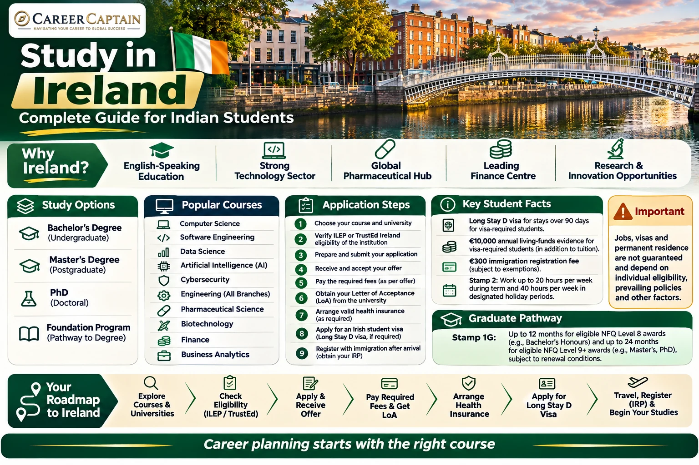

Ireland is an increasingly attractive destination for Indian students interested in technology, pharmaceuticals, finance, engineering, business and research.

Its English-speaking academic environment, internationally recognised qualifications and presence of multinational companies make it an important option for students considering education abroad.

Irish institutions offer undergraduate degrees, postgraduate programmes, professional qualifications and doctoral research opportunities.

However, studying in Ireland requires careful planning. Students must understand admission requirements, eligible programmes, tuition fees, scholarships, student immigration permissions, work restrictions and post-study employment opportunities.

This guide explains the process for Indian students, from selecting a course to planning a career after graduation.

*Last reviewed: 12 November 2026. Admission requirements, tuition fees and immigration policies can change. Check both ILEP and TrustEd Ireland programme lists and verify all current requirements through official Irish government and institution websites.*

---

## 1. Why Study in Ireland?

Ireland offers several advantages for international students.

- **English-speaking education:** Most higher education programmes are taught in English.
- **Internationally recognised qualifications:** Irish universities and institutions offer qualifications recognised internationally.
- **Technology industry:** Ireland has a significant presence of international technology companies.
- **Pharmaceutical and life sciences industry:** The country has opportunities in biotechnology, pharmaceutical manufacturing and research.
- **Finance and business:** Dublin is an important European business and financial centre.
- **Research opportunities:** Universities offer research facilities and postgraduate programmes.
- **Post-study opportunities:** Eligible graduates may qualify for the Third Level Graduate Programme.

Ireland can be particularly interesting for students pursuing technology, computer science, pharmaceutical sciences, business analytics, finance and engineering.

The right university depends on your academic goals, financial capacity and intended career direction.

## 2. Understand the Different Study Options

Indian students generally consider four academic pathways.

### A. Undergraduate study

Bachelor's degrees commonly take three to four years, depending on the institution and programme.

Popular programmes include:

- Computer Science
- Software Engineering
- Mechanical Engineering
- Civil Engineering
- Electrical Engineering
- Electronic Engineering
- Business Studies
- Accounting and Finance
- Economics
- Biotechnology
- Pharmaceutical Science
- Data Science
- Artificial Intelligence
- Cybersecurity
- Psychology
- Biomedical Science

Students generally apply after completing Class 12.

Admission requirements depend on the university, course and Indian qualification. Some institutions accept Class 12 qualifications directly, while others may require a foundation programme or additional academic preparation.

### B. Postgraduate study

Many taught Master's programmes take one year, although some take two years.

Popular options include:

- MSc Computer Science
- MSc Data Analytics
- MSc Artificial Intelligence
- MSc Cybersecurity
- MSc Software Engineering
- MSc Mechanical Engineering
- MSc Pharmaceutical Science
- MSc Biotechnology
- MSc Finance
- MSc Business Analytics
- MBA
- MSc Supply Chain Management
- MSc Public Health

Some programmes require relevant undergraduate qualifications, prerequisite subjects or work experience.

### C. Doctoral study

A PhD is suitable for students interested in advanced research, academic careers and specialised research and development.

Funding opportunities may include:

- Irish Research Council funding
- University scholarships
- Research assistantships
- Faculty-funded research projects
- External fellowships

Funding conditions vary. Confirm whether the award covers tuition, living expenses or both.

### D. Foundation and pathway programmes

Foundation programmes help international students meet the academic or English-language requirements for higher education.

Some are linked to conditional offers for Bachelor's or postgraduate programmes.

Before enrolling, check the provider, programme recognition, progression conditions and immigration eligibility.

## 3. Eligibility for Indian Students

Irish universities and colleges establish their own admission standards.

### Undergraduate admission

Common requirements include:

- Class 10 academic records
- Class 12 marksheets and certificates
- Required subject combinations
- Minimum academic marks
- English-language proficiency
- Additional application documents
- Portfolio or supplementary assessment for selected programmes

Some institutions accept Indian Class 12 qualifications directly.

For example:

- Engineering programmes may require Mathematics and Physics.
- Computer Science programmes may require Mathematics.
- Pharmaceutical and life sciences programmes may require Chemistry and Biology.
- Design programmes may require portfolios.

Check the exact eligibility criteria for your intended course.

### Postgraduate admission

Common requirements include:

- Recognised Bachelor's degree
- Academic transcripts
- Minimum marks or equivalent GPA
- Relevant subject background
- English-language proficiency
- Statement of Purpose
- Letters of Recommendation
- Resume or CV
- Portfolio or research proposal, where required
- Work experience for selected programmes

Some universities accept three-year Indian Bachelor's degrees, while others have specific requirements relating to the qualification, institution and academic performance.

Confirm eligibility directly with the university.

## 4. English-Language Requirements

English-language proficiency is commonly required for admission.

Popular tests include:

- IELTS Academic
- TOEFL iBT
- PTE Academic
- Cambridge English qualifications
- Other tests accepted by the institution

Minimum scores vary by university and programme.

Some universities may provide exemptions based on previous education in English.

### Important distinction

University admission requirements and Irish immigration English-language requirements are separate.

A university may accept a particular test for admission, but the immigration authority may apply its own requirements.

For visa applications, consult the current English-language test requirements and the relevant Irish visa checklist.

Do not assume that the same minimum score applies to every university and immigration application.

## 5. How to Choose the Right University

Do not select a university only because it appears in a global ranking.

Evaluate these factors:

1. Course curriculum and specialisation
2. Institutional recognition and accreditation
3. National Framework of Qualifications (NFQ) level
4. Faculty expertise and research facilities
5. Internship and industry connections
6. Graduate employment outcomes
7. Tuition and living expenses
8. Scholarships and financial assistance
9. Location and accommodation costs
10. International student support
11. Professional accreditation where applicable
12. Immigration eligibility of the intended programme

### Types of institutions

**Universities:** Offer undergraduate, postgraduate and doctoral degrees, along with research opportunities.

**Technological Universities:** Often provide applied learning, technical programmes and industry-oriented education.

**Institutes and specialist institutions:** Offer selected professional, academic and career-oriented qualifications.

**Private higher education providers:** Offer specific programmes. Check their recognition and immigration eligibility carefully.

### Understanding eligible programmes

For non-EEA students studying in Ireland for more than 90 days, the programme must meet the applicable immigration eligibility requirements.

The eligible programme must appear on the **Interim List of Eligible Programmes (ILEP)** or be an eligible programme offered by a provider authorised to use the **TrustEd Ireland** statutory quality mark.

The ILEP is closed to new provider applications and its final update was published in June 2025. It is being superseded by TrustEd Ireland. During the transition, eligible programmes may appear on either list. **Check both official lists for the exact provider and programme before paying a deposit.** An institution's general reputation does not make every course immigration-eligible.

Official information:

- Eligible programmes and both lists: https://www.irishimmigration.ie/coming-to-study-in-ireland/what-are-my-study-options/a-third-level-course-or-a-language-course/
- ILEP and TrustEd transition: https://www.irishimmigration.ie/coming-to-study-in-ireland/what-are-my-study-options/interim-list-of-eligible-programmes-ilep/
- TrustEd Ireland: https://www.trustedireland.ie/

## 6. Estimated Cost of Studying in Ireland

Ireland can be expensive, particularly in Dublin.

Costs vary depending on the institution, programme, accommodation and lifestyle.

### Indicative tuition fees

The following are broad planning ranges for international students, not official quotations.

| Programme | Illustrative annual tuition |
|---|---:|
| Undergraduate programmes | €10,000–€25,000+ |
| Postgraduate business programmes | €14,000–€40,000+ |
| Postgraduate engineering | €15,000–€30,000+ |
| Postgraduate science and technology | €15,000–€31,000+ |
| Postgraduate arts and humanities | €12,000–€23,000+ |
| Medicine and health sciences | Varies significantly |

Actual tuition fees depend on the university and course. Some specialist programmes cost substantially more.

### Illustrative annual living budget

| Expense | Illustrative annual range |
|---|---:|
| Accommodation | €7,000–€15,000+ |
| Food and groceries | €2,500–€4,000 |
| Transport | €600–€1,200 |
| Books and supplies | €300–€800 |
| Personal expenses | €1,000–€2,000 |

These are planning estimates. Accommodation costs in Dublin may be substantially higher.

### How to reduce expenses

- Compare institutions outside Dublin.
- Research accommodation before accepting an offer.
- Apply for university scholarships.
- Compare the full programme cost.
- Investigate research funding and assistantships.
- Prepare a realistic monthly budget.
- Avoid relying on part-time employment to finance the entire degree.

Official tuition information: https://www.educationinireland.com/

## 7. Scholarships for Indian Students

Scholarships can reduce the financial burden of studying in Ireland.

### Common funding options

**Government of Ireland International Education Scholarships (GOI-IES):** A competitive scholarship programme for eligible international students pursuing selected higher education qualifications in Ireland.

The scheme's availability, eligible institutions, award value and application conditions depend on the relevant academic year.

Official information: https://hea.ie/policy/internationalisation/goi-ies/

**University scholarships:** Many Irish universities offer merit-based scholarships to international students.

**Research funding:** PhD and research Master's students may receive funding through research projects, supervisors and research organisations.

**External scholarships:** Selected foundations and organisations provide funding for eligible students.

### Scholarship application strategy

1. Identify universities offering international scholarships.
2. Confirm eligibility for Indian applicants.
3. Check deadlines.
4. Prepare academic records.
5. Write a strong Statement of Purpose.
6. Obtain suitable recommendation letters.
7. Contact departments about research funding.
8. Confirm the award value and duration.

Some scholarships cover only part of tuition, while others may include living support.

Never assume that every international student receives a scholarship.

## 8. Application Process: Step by Step

### Step 1: Select your course

Identify the subject, qualification level and career direction you want to pursue.

Compare course content, specialisations and entry requirements.

### Step 2: Shortlist institutions

Prepare a balanced shortlist based on:

- Academic eligibility
- Course quality
- Programme recognition
- Tuition fees
- Location
- Scholarship opportunities
- Career outcomes

### Step 3: Check admission requirements

For each institution, record:

- Minimum marks
- Required subjects
- English-language requirements
- Standardised tests, if applicable
- Application deadlines
- Tuition fees
- Scholarship deadlines

### Step 4: Prepare documents

Common documents include:

- Passport
- Class 10 and Class 12 certificates
- Undergraduate transcripts, if applicable
- Degree certificate, if applicable
- English-language test scores
- Statement of Purpose
- Letters of Recommendation
- Resume or CV
- Portfolio, where required
- Financial documents, where requested

### Step 5: Submit your application

Apply through the university's official application portal.

Some undergraduate applications may use the Central Applications Office (CAO), depending on the course and institution.

Check whether your chosen institution requires a direct application or a CAO application.

CAO: https://www.cao.ie/

### Step 6: Receive your admission decision

You may receive:

- Unconditional admission
- Conditional admission
- Waitlist placement
- Rejection

Read the admission letter carefully.

### Step 7: Accept your offer

Complete the institution's acceptance process and pay any required deposit.

### Step 8: Obtain your Letter of Acceptance

Your institution will provide the relevant acceptance documentation for your visa application.

Check the course name, duration, fees and payment information carefully.

### Indian student application checklist

Use this checklist alongside the current New Delhi Visa Office instructions and the exact document list generated for your application. Requirements can vary by applicant.

- [ ] Confirm the exact course, awarding body, NFQ level and start date.
- [ ] Verify that the exact programme is on the ILEP or the provider's eligible TrustEd Ireland list.
- [ ] Check academic entry requirements for your Indian Class 12 or undergraduate qualification.
- [ ] Confirm accepted English-language tests and minimum scores with both the institution and visa authority.
- [ ] Compare tuition, accommodation, insurance, transport and realistic living costs.
- [ ] Check university scholarships and deadlines before paying a deposit.
- [ ] Prepare a valid passport and copies of current and previous passports as instructed.
- [ ] Collect Class 10, Class 12 and/or degree certificates, marksheets and transcripts.
- [ ] Prepare a CV, Statement of Purpose or application letter, references and portfolio where required.
- [ ] Explain education or employment gaps and any change in academic direction.
- [ ] Submit the institution application and obtain the formal Letter of Acceptance.
- [ ] Confirm the tuition payment required by immigration rules and obtain official receipts.
- [ ] Arrange private medical insurance that meets Irish immigration requirements.
- [ ] Prepare six months of bank statements and sponsor documents, if applicable.
- [ ] Demonstrate access to €10,000 for a course resulting in a stay longer than eight months, plus tuition and subsequent-year funds where applicable.
- [ ] Complete the AVATS long-stay study visa application and print, sign and date the summary form.
- [ ] Follow the current New Delhi Visa Office checklist, document-submission instructions and appointment requirements.
- [ ] Disclose all previous visa refusals and provide the required details.
- [ ] Do not purchase non-refundable flights before the visa decision.
- [ ] After arrival, complete immigration registration within the required period and obtain the appropriate IRP/Stamp 2 permission before working.

India-specific visa information: https://www.dfa.ie/irish-embassy/india/visas/visas-for-ireland/ and https://assets.ireland.ie/documents/20250425_Study_visa_information_leaflet.pdf

## 9. Understanding the Irish Student Visa

Indian citizens generally require a visa to travel to Ireland for study.

For a course lasting more than 90 days, applicants generally need a **Long Stay D Study Visa** before travelling.

Apply from your home country or a country where you are legally resident. Official guidance says you can apply up to three months before your planned travel date; check the current instructions for India and the relevant visa office. A visa application does not guarantee approval.

Most non-EEA students do not have an automatic right to bring family members to Ireland on the basis of student status. Very limited exceptions may apply, so family members must check their own immigration eligibility.

A visa permits travel to Ireland for the stated purpose. It does not itself grant permission to remain indefinitely.

### Basic requirements

Applicants generally need to:

- Have an offer from an eligible education provider.
- Be enrolled in an eligible full-time course.
- Demonstrate sufficient financial resources.
- Provide evidence of academic ability.
- Demonstrate the required English-language ability.
- Have private medical insurance.
- Meet the applicable immigration requirements.

### Application process

1. Obtain admission from an eligible institution.
2. Accept the offer.
3. Pay the required tuition deposit.
4. Prepare academic and financial documents.
5. Complete the online visa application through AVATS.
6. Follow the instructions for submitting supporting documents.
7. Attend the relevant visa application centre appointment, if required.
8. Pay the applicable visa fee.
9. Wait for the decision.
10. Follow the travel and entry instructions.

### Common supporting documents

Depending on your circumstances, you may need:

- Valid passport
- Online visa application summary
- Letter of Acceptance
- Proof of tuition payment
- Academic transcripts and certificates
- English-language test certificate
- Financial evidence
- Explanation of study gaps, where relevant
- Private medical insurance
- Evidence of previous visa refusals, if applicable
- Other supporting documents requested by the authorities

Official application information:

https://www.irishimmigration.ie/coming-to-study-in-ireland/what-are-my-study-visa-options/how-to-apply-for-long-term-study-visa/

## 10. Financial Requirements for an Irish Student Visa

Students must demonstrate that they can pay their tuition fees and support themselves without depending on public funds or casual employment.

### Financial requirement for courses lasting more than eight months

The published financial requirement for visa-required students is:

**€10,000 for one academic year.**

Students must also demonstrate access to the necessary funds for each subsequent year of study, in addition to tuition fees.

### Courses lasting eight months or less

The published requirement is:

- €833 per month, or
- €6,665 in total,

whichever is the lesser amount.

### Possible financial evidence

- Recent bank statements
- Education loan documentation
- Scholarship letters
- Sponsor's financial documents
- Evidence of tuition payments
- Other acceptable financial support documents

Bank statements generally need to demonstrate the movement of funds over the required period. Large or unusual deposits may require an explanation and supporting evidence.

### Tuition payment

For long-stay study visa applications, where course fees exceed €6,000, at least €6,000 generally needs to be paid before applying for the visa.

If the course fee is €6,000 or less, the full amount generally needs to be paid.

Your institution may require a higher deposit or full payment.

**Important:** The €10,000 immigration financial requirement is a minimum evidence threshold, not a guarantee that the amount will cover actual living costs.

Official information:

https://www.irishimmigration.ie/coming-to-study-in-ireland/what-are-my-study-options/a-fee-paying-private-primary-or-secondary-school/information-on-student-finances/

## 11. Immigration Registration and Stamp 2 Permission

After arriving in Ireland, non-EEA students staying for more than 90 days generally need to register their immigration permission.

Eligible full-time students are generally granted **Stamp 2** permission.

### What is Stamp 2?

Stamp 2 is a student immigration permission that allows eligible international students to study and undertake limited casual employment.

Students must:

- Remain enrolled in an eligible full-time programme.
- Meet attendance and academic progression requirements.
- Follow immigration conditions.
- Renew permission when required.
- Maintain appropriate medical insurance.

### Immigration Registration Fee

The published registration fee is €300, subject to applicable exemptions. It is generally payable by credit or debit card at registration. Confirm current exemptions and booking instructions before your appointment.

Students must follow the current registration process and obtain the appropriate Irish Residence Permit (IRP).

Official information:

- https://www.irishimmigration.ie/registering-your-immigration-permission/
- https://www.irishimmigration.ie/registering-your-immigration-permission/information-on-registering/immigration-permission-Stamps/

## 12. Working While Studying

Eligible non-EEA students holding valid Stamp 2 permission can undertake casual employment.

### Working hours

| Period | Maximum working hours |
|---|---:|
| Normal academic term | 20 hours per week |
| 1 June–30 September | 40 hours per week |
| 15 December–15 January | 40 hours per week |

These are the designated holiday periods under the student employment arrangements.

Students must continue to satisfy the conditions of their immigration permission.

### Common student jobs

- Retail assistant
- Hospitality staff
- Customer service representative
- Administrative assistant
- Campus support roles
- Research assistant, where eligible
- Tutoring, subject to applicable conditions

### Important restrictions

- Stamp 2A does not provide the same employment rights as Stamp 2.
- Students cannot operate a business or be self-employed under Stamp 2.
- Employment must not interfere with studies.
- Students must follow the permitted work-hour limits.

Part-time employment may help with living expenses, but it should not be treated as the primary source of funding for tuition or the entire degree.

Official information:

https://www.educationinireland.com/en/living-in-ireland/working-in-ireland

## 13. Internships and Industry Placements

Some Irish programmes include practical work placements or industry projects.

These may involve:

- Software development
- Engineering projects
- Pharmaceutical research
- Business analytics
- Finance
- Biotechnology
- Supply chain management

Before starting an internship, confirm whether it is part of your programme and whether the relevant immigration conditions permit it.

Professional and healthcare placements may have additional requirements.

## 14. Third Level Graduate Programme: Stamp 1G

Ireland offers a graduate immigration pathway known as the **Third Level Graduate Programme**.

Eligible international graduates may receive Stamp 1G permission to remain in Ireland temporarily while seeking graduate-level employment.

### Eligibility

The programme generally applies to eligible non-EEA graduates who:

- Successfully complete a qualifying Irish higher education award.
- Receive an eligible award from a recognised Irish awarding body.
- Hold valid Stamp 2 permission when applying.
- Apply within the required period after receiving confirmation of the award.
- Meet the other immigration conditions.

### Graduate permission duration

| Qualification | Potential Stamp 1G duration |
|---|---:|
| NFQ Level 8 award | Up to 12 months |
| NFQ Level 9 or above | Up to 24 months, subject to conditions |

For eligible Level 9 and higher graduates, permission is generally granted initially for 12 months and may be renewed for another 12 months if the relevant conditions are met.

### Employment conditions

During Stamp 1G permission, eligible graduates can generally:

- Work full-time.
- Seek graduate-level employment.
- Apply for an eligible employment permit.
- Explore suitable professional opportunities.

However, graduates cannot operate a business or become self-employed under this permission.

### What happens after Stamp 1G?

Graduates who wish to continue working in Ireland generally need to qualify for an appropriate employment permission, such as:

- Critical Skills Employment Permit
- General Employment Permit
- Another eligible immigration route

An Irish degree does not automatically guarantee employment or an employment permit.

Official information:

- https://www.irishimmigration.ie/my-situation-has-changed-since-i-arrived-in-ireland/third-level-graduate-programme/
- https://www.irishimmigration.ie/registering-your-immigration-permission/information-on-registering/immigration-permission-Stamps/

## 15. Career Opportunities After Graduation

Ireland has employment opportunities across several industries.

However, employment is not guaranteed. Graduates must meet employer requirements and any applicable professional registration conditions.

### Technology

- Software engineering
- Artificial intelligence
- Data science
- Cybersecurity
- Cloud computing
- Business intelligence
- Product management

### Engineering

- Mechanical engineering
- Civil engineering
- Electrical engineering
- Electronic engineering
- Manufacturing
- Automation
- Renewable energy

### Pharmaceuticals and life sciences

- Pharmaceutical research
- Biotechnology
- Quality assurance
- Regulatory affairs
- Clinical research
- Biomedical science
- Manufacturing operations

### Business and finance

- Financial analysis
- Accounting
- Business analytics
- Consulting
- Marketing
- Risk management
- Supply chain management

### Healthcare

- Healthcare administration
- Public health
- Pharmaceutical services
- Biomedical research

Some occupations require professional licensing or registration.

Research these requirements before selecting your course.

## 16. Building a Strong Profile Before Applying

A strong application demonstrates more than academic marks.

### For engineering students

- Develop technical skills.
- Complete practical projects.
- Participate in engineering competitions.
- Build a technical portfolio.
- Gain internship experience.
- Strengthen mathematics and core engineering subjects.

### For business students

- Develop analytical and communication skills.
- Participate in leadership activities.
- Complete market research projects.
- Gain internship experience.
- Learn relevant business tools.

### For science students

- Participate in research projects.
- Develop laboratory skills.
- Explore research internships.
- Build relationships with faculty members.
- Strengthen analytical and academic writing skills.

### For all applicants

- Maintain consistent academic performance.
- Develop a clear academic direction.
- Participate in meaningful extracurricular activities.
- Prepare strong application essays.
- Request recommendations from people who know your work.

Meaningful experience is more valuable than collecting certificates without practical learning.

## 17. A 12-Month Preparation Roadmap

| Timeline | Recommended action |
|---|---|
| Months 1–2 | Identify courses, institutions and eligibility |
| Months 3–4 | Prepare for English-language tests and strengthen your profile |
| Months 5–6 | Shortlist institutions and research scholarships |
| Months 7–8 | Prepare applications and recommendation letters |
| Months 9–10 | Submit applications and scholarship applications |
| Month 11 | Compare offers, fees and accommodation |
| Month 12 | Complete tuition payments and prepare your visa application |

This is an illustrative schedule. Admission and visa timelines vary.

## 18. Common Mistakes Indian Students Should Avoid

1. Choosing an institution without checking programme eligibility.
2. Assuming every course at a recognised institution qualifies for Stamp 2.
3. Selecting a course only because it appears to offer immigration opportunities.
4. Ignoring the total tuition and living costs.
5. Depending on part-time work to finance the entire degree.
6. Applying without checking academic prerequisites.
7. Ignoring the financial evidence requirements.
8. Misunderstanding Stamp 2 employment restrictions.
9. Assuming every Master's graduate automatically receives 24 months of Stamp 1G.
10. Assuming permanent residence is guaranteed after graduation.
11. Ignoring professional accreditation.
12. Trusting agents who promise guaranteed admission, visas or employment.

## 19. Useful Official Resources

| Resource | Purpose |
|---|---|
| https://www.educationinireland.com/ | Study in Ireland information |
| https://www.irishimmigration.ie/ | Official immigration information |
| https://www.irishimmigration.ie/coming-to-study-in-ireland/ | Student immigration guidance |
| https://www.irishimmigration.ie/coming-to-study-in-ireland/what-are-my-study-options/interim-list-of-eligible-programmes-ilep/ | Eligible programme information |
| https://www.irishimmigration.ie/coming-to-study-in-ireland/what-are-my-study-visa-options/ | Study visa options |
| https://www.irishimmigration.ie/coming-to-study-in-ireland/what-are-my-study-options/a-fee-paying-private-primary-or-secondary-school/information-on-student-finances/ | Financial requirements |
| https://hea.ie/ | Higher Education Authority |
| https://www.cao.ie/ | Undergraduate applications |
| https://www.qqi.ie/ | Qualifications and quality assurance |

Always verify the latest requirements directly through Irish immigration authorities and your chosen institution.

## 20. How Career Captain Can Help

Choosing a country is only one part of a successful study-abroad decision.

Students also need to understand their interests, abilities, academic strengths, suitable courses and long-term career objectives.

Career Captain Global Solutions supports students and young professionals through:

- One-to-one career counselling
- Five-dimensional psychometric career assessments
- Stream and subject selection
- Course and college planning
- Study-abroad guidance
- Scholarship and admission support
- Career exploration and planning

Explore: https://careercaptain.co.in?utm_source=career_roadmaps_india&utm_medium=referral&utm_campaign=github_career_roadmaps&utm_content=study-in-ireland-complete-guide-for-indian-students

The objective is to help students make informed education and career decisions rather than selecting a course simply because it is popular.

---

## Final Thoughts

Studying in Ireland can provide valuable academic and professional exposure, particularly in technology, engineering, pharmaceuticals, finance and business.

However, students must carefully compare institutions, verify eligible programmes, calculate the full cost and understand the immigration conditions.

Most importantly, select a course that matches your interests, academic background and long-term career goals.

A successful study-abroad journey begins with choosing the right educational pathway.

---

## Attribution and Licence

This educational guide is published by **Career Captain Global Solutions** as part of the Open-Source BTech and Career Roadmaps initiative.

This work is licensed under the **Creative Commons Attribution 4.0 International (CC BY 4.0)** licence.

You may share and adapt this material with appropriate attribution.

**Attribution:** Career Captain Global Solutions — https://careercaptain.co.in?utm_source=career_roadmaps_india&utm_medium=referral&utm_campaign=github_career_roadmaps&utm_content=study-in-ireland-complete-guide-for-indian-students

*Disclaimer: This guide is for general educational information and is not legal, immigration, financial or admission advice. University policies, fees and immigration rules can change. Verify all requirements through official sources before making decisions.*

---

## Plan your study-abroad journey with Career Captain

Country and university choices should be evaluated against your academic profile, course goals, budget, entry requirements and long-term plans. Career Captain provides study-abroad counselling and application-planning support. Admission, scholarship and visa decisions remain with the relevant institutions and authorities.

- [Study-abroad counselling in Hyderabad](https://careercaptain.co.in/?utm_source=career_roadmaps_india&utm_medium=referral&utm_campaign=github_career_roadmaps&utm_content=study-in-ireland-complete-guide-for-indian-students)
- [Scholarship guidance for Indian students](https://guide.careercaptain.co.in/study-abroad/?utm_source=career_roadmaps_india&utm_medium=referral&utm_campaign=github_career_roadmaps&utm_content=study-in-ireland-complete-guide-for-indian-students)
- [Explore Career Captain](https://careercaptain.co.in?utm_source=career_roadmaps_india&utm_medium=referral&utm_campaign=github_career_roadmaps&utm_content=study-in-ireland-complete-guide-for-indian-students)

[WhatsApp Career Captain](https://wa.me/919849488838?text=Hi%20Career%20Captain%2C%20I%20found%20your%20study%20in%20ireland%20complete%20guide%20for%20indian%20students%20guide%20in%20Career%20Roadmaps%20India.%20I%20would%20like%20to%20know%20more%20about%20study%20abroad%20guidance.%20Source%3A%20study-in-ireland-complete-guide-for-indian-students.)
