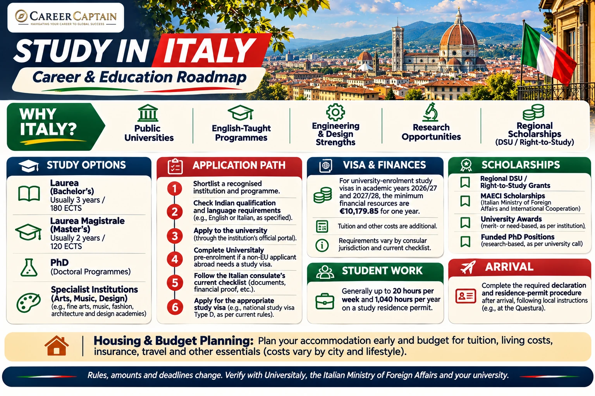

*Last reviewed: 12 November 2026. Admission, visa, financial and scholarship rules can change; confirm current requirements with the university and Italian authorities before applying.*

**A practical roadmap covering Italian universities, courses, admissions, tuition, scholarships, student visas, work rights and career planning.**

Italy offers internationally recognised universities, specialist schools in design and the arts, engineering and technology programmes, and a range of English-taught degrees. It can be an attractive option for Indian students comparing European destinations, but a successful plan requires careful course selection, qualification checks, realistic budgeting and early visa preparation.

## 1. Why Consider Italy?

- Public universities with comparatively moderate tuition at many institutions.
- English-taught bachelor's and master's programmes in selected fields.
- Strong academic traditions in engineering, architecture, design, fashion, business, humanities and sciences.
- Regional and university scholarships, including need-based support.
- Research opportunities and access to European academic and industry networks.
- A distinctive cultural environment and opportunities to learn Italian.

Admission, employment and residence outcomes are never guaranteed. Evaluate each programme on its own quality, recognition, cost and career relevance.

## 2. Understand the Italian Higher Education System

Italy follows the Bologna framework and uses the European Credit Transfer and Accumulation System (ECTS).

| Qualification | Typical structure |
|---|---|
| Laurea (Bachelor's) | Usually 3 years / 180 ECTS |
| Laurea Magistrale (Master's) | Usually 2 years / 120 ECTS |
| Laurea Magistrale a ciclo unico | Integrated long-cycle degree, commonly 5–6 years |
| Dottorato di Ricerca (PhD) | Usually 3 years or more, depending on programme |

Other institutions include AFAM institutions for arts, music and dance, higher technical institutes and specialised schools. Check the institution's legal status and the qualification it awards.

## 3. Popular Fields for Indian Students

**Engineering and technology**
- Mechanical, automotive and aerospace engineering
- Electrical and electronics engineering
- Civil and environmental engineering
- Robotics, automation and mechatronics
- Computer science, AI and data science

**Design and creative industries**
- Architecture and urban planning
- Industrial and product design
- Fashion and luxury management
- Interior, visual and communication design

**Business and economics**
- Management and international business
- Finance, economics and marketing
- Supply chain and logistics

**Science and health**
- Biotechnology and life sciences
- Physics, chemistry and mathematics
- Food science and agriculture
- Selected health-related degrees

Professional degrees such as medicine, dentistry and architecture can have specific admission tests, language requirements and regulated-practice rules. Check the exact course.

## 4. Universities to Research

These are examples to begin your research, not a ranking:

| Institution | Areas to explore |
|---|---|
| Politecnico di Milano | Engineering, architecture, design |
| Politecnico di Torino | Engineering, technology, architecture |
| University of Bologna | Broad academic and research disciplines |
| Sapienza University of Rome | Engineering, sciences, humanities |
| University of Padua | Science, engineering, medicine |
| University of Pisa | Engineering, computer science, sciences |
| University of Milan | Sciences, life sciences, humanities |
| Bocconi University | Economics, management, finance |
| University of Trento | Engineering, computer science, research |
| University of Turin | Sciences, business, humanities |

Compare the exact department, curriculum, teaching language, accreditation, tuition, location, housing and internship access. Do not select a university based only on a ranking.

## 5. Eligibility for Indian Applicants

Requirements are set by each institution and programme.

**Bachelor's applicants** may need:
- Class 10 and Class 12 certificates and marksheets.
- A school-leaving qualification accepted for entry to higher education.
- Subject prerequisites, particularly for science and engineering.
- Entrance test or selection results where required.
- Language proficiency evidence.
- Additional qualification recognition or documentation requested by the university.

A Class 12 certificate does not automatically guarantee admission to every Italian bachelor's programme. The university assesses the qualification, duration of schooling, subjects and admission criteria.

**Master's applicants** may need:
- A recognised bachelor's degree in a relevant discipline.
- Transcripts, degree certificate and grading information.
- Required prerequisite subjects or credits.
- CV, motivation letter and recommendation letters where requested.
- Portfolio or research proposal for selected programmes.
- Language test results where required.

## 6. Language Requirements

Italy offers both Italian-taught and English-taught programmes.

- English-taught courses may accept IELTS, TOEFL or other tests specified by the institution.
- Italian-taught courses may require an accepted Italian-language certificate or university assessment.
- Some programmes require minimum scores in individual test sections.
- A language waiver is possible only where the institution's rules permit it.

Check the exact programme page. Do not assume that every course at an English-taught university is delivered in English or that a test waiver will be granted.

## 7. How to Apply

1. Search programmes through university websites and the official [Universitaly portal](https://www.universitaly.it/).
2. Confirm the qualification, subject, language and entrance-test requirements.
3. Check application deadlines, tuition, scholarships and document rules.
4. Prepare academic records, passport, CV, motivation letter and language evidence.
5. Apply through the university's own admissions system.
6. Complete any entrance examination, interview or portfolio assessment.
7. Receive and review the admission decision and conditions.
8. Follow the university's instructions for pre-enrolment and visa procedures.

For non-EU applicants living abroad who require a study visa, pre-enrolment through Universitaly is mandatory for the higher-education course categories specified in the official procedures for academic years 2026/27 and 2027/28. The university's validation of pre-enrolment does not guarantee a visa.

## 8. Tuition Fees and Living Costs

Tuition varies by institution, programme, income assessment and scholarship status.

Indicative ranges published by the European Education Area:
- Public universities: approximately €900–€4,000 per year.
- Private institutions: approximately €6,000–€20,000 or more per year.
- Living costs: approximately €700–€1,100 per month, with substantial differences by city and accommodation.

Milan, Rome and other high-demand cities may cost more. Confirm fees directly with the university and budget for deposits, utilities, transport, food, insurance, books, travel and emergency expenses.

## 9. Scholarships and Financial Support

Explore more than one funding route:

**Regional right-to-study (DSU) scholarships**
Regional authorities provide support based on financial circumstances and merit rules. Benefits can include grants, meals or accommodation, depending on the region and annual call. Documentation for family income and assets from India may need translation, legalisation or other formal processing.

**MAECI scholarships**
The Italian Ministry of Foreign Affairs offers scholarships to eligible foreign students under annual calls. Eligible degree levels, countries, age limits, benefits and deadlines vary by call.

**University scholarships**
Universities may offer merit awards, tuition waivers, fee reductions or grants for international students.

**PhD funding**
Doctoral positions may include a scholarship or stipend. Check the specific call, supervisor, research project and funding conditions.

Never assume a scholarship covers every cost. Check whether tuition, regional fees, accommodation, meals, insurance and travel are included, and when funds are paid.

Official starting points:
- [Study in Italy – scholarships and study information](https://studyinitaly.esteri.it/)
- [Italian Ministry of Foreign Affairs](https://www.esteri.it/en/)
- [European Education Area – Italy profile](https://education.ec.europa.eu/study-in-europe/country-profiles/italy)

## 10. Student Visa for Indian Students

For a course longer than 90 days, Indian students generally need a national long-stay study visa (Type D). For shorter study visits, the appropriate short-stay visa rules apply.

The usual higher-education sequence is:
1. Secure admission according to the university's process.
2. Complete Universitaly pre-enrolment where required.
3. Obtain the university's pre-enrolment validation or admission documentation.
4. Follow the current checklist for the Italian Embassy/Consulate responsible for your place of residence.
5. Book the visa appointment through the authorised channel and submit the required documents and biometrics.
6. Wait for the visa decision before making non-refundable travel commitments.

The consular authority makes the final visa decision. Admission or Universitaly validation is not a guarantee of visa issuance.

Official information: [Visa for Italy](https://vistoperitalia.esteri.it/) and [Italian Ministry of Foreign Affairs – Study in Italy](https://www.esteri.it/en/ministero/sportello_info/domandefrequenti/studiare-in-italia/).

## 11. Financial Proof for the Study Visa

For university-enrolment study visas for academic years 2026/27 and 2027/28, the Italian Ministry of Foreign Affairs states a minimum financial-resource amount of **€10,179.85 for one year**.

Important points:
- This is a visa financial-resource threshold, not a complete estimate of actual living costs.
- Tuition, accommodation, insurance, travel and other costs must be budgeted separately.
- The Ministry states that a bank guarantee or insurance policy is not an acceptable substitute for the required financial means for this study-visa category.
- Personal or family financial support and other qualifying guarantees may be assessed under the official rules.
- Indian applicants must follow the current checklist issued for the consular jurisdiction where they legally reside.

Visa checklists can specify bank-statement periods, sponsor eligibility, income evidence, apostilles, translations and accommodation documents. Requirements may differ between consular jurisdictions and can be updated. Use the latest official checklist for your application location rather than relying on an old checklist or another applicant's document list.

## 12. Residence Permit After Arrival

For a long-stay study visa, students generally need to apply for a residence permit (permesso di soggiorno) after arrival.

- Follow the current instructions for submitting the residence-permit application, generally through an authorised post-office kit.
- The European Education Area guidance states that students should declare their presence at the Questura within eight days of arrival and apply for the residence permit.
- Keep the application receipt and follow instructions for fingerprinting and collection.
- Maintain valid health coverage and keep your address and university-enrolment details current.

Follow the instructions provided by your university and the local Questura because procedures can vary.

## 13. Working While Studying

A study residence permit generally allows non-EU students to work part-time:
- Up to 20 hours per week.
- No more than 1,040 hours in a year.

Do not assume student status permits full-time employment throughout the year. Check the current legal conditions before accepting work. Part-time employment should supplement—not replace—your funding plan.

## 14. Accommodation and Student Life

Start searching as soon as you receive an admission offer. Options may include:
- University residences and student housing.
- Regional housing services.
- Shared apartments and private rentals.
- University colleges or other student residences.

Before paying a deposit, verify the landlord, property address, contract, deposit terms and whether registration is possible. Avoid sending money to unverified contacts.

Learning Italian can make daily life easier and improve access to internships and employment, even if your degree is taught in English.

## 15. After Graduation

Graduates may explore employment, further study or other residence categories if they meet the relevant legal requirements. Italy's rules for converting a study residence permit to work-related status depend on the route and current legislation.

Do not assume that graduation automatically grants a job-search permit, work permit or permanent residence. Check the current rules with the Italian immigration authorities and the relevant Questura before your student permit expires.

## 16. Indian Student Application Checklist

- [ ] Shortlist at least three suitable programmes and verify their recognition and teaching language.
- [ ] Confirm that your Class 12 or bachelor's qualification meets the exact entry requirements.
- [ ] Check subject prerequisites, entrance tests, portfolio and language requirements.
- [ ] Review application deadlines, tuition, deposits and refund conditions.
- [ ] Prepare passport, academic certificates, transcripts and grading-scale documents.
- [ ] Arrange translations, attestations or apostilles if the university or consulate requires them.
- [ ] Apply through the university's official admissions portal.
- [ ] Complete Universitaly pre-enrolment if you are a non-EU applicant abroad who needs a study visa.
- [ ] Apply for relevant MAECI, DSU regional and university scholarships using the current calls.
- [ ] Prepare proof of funds meeting the current €10,179.85 annual visa threshold for 2026/27 and 2027/28, plus a realistic budget for all other expenses.
- [ ] Follow the latest checklist for the Italian consular jurisdiction where you legally reside.
- [ ] Arrange accommodation and health insurance in the form required for your visa application.
- [ ] Submit the Type D study-visa application and attend the appointment.
- [ ] Do not make non-refundable travel bookings before the visa decision.
- [ ] After arrival, complete the required declaration and residence-permit procedure within the applicable deadline.
- [ ] Register with the university and keep copies of all immigration and enrolment documents.
- [ ] Check work-hour limits and residence-permit conditions before accepting employment.

## 17. Suggested Planning Timeline

| Period before course begins | Suggested action |
|---|---|
| 12–15 months | Research institutions, courses and eligibility |
| 9–12 months | Prepare language tests, academic documents and portfolio |
| 6–9 months | Apply to universities and entrance tests |
| After admission | Complete Universitaly pre-enrolment where required |
| Before travel | Apply for visa, arrange finances, insurance and housing |
| After arrival | Complete residence-permit and university formalities |

This is a planning framework, not a guarantee of application or visa processing times. Follow the specific university and consular deadlines.

## 18. Official Resources

| Purpose | Official resource |
|---|---|
| Study and scholarship information | https://studyinitaly.esteri.it/ |
| Universitaly and international student procedures | https://www.universitaly.it/ |
| Italian Ministry of Foreign Affairs | https://www.esteri.it/en/ |
| Visa information | https://vistoperitalia.esteri.it/ |
| European Education Area – Italy | https://education.ec.europa.eu/study-in-europe/country-profiles/italy |
| Italian university and research system | https://www.mur.gov.it/ |

## 19. How Career Captain Can Help

Choosing Italy is only one part of a successful international education plan. Students also need to identify a suitable course, assess academic eligibility, compare institutions, plan funding and understand future career pathways.

Career Captain Global Solutions supports students and families through:
- One-to-one career counselling and career exploration.
- Course and university selection.
- Academic profile assessment.
- Study-abroad planning.
- Scholarship and admission guidance.
- Career pathway planning.

Explore: https://careercaptain.co.in?utm_source=career_roadmaps_india&utm_medium=referral&utm_campaign=github_career_roadmaps&utm_content=study-in-italy-complete-guide-for-indian-students

## Conclusion

Italy can offer Indian students a combination of recognised higher education, specialist institutions, regional funding opportunities and access to European academic networks. The right decision depends on programme quality, eligibility, language, total cost, accommodation and realistic career planning.

**Choose the course first, verify the institution, calculate the full cost and follow the official admission and visa process.**

---

**Educational Disclaimer**

This guide is for general educational and career-planning purposes. Admission requirements, tuition fees, scholarship conditions, visa procedures, financial thresholds and employment rules can change. It does not guarantee admission, funding, a visa, employment or permanent residence. Verify current requirements with the university and official Italian authorities before making decisions.

**Published by Career Captain Global Solutions**  
Website: https://careercaptain.co.in?utm_source=career_roadmaps_india&utm_medium=referral&utm_campaign=github_career_roadmaps&utm_content=study-in-italy-complete-guide-for-indian-students

**Open Licence:** Creative Commons Attribution 4.0 International (CC BY 4.0), subject to applicable third-party asset rights.  
https://creativecommons.org/licenses/by/4.0/

---

## Plan your study-abroad journey with Career Captain

Country and university choices should be evaluated against your academic profile, course goals, budget, entry requirements and long-term plans. Career Captain provides study-abroad counselling and application-planning support. Admission, scholarship and visa decisions remain with the relevant institutions and authorities.

- [Study-abroad counselling in Hyderabad](https://careercaptain.co.in/?utm_source=career_roadmaps_india&utm_medium=referral&utm_campaign=github_career_roadmaps&utm_content=study-in-italy-complete-guide-for-indian-students)
- [Scholarship guidance for Indian students](https://guide.careercaptain.co.in/study-abroad/?utm_source=career_roadmaps_india&utm_medium=referral&utm_campaign=github_career_roadmaps&utm_content=study-in-italy-complete-guide-for-indian-students)
- [Explore Career Captain](https://careercaptain.co.in?utm_source=career_roadmaps_india&utm_medium=referral&utm_campaign=github_career_roadmaps&utm_content=study-in-italy-complete-guide-for-indian-students)

[WhatsApp Career Captain](https://wa.me/919849488838?text=Hi%20Career%20Captain%2C%20I%20found%20your%20study%20in%20italy%20complete%20guide%20for%20indian%20students%20guide%20in%20Career%20Roadmaps%20India.%20I%20would%20like%20to%20know%20more%20about%20study%20abroad%20guidance.%20Source%3A%20study-in-italy-complete-guide-for-indian-students.)
