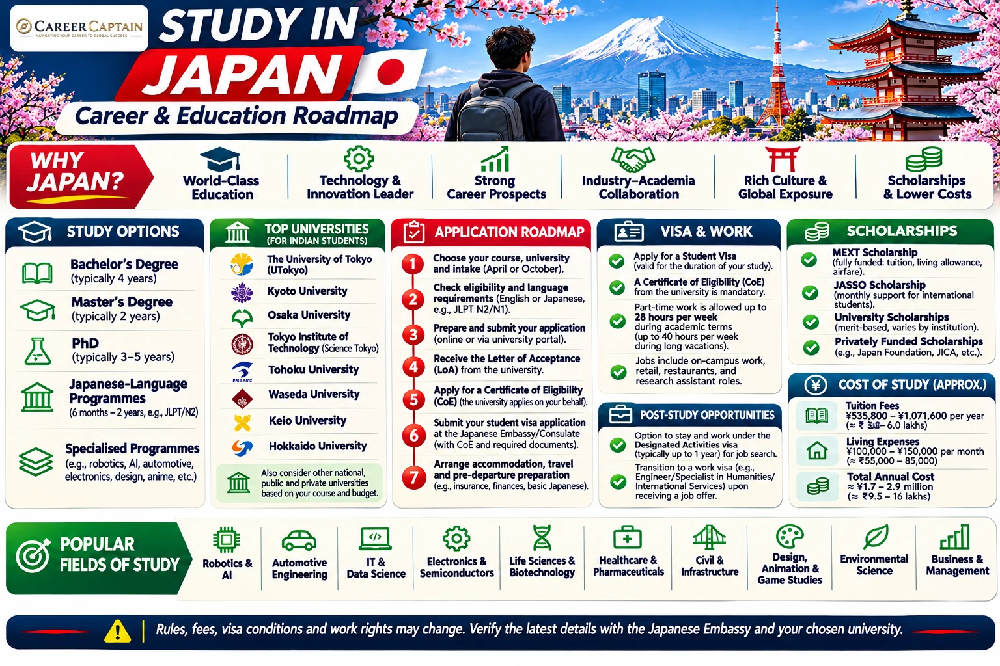

# Study in Japan: Complete Guide for Indian Students

*Last reviewed: 12 November 2026. Admission requirements, tuition, scholarships, immigration procedures and work rules can change. Confirm current requirements with your institution and official Japanese authorities before applying.*

**A practical guide for Indian students exploring Japanese universities, courses, admissions, tuition, scholarships, student visas, part-time work and career pathways.**

Japan offers a wide range of higher education options, including national, public and private universities, junior colleges, colleges of technology and professional training colleges. It is known for strengths in engineering, robotics, automotive technology, electronics, materials science, AI, manufacturing, business and design. Students should assess the language of instruction, qualification recognition, total cost and career relevance of each programme.

## 1. Why Consider Japan?

- Strong academic and industrial capabilities in engineering, robotics, electronics and advanced manufacturing.
- Research opportunities in science, technology, medicine and interdisciplinary fields.
- English-taught degree options at selected institutions, alongside a much larger range of Japanese-taught courses.
- Government and university scholarship opportunities, including MEXT.
- Opportunities to learn Japanese and gain cross-cultural experience.
- A large industrial and technology ecosystem spanning automotive, electronics, robotics, materials, finance and services.

Japan is not automatically an inexpensive destination. Tuition, accommodation and living costs vary by city and institution. Japanese-language ability can materially affect daily life, internships and employment opportunities.

## 2. Understand the Japanese Higher Education System

| Institution / qualification | Typical structure |
|---|---|
| Bachelor's degree (university) | Usually 4 years; medicine, dentistry, veterinary medicine and some other programmes take longer |
| Master's degree | Usually 2 years |
| Doctoral degree | Commonly 3 years after a master's, with variations by field |
| Junior college | Commonly 2–3 years |
| College of technology (KOSEN) | Typically a 5-year integrated programme after lower secondary education; international transfer routes differ |
| Professional training college (senmon gakkō) | Commonly 2 years or more, depending on course |

Japan's academic calendar commonly begins in April, although some institutions and programmes offer September or October admission. Confirm the exact intake and academic calendar with the institution.

## 3. Universities to Research

Examples of Japanese universities to begin your research include:

| Institution | Areas to explore |
|---|---|
| The University of Tokyo | Engineering, sciences, medicine, public policy |
| Kyoto University | Science, engineering, research, medicine |
| Osaka University | Engineering, sciences, medicine, international studies |
| Tohoku University | Materials science, engineering, research |
| Tokyo Institute of Science | Science, engineering, technology |
| Nagoya University | Automotive-related research, engineering, sciences |
| Hokkaido University | Agriculture, environmental science, engineering |
| Kyushu University | Engineering, energy, materials, sciences |
| Waseda University | Engineering, business, political science, humanities |
| Keio University | Business, economics, medicine, science and technology |

This is a starting list, not a ranking. Compare the exact department, supervisor, curriculum, language, tuition, location, research facilities and graduate outcomes.

## 4. Popular Fields for Indian Students

**Engineering and advanced technology**
- Mechanical, automotive and aerospace engineering
- Electrical and electronic engineering
- Robotics, mechatronics and automation
- Materials science and semiconductor technology
- Civil, environmental and infrastructure engineering

**Computing and digital technology**
- Computer science and software engineering
- Artificial intelligence and machine learning
- Data science and cybersecurity
- Human-computer interaction and information systems

**Science and research**
- Physics, chemistry and applied mathematics
- Biotechnology and life sciences
- Energy, environmental and climate science
- Nanotechnology and advanced materials

**Business and creative disciplines**
- Economics, finance and management
- International business and logistics
- Industrial design, animation and digital media
- Architecture and urban planning

For regulated professions, verify professional recognition and licensing requirements in Japan and in any country where you intend to practise later.

## 5. Eligibility for Indian Applicants

Requirements depend on the institution, programme and admission route.

**Undergraduate applicants**
- Usually 12 years of formal schooling or an accepted equivalent.
- Class 10 and Class 12 certificates and marksheets.
- Required subject prerequisites and academic grades.
- Japanese or English-language evidence, depending on the course.
- Entrance examination, interview or other selection assessment where required.

Some universities use the Examination for Japanese University Admission for International Students (EJU), their own examinations, or other accepted assessments. EJU requirements are not universal; check each institution's admission guidelines.

**Master's applicants**
- A bachelor's degree or recognised equivalent meeting the institution's requirements.
- Academic transcripts, degree certificate and grading information.
- Relevant prerequisite subjects and, in some cases, research experience.
- Research proposal, statement of purpose and CV where required.
- Supervisor approval or prior contact for programmes that require it.
- Language test results and entrance examinations as specified.

**Doctoral applicants**
- A relevant master's degree or accepted equivalent, subject to the programme's rules.
- Research proposal and evidence of research ability.
- Supervisor or laboratory match where required.
- Academic references, transcripts and language evidence.

## 6. Language Requirements

Japan has both Japanese-taught and English-taught programmes.

**Japanese-taught programmes**
- Universities may require Japanese Language Proficiency Test (JLPT) results, often at an advanced level, or other evidence of Japanese proficiency.
- Some programmes use EJU Japanese scores or their own language assessments.
- Requirements vary by subject and institution.

**English-taught programmes**
- IELTS, TOEFL or other accepted English-language evidence may be required.
- Minimum scores and component requirements differ by programme.
- Some institutions may grant waivers under defined conditions.

Do not assume that an English-taught degree removes the need to learn Japanese. Japanese ability can be important for internships, part-time work, daily life and many graduate employment opportunities.

## 7. How to Apply

1. Decide whether you are applying for a Japanese-taught or English-taught programme.
2. Search for universities and courses through official university websites and Study in Japan resources.
3. Check the exact admission route, qualification requirements, language tests, EJU and entrance examinations.
4. Identify a research supervisor or laboratory if the programme requires it.
5. Prepare academic certificates, transcripts, passport, CV, essays and research proposal where applicable.
6. Apply through the university's official admissions portal by the relevant deadline.
7. Complete interviews, written examinations or other assessments.
8. Receive and review the admission offer, tuition details and scholarship conditions.
9. Follow the institution's instructions for the Certificate of Eligibility (COE) and student visa process.

Application schedules differ. Many April-entry programmes require applications several months in advance, while September/October intakes follow separate timelines. Use the institution's current admission calendar.

## 8. Tuition Fees and Living Costs

Costs vary by institution and location. As a broad reference, the official Study in Japan guidance has published first-year academic fee averages (including admission fees where applicable) approximately as follows:

| Institution type | Approximate first-year academic fees |
|---|---:|
| National university undergraduate | ¥820,000 |
| Local public university undergraduate | ¥910,000 |
| Private university undergraduate (non-medical fields) | ¥1,100,000 |

Medicine, dentistry, pharmacy and other specialised programmes can cost substantially more. Actual fees vary, and these figures are reference averages rather than a quote for a particular university or 2026/27 intake.

The official Study in Japan guidance has estimated average monthly living expenses for international students at around **¥105,000 nationally**, excluding tuition. Tokyo and other major cities can be more expensive.

Budget for:
- Tuition and admission fees.
- Accommodation, deposits and utilities.
- Food, transport and communications.
- National health insurance contributions.
- Books, equipment and laboratory expenses.
- Visa, travel and initial settlement costs.
- Emergency funds.

Check the latest fee schedule and cost estimates before making a financial plan.

## 9. Scholarships and Financial Support

**MEXT (Japanese Government) Scholarships**
The Ministry of Education, Culture, Sports, Science and Technology offers scholarships through embassy recommendation and university recommendation routes. Categories, eligibility, benefits, age limits, language requirements and selection procedures depend on the current call.

Indian applicants should check the Embassy of Japan in India and the official Study in Japan scholarship pages for the current cycle. Embassy-recommended applications normally follow the embassy's published schedule and screening process.

**JASSO support**
The Japan Student Services Organization administers scholarships and support programmes, including assistance for privately financed international students. Eligibility and availability vary.

**University scholarships and tuition reductions**
Universities may offer tuition exemptions, fee reductions, merit scholarships or research funding. Some are available only after enrolment; others require application before admission.

**Research funding**
Master's and doctoral applicants should investigate laboratory funding, supervisor grants and university research scholarships.

Do not assume that a scholarship is guaranteed or covers all expenses. Check the exact award, duration, renewal conditions, payment timing and any restrictions.

Official resources:
- [Study in Japan – Scholarships](https://www.studyinjapan.go.jp/en/planning/scholarships/)
- [MEXT Scholarships](https://www.studyinjapan.go.jp/en/planning/scholarships/mext-scholarships/)
- [JASSO](https://www.jasso.go.jp/en/)
- [Embassy of Japan in India](https://www.in.emb-japan.go.jp/)

## 10. Student Visa and Certificate of Eligibility

Indian students planning to study in Japan generally need a College Student (留学) status of residence for an eligible full-time programme.

The common process is:
1. Receive admission from a Japanese educational institution.
2. The institution usually acts as the proxy to apply for a Certificate of Eligibility (COE) with the regional Immigration Services Agency.
3. Provide the institution with the required academic, identity and financial documents.
4. After the COE is issued, apply for a student visa at the Japanese Embassy or the consular office with jurisdiction over your residence, following its current procedure.
5. Submit the passport, visa application, photograph, COE and other documents required by the mission.
6. After visa issuance, travel to Japan and complete the landing and residence procedures.

The COE facilitates the visa process but does not guarantee visa issuance. The embassy or consulate makes the visa decision and may request additional documents.

Official information:
- [Ministry of Foreign Affairs of Japan – Visa](https://www.mofa.go.jp/j_info/visit/visa/)
- [Immigration Services Agency of Japan](https://www.moj.go.jp/isa/)
- [Embassy of Japan in India](https://www.in.emb-japan.go.jp/)

## 11. Financial Evidence for the Student Visa

Japanese immigration authorities and the educational institution may assess whether the student can meet tuition and living costs.

Depending on the case, evidence may include:
- Bank balance certificates and bank statements.
- Sponsor's income and employment evidence.
- Proof of relationship to the financial sponsor.
- Scholarship award letters.
- Tuition payment receipts and other funding records.
- Explanation of the source of funds where requested.

There is no single universal bank-balance figure that should be treated as a guaranteed visa threshold for every applicant. The institution and immigration authorities assess the programme duration, tuition, living costs, sponsor circumstances and supporting documents. Follow the exact financial-document checklist supplied by the institution and the Japanese mission responsible for your application.

Avoid sudden unexplained deposits or borrowed funds presented as genuine savings. Documents must accurately reflect the source and availability of funds.

## 12. Working While Studying

A Student status of residence does not automatically authorise employment.

Students who wish to work part-time must obtain **Permission to Engage in Activity Other Than That Permitted under the Status of Residence Previously Granted** (資格外活動許可).

The general limits for students with permission are:
- Up to **28 hours per week** during the academic term.
- Up to **8 hours per day** during officially designated long school holidays.

Important conditions:
- The permission must be obtained before starting work.
- Work in adult-entertainment businesses and related prohibited activities is not allowed, even if the student's role appears unrelated.
- Students must continue to meet attendance and academic requirements.
- Working beyond the permitted hours can result in immigration consequences and affect future applications.

Part-time work should not be treated as the main source of tuition or living funds.

Official information: [Study in Japan – Part-time Work](https://www.studyinjapan.go.jp/en/life/part-time-work/).

## 13. Health Insurance and Accommodation

**National Health Insurance**
Residents staying in Japan for more than three months generally need to enrol in National Health Insurance unless covered by an applicable exception or other qualifying scheme. Students usually complete enrolment through the municipal office after registering their address. The insurance covers a portion of eligible medical costs; the student pays the applicable share and any non-covered expenses.

**Accommodation**
Options include:
- University dormitories.
- Private student residences.
- Shared apartments.
- Private rental housing.
- Homestays or other university-arranged options.

Private rentals may involve deposits, key money, agency fees, guarantor arrangements and furnishing costs. Confirm all costs and contract terms before paying. University housing can be limited, so apply early.

## 14. Employment After Graduation

Graduation does not automatically authorise full-time employment in Japan.

Students who secure suitable employment generally need to change from Student status to an appropriate work-related status of residence before starting work. The employer and graduate must meet the requirements for the relevant status.

Common work-related categories include Engineer/Specialist in Humanities/International Services, Highly Skilled Professional and other categories depending on the role and qualifications. The correct category depends on the actual duties, education or experience and employer.

Some graduates who have not yet secured a job may be eligible to change to Designated Activities status to continue job hunting, subject to the institution, recommendation and immigration requirements. This is not automatic for every graduate.

Japanese-language ability, relevant skills, internships and professional networks can improve employment prospects, but no job or residence outcome is guaranteed.

Official information: [Immigration Services Agency of Japan](https://www.moj.go.jp/isa/).

## 15. Indian Student Application Checklist

- [ ] Decide whether you want a Japanese-taught or English-taught programme.
- [ ] Shortlist institutions and verify the exact course, qualification and admission route.
- [ ] Confirm whether EJU, JLPT, IELTS, TOEFL, entrance tests or interviews are required.
- [ ] Check Indian Class 12 or bachelor's qualification eligibility and subject prerequisites.
- [ ] For research programmes, identify a suitable supervisor and prepare a research proposal where required.
- [ ] Review application deadlines, tuition, admission fees and refund conditions.
- [ ] Prepare passport, academic certificates, transcripts, CV, essays and references.
- [ ] Arrange certified translations or other document formalities if requested.
- [ ] Apply through the university's official process.
- [ ] Check MEXT, JASSO and university scholarships against the current eligibility rules and deadlines.
- [ ] Prepare credible financial evidence for tuition and living costs, including sponsor income and source-of-funds documents if applicable.
- [ ] Follow the institution's instructions for the COE application.
- [ ] After the COE is issued, follow the current Japanese Embassy/consulate visa checklist for your place of residence.
- [ ] Do not make non-refundable travel bookings before the visa decision.
- [ ] Arrange accommodation and understand National Health Insurance enrolment.
- [ ] Obtain permission for part-time work before starting any job.
- [ ] Check the correct residence-status change process before accepting full-time work after graduation.

**Important:** This checklist is a planning aid, not a substitute for the current university, immigration or Japanese mission checklist.

## 16. Suggested Application Timeline

| Period before course begins | Suggested action |
|---|---|
| 12–18 months | Research universities, programmes, language requirements and scholarships |
| 9–12 months | Prepare EJU/language tests, academic documents and research proposal |
| 6–9 months | Submit applications and complete examinations/interviews |
| After admission | Complete funding arrangements and COE documentation |
| Before travel | Apply for visa, arrange accommodation and prepare arrival documents |
| After arrival | Complete residence registration, insurance and university procedures |

This is a planning framework. April and autumn intakes have different schedules, and scholarship applications may close much earlier.

## 17. Official Resources

| Purpose | Official resource |
|---|---|
| Study in Japan information | https://www.studyinjapan.go.jp/en/ |
| Scholarships | https://www.studyinjapan.go.jp/en/planning/scholarships/ |
| MEXT scholarships | https://www.studyinjapan.go.jp/en/planning/scholarships/mext-scholarships/ |
| JASSO | https://www.jasso.go.jp/en/ |
| Japanese immigration | https://www.moj.go.jp/isa/ |
| Ministry of Foreign Affairs visa information | https://www.mofa.go.jp/j_info/visit/visa/ |
| Embassy of Japan in India | https://www.in.emb-japan.go.jp/ |

## 18. How Career Captain Can Help

Choosing a country is only one part of a successful international education plan. Students also need to identify a suitable course, assess academic eligibility, compare institutions, plan funding and understand career pathways.

Career Captain Global Solutions supports students and families through:
- One-to-one career counselling and career exploration.
- Course and university selection.
- Academic profile assessment.
- Study-abroad planning.
- Scholarship and admission guidance.
- Career pathway planning.

Explore: https://careercaptain.co.in/

## Conclusion

Japan can be a strong destination for Indian students interested in engineering, robotics, advanced manufacturing, computing, science and research. The best route depends on the programme's language, academic fit, cost, scholarship availability and long-term career relevance.

**Choose the course carefully, prepare for its language requirements, verify funding and follow the official COE and visa process.**

---

**Educational Disclaimer**

This guide is for general educational and career-planning purposes. Admission requirements, tuition fees, scholarship conditions, immigration procedures and employment rules can change. It does not guarantee admission, funding, a visa, employment or permanent residence. Verify current requirements with the educational institution and official Japanese authorities before making decisions.

**Published by Career Captain Global Solutions**  
Website: https://careercaptain.co.in/

**Open Licence:** Creative Commons Attribution 4.0 International (CC BY 4.0), subject to applicable third-party asset rights.  
https://creativecommons.org/licenses/by/4.0/

---

## Plan your study-abroad journey with Career Captain

Country and university choices should be evaluated against your academic profile, course goals, budget, entry requirements and long-term plans. Career Captain provides study-abroad counselling and application-planning support. Admission, scholarship and visa decisions remain with the relevant institutions and authorities.

- [Study-abroad counselling in Hyderabad](https://careercaptain.co.in/study-abroad-consultant-hyderabad)
- [Scholarship guidance for Indian students](https://careercaptain.co.in/study-abroad-scholarships)
- [Explore Career Captain](https://careercaptain.co.in/)

[WhatsApp Career Captain](https://wa.me/919849488838)
