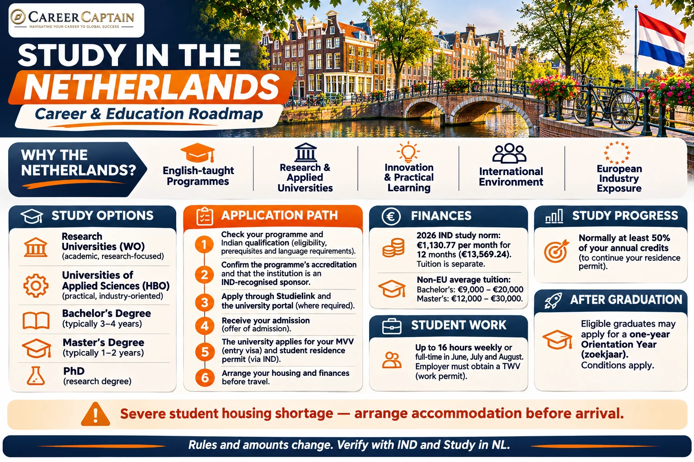

**A practical guide to universities, admissions, tuition fees, scholarships, student visas, part-time work and career opportunities in the Netherlands.**

The Netherlands has become an attractive destination for Indian students looking for internationally recognised degrees, English-taught programmes, research opportunities and exposure to European industries.

From engineering and computer science to business, economics, design and life sciences, Dutch universities offer a wide range of academic pathways.

However, studying in the Netherlands requires careful planning. Students must understand the difference between university types, check whether their previous qualifications meet admission requirements, arrange sufficient finances and secure accommodation before travelling.

This guide explains the process step by step.

---

## 1. Why Study in the Netherlands?

The Netherlands offers several advantages for international students:

- A wide selection of English-taught bachelor's and master's programmes.
- Internationally recognised higher education institutions.
- Strong connections between universities, research organisations and industries.
- Opportunities for internships and practical learning.
- A multicultural environment with students from many countries.
- Access to European research, innovation and business networks.
- A post-study orientation-year route for eligible graduates.

The Netherlands can be particularly relevant for students interested in engineering, technology, business, logistics, agriculture, sustainability and scientific research.

**Important:** An international degree does not automatically guarantee employment or permanent residence. Career outcomes depend on qualifications, experience, language ability, labour-market demand and immigration requirements.

## 2. Understand the Dutch Higher Education System

One of the most important decisions is choosing the correct type of institution.

The Netherlands has two major types of higher education institutions.

### A. Research Universities (WO)

Research universities focus on academic education, theoretical foundations and scientific research.

They may be suitable for students interested in:

- Computer Science
- Artificial Intelligence
- Data Science
- Mechanical Engineering
- Electrical Engineering
- Physics
- Mathematics
- Economics
- Business and research

Research universities generally offer bachelor's, master's and doctoral programmes.

### B. Universities of Applied Sciences (HBO)

Universities of applied sciences focus on professional education, practical skills and industry-oriented learning.

They may be suitable for students interested in:

- Applied Engineering
- Information Technology
- Business Management
- Design
- Logistics
- Hospitality
- Applied Sciences
- Professional development

These institutions often include projects, practical assignments, internships and industry exposure.

### Which one should you choose?

| Research University (WO) | University of Applied Sciences (HBO) |
|---|---|
| Research-oriented | Practice-oriented |
| Strong theoretical foundation | Strong professional application |
| Academic research pathways | Industry-focused learning |
| Often suited to research careers | Often suited to professional careers |

Neither route is automatically better. Choose according to your academic background and career objectives.

## 3. Popular Courses for Indian Students

The Netherlands offers programmes across several fields.

### Engineering and Technology

- Mechanical Engineering
- Electrical Engineering
- Civil Engineering
- Aerospace Engineering
- Chemical Engineering
- Robotics
- Embedded Systems
- Automotive Technology

### Computer Science and Digital Technology

- Computer Science
- Artificial Intelligence
- Data Science
- Cybersecurity
- Software Engineering
- Information Technology
- Human-Computer Interaction

### Business and Management

- Business Administration
- International Business
- Finance
- Economics
- Supply Chain Management
- Marketing
- Entrepreneurship

### Science and Sustainability

- Environmental Science
- Biotechnology
- Biomedical Sciences
- Agricultural Sciences
- Food Technology
- Renewable Energy
- Water Management

Always check the exact curriculum, accreditation, admission requirements and career outcomes rather than choosing a programme based only on its title.

## 4. Top Universities to Research

The following institutions are useful starting points when exploring Dutch higher education.

| University | Known academic areas |
|---|---|
| Delft University of Technology | Engineering, architecture and technology |
| Eindhoven University of Technology | Engineering, technology and innovation |
| University of Twente | Engineering, technology and research |
| University of Amsterdam | Social sciences, economics and research |
| Utrecht University | Sciences, humanities and research |
| Leiden University | Law, humanities and sciences |
| University of Groningen | Sciences, engineering and research |
| Maastricht University | Business, health and interdisciplinary education |
| Erasmus University Rotterdam | Economics, business and management |
| Wageningen University & Research | Agriculture, food and environmental sciences |

This is not a ranking. Compare programmes, tuition fees, admission requirements, location and available accommodation before selecting an institution.

Official programme search: https://www.studyinnl.org/

## 5. Eligibility for Indian Students

Admission requirements differ between institutions and individual programmes.

### For Bachelor's Programmes

Indian applicants may be asked to provide:

- Class 10 academic records.
- Class 12 marksheets and certificates.
- Subject-specific qualifications.
- Proof of English-language proficiency.
- A motivation letter or personal statement.
- A CV, where required.
- Additional entrance assessments or selection documents, where applicable.

Your Indian Class 12 qualification is assessed by the institution against the Dutch entry requirements.

Do not assume that every Indian board, stream or percentage automatically qualifies for direct entry into every bachelor's programme.

Some students may need additional qualifications, a foundation programme or a different admission pathway.

### For Master's Programmes

Applicants generally need:

- A recognised bachelor's degree.
- Relevant academic background.
- Official transcripts and degree certificates.
- English-language test results, if required.
- A CV.
- Statement of purpose or motivation letter.
- Letters of recommendation, where required.
- Portfolio, research proposal or additional documents for selected courses.

Some programmes require specific prerequisite subjects or a minimum academic level.

## 6. English-Language Requirements

Many Dutch universities offer programmes taught in English.

Commonly accepted tests include:

- IELTS Academic
- TOEFL iBT
- Cambridge English qualifications
- Other tests accepted by the institution

The required score depends on the university and programme.

Before taking an examination, check:

1. Which tests are accepted.
2. The minimum overall score.
3. Minimum scores for individual sections.
4. Whether the test must be taken within a specified validity period.
5. Whether an English-language waiver is available.

Do not rely on a general IELTS score found online. Programme-specific requirements take priority.

## 7. Application Process: Step by Step

### Step 1: Identify Your Course

Search for programmes that match your academic background and career plans.

Compare:

- Course curriculum.
- Degree type.
- University reputation.
- Admission requirements.
- Tuition fees.
- Internship opportunities.
- Career pathways.
- Application deadlines.

### Step 2: Check the Institution's Application Procedure

Many Dutch higher education institutions use Studielink, the official registration and application portal.

However, some institutions require additional applications through their own portals.

Official portal: https://www.studielink.nl/

### Step 3: Prepare Your Documents

Keep the following documents ready:

- Passport.
- Academic marksheets.
- School or university certificates.
- English-language test results.
- CV.
- Statement of purpose.
- Letters of recommendation, if required.
- Portfolio or additional documents, if applicable.

Check whether documents need certified translations, legalisation or a particular format.

### Step 4: Submit Your Application

Follow the university's instructions carefully.

Some programmes have limited seats and selection procedures.

The general application deadlines published by Study in NL include:

- **15 January:** Numerus fixus programmes.
- **1 May:** General deadline for many other programmes.

These are general reference dates, not guaranteed deadlines for every international applicant. Universities may set earlier deadlines, particularly for students who require immigration arrangements.

For numerus fixus programmes, the number of available places is limited and applicants may be selected through a ranking process.

### Step 5: Receive Your Admission Decision

If selected, review:

- Admission conditions.
- Tuition payment requirements.
- Deposit requirements.
- Document submission deadlines.
- Residence permit arrangements.
- Accommodation information.

Accept the offer within the stated deadline.

## 8. Tuition Fees in the Netherlands

Students from India are classified as non-EU/EEA students for tuition-fee purposes.

According to Study in NL, average institutional tuition fees for non-EU/EEA students are:

| Programme | Average annual tuition fee |
|---|---:|
| Bachelor's | €9,000–€20,000 |
| Master's | €12,000–€30,000 |

These are indicative averages. Certain specialised programmes may cost more or less.

Some universities also charge application or handling fees, commonly around €75–€100.

Always confirm the exact fee on the university's official programme page.

Official information: https://www.studyinnl.org/finances/tuition-fees

### Indian student application checklist

Use this checklist alongside the current instructions from your chosen university and the IND.

- [ ] Confirm whether the institution is a research university (WO) or university of applied sciences (HBO), and whether the exact programme fits your academic background.
- [ ] Check that the programme is accredited and that the institution is an IND-recognised sponsor authorised to apply for student residence permits.
- [ ] Verify the Indian qualification equivalency, subject prerequisites, minimum grades and any selection procedure.
- [ ] Confirm the language of instruction and programme-specific English test requirements.
- [ ] Check the application deadline, including earlier deadlines for numerus fixus programmes and non-EU applicants.
- [ ] Apply through Studielink where required and complete any separate university application.
- [ ] Prepare passport, Class 10 and 12 records, degree certificates/transcripts, CV, motivation letter, references and portfolio where applicable.
- [ ] Check whether documents need certified translation, legalisation or verification.
- [ ] Review the offer, tuition, deposits, refund rules and scholarship conditions before paying.
- [ ] Confirm the current IND study norm and arrange proof of funds for 12 months, separately from tuition.
- [ ] Follow the university's instructions for the MVV and student residence-permit application; the recognised sponsor submits the application.
- [ ] Arrange accommodation before travelling. The Netherlands has a severe student-housing shortage; verify the property and contract before transferring money.
- [ ] Check whether a TB test or other arrival formalities apply to your nationality and circumstances.
- [ ] After arrival, collect your residence card and complete municipal registration and other university formalities.
- [ ] Track study progress: the normal requirement is at least 50% of the credits per study year, subject to the IND rules and accepted exceptions.
- [ ] Before accepting employment, confirm the 16-hour weekly or full-time summer option and ensure the employer obtains a TWV.
- [ ] Keep track of residence-permit validity, insurance and renewal requirements.

**Important:** This is a planning checklist, not a substitute for the university's current immigration instructions or the IND requirements.

## 9. Cost of Living

Living costs depend on your city, accommodation, lifestyle and spending habits.

Major expenses include:

- Accommodation.
- Food and groceries.
- Local transport.
- Health insurance.
- Study materials.
- Mobile and internet services.
- Personal expenses.

A practical planning estimate is approximately €1,000–€1,500 per month, but actual costs can vary considerably.

### Important: Immigration Financial Requirement

For 2026, the Dutch Immigration and Naturalisation Service (IND) lists a monthly study norm of **€1,130.77** for higher professional education and university students. This is **€13,569.24 for 12 months**. The study norm is separate from tuition fees and is updated annually; check the IND amount for the year in which the application is submitted.

That means a student generally needs to demonstrate the required living funds for 12 months.

This amount:

- Is an immigration financial requirement.
- Does not include tuition fees.
- Is updated periodically.
- Must be checked again for the year of application.

The university will explain the accepted methods of demonstrating sufficient funds.

Official sources:

https://ind.nl/en/income-requirements-study

https://ind.nl/en/required-amounts-income-requirements

## 10. Scholarships for Indian Students

Scholarships can reduce the financial burden of studying abroad.

Indian students should investigate:

### NL Scholarship

The NL Scholarship is intended for international students from outside the European Economic Area who want to pursue a bachelor's or master's degree at participating Dutch institutions.

Scholarship availability and eligibility depend on the participating institution and academic year.

### University Scholarships

Several Dutch universities offer scholarships or tuition-fee reductions for international applicants.

Examples include scholarship opportunities associated with:

- Delft University of Technology.
- University of Twente.
- Maastricht University.
- University of Groningen.
- Erasmus University Rotterdam.

### Other Funding Options

Students can also investigate:

- Government-funded scholarships.
- Research grants.
- Faculty-specific scholarships.
- Employer-sponsored funding.
- Education loans in India.

**Scholarship strategy:** Apply early, check eligibility carefully and never assume that receiving admission automatically means receiving a scholarship.

Official scholarship information: https://www.studyinnl.org/finances/scholarships

## 11. Student Visa and Residence Permit

Indian students planning to study in the Netherlands for a degree programme generally need immigration permission for long-term residence.

For higher education, the Dutch university or institution must be a recognised sponsor with the IND.

The institution normally submits the application for the student residence permit and, where required, the entry visa (MVV).

### Main Requirements

Students generally need to:

- Have admission or registration at an eligible institution.
- Enrol in a full-time accredited programme.
- Meet the financial requirements.
- Have the required travel documents.
- Meet other applicable immigration conditions.

### Application Process

1. Receive admission from the institution.
2. Follow the university's immigration instructions.
3. Submit the requested documents.
4. Transfer the required funds or provide acceptable financial evidence.
5. Allow the university to submit the immigration application.
6. Complete the MVV process if applicable.
7. Travel after receiving the required permission.
8. Collect your residence permit in the Netherlands.

The IND states that only an institution recognised by the IND as a sponsor can apply for the student residence permit on the student's behalf. The programme must be full-time and accredited. Students must also make sufficient study progress, normally at least 50% of the credits for each study year; the institution assesses progress and reports cases that do not meet the rules without an accepted reason.

The residence permit application fee and immigration procedures can change. Confirm the current amount and process with the IND and your university.

Official information:

https://ind.nl/en/residence-permits/study/student-residence-permit-for-university-or-higher-professional-education

## 12. Working While Studying

International students may work in the Netherlands, but restrictions apply.

For students holding the relevant student residence permit, employment as an employee is generally allowed under one of these arrangements:

- Up to 16 hours per week during the academic year; or
- Full-time employment during June, July and August.

The employer must obtain the required work permit (TWV).

Students should not assume that they can work unlimited hours or begin employment without checking the applicable conditions.

Self-employment has different rules, including registration and tax obligations.

Official information: https://ind.nl/en/residence-permits/study/student-residence-permit-for-university-or-higher-professional-education

**Financial advice:** Do not plan to fund your entire tuition and living expenses through part-time work. Secure sufficient funds before travelling.

## 13. Housing in the Netherlands

Accommodation is one of the most important challenges for international students.

Some Dutch cities experience a shortage of student housing.

Start searching as soon as you receive your admission offer.

Explore:

- University accommodation services.
- Student housing organisations.
- Private rental accommodation.
- Shared apartments.
- Student residences.

Before paying any deposit:

- Verify the landlord or housing provider.
- Confirm the exact property address.
- Request a written rental agreement.
- Check registration eligibility.
- Avoid transferring money to unverified individuals.
- Be cautious of unusually cheap offers.

Never travel assuming that you will easily find accommodation after arrival.

Official starting point: https://www.studyinnl.org/

## 14. Life in the Netherlands

The Netherlands offers an international environment and a well-developed public transport system.

Students should prepare for:

- Independent living.
- Cycling and public transport.
- Different teaching and assessment methods.
- Group projects and presentations.
- Time management.
- Managing personal finances.
- Understanding local regulations.

Although many people speak English, learning Dutch can improve daily communication and expand employment opportunities.

## 15. Post-Study Opportunities

The Netherlands offers an important post-study pathway known as the **Orientation Year (Zoekjaar)**.

Eligible graduates may apply for a residence permit that allows them to look for employment or start a business.

### Orientation Year

The permit is generally valid for one year and is not extendable. Graduates normally need to apply within three years after completing the qualifying programme or research. The eligible categories include accredited Dutch higher-education graduates, certain Dutch post-master's programmes, Erasmus Mundus Joint Master graduates, qualifying researchers and graduates of designated foreign institutions. For a foreign institution, the IND applies specific top-200 ranking criteria across at least two of the three named ranking publishers and requires a Nuffic credential evaluation; additional language requirements apply. Do not assume that any overseas degree automatically qualifies.

Eligibility includes certain graduates of Dutch higher education institutions and other qualifying categories specified by the IND.

Students who complete eligible master's or doctoral programmes at certain designated foreign institutions may also qualify, subject to additional conditions.

### After Finding Employment

If you secure suitable employment, you may be able to switch to another residence category, such as the highly skilled migrant residence permit, provided you meet the applicable requirements.

The orientation-year permit allows unrestricted employment, including self-employment, without a TWV during its one-year validity. It is not an automatic route to permanent residence.

Official information:

https://ind.nl/en/residence-permits/work/residence-permit-for-orientation-year

## 16. Common Mistakes Indian Students Should Avoid

1. Selecting a university without checking its recognition and accreditation.
2. Confusing research universities with universities of applied sciences.
3. Applying without checking whether the Indian qualification meets entry requirements.
4. Ignoring programme-specific application deadlines.
5. Assuming all courses are available in English.
6. Underestimating accommodation costs.
7. Depending entirely on part-time employment.
8. Paying deposits to unverified accommodation providers.
9. Assuming that a student residence permit allows unrestricted employment.
10. Treating the orientation year as a guaranteed job or permanent-residence pathway.

## 17. Suggested Application Timeline

The following is a planning framework. Individual university deadlines take priority.

| Period | Recommended activity |
|---|---|
| 12–15 months before | Research universities and courses |
| 10–12 months before | Check eligibility and language requirements |
| 8–10 months before | Prepare documents and applications |
| 6–9 months before | Submit applications according to deadlines |
| After admission | Accept offer and arrange finances |
| Before travel | Complete immigration and accommodation arrangements |
| After arrival | Register locally and complete university formalities |

For programmes with a 15 January deadline, preparation should begin much earlier.

## 18. Official Resources for Indian Students

Use these official sources when planning an application.

| Resource | Website |
|---|---|
| Study in NL | https://www.studyinnl.org/ |
| Studielink | https://www.studielink.nl/ |
| Dutch Immigration and Naturalisation Service (IND) | https://ind.nl/en |
| Nuffic | https://www.nuffic.nl/en |
| Netherlands Worldwide | https://www.netherlandsworldwide.nl/ |
| Study in NL Scholarships | https://www.studyinnl.org/finances/scholarships |

Always verify current requirements directly with the university and the relevant Dutch authorities.

## 19. How Career Captain Can Help

Choosing a country is only one part of the study-abroad decision.

Students must also identify the right course, assess their academic eligibility, compare universities, plan finances and understand the career opportunities associated with their chosen degree.

**Career Captain Global Solutions** supports students and families through:

- Career counselling and career exploration.
- Course and university selection.
- Academic profile assessment.
- Study-abroad planning.
- Scholarship and admission guidance.
- Career pathway planning.

Explore our services:

https://careercaptain.co.in?utm_source=career_roadmaps_india&utm_medium=referral&utm_campaign=github_career_roadmaps&utm_content=study-in-netherlands-complete-guide-for-indian-students

## Conclusion

The Netherlands can be a strong destination for Indian students seeking international education and exposure to European industries.

However, the right decision requires more than choosing a popular university. Students should evaluate academic suitability, institutional recognition, total cost, accommodation, immigration rules and long-term career opportunities.

Start early, research carefully and choose a programme that supports your long-term goals.

---

**Last reviewed: November 2026.** Financial thresholds, tuition, admission procedures and immigration rules can change. The figures in this guide are dated and should be checked again before applying.

**Educational Disclaimer**

This guide is intended for general educational and career-planning purposes. Admission decisions, tuition fees, scholarships, immigration requirements and employment regulations are determined by the relevant institutions and authorities. Rules may change. Students must verify current information through official sources before making financial, academic or immigration decisions.

---

**Published by Career Captain Global Solutions**

Website: https://careercaptain.co.in?utm_source=career_roadmaps_india&utm_medium=referral&utm_campaign=github_career_roadmaps&utm_content=study-in-netherlands-complete-guide-for-indian-students

**Open Licence:** This educational guide is shared under the Creative Commons Attribution 4.0 International (CC BY 4.0) licence. You may share and adapt the material with appropriate attribution.

Licence: https://creativecommons.org/licenses/by/4.0/

---

## Plan your study-abroad journey with Career Captain

Country and university choices should be evaluated against your academic profile, course goals, budget, entry requirements and long-term plans. Career Captain provides study-abroad counselling and application-planning support. Admission, scholarship and visa decisions remain with the relevant institutions and authorities.

- [Study-abroad counselling in Hyderabad](https://careercaptain.co.in/?utm_source=career_roadmaps_india&utm_medium=referral&utm_campaign=github_career_roadmaps&utm_content=study-in-netherlands-complete-guide-for-indian-students)
- [Scholarship guidance for Indian students](https://guide.careercaptain.co.in/study-abroad/?utm_source=career_roadmaps_india&utm_medium=referral&utm_campaign=github_career_roadmaps&utm_content=study-in-netherlands-complete-guide-for-indian-students)
- [Explore Career Captain](https://careercaptain.co.in?utm_source=career_roadmaps_india&utm_medium=referral&utm_campaign=github_career_roadmaps&utm_content=study-in-netherlands-complete-guide-for-indian-students)

[WhatsApp Career Captain](https://wa.me/919849488838?text=Hi%20Career%20Captain%2C%20I%20found%20your%20study%20in%20netherlands%20complete%20guide%20for%20indian%20students%20guide%20in%20Career%20Roadmaps%20India.%20I%20would%20like%20to%20know%20more%20about%20study%20abroad%20guidance.%20Source%3A%20study-in-netherlands-complete-guide-for-indian-students.)
