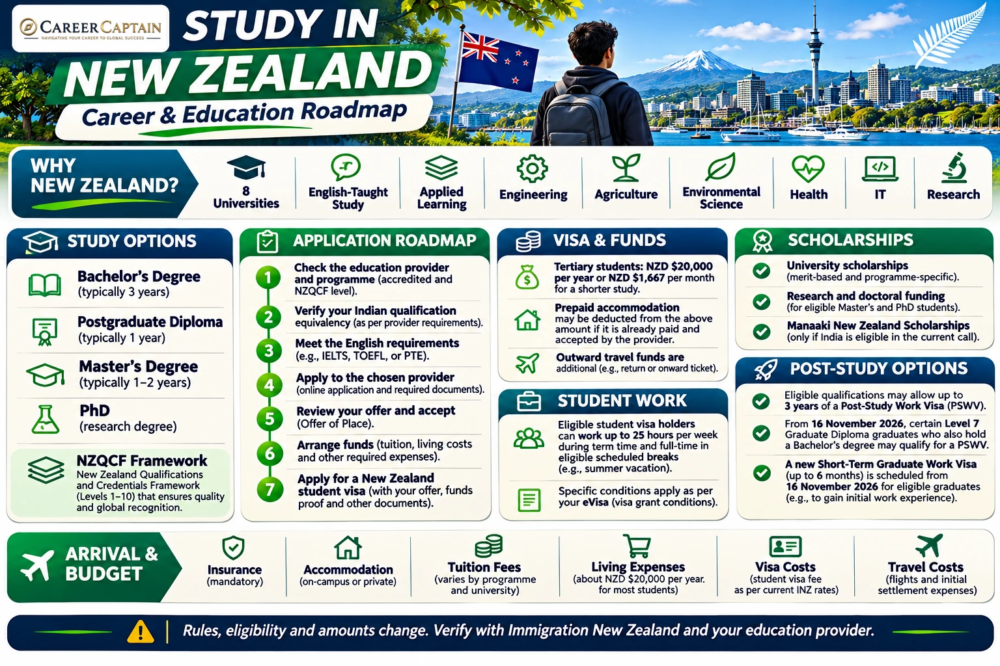

# Study in New Zealand: Complete Guide for Indian Students

*Last reviewed: 12 November 2026. Immigration rules, financial thresholds, tuition and admission requirements can change. Confirm the current rules with Immigration New Zealand and your chosen education provider before applying.*

**A practical guide for Indian students exploring universities, courses, admissions, tuition, scholarships, student visas, work rights and post-study options in New Zealand.**

New Zealand offers universities, institutes of technology and polytechnics, and other approved education providers. It is known for strengths in engineering, agriculture, environmental sciences, health, business, information technology and research. The right choice depends on the programme, provider quality, total cost, location and career goals.

## 1. Why Consider New Zealand?

- A range of universities and applied-learning providers.
- English-language instruction across many programmes.
- Study and research options in engineering, IT, agriculture, environmental science, health and business.
- Student work rights for eligible visa holders, subject to visa conditions.
- Post-study work options for graduates of eligible New Zealand qualifications.
- A multicultural environment and opportunities to gain international experience.

Admission, employment and residence outcomes are not guaranteed. Evaluate the actual programme and your likely costs rather than relying on general destination claims.

## 2. Understand the New Zealand Education System

New Zealand qualifications are referenced to the New Zealand Qualifications and Credentials Framework (NZQCF).

| Qualification | Typical duration |
|---|---|
| Bachelor's degree | Usually 3 years; some professional degrees take longer |
| Graduate certificate/diploma | Commonly 6 months to 1 year |
| Postgraduate diploma | Commonly 1 year |
| Master's degree | Commonly 1–2 years, depending on entry route and programme |
| Doctoral degree (PhD) | Commonly 3–4 years full-time |
| Certificate/diploma | Varies by level and programme |

Check the NZQCF level, accreditation, programme length, entry requirements and recognition of the exact qualification. Similar-sounding awards can have different immigration and professional outcomes.

## 3. Universities and Providers to Research

New Zealand has eight universities:

| University | Areas to explore |
|---|---|
| University of Auckland | Engineering, medicine, business, science |
| Auckland University of Technology (AUT) | Technology, engineering, design, health |
| University of Waikato | Engineering, computing, business, sciences |
| Massey University | Agriculture, food technology, aviation, business |
| Victoria University of Wellington | Public policy, law, humanities, science |
| University of Canterbury | Engineering, science, forestry, education |
| Lincoln University | Agriculture, environmental management, land-based studies |
| University of Otago | Health sciences, biomedical science, humanities |

Institutes of technology, polytechnics and private training establishments may offer applied and vocational programmes. Before paying fees, confirm that the provider and course are eligible for the student visa you intend to apply for and that the qualification meets your academic and career needs.

## 4. Popular Fields for Indian Students

**Engineering and technology**
- Mechanical, civil, electrical and electronic engineering
- Mechatronics, robotics and automation
- Software engineering, computer science and cybersecurity
- Data science and artificial intelligence
- Construction and infrastructure

**Agriculture and environment**
- Agricultural science and agribusiness
- Food technology and food safety
- Environmental science and sustainability
- Forestry, horticulture and conservation

**Business and professional studies**
- Accounting, finance and economics
- Management, marketing and international business
- Supply chain and logistics
- Tourism and hospitality

**Health and sciences**
- Nursing and allied health
- Biomedical and biological sciences
- Public health and health management
- Psychology and selected clinical pathways

Regulated professions can require registration, supervised practice or additional examinations. Check the relevant New Zealand professional authority before choosing a course as a route to employment.

## 5. Eligibility for Indian Applicants

Entry requirements are determined by the provider and programme.

**Bachelor's applicants**
- Class 10 and Class 12 certificates and marksheets.
- Required academic grades and subject prerequisites.
- Evidence that the school-leaving qualification is accepted for entry.
- English-language evidence where required.
- Portfolio, interview or aptitude test for selected programmes.

**Master's applicants**
- A recognised bachelor's degree in a relevant discipline.
- Academic transcripts and degree certificate.
- Required grades and prerequisite subjects.
- CV, statement of purpose and references where requested.
- Work experience, portfolio or research proposal for selected programmes.
- English-language evidence where required.

Some programmes have higher entry requirements than the university's general minimum. Ask the admissions office to assess your Indian qualification and grading scale.

## 6. English-Language Requirements

English-language requirements vary by institution, qualification and subject.

Commonly accepted tests may include IELTS Academic, TOEFL iBT, PTE Academic and other tests listed by the provider. Some programmes require higher scores or minimum component scores. Health, teaching and other regulated fields can have additional language standards.

A medium-of-instruction letter does not automatically qualify for a test waiver. Obtain written confirmation from the university before relying on an exemption.

## 7. How to Apply

1. Identify programmes matching your previous education and career objective.
2. Confirm the provider's status, programme accreditation, NZQCF level and visa eligibility.
3. Check entry requirements, English test scores, fees and deadlines.
4. Prepare academic documents, passport, CV, statement of purpose and references.
5. Apply through the provider's official admissions portal.
6. Complete any interview, portfolio review or additional assessment.
7. Review the offer of place, tuition invoice, refund policy and conditions.
8. Pay the required tuition deposit or fees according to the provider's instructions.
9. Follow the provider's instructions for the student visa application.

Apply early enough to allow time for document verification, financial evidence, medical or police checks if requested, and visa processing.

## 8. Tuition Fees and Living Costs

Costs depend on qualification, institution, subject, city and lifestyle. As broad planning estimates, international tuition can range from approximately NZD $20,000 to $45,000 or more per year for many university programmes; specialised programmes may cost more. Accommodation and living expenses vary substantially between cities.

Prepare a budget that includes:
- Tuition and compulsory student fees.
- Accommodation, bond and utilities.
- Food, local transport and communications.
- Medical and travel insurance.
- Books, equipment and course materials.
- Visa, medical and document costs.
- Return travel and emergency funds.

Use the university's current fee schedule and a realistic city-level budget. Do not rely on part-time work to fund tuition or meet the visa financial requirement.

## 9. Scholarships and Funding

Possible funding sources include:

**University scholarships**
Many universities offer merit-based, subject-specific or international-student scholarships. Awards can be competitive and may be limited to particular intakes or programmes.

**New Zealand government scholarships**
The Manaaki New Zealand Scholarships programme offers awards for eligible partner-country applicants under its published country and programme rules. Check whether India is included in the current eligible-country list and whether your intended qualification and field are covered; do not assume eligibility.

**Research funding**
Master's research and PhD applicants should investigate funded projects, supervisor grants, doctoral scholarships and research assistant opportunities.

**External funding**
Indian education loans, employer sponsorship and other independent awards may be relevant. Check disbursement schedules and whether the funds meet Immigration New Zealand's evidence rules.

Official starting points:
- [Study with New Zealand](https://www.studywithnewzealand.govt.nz/)
- [Manaaki New Zealand Scholarships](https://www.nzscholarships.govt.nz/)
- Individual university scholarship pages.

## 10. Fee Paying Student Visa

Indian students enrolling in an eligible full-time course and paying international fees commonly apply for a Fee Paying Student Visa. The exact visa category depends on the course, provider and circumstances.

Immigration New Zealand's published visa requirements include:
- An offer of place from an approved education provider.
- Evidence of tuition payment or an acceptable arrangement, as required.
- Evidence of sufficient funds for living costs and outward travel.
- Acceptable health and character evidence.
- Medical and travel insurance for the required period, unless an exemption applies.
- Evidence that the applicant is a genuine student and intends to comply with visa conditions.

The visa is applied for through Immigration New Zealand's official process. An offer of place does not guarantee visa approval.

Official information: [Fee Paying Student Visa](https://www.immigration.govt.nz/visas/fee-paying-student-visa/).

## 11. Financial Requirements for a Student Visa

For tertiary, English-language and other non-compulsory study, Immigration New Zealand currently requires evidence of:

- **NZD $20,000 for each year** of study if the course is one year or longer; or
- **NZD $1,667 per month** for a course shorter than one year.

Prepaid accommodation may be deducted from the amount required if acceptable evidence is provided. Funds for outward travel are additional: students must show a ticket or sufficient money to buy one, unless an accepted sponsorship arrangement covers this.

Accepted evidence can include bank statements, qualifying fixed-term deposits, scholarship award letters and eligible education-loan documentation. Immigration New Zealand may request evidence showing the source of funds and that the money is genuinely available to the student.

For applicants from India and other specified South Asian countries applying in the region, Immigration New Zealand states that only immediate family members can sponsor or provide a financial undertaking. Check the exact current definition and evidence rules before relying on a sponsor.

The financial threshold is a visa minimum, not a complete estimate of actual living costs. Tuition, insurance, travel and other expenses must be budgeted separately.

Official sources:
- [Student fund requirements](https://www.immigration.govt.nz/process-to-apply/applying-for-a-visa/providing-evidence-and-documents-to-support-your-visa-application/student-fund-requirements/)
- [Fee Paying Student Visa](https://www.immigration.govt.nz/visas/fee-paying-student-visa/)

## 12. Student Visa Work Rights

Eligible student visa holders may be permitted to work:
- Up to **25 hours per week** during the academic term, where the visa conditions allow it.
- Full-time during scheduled holidays or breaks if the course and visa conditions qualify.
- Research master's and PhD students may have different work conditions.

The right to work is not automatic for every student or every course. Your eVisa states the conditions that apply to you. Students must not begin work unless their visa permits it. Working beyond the permitted hours can breach visa conditions and affect future immigration applications.

Official information: [Working while on a student visa](https://www.immigration.govt.nz/study/while-you-study/working-while-you-study/).

## 13. Health and Travel Insurance

International students generally need acceptable medical and travel insurance from the beginning of their course until the end of the visa period, as required by their visa conditions and provider. The education provider can explain the policy standards and whether it arranges cover.

PhD students may have an exemption from the student-visa insurance requirement. Confirm the exemption and any university requirements directly with the provider.

## 14. Accommodation and Student Life

Options may include:
- University halls of residence.
- Purpose-built student accommodation.
- Shared rental housing.
- Homestays.
- Private rentals.

Start searching early, especially in Auckland and other high-demand locations. Verify the property, contract, bond, payment details and landlord before transferring money. Understand tenancy obligations and the cost of utilities.

New Zealand's climate, transport and living costs vary by region. Compare the campus location, commuting options, student support and access to internships before choosing accommodation.

## 15. Post-Study Work Visa

Eligible graduates may apply for a Post-Study Work Visa (PSWV). It can allow work in New Zealand for up to three years, depending on the qualification and study duration.

Current key rules include:
- A degree qualification at NZQCF level 7 studied full-time for at least 30 weeks in New Zealand can qualify.
- Level 8 to 10 qualifications generally need at least 30 weeks of full-time study in New Zealand.
- Master's and doctoral graduates who meet the conditions can receive up to three years.
- Certain non-degree qualifications at levels 4 to 7 are eligible only if they appear on Immigration New Zealand's eligible-qualification list; work may need to be related to the qualification.
- The application deadline is generally within three months after the student visa expires, with different timing for some doctoral or consecutive-study situations.
- Applicants must meet the other visa requirements, including funds and character/health criteria.

**Upcoming change from 16 November 2026:** Immigration New Zealand has announced an extension for certain graduates who complete a full-time NZQCF Level 7 Graduate Diploma in New Zealand and also hold a bachelor's degree from New Zealand or overseas. The graduate diploma must be completed for its full duration, without cross-crediting or recognition of prior learning. The PSWV duration is based on time spent studying the graduate diploma, up to one year.

A new Short-Term Graduate Work Visa is also scheduled to open on 16 November 2026 for eligible graduates, offering up to six months of open work rights. Check the final published eligibility and application instructions before relying on this route.

A post-study visa is not automatic. Course selection should be based on educational quality and career fit first, with immigration eligibility checked against the exact qualification.

Official sources:
- [Post-Study Work Visa](https://www.immigration.govt.nz/visas/post-study-work-visa/)
- [Qualifications needed for a Post-Study Work Visa](https://www.immigration.govt.nz/study/after-you-finish-your-study/qualifications-needed-for-a-post-study-work-visa/)
- [New and updated post-study work visa options](https://www.immigration.govt.nz/about-us/news-centre/new-and-updated-post-study-work-visa-options/)

## 16. Indian Student Application Checklist

- [ ] Shortlist programmes that match your academic background and career objective.
- [ ] Verify the provider, course, NZQCF level and student visa eligibility.
- [ ] Confirm academic entry requirements and Indian qualification equivalency.
- [ ] Check English-language requirements and any test exemptions in writing.
- [ ] Compare tuition, compulsory fees, location and realistic living costs.
- [ ] Review scholarship eligibility, conditions and application deadlines.
- [ ] Prepare passport, Class 10/12 marksheets, degree certificates and transcripts as applicable.
- [ ] Prepare CV, statement of purpose, references, portfolio or research proposal where required.
- [ ] Apply through the provider's official admissions portal.
- [ ] Review the offer of place and understand the tuition refund policy.
- [ ] Prepare proof of funds: NZD $20,000 per year or NZD $1,667 per month for shorter tertiary study, plus outward travel funds.
- [ ] Gather evidence of the source and availability of funds and confirm sponsor eligibility.
- [ ] Arrange tuition payment and acceptable medical/travel insurance as required.
- [ ] Complete the Fee Paying Student Visa application and provide health or character documents if requested.
- [ ] Do not make non-refundable travel bookings before the visa decision.
- [ ] Check the work conditions written on the eVisa before accepting employment.
- [ ] After graduation, verify PSWV or other work-visa eligibility and apply within the correct deadline.

**Important:** This checklist is a planning aid, not a substitute for the current Immigration New Zealand checklist or your provider's instructions.

## 17. Suggested Application Timeline

| Period before course starts | Suggested action |
|---|---|
| 12–15 months | Research providers, programmes, entry requirements and budgets |
| 9–12 months | Prepare English tests, academic documents and scholarship applications |
| 6–9 months | Apply to providers and complete assessments |
| After offer | Review conditions, arrange tuition and prepare financial evidence |
| Before travel | Submit visa application, arrange insurance and accommodation |
| After arrival | Attend orientation, maintain enrolment and follow visa conditions |

This is a planning framework, not a promise of admission or visa processing time. Follow the actual university intake and Immigration New Zealand deadlines.

## 18. Official Resources

| Purpose | Official resource |
|---|---|
| Study and provider search | https://www.studywithnewzealand.govt.nz/ |
| Immigration New Zealand | https://www.immigration.govt.nz/ |
| Fee Paying Student Visa | https://www.immigration.govt.nz/visas/fee-paying-student-visa/ |
| Student funds | https://www.immigration.govt.nz/process-to-apply/applying-for-a-visa/providing-evidence-and-documents-to-support-your-visa-application/student-fund-requirements/ |
| Student work rights | https://www.immigration.govt.nz/study/while-you-study/working-while-you-study/ |
| Post-Study Work Visa | https://www.immigration.govt.nz/visas/post-study-work-visa/ |
| New Zealand Qualifications Authority | https://www.nzqa.govt.nz/ |
| Manaaki Scholarships | https://www.nzscholarships.govt.nz/ |

## 19. How Career Captain Can Help

Choosing a country is only one part of a successful international education plan. Students also need to identify a suitable course, assess academic eligibility, compare institutions, plan funding and understand career pathways.

Career Captain Global Solutions supports students and families through:
- One-to-one career counselling and career exploration.
- Course and university selection.
- Academic profile assessment.
- Study-abroad planning.
- Scholarship and admission guidance.
- Career pathway planning.

Explore: https://careercaptain.co.in/

## Conclusion

New Zealand can offer Indian students strong academic and applied-learning pathways, particularly in engineering, technology, agriculture, environmental science, health and business. A sound decision requires checking the exact provider and qualification, comparing total costs, preparing genuine financial evidence and understanding the conditions attached to student and post-study visas.

**Choose the programme carefully, verify the provider, calculate the full cost and follow the current official immigration process.**

---

**Educational Disclaimer**

This guide is for general educational and career-planning purposes. Admission requirements, tuition fees, scholarship conditions, visa procedures, financial thresholds and employment rules can change. It does not guarantee admission, funding, a visa, employment or permanent residence. Verify current requirements with the education provider and official New Zealand authorities before making decisions.

**Published by Career Captain Global Solutions**  
Website: https://careercaptain.co.in/

**Open Licence:** Creative Commons Attribution 4.0 International (CC BY 4.0), subject to applicable third-party asset rights.  
https://creativecommons.org/licenses/by/4.0/

---

## Plan your study-abroad journey with Career Captain

Country and university choices should be evaluated against your academic profile, course goals, budget, entry requirements and long-term plans. Career Captain provides study-abroad counselling and application-planning support. Admission, scholarship and visa decisions remain with the relevant institutions and authorities.

- [Study-abroad counselling in Hyderabad](https://careercaptain.co.in/study-abroad-consultant-hyderabad)
- [Scholarship guidance for Indian students](https://careercaptain.co.in/study-abroad-scholarships)
- [Explore Career Captain](https://careercaptain.co.in/)

[WhatsApp Career Captain](https://wa.me/919849488838)
