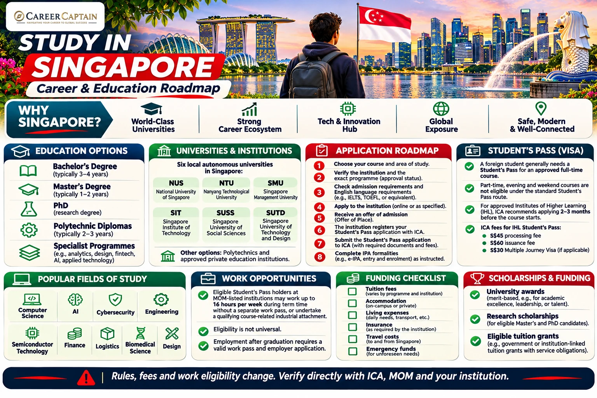

# Study in Singapore: Complete Guide for Indian Students

*Last reviewed: 12 November 2026. Admissions, tuition, scholarship availability and immigration rules can change. Verify the current requirements with the institution, Immigration & Checkpoints Authority (ICA), Ministry of Manpower (MOM) and other official Singapore authorities before applying.*

**A practical guide for Indian students exploring Singapore's universities, courses, admissions, tuition, scholarships, Student's Pass, work rules and career pathways.**

Singapore is a regional centre for higher education, finance, technology, logistics, biomedical science and advanced manufacturing. Its universities and specialist institutions offer undergraduate, postgraduate and research programmes, including courses taught in English. The education landscape includes local autonomous universities, polytechnics and approved private education institutions; their qualifications, admissions standards and immigration arrangements are not interchangeable.

## 1. Why Consider Singapore?

- English is widely used in higher education and professional settings.
- Local universities have strong research and international partnerships.
- The economy has significant activity in finance, technology, logistics, biomedical science, electronics and advanced manufacturing.
- Singapore is geographically close to India and connected to major Asian markets.
- Some eligible Student's Pass holders can work part-time under specific MOM exemptions.
- Selected graduates may explore employment opportunities, subject to employer sponsorship and the relevant work-pass criteria.

Singapore is not a low-cost destination. Compare the complete cost of tuition, accommodation and living expenses, and do not assume that part-time work will finance your education.

## 2. Understand the Higher Education System

Singapore offers several types of post-secondary institutions.

**Autonomous universities**
These offer bachelor's, master's and doctoral programmes, with research-intensive and professionally oriented options.

**Polytechnics**
Polytechnics provide diploma-level and applied education, with industry-oriented training. A diploma is not automatically equivalent to a bachelor's degree; check progression and credit-transfer arrangements.

**Private education institutions (PEIs)**
Private institutions may offer their own qualifications or deliver programmes in partnership with overseas universities. For international students, confirm the institution's current regulatory status, EduTrust certification where applicable, the exact awarding body and the Student's Pass eligibility of the programme.

**Specialist institutions**
Institutions focus on areas such as art and design, hospitality, business, technology and other professional disciplines.

## 3. Universities and Institutions to Research

Singapore's six local autonomous universities listed by ICA include:

| Institution | Areas to explore |
|---|---|
| National University of Singapore (NUS) | Engineering, computing, science, business, medicine |
| Nanyang Technological University (NTU) | Engineering, technology, business, sciences |
| Singapore Management University (SMU) | Business, accountancy, economics, law, computing |
| Singapore University of Technology and Design (SUTD) | Design, engineering, architecture, technology |
| Singapore Institute of Technology (SIT) | Applied learning, engineering, health, technology |
| Singapore University of Social Sciences (SUSS) | Business, social sciences, applied disciplines |

Other institutions include:
- Nanyang Polytechnic
- Ngee Ann Polytechnic
- Republic Polytechnic
- Singapore Polytechnic
- Temasek Polytechnic
- INSEAD Singapore
- ESSEC Business School Singapore
- TUM Asia
- DigiPen Institute of Technology

This is a research shortlist, not a ranking or endorsement. Confirm that the institution and exact course are approved for international enrolment and that the qualification matches your intended career or further-study plan.

## 4. Popular Fields for Indian Students

**Computing and technology**
- Computer science and software engineering
- Artificial intelligence, data science and analytics
- Cybersecurity and information systems
- Information technology and cloud systems

**Engineering and advanced manufacturing**
- Electrical and electronic engineering
- Mechanical and aerospace engineering
- Robotics, automation and semiconductor technology
- Chemical and materials engineering

**Business and finance**
- Finance, accountancy and economics
- Business analytics and management
- Supply chain, logistics and operations
- Marketing and entrepreneurship

**Life sciences and health**
- Biomedical science and biotechnology
- Pharmaceutical science
- Public health and selected health-related fields

**Design and built environment**
- Architecture and urban planning
- Product, interaction and communication design
- Digital media and creative technology

Regulated professions may require additional qualifications, registration or professional examinations. Check the relevant Singapore regulator before selecting a programme on the assumption that it leads directly to professional practice.

## 5. Eligibility for Indian Applicants

Entry requirements are set by each institution and course.

**Undergraduate applicants**
- Class 10 and Class 12 certificates and marksheets.
- Required academic grades and subject prerequisites.
- Accepted Indian school-leaving qualification for the programme.
- Standardised tests, interviews, portfolios or additional assessments where required.
- English-language evidence where required.

**Postgraduate applicants**
- A recognised bachelor's degree in a relevant discipline.
- Academic transcripts, degree certificate and grading information.
- Required prerequisite subjects or relevant work experience.
- CV, statement of purpose and references where requested.
- GMAT, GRE, portfolio or research proposal where applicable.
- English-language evidence where required.

Some competitive programmes have subject-specific requirements and selection processes. Check the admissions page for the exact intake and ask the institution to assess your Indian qualification if equivalency is unclear.

## 6. English-Language Requirements

Many Singapore higher-education programmes are taught in English. Institutions may accept IELTS Academic, TOEFL iBT, PTE Academic or other specified evidence.

- Minimum scores vary by university, course and qualification level.
- Some programmes require minimum scores in each test component.
- Previous education in English may qualify for a waiver only under the institution's policy.
- Business, law, health and other specialist programmes can have additional communication requirements.

Do not assume that an English-medium certificate guarantees a waiver. Obtain written confirmation from the admissions office.

## 7. How to Apply

1. Choose the institution and exact programme based on academic fit and career outcomes.
2. Confirm the institution's status, programme recognition, awarding body and international-student eligibility.
3. Check academic, language, test and portfolio requirements.
4. Review tuition, compulsory fees, scholarships and refund conditions.
5. Prepare passport, academic records, CV, essays and references.
6. Submit the application through the institution's official admissions portal.
7. Complete interviews, tests or other assessments if required.
8. Review the offer and conditions carefully.
9. If accepting, follow the institution's instructions for registration in ICA's Student's Pass system.
10. Submit the Student's Pass application and complete the required formalities after approval.

Application deadlines differ significantly between institutions and programmes. Some courses have one annual intake; others have multiple intakes. Apply according to the institution's published calendar.

## 8. Tuition Fees and Living Costs

Singapore's costs vary by institution, qualification, subject and accommodation type. Tuition at local autonomous universities can be substantial for international students, and subsidised fees may carry additional obligations. Private institutions and overseas university campuses set their own fee structures.

Build a full budget that includes:
- Tuition and compulsory institutional fees.
- Accommodation and utilities.
- Food and groceries.
- Public transport and communications.
- Books, equipment and course materials.
- Medical insurance and healthcare expenses.
- Student's Pass application and issuance fees.
- Travel, deposits and emergency funds.

Use the institution's current fee schedule and its official living-cost guidance. Check whether a tuition grant or subsidy is available to international students and read any service obligation or repayment conditions before accepting it.

## 9. Scholarships and Financial Support

Potential funding routes include:

**University scholarships**
NUS, NTU, SMU, SUTD, SIT, SUSS and other institutions publish scholarships and awards for selected international applicants. Eligibility, award value, renewal conditions and service obligations differ.

**Research scholarships**
Research master's and PhD applicants should check faculty funding, supervisor grants, graduate research scholarships and project-funded positions.

**Tuition grants and subsidies**
Some eligible programmes may offer government tuition grants. International recipients may be required to sign a service obligation to work for a Singapore-registered company for a specified period after graduation. Read the current terms before accepting.

**External funding**
Indian education loans, employer sponsorship and external scholarships may help cover costs. Confirm disbursement timing and whether the funding meets the institution's payment schedule.

Scholarships are competitive and should not be assumed in a financial plan until an official award letter is received. Verify all offers directly with the institution.

Official starting points:
- [NUS Scholarships](https://www.nus.edu.sg/oam/scholarships)
- [NTU Scholarships](https://www.ntu.edu.sg/admissions/undergraduate/scholarships)
- [SMU Scholarships](https://admissions.smu.edu.sg/financial-matters/financial-aid)
- [MOE Tuition Grant Scheme](https://www.moe.gov.sg/financial-matters/tuition-grant-scheme)

## 10. Student's Pass: Who Needs It?

Foreign students generally need a Student's Pass to pursue an approved full-time course in Singapore, unless they hold a qualifying immigration pass or exemption.

Important rules:
- The course must be approved and full-time.
- Part-time, evening and weekend courses are not eligible for a Student's Pass under the standard student route.
- The institution type determines the application process.
- Students at approved Institutes of Higher Learning (IHLs) follow the IHL process.
- Only EduTrust-certified private education institutions can offer placements to foreign students for the relevant full-time private-education courses.
- The Student's Pass is issued by ICA, not by the school.

Official information: [ICA – Student's Pass](https://www.ica.gov.sg/information-and-e-services/long-term-visit-and-study/student-s-pass).

## 11. Student's Pass Application Process

For approved Institutes of Higher Learning, ICA advises applicants to apply **2 to 3 months before the course begins**.

The process generally involves:
1. Accept an offer for an approved full-time course.
2. The institution registers the student in ICA's system and provides the application details or reference number.
3. Prepare the required personal, education, travel-document and supporting information.
4. Submit the Student's Pass application through ICA's e-Service.
5. Pay the non-refundable **S$45 processing fee**.
6. Monitor the application and respond to requests for additional information.
7. If approved, receive the In-Principle Approval (IPA) letter.
8. Complete the required formalities, medical examination if applicable, and pass issuance steps.

Processing times depend on the institution and application type. ICA indicates that IHL applications are generally processed within one week, or within two weeks if a visa is required; some cases take longer. Do not treat these indicative periods as a guarantee.

Official process: [ICA – Institutes of Higher Learning](https://www.ica.gov.sg/information-and-e-services/long-term-visit-and-study/student-s-pass/student%27s-pass-application-renewal/institutes-of-higher-learning).

## 12. Student's Pass Fees and Arrival Formalities

For IHL applicants, ICA lists:
- **S$45** non-refundable processing fee.
- **S$60** Student's Pass issuance fee after approval.
- **S$30** Multiple Journey Visa fee, if applicable.

Once an IPA is issued:
- If you require an entry visa, it is included in the IPA letter.
- Arrive no more than one month before the course starts.
- Present the IPA letter at immigration; it does not guarantee entry.
- Complete ICA's required formalities and appointment steps.
- Complete a medical examination if required.
- Retrieve the digital Student's Pass after issuance.

An IPA is not itself an immigration pass and does not authorise an overstay. Follow the validity dates and conditions stated by ICA.

Official information: [ICA – Completion of Formalities and Issuance](https://www.ica.gov.sg/information-and-e-services/long-term-visit-and-study/student-s-pass/completion-of-formalities-and-issuance-of-student%27s-pass).

## 13. Working While Studying

A Student's Pass does **not** give every international student an unrestricted right to work.

Under MOM's work-pass exemption, eligible full-time students at specified institutions may work during term time without a separate work pass if:
- They hold a Student's Pass issued by ICA.
- They are enrolled full-time at an institution on MOM's approved list.
- Work is no more than **16 hours per week**, or is an industrial attachment/internship that is part of the course requirements.

Eligible students at listed institutions may work during vacation without a work pass if they meet MOM's conditions. The approved institution lists and conditions are specific; do not assume that every private college or programme is included.

Students who do not meet the exemption criteria need the appropriate work authorisation before working. After studies and expiry of the Student's Pass, a graduate must obtain a valid work pass to work in Singapore.

Check the current list before accepting any job:
[MOM – Work Pass Exemption for Foreign Students](https://www.mom.gov.sg/passes-and-permits/work-pass-exemption-for-foreign-students).

## 14. Accommodation and Student Life

Options may include:
- University halls and residences.
- Private student residences.
- Shared apartments.
- Private rental accommodation.
- Homestays, where available.

Accommodation can be expensive and availability varies by campus and season. Apply for university housing early and verify private rental contracts, deposits and property details before transferring money.

Singapore has a tropical climate and an extensive public transport system. Compare commute times, access to campus, food costs, healthcare and the total monthly budget when choosing accommodation.

## 15. Employment After Graduation

Graduation does not automatically grant permission to work in Singapore.

To take up employment after studies:
- A graduate generally needs an employer willing and eligible to apply for the appropriate work pass.
- The candidate and employer must meet the current eligibility and salary criteria for the pass category.
- The Student's Pass does not itself authorise post-study employment.
- Work-pass approval is assessed under the rules in force at the time of application.

Singapore's main work-pass categories include the Employment Pass and S Pass, each with different eligibility conditions. Check the current MOM criteria and do not rely on historic salary thresholds.

Official resource: [MOM – Work Passes](https://www.mom.gov.sg/passes-and-permits).

## 16. Indian Student Application Checklist

- [ ] Shortlist institutions and programmes that fit your academic background and career goals.
- [ ] Confirm that the institution and exact full-time programme are eligible for international students and the relevant Student's Pass route.
- [ ] Check the awarding body, qualification recognition and any tuition-grant service obligation.
- [ ] Verify Class 12 or bachelor's entry requirements, subject prerequisites and English-language criteria.
- [ ] Review the application deadline, tuition, compulsory fees and refund conditions.
- [ ] Prepare passport, academic certificates, transcripts, CV, essays, references and portfolio where required.
- [ ] Apply through the institution's official admissions portal.
- [ ] Compare scholarships and research funding; rely only on confirmed award letters.
- [ ] Arrange funds for tuition, accommodation, living expenses, travel and emergency costs.
- [ ] Accept the offer and follow the institution's Student's Pass registration instructions.
- [ ] Apply through ICA within the recommended period, generally 2 to 3 months before the course begins for IHL applicants.
- [ ] Pay the S$45 processing fee and provide any additional documents requested.
- [ ] After approval, follow the IPA instructions, pay applicable issuance fees and complete the required formalities.
- [ ] Arrange accommodation and medical insurance according to institutional and immigration requirements.
- [ ] Check MOM's approved institution list and the exact work conditions before accepting employment.
- [ ] Before graduation, research work-pass eligibility and employer requirements if you plan to remain in Singapore.

**Important:** This is a planning checklist, not a substitute for the current ICA, MOM or university instructions.

## 17. Suggested Application Timeline

| Period before course begins | Suggested action |
|---|---|
| 12–15 months | Research institutions, programmes, costs and scholarships |
| 9–12 months | Prepare academic records, tests and application materials |
| 6–9 months | Apply to institutions and complete assessments |
| After offer | Review fees, grant conditions and funding |
| 2–3 months before start | Submit Student's Pass application for IHL route |
| Before arrival | Arrange accommodation, travel and required documents |
| After arrival | Complete ICA formalities and university registration |

This is a planning framework. Always follow the specific institution's intake calendar and ICA instructions.

## 18. Official Resources

| Purpose | Official resource |
|---|---|
| Student's Pass | https://www.ica.gov.sg/information-and-e-services/long-term-visit-and-study/student-s-pass |
| IHL Student's Pass procedure | https://www.ica.gov.sg/information-and-e-services/long-term-visit-and-study/student-s-pass/student%27s-pass-application-renewal/institutes-of-higher-learning |
| Student's Pass issuance | https://www.ica.gov.sg/information-and-e-services/long-term-visit-and-study/student-s-pass/completion-of-formalities-and-issuance-of-student%27s-pass |
| Work rights for foreign students | https://www.mom.gov.sg/passes-and-permits/work-pass-exemption-for-foreign-students |
| Private education institutions | https://www.ica.gov.sg/information-and-e-services/long-term-visit-and-study/student-s-pass/student%27s-pass-application-renewal/approved-private-education-institutions |
| Ministry of Education | https://www.moe.gov.sg/ |
| NUS | https://www.nus.edu.sg/ |
| NTU | https://www.ntu.edu.sg/ |
| Study Singapore | https://www.moe.gov.sg/ |

## 19. How Career Captain Can Help

Choosing a country is only one part of a successful international education plan. Students also need to identify a suitable course, assess academic eligibility, compare institutions, plan funding and understand career pathways.

Career Captain Global Solutions supports students and families through:
- One-to-one career counselling and career exploration.
- Course and university selection.
- Academic profile assessment.
- Study-abroad planning.
- Scholarship and admission guidance.
- Career pathway planning.

Explore: https://careercaptain.co.in/

## Conclusion

Singapore can offer Indian students strong options in technology, engineering, business, finance, biomedical science and research. It is important to understand the differences between universities, polytechnics and private institutions, verify the exact programme's Student's Pass eligibility, calculate the full cost and check work restrictions before relying on part-time income.

**Choose the programme carefully, verify the institution, plan your finances and follow the current ICA and MOM requirements.**

---

**Educational Disclaimer**

This guide is for general educational and career-planning purposes. Admission requirements, tuition fees, scholarships, Student's Pass procedures and employment rules can change. It does not guarantee admission, funding, a Student's Pass, employment or permanent residence. Verify current requirements with the education provider and official Singapore authorities before making decisions.

**Published by Career Captain Global Solutions**  
Website: https://careercaptain.co.in/

**Open Licence:** Creative Commons Attribution 4.0 International (CC BY 4.0), subject to applicable third-party asset rights.  
https://creativecommons.org/licenses/by/4.0/
