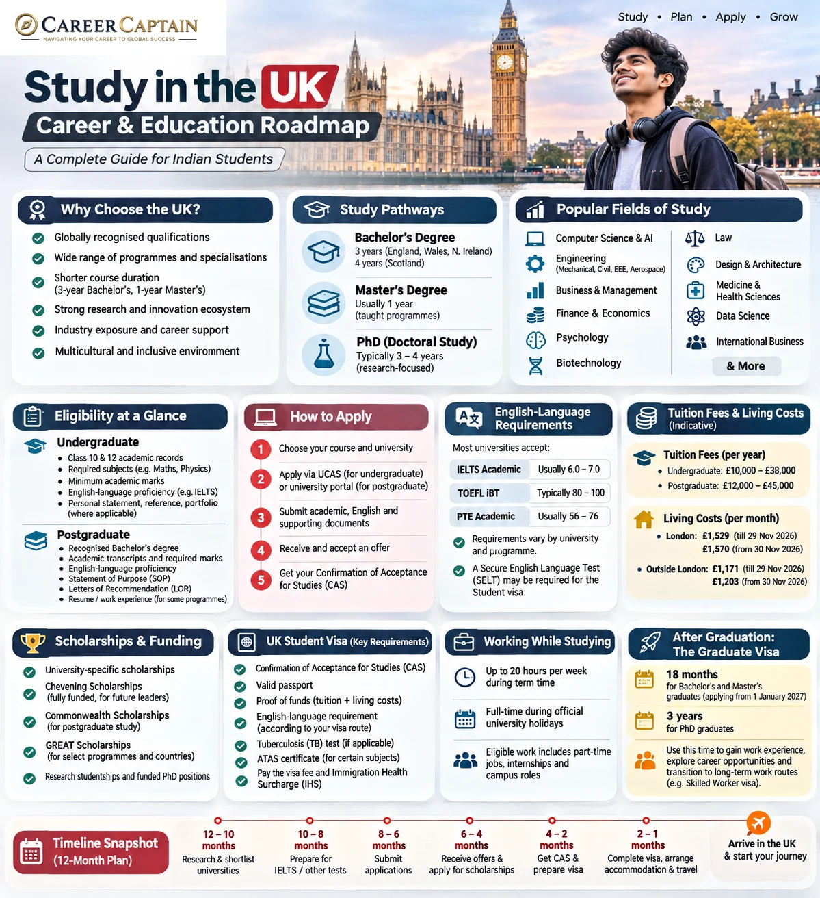

# Study in the UK: Complete Roadmap for Indian Students

The United Kingdom is a popular destination for Indian students seeking internationally recognised qualifications, specialised academic programmes and exposure to a global professional environment.

The UK offers undergraduate degrees, postgraduate programmes, research opportunities and professional qualifications. However, choosing the right university requires more than comparing rankings. Students must understand admission requirements, tuition fees, scholarships, visa rules and employment opportunities.

This guide explains the study-abroad process for Indian students, from selecting a course to planning a career after graduation.

*Last reviewed: November 2026. Admission requirements, fees and immigration policies can change. Always verify current information through official university and government websites.*

---

## 1. Why Study in the UK?

The UK offers several advantages for international students.

- **Internationally recognised qualifications:** UK universities offer degrees recognised by employers and academic institutions around the world.
- **Specialised programmes:** Students can explore engineering, business, medicine, law, technology, finance, arts and sciences.
- **Shorter degree durations:** Many Bachelor's degrees take three years in England, Wales and Northern Ireland, while many Master's programmes take one year. Scotland often has four-year undergraduate degrees.
- **Research opportunities:** Universities offer research facilities, academic collaborations and postgraduate research programmes.
- **Industry exposure:** Students may access internships, employer networking, placements and career services.
- **Multicultural environment:** International students study alongside people from different countries and backgrounds.

The right university depends on your academic interests, financial capacity and long-term career objectives.

## 2. Understand the Different Study Options

Indian students generally consider three major academic routes.

### A. Undergraduate study

A Bachelor's degree in the UK commonly takes:

- Three years in England, Wales and Northern Ireland.
- Four years in Scotland.
- Longer for some programmes with placements, foundation years or integrated Master's qualifications.

Popular programmes include:

- Computer Science
- Mechanical Engineering
- Civil Engineering
- Electrical and Electronic Engineering
- Aerospace Engineering
- Business Management
- Economics
- Finance
- Psychology
- Biotechnology
- Architecture
- Law
- Design
- Artificial Intelligence
- Data Science

Indian students usually apply after completing Class 12. Depending on the university and programme, applicants may need a foundation course or other recognised qualification before entering the Bachelor's programme.

### B. Postgraduate study

Many taught Master's degrees take one year, although some programmes take longer.

Popular options include:

- MSc Computer Science
- MSc Data Science
- MSc Artificial Intelligence
- MSc Cybersecurity
- MSc Mechanical Engineering
- MSc Civil Engineering
- MSc Finance
- MSc Business Analytics
- MBA
- MSc Biotechnology
- MSc Public Health
- MSc International Business

Admission requirements vary according to the programme and university.

### C. Doctoral study

A PhD is suitable for students interested in advanced research, academic careers or specialised research and development.

Doctoral programmes commonly take three to four years, although the duration varies.

Funding may be available through:

- University scholarships
- Research Council funding
- Funded doctoral projects
- Research assistantships
- External fellowships

Check whether the advertised funding covers tuition, living expenses or both.

## 3. Eligibility for Indian Students

There is no single admission standard across all UK universities.

Each institution establishes its own academic requirements, accepted qualifications and subject prerequisites.

### Undergraduate admission

Common requirements include:

- Class 10 and Class 12 academic records
- Required subject combinations
- Minimum academic marks
- English-language proficiency
- Personal statement or application responses
- Academic reference
- Portfolio or additional assessment for selected programmes

Some universities accept Indian Class 12 qualifications directly. Others require a foundation year or additional qualifications.

For competitive programmes, universities may require higher marks in specific subjects.

For example:

- Engineering courses may require Mathematics and Physics.
- Computer Science courses may require Mathematics.
- Medical programmes have additional academic and selection requirements.
- Architecture and design programmes may require portfolios.

Never assume that one university's Class 12 eligibility rules apply to another.

### Postgraduate admission

Common requirements include:

- Recognised Bachelor's degree
- Academic transcripts
- Minimum marks or equivalent GPA
- Relevant subject background
- English-language proficiency
- Statement of Purpose
- Letters of Recommendation
- Resume or CV
- Portfolio, where required
- Work experience for selected programmes

Some universities accept a three-year Indian Bachelor's degree, while others have specific requirements regarding the institution, qualification and academic performance.

Always confirm degree equivalency directly with the university.

## 4. English-Language Requirements

English-language proficiency is an important part of the admission process.

Commonly accepted tests include:

- IELTS Academic
- TOEFL iBT
- PTE Academic
- Other tests accepted by the individual university

The required score varies according to the institution and course.

Some universities may accept previous education in English as evidence of proficiency, subject to their policies.

### Important distinction

University admission requirements and UK Student visa English-language requirements are not always identical.

For a degree-level course at a Higher Education Provider with a track record of compliance, the university may assess English proficiency through its own approved process. Other courses and providers may have different requirements.

Check both the university's admission policy and the official visa guidance.

Official information: https://www.gov.uk/student-visa/knowledge-of-english

## 5. How to Choose the Right University

Do not select a university only because it appears in a global ranking.

Evaluate the following:

1. Course curriculum and specialisations
2. University recognition and relevant professional accreditation
3. Faculty expertise
4. Research facilities
5. Industry connections
6. Internship and placement opportunities
7. Graduate employment outcomes
8. Tuition and living expenses
9. Scholarships and financial support
10. Location and student accommodation
11. International student support
12. Career opportunities after graduation

### Types of institutions

**Research-intensive universities:** Often have extensive research facilities and postgraduate opportunities.

**Modern universities:** May offer professionally oriented courses and industry-focused learning.

**Specialist institutions:** Focus on areas such as art, design, business, music or specific professional disciplines.

**Colleges and pathway providers:** May offer foundation or pathway programmes that lead to university admission, subject to progression requirements.

Check the exact institution and course before paying any deposit.

### Useful university research resources

- UCAS: https://www.ucas.com/
- Discover Uni: https://discoveruni.gov.uk/
- British Council Study UK: https://study-uk.britishcouncil.org/
- UK university websites: https://www.universitiesuk.ac.uk/

Use official university pages to confirm the final course requirements and fees.

## 6. Understanding UCAS Applications

UCAS is the central undergraduate application service used by many UK universities.

Students applying for undergraduate courses generally use the UCAS application system, although some institutions and courses have separate application arrangements.

### How UCAS works

1. Create a UCAS account.
2. Search for suitable courses.
3. Select your university choices.
4. Enter personal and academic information.
5. Complete the required personal statement or structured application questions.
6. Arrange your academic reference.
7. Submit the application.
8. Track university decisions through your UCAS account.

For most undergraduate applications, students can select up to five choices, subject to UCAS rules and restrictions for certain courses.

Medicine, dentistry and veterinary applications have specific choice restrictions and earlier deadlines.

### Important application deadlines

Deadlines depend on the entry year.

For 2027 undergraduate entry, UCAS lists:

- Applications opened for submission on 1 September 2026.
- 15 October 2026: Equal consideration deadline for Oxford, Cambridge and most medicine, dentistry and veterinary courses.
- 13 January 2027: Equal consideration deadline for most undergraduate courses.

Always check the current UCAS calendar. Some universities and courses may have different deadlines.

Official source: https://www.ucas.com/applying/applying-to-university/dates-and-deadlines-for-uni-applications

### Postgraduate applications

Most postgraduate applications are submitted directly through university websites.

You generally need to:

- Find a suitable Master's programme.
- Check academic and subject requirements.
- Prepare transcripts and certificates.
- Write a Statement of Purpose.
- Obtain recommendation letters.
- Submit English-language test scores if required.
- Apply for scholarships separately where necessary.

Some competitive programmes fill their places early, so early applications are advisable.

## 7. Estimated Cost of Studying in the UK

The cost depends on the university, programme, city and accommodation arrangement.

London is generally more expensive than many other UK student destinations.

### Illustrative annual budget

The following figures are broad planning estimates, not official university fee quotations.

| Expense | Illustrative annual range |
|---|---:|
| Undergraduate tuition | £12,000–£30,000+ |
| Postgraduate tuition | £13,000–£35,000+ |
| Accommodation | £6,000–£14,000 |
| Food and groceries | £2,000–£4,000 |
| Transport | £500–£1,500 |
| Books and personal expenses | £1,000–£2,500 |

Some programmes, particularly medicine, dentistry, laboratory-intensive courses and specialist degrees, can cost considerably more.

A one-year Master's degree may reduce the total cost compared with a longer programme, but students must still budget for tuition, accommodation, travel and other expenses.

### How to reduce costs

- Compare universities outside London.
- Apply for merit-based scholarships.
- Check university accommodation costs.
- Compare course duration and total programme fees.
- Investigate eligible education loans.
- Prepare a realistic monthly budget.
- Avoid relying on part-time employment to finance your entire degree.

## 8. Scholarships for Indian Students

Scholarships can significantly reduce the cost of studying in the UK.

### Common funding options

**University scholarships:** Many universities provide merit-based awards for international students.

**Chevening Scholarships:** A UK government scholarship programme for eligible applicants pursuing a Master's degree. It has specific eligibility, work experience and leadership requirements.

Official website: https://www.chevening.org/

**Commonwealth Scholarships:** Funding opportunities for eligible citizens of Commonwealth countries, including Indians, depending on the scholarship scheme and eligibility criteria.

Official website: https://cscuk.fcdo.gov.uk/

**GREAT Scholarships:** Scholarships offered through participating UK universities for eligible students from selected countries and programmes. Availability varies by academic year.

Official website: https://study-uk.britishcouncil.org/scholarships-funding/great-scholarships

**Research funding:** Some universities offer funded research Master's and PhD opportunities.

### Scholarship application strategy

1. Shortlist universities with international scholarships.
2. Check whether Indian applicants are eligible.
3. Review scholarship deadlines.
4. Prepare academic records.
5. Develop a strong personal statement.
6. Obtain relevant recommendation letters.
7. Check whether the scholarship covers tuition, living costs or both.

Do not assume that receiving an admission offer automatically qualifies you for a scholarship.

## 9. The UK Student Visa

Most Indian students pursuing full-time degree programmes at an eligible UK institution require a **Student visa**.

### Basic eligibility

Generally, applicants must:

- Have an offer from a licensed Student sponsor.
- Receive a Confirmation of Acceptance for Studies (CAS).
- Meet the applicable English-language requirement.
- Demonstrate sufficient financial resources.
- Meet the relevant immigration requirements.
- Provide additional documents where required.

### What is a CAS?

A Confirmation of Acceptance for Studies is an electronic reference issued by your education provider after it has agreed to sponsor your studies.

The CAS contains information about your course, institution and sponsorship.

You need this reference when applying for your Student visa.

### Basic application process

1. Receive an unconditional or otherwise eligible offer.
2. Meet the university's conditions.
3. Pay any required deposit.
4. Obtain your CAS.
5. Prepare financial evidence.
6. Complete the online Student visa application.
7. Pay the applicable visa fee and Immigration Health Surcharge.
8. Complete identity verification and any required biometrics.
9. Follow the instructions provided by UK Visas and Immigration.

Official information: https://www.gov.uk/student-visa

### Common supporting documents

Depending on your circumstances, you may need:

- Valid passport
- CAS reference
- Academic certificates and transcripts
- English-language evidence, where required
- Financial evidence
- ATAS certificate, if applicable
- Parental consent and relationship documents for eligible applicants under 18
- Tuberculosis test results, where required
- Other documents requested by UKVI

Indian applicants should check whether a tuberculosis test is required for their application and where it must be completed.

Official TB information: https://www.gov.uk/tb-test-visa

## 10. Financial Requirements for the Student Visa

Applicants generally need to demonstrate that they can pay their outstanding course fees and support themselves in the UK.

According to the official GOV.UK financial requirement guidance available in November 2026, the living-cost requirement is:

| Study location | Required amount per month | Maximum 9-month amount |
|---|---:|---:|
| London | £1,529 | £13,761 |
| Outside London | £1,171 | £10,539 |

You must also account for the course fees stated on your CAS, less any eligible amount already paid.

### The 28-day rule

Where financial evidence is required, the necessary funds generally need to be held for at least 28 consecutive days.

The end date of that 28-day period must be within 31 days of the visa application date.

Certain exemptions and alternative evidence rules apply.

Do not confuse the visa's minimum financial requirement with the actual amount you may need to live comfortably.

Official source: https://www.gov.uk/student-visa/money

**Important:** Financial rules can change. Recheck the official GOV.UK page immediately before submitting your visa application.
## UK Student Application Checklist for Indian Students

Use this checklist to organise your journey from university selection to arrival in the United Kingdom. Requirements vary by university, programme and individual immigration circumstances.

### 1. Course and University Selection

- [ ] Decide whether you want to pursue a Bachelor's, Master's or PhD.
- [ ] Identify suitable universities and courses.
- [ ] Check whether your Class 12 qualification is accepted directly.
- [ ] Check whether a foundation year is required.
- [ ] Verify Bachelor's degree equivalency for Master's admission.
- [ ] Review subject prerequisites and minimum academic marks.
- [ ] Check professional accreditation where relevant.
- [ ] Compare course duration and curriculum.
- [ ] Review tuition fees and living expenses.
- [ ] Record university and scholarship deadlines.

### 2. Academic and Application Documents

**For Bachelor's applicants:**
- [ ] Class 10 marksheets and certificates.
- [ ] Class 12 marksheets and certificates.
- [ ] Academic transcripts.
- [ ] English-language proficiency evidence, if required.
- [ ] Personal statement or required UCAS application responses.
- [ ] Academic reference.
- [ ] Portfolio or additional assessment, where applicable.

**For Master's applicants:**
- [ ] Bachelor's degree certificate or provisional certificate.
- [ ] All semester marksheets and transcripts.
- [ ] Grading-system explanation, if requested.
- [ ] Statement of Purpose.
- [ ] Academic or professional CV.
- [ ] Letters of Recommendation.
- [ ] English-language test results, where required.
- [ ] Work experience documents, where applicable.
- [ ] Portfolio, research proposal or writing sample, if required.

**For PhD applicants:**
- [ ] Previous degree certificates and transcripts.
- [ ] Research proposal.
- [ ] Academic CV.
- [ ] Academic references.
- [ ] Evidence of relevant research experience.
- [ ] Funding or supervisor correspondence, where applicable.

### 3. English-Language Preparation

- [ ] Check the university's accepted English-language tests.
- [ ] Confirm the required score for your programme.
- [ ] Check whether previous education in English can be accepted as evidence.
- [ ] Verify whether a separate Secure English Language Test (SELT) is required for your visa route.
- [ ] Check the validity and format of your test results.

Remember that university admission requirements and UK Student visa English-language requirements may differ.

### 4. University Application

**For undergraduate applicants:**

- [ ] Create your UCAS account.
- [ ] Research courses and university choices.
- [ ] Prepare your application information.
- [ ] Complete the required personal statement or structured questions.
- [ ] Arrange your academic reference.
- [ ] Submit the application before the relevant deadline.
- [ ] Track decisions and respond to offers.
- [ ] Meet any conditions attached to your offer.

**For postgraduate applicants:**

- [ ] Apply through the university's official application portal.
- [ ] Submit transcripts, certificates and supporting documents.
- [ ] Submit your Statement of Purpose and recommendations.
- [ ] Complete any interview or additional assessment.
- [ ] Apply separately for scholarships where necessary.
- [ ] Track the application and respond to university requests.

### 5. Scholarships and Financial Planning

- [ ] Research university-specific scholarships.
- [ ] Check Chevening eligibility, where applicable.
- [ ] Research Commonwealth Scholarship opportunities.
- [ ] Check GREAT Scholarship availability.
- [ ] Investigate research studentships and funded PhD positions.
- [ ] Review scholarship deadlines separately from admission deadlines.
- [ ] Calculate tuition fees and living expenses.
- [ ] Arrange suitable financial resources.
- [ ] Check the latest UK Student visa maintenance-fund requirement.
- [ ] Prepare acceptable financial evidence.

Do not rely on part-time employment or an unconfirmed scholarship to meet your visa financial requirements.

### 6. Confirmation of Acceptance for Studies (CAS)

After receiving and accepting an eligible university offer:

- [ ] Meet the university's admission conditions.
- [ ] Submit any outstanding academic documents.
- [ ] Complete the university's required credibility or pre-CAS checks.
- [ ] Pay the required tuition deposit, if applicable.
- [ ] Provide financial and other information requested by the university.
- [ ] Receive your CAS reference.
- [ ] Check your name, course details, tuition fees and course dates.
- [ ] Verify that the information is accurate before applying for your visa.

The CAS is an electronic sponsorship record. You need its reference for your Student visa application.

### 7. Student Visa Preparation

- [ ] Confirm that your university is a licensed Student sponsor.
- [ ] Check your CAS details.
- [ ] Complete the online Student visa application.
- [ ] Prepare your valid passport.
- [ ] Arrange acceptable financial evidence, where required.
- [ ] Prepare academic documents listed in your CAS or requested by UKVI.
- [ ] Arrange English-language evidence, where required.
- [ ] Obtain an ATAS certificate if your course and nationality require one.
- [ ] Complete a tuberculosis test if required.
- [ ] Pay the applicable visa application fee.
- [ ] Pay the Immigration Health Surcharge, where applicable.
- [ ] Complete identity verification and biometrics as instructed.
- [ ] Follow all additional instructions from UK Visas and Immigration.

### 8. Before Travelling to the UK

- [ ] Check your visa decision and immigration status.
- [ ] Confirm your university enrolment instructions.
- [ ] Arrange accommodation.
- [ ] Confirm travel dates and permitted arrival arrangements.
- [ ] Arrange funds for initial living expenses.
- [ ] Carry your passport and relevant university documents.
- [ ] Keep your CAS and visa information accessible.
- [ ] Understand your university's registration process.
- [ ] Review your Student visa work conditions.
- [ ] Save university emergency contacts.

### Important Reminders

- Admission does not guarantee a Student visa.
- A CAS does not guarantee visa approval.
- Financial requirements must be checked using the latest official rules.
- ATAS and tuberculosis requirements depend on the applicant and programme.
- Student visa holders must follow their individual work conditions.
- Graduate visa eligibility and duration depend on the rules applicable when you apply.

### Official UK Application Resources

- [UCAS – Undergraduate Applications](https://www.ucas.com/)
- [GOV.UK – Student Visa](https://www.gov.uk/student-visa)
- [GOV.UK – Student Visa Financial Requirements](https://www.gov.uk/student-visa/money)
- [GOV.UK – Knowledge of English](https://www.gov.uk/student-visa/knowledge-of-english)
- [GOV.UK – ATAS](https://www.gov.uk/guidance/academic-technology-approval-scheme)
- [GOV.UK – Tuberculosis Testing](https://www.gov.uk/tb-test-visa)
- [British Council – Study UK](https://study-uk.britishcouncil.org/)

*Disclaimer: This checklist is an educational planning aid, not legal or immigration advice. University admission policies, visa fees and immigration requirements can change. Verify all requirements through official sources before applying.*
## 11. Working While Studying

Eligible international students can work during their studies, subject to the conditions attached to their Student permission.

### During term time

Students studying a full-time degree-level course at an eligible higher education provider with a track record of compliance can generally work:

- Up to 20 hours per week during term time.
- Full-time during permitted vacation periods.

Some courses below degree level have a 10-hour weekly limit. Certain other courses do not permit employment.

Your visa conditions and university term dates determine what is permitted.

### Work restrictions

Student visa holders must follow restrictions on activities such as:

- Self-employment
- Business activity
- Filling a permanent full-time vacancy, except in specific permitted circumstances
- Professional sportsperson employment
- Certain professional entertainer roles

Check the exact conditions attached to your immigration permission before accepting work.

Official source: https://www.gov.uk/guidance/immigration-rules/immigration-rules-appendix-student

### Internships and placements

Some programmes include work placements as an integral and assessed part of the course.

These must satisfy the relevant immigration and course requirements.

Confirm placement arrangements with your university's international student office before starting.

## 12. Career Opportunities After Graduation

The UK has employment opportunities across technology, engineering, finance, healthcare, business, research and creative industries.

However, completing a UK degree does not guarantee employment.

### Technology

- Software engineering
- Artificial intelligence
- Data science
- Cybersecurity
- Cloud computing
- Product management
- Business intelligence

### Engineering

- Mechanical design
- Civil engineering
- Aerospace engineering
- Automotive engineering
- Electrical systems
- Renewable energy
- Manufacturing
- Robotics

### Business and finance

- Financial analysis
- Accounting
- Consulting
- Business analytics
- Marketing
- Human resources
- Supply chain management

### Healthcare and life sciences

- Biotechnology
- Biomedical research
- Public health
- Pharmaceutical research
- Healthcare management

Some occupations require professional registration, licensing or additional qualifications.

Research the requirements before selecting a course.

## 13. Graduate Visa: What Happens After Graduation?

The UK Graduate route allows eligible international students to remain in the UK after successfully completing an eligible course.

The duration is changing.

### Graduate visa duration in November 2026

| Application date | Bachelor's and Master's graduates | Doctoral graduates |
|---|---:|---:|
| On or before 31 December 2026 | 2 years | 3 years |
| On or after 1 January 2027 | 18 months | 3 years |

This change is important for students planning their future admission and graduation timelines.

### Key conditions

- You must successfully complete an eligible course.
- Your education provider must have reported your successful completion to the Home Office.
- You must apply while you still have valid Student permission.
- You cannot extend a Graduate visa.
- You may be able to switch to another eligible immigration route.

The Graduate route is not itself a route to settlement.

### Skilled Worker route

Some graduates may qualify to switch to a Skilled Worker visa if they meet the applicable requirements, including sponsorship by an eligible employer and the relevant salary and occupation rules.

Do not assume that every graduate will qualify.

Official sources:

- Graduate visa: https://www.gov.uk/graduate-visa
- Skilled Worker visa: https://www.gov.uk/skilled-worker-visa

## 14. Building a Strong Profile Before Applying

Academic marks matter, but a strong application should also demonstrate your interests, capabilities and preparation.

### For engineering students

- Develop technical and programming skills.
- Complete practical projects.
- Participate in engineering competitions.
- Gain internship experience.
- Build a technical portfolio.
- Strengthen mathematics and core engineering subjects.

### For business students

- Develop analytical and communication skills.
- Participate in leadership activities.
- Complete market research projects.
- Gain internship experience.
- Learn relevant business and data tools.

### For science students

- Participate in research projects.
- Develop laboratory skills.
- Build relationships with faculty members.
- Explore research internships.
- Develop strong analytical and academic writing skills.

### For all applicants

- Maintain consistent academic performance.
- Develop a clear academic direction.
- Participate in meaningful extracurricular activities.
- Prepare strong application essays.
- Request recommendations from people who know your work.

Meaningful experience is more valuable than collecting certificates without developing practical skills.

## 15. A 12-Month Preparation Roadmap

| Timeline | Recommended action |
|---|---|
| Months 1–2 | Identify courses, universities and eligibility |
| Months 3–4 | Prepare for English-language tests and strengthen your profile |
| Months 5–6 | Shortlist universities and research scholarships |
| Months 7–8 | Prepare applications, essays and recommendation letters |
| Months 9–10 | Submit applications and funding applications |
| Month 11 | Compare offers, fees and accommodation |
| Month 12 | Obtain CAS and prepare the visa application |

This is an illustrative schedule. Competitive programmes and scholarship applications may require much earlier preparation.

## 16. Common Mistakes Indian Students Should Avoid

1. Selecting universities only by ranking.
2. Ignoring the total cost of the degree.
3. Assuming all UK universities accept the same Class 12 qualifications.
4. Applying without checking subject prerequisites.
5. Ignoring UCAS deadlines.
6. Writing generic personal statements.
7. Assuming scholarships are guaranteed.
8. Depending on part-time employment to fund the entire degree.
9. Misunderstanding Student visa work restrictions.
10. Assuming the Graduate visa will always last two years.
11. Ignoring professional accreditation.
12. Trusting agents who promise guaranteed admission or visas.

## 17. Useful Official Resources

| Resource | Purpose |
|---|---|
| https://www.gov.uk/student-visa | Student visa requirements |
| https://www.gov.uk/student-visa/money | Financial requirements |
| https://www.gov.uk/graduate-visa | Post-study Graduate route |
| https://www.ucas.com/ | Undergraduate applications |
| https://study-uk.britishcouncil.org/ | Study UK guidance |
| https://www.chevening.org/ | Chevening scholarships |
| https://cscuk.fcdo.gov.uk/ | Commonwealth Scholarships |
| https://discoveruni.gov.uk/ | University and course comparisons |
| https://www.gov.uk/skilled-worker-visa | Skilled Worker immigration route |

Always verify current information directly through official sources.

## 18. How Career Captain Can Help

Choosing a country is only one part of a successful study-abroad decision.

Students must also understand their interests, strengths, academic profile, suitable courses and long-term career objectives.

Career Captain Global Solutions supports students and young professionals through:

- One-to-one career counselling
- Five-dimensional psychometric career assessments
- Stream and subject selection
- Course and college planning
- Study-abroad guidance
- Scholarship and admission support
- Career exploration and planning

Explore: https://careercaptain.co.in?utm_source=career_roadmaps_india&utm_medium=referral&utm_campaign=github_career_roadmaps&utm_content=study-in-uk-complete-guide-for-indian-students

The objective is to help students make informed education and career decisions instead of selecting a course simply because it is popular.

---

## Final Thoughts

Studying in the UK can provide valuable academic and professional exposure, but it requires careful planning.

Understand the admission requirements, compare universities, calculate the total cost, research scholarships and stay informed about immigration rules.

Most importantly, select a course that aligns with your interests, abilities and long-term career goals.

A successful study-abroad journey begins with choosing the right educational pathway.

---

## Attribution and Licence

This educational guide is published by **Career Captain Global Solutions** as part of the Open-Source BTech and Career Roadmaps initiative.

This work is licensed under the **Creative Commons Attribution 4.0 International (CC BY 4.0)** licence.

You may share and adapt this material with appropriate attribution.

**Attribution:** Career Captain Global Solutions — https://careercaptain.co.in?utm_source=career_roadmaps_india&utm_medium=referral&utm_campaign=github_career_roadmaps&utm_content=study-in-uk-complete-guide-for-indian-students

*Disclaimer: This guide is for general educational information and is not legal, immigration, financial or admission advice. University policies, fees and immigration rules can change. Verify all requirements through official sources before making decisions.*

---

## Plan your study-abroad journey with Career Captain

Country and university choices should be evaluated against your academic profile, course goals, budget, entry requirements and long-term plans. Career Captain provides study-abroad counselling and application-planning support. Admission, scholarship and visa decisions remain with the relevant institutions and authorities.

- [Study-abroad counselling in Hyderabad](https://careercaptain.co.in?utm_source=career_roadmaps_india&utm_medium=referral&utm_campaign=github_career_roadmaps&utm_content=study-in-uk-complete-guide-for-indian-students?utm_source=career_roadmaps_india&utm_medium=referral&utm_campaign=github_career_roadmaps&utm_content=study-in-uk-complete-guide-for-indian-students)
- [Scholarship guidance for Indian students](https://guide.careercaptain.co.in/study-abroad/?utm_source=career_roadmaps_india&utm_medium=referral&utm_campaign=github_career_roadmaps&utm_content=study-in-uk-complete-guide-for-indian-students)
- [Explore Career Captain](https://careercaptain.co.in?utm_source=career_roadmaps_india&utm_medium=referral&utm_campaign=github_career_roadmaps&utm_content=study-in-uk-complete-guide-for-indian-students)

[WhatsApp Career Captain](https://wa.me/919849488838?text=Hi%20Career%20Captain%2C%20I%20found%20your%20study%20in%20uk%20complete%20guide%20for%20indian%20students%20guide%20in%20Career%20Roadmaps%20India.%20I%20would%20like%20to%20know%20more%20about%20study%20abroad%20guidance.%20Source%3A%20study-in-uk-complete-guide-for-indian-students.)
